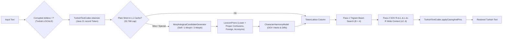

# `LatticeDeasciifier`: Production Architecture, Normalization Integration, Linguistic Case Handling & 14-Suite Benchmark Report

This document serves as the architectural reference and empirical report for Zemberek's production **`LatticeDeasciifier`** in [`zemberek.normalization.deasciifier.latticedeasciifier`](normalization/src/main/java/zemberek/normalization/deasciifier/latticedeasciifier/LatticeDeasciifier.java), cross-checked against [TURKISH_DEASCIIFIER_INVESTIGATION_AND_DESIGN.md](TURKISH_DEASCIIFIER_INVESTIGATION_AND_DESIGN.md) and integrated directly with [`TurkishSentenceNormalizer`](normalization/src/main/java/zemberek/normalization/TurkishSentenceNormalizer.java).

---

## 1. Production Package Layout & Java 21 Design

The production implementation lives in `normalization` with a bundled uncompressed default model resource, while the expanded 14-suite (`40,564`-sentence) evaluation harness and benchmark datasets live separately in `experiment`:



### 1.1 Production Classes (`normalization/src/main/java/zemberek/normalization/deasciifier/latticedeasciifier/`)

Written in clean, idiomatic **Java 21** (`record` value types, `sealed interface WeightTable`, `switch` expressions, `Math.clamp`, sequenced collection `getFirst()`/`getLast()`) across `5,214` LOC with shared feature/sequence scorers, shared character/vowel helpers, and zero `ThreadLocal` scratch-buffer tangles:

| Class | LOC | Visibility | Responsibility |
| :--- | :---: | :---: | :--- |
| [`LatticeDeasciifier.java`](normalization/src/main/java/zemberek/normalization/deasciifier/latticedeasciifier/LatticeDeasciifier.java) | 725 | `public final` | Thread-safe facade (`createWithDefaults(...)`, `deasciify(String)`, `CircumflexMode` defaulting to `DISAMBIGUATION_ONLY`), `32,768`-entry `plainTokenCache`, `Turkish.LOCALE` dotless-`'ı'` recovery, Pass-1 beam search (`B = 4`), and Pass-2 refinement. |
| [`DeasciifierModel.java`](normalization/src/main/java/zemberek/normalization/deasciifier/latticedeasciifier/DeasciifierModel.java) | 101 | `public record` | Versioned uncompressed binary model container (`ZLDM`) with `loadDefault()` (`/deasciifier/lattice_deasciifier.bin`), `save(Path)`, and `load(Path/InputStream)`. |
| [`MorphologicalCandidateGenerator.java`](normalization/src/main/java/zemberek/normalization/deasciifier/latticedeasciifier/MorphologicalCandidateGenerator.java) | 895 | `public final` | Supports self-contained, single-injected `TurkishMorphology`, and dual-injected `(strictMorphology, asciiTolerantInformalMorphology)` modes; filters Zemberek lexicon false friends; handles apostrophes, acronyms, elongations, and glued clitics. |
| [`TurkishTextCodec.java`](normalization/src/main/java/zemberek/normalization/deasciifier/latticedeasciifier/TurkishTextCodec.java) | 921 | `public final` | Java 21 `record Token` & `record SqueezedWord`, exact-offset tokenizer, alphanumeric/URL/handle immutability, shared char mappers & Turkish vowel-harmony helpers, 4-way `'I'/'i'/'İ'/'ı'` casing, distributive & ordinal numeral suffixes (`3'üncü`, `6'şar`), and pin guards. |
| [`LexiconPriors.java`](normalization/src/main/java/zemberek/normalization/deasciifier/latticedeasciifier/LexiconPriors.java) | 718 | `public final` | Java 21 `record ConfusionSet`; mines & serializes separate lowercase (`confusionMap`) and mid-sentence `TitleCase` (`properConfusionMap`) priors, circumflex-intact shares, foreign ASCII shields, acronyms, and lemma log-counts. |
| [`CharacterHarmonyModel.java`](normalization/src/main/java/zemberek/normalization/deasciifier/latticedeasciifier/CharacterHarmonyModel.java) | 616 | `public final` | 5-state Turkish vowel-harmony character Perceptron (`150,000` quantized features) for OOV/typo Viterbi decoding (with circumflex hallucination disabled on OOVs) and candidate divergence scoring. |
| [`SentenceLatticeScorer.java`](normalization/src/main/java/zemberek/normalization/deasciifier/latticedeasciifier/SentenceLatticeScorer.java) | 356 | package-private | Single source of truth for structural priors plus unary, agglutinative neighbor-stem (`±1` & `±2..5`), transition, clitic-harmony, Pass-2 wide-context (`±2..6`), and full sequence-neighborhood scoring. |
| [`LatticeDeasciifierTrainer.java`](normalization/src/main/java/zemberek/normalization/deasciifier/latticedeasciifier/LatticeDeasciifierTrainer.java) | 316 | `public final` | Self-supervised trainer orchestrating lexicon mining, character-model training, and live-beam Structured Margin-Perceptron (`margin = 1.25`, `750,000` quantized sentence features). |
| [`QuantizedWeightTable.java`](normalization/src/main/java/zemberek/normalization/deasciifier/latticedeasciifier/QuantizedWeightTable.java) | 241 | `public final` | Read-only 64-bit hash -> `float32` map using 2-level MPHF displacement + 16-bit collision fingerprints + 256-centroid 1D Lloyd-Max quantization (`~3.40 bytes/feature`). |
| [`Candidate.java`](normalization/src/main/java/zemberek/normalization/deasciifier/latticedeasciifier/Candidate.java) | 187 | `public final` | Candidate representation with precomputed FNV-1a hashes (`surfaceHash`, `lemmaHash`, `baseLemmaHash`, `morphTagHash` including `secondaryPos` & `plural`, `caseHash`), final-vowel harmony state, and surface-set helpers. |
| [`AveragedPerceptronWeights.java`](normalization/src/main/java/zemberek/normalization/deasciifier/latticedeasciifier/AveragedPerceptronWeights.java), [`FeatureHash.java`](normalization/src/main/java/zemberek/normalization/deasciifier/latticedeasciifier/FeatureHash.java), [`WeightTable.java`](normalization/src/main/java/zemberek/normalization/deasciifier/latticedeasciifier/WeightTable.java) | 227 | package-private | Open-addressing lazy-averaged online Perceptron table, MurmurHash3 64-bit mixer, and `sealed interface WeightTable`. |

### 1.2 Bundled Resource, Normalizer Integration & Benchmark Suite

- **Bundled Default Model**: `normalization/src/main/resources/deasciifier/lattice_deasciifier.bin` (`3.58 MiB` / `3,750,860` bytes uncompressed — GZIP only reduced quantized MPHF/fingerprint data by `11.9%`, so keeping it uncompressed removes startup decompression overhead while JAR packaging compresses distribution artifacts if needed).
- **Default Normalizer Integration**: Enabled by default in [`TurkishSentenceNormalizer.java`](normalization/src/main/java/zemberek/normalization/TurkishSentenceNormalizer.java#L101-L160) (`useLatticeDeasciifier()`, `useLegacyDeasciifier()`, and `setLatticeDeasciifier(...)`), submitted as [PR #345](https://github.com/ahmetaa/zemberek-nlp/pull/345).
- **Unit & Integration Tests**: [`LatticeDeasciifierTest.java`](normalization/src/test/java/zemberek/normalization/deasciifier/latticedeasciifier/LatticeDeasciifierTest.java).
- **Separate Benchmark Harness & Curated Resources**:
  - [`CorpusMixSampler.java`](experiment/src/main/java/zemberek/normalization/deasciifier/benchmark/CorpusMixSampler.java) & [`LatticeDeasciifierBenchmark.java`](experiment/src/main/java/zemberek/normalization/deasciifier/benchmark/LatticeDeasciifierBenchmark.java)
  - `experiment/src/test/resources/deasciifier-benchmarks/` (`curated_homographs_100.txt`, `curated_oov_typos_numerals_40.txt`, `curated_foreign_acronyms_spans_36.txt`, `curated_noisy_slang_clitics_36.txt`, `curated_allcaps_and_turkish_locale_lower_30.txt`).

---

## 2. Analyzer Injection & `TurkishSentenceNormalizer` Integration

### 2.1 Three Analyzer Initialization Modes
[`LatticeDeasciifier`](normalization/src/main/java/zemberek/normalization/deasciifier/latticedeasciifier/LatticeDeasciifier.java#L74-L127) supports every deployment topology cleanly:

1. **Self-Contained (`LatticeDeasciifier.createWithDefaults()` / `new LatticeDeasciifier(model)`)**:
   - Builds an internal `TurkishMorphology` with Zemberek's static cache disabled, dynamic `AnalysisCache` capped at `1,024` entries, and `NOOP_AMBIGUITY_RESOLVER` (saving the internal Perceptron disambiguator allocation).
2. **Single-Analyzer Injection (`LatticeDeasciifier.createWithDefaults(morphology)`)**:
   - Shares the caller's existing `TurkishMorphology` (`RootLexicon`, formal morphotactics, and `WordGenerator`) **without mutating or clearing its cache**, building only a lightweight diacritic-insensitive `InformalTurkishMorphotactics` graph over the shared `RootLexicon`.
3. **Dual-Analyzer Injection (`LatticeDeasciifier.createWithDefaults(strictMorphology, asciiTolerantInformalMorphology)`)**:
   - Directly reuses **both** analyzers already owned by [`TurkishSentenceNormalizer`](normalization/src/main/java/zemberek/normalization/TurkishSentenceNormalizer.java#L97-L101), adding **zero** extra `RootLexicon` or morphotactic graph overhead.

### 2.2 Critical Ordering Fix in `TurkishSentenceNormalizer.preProcess`

> [!IMPORTANT]
> **Why Deasciification Must Run Before `toLowerCase(Turkish.LOCALE)` in Normalization**:
> Previously, `TurkishSentenceNormalizer.preProcess` lowercased the entire sentence with `Turkish.LOCALE` **before** calling `probablyRequiresDeasciifier` / `Deasciifier`. On ASCII-typed uppercase text (`"ISTANBUL'DA HAVA COK GUZEL"`), `toLowerCase(Turkish.LOCALE)` converts ASCII `'I'` into Turkish dotless `'ı'` (`"ıstanbul'da hava cok guzel"`), both corrupting `'İ' -> 'i'` into `'ı'` and artificially depressing `asciiRatio` below the deasciifier trigger threshold!
>
> With `LatticeDeasciifier` enabled by default in `TurkishSentenceNormalizer` (callers may still opt into `normalizer.useLegacyDeasciifier()`):
> 1. In [`TurkishSentenceNormalizer.preProcess`](normalization/src/main/java/zemberek/normalization/TurkishSentenceNormalizer.java#L455-L480), `latticeDeasciifier.deasciifyKnownWords(sentence)` runs **before** `toLowerCase(Turkish.LOCALE)`, preserving `TitleCase` (`Şişli` vs `sisli`, `Can` vs `çan`), `ALL-CAPS` acronyms (`TÜİK`, `ÖSYM`, `İSKİ`, `BIOS`, `AVI`), and uppercase `'I'` (`ISTANBUL'DA -> İSTANBUL'DA -> istanbul'da`), while leaving OOV typos (`alndığından`, `Kitp`) and capitalized foreign words (`Tunis`, `Goods`, `Jeddah`) untouched for downstream spell-checking.
> 2. Even if an upstream caller already lowercased ASCII text with `Turkish.LOCALE` before calling `LatticeDeasciifier` directly (`"ıstanbul'da ıyı gunler"`), [`LatticeDeasciifier.hasCorruptedDotlessIToken`](normalization/src/main/java/zemberek/normalization/deasciifier/latticedeasciifier/LatticeDeasciifier.java#L634-L649) detects sentences lacking `{ç, ğ, ö, ş, ü, â, î, û, İ}` whose `'ı'`-bearing tokens have no valid Turkish parse (yet parse cleanly when unpinned) and automatically unpins `'ı'` -> `'i'` across the sentence (`96.67%` sentence / `99.45%` word accuracy on Suite 14).

---

## 3. Seven Root-Cause Improvements Discovered via Error Forensics

Systematic error inspection across formal, noisy forum, and stress benchmarks uncovered seven high-leverage linguistic and lexicon root causes — all resolved in the production codebase:

1. **Case-Sensitive Separation of Common Words vs Mid-Sentence `TitleCase` Proper Nouns (`LexiconPriors` v2)**:
   - News corpora contain thousands of mid-sentence `TitleCase` tokens (`Şişli`, `Bolu`, `Aydın`, `Çiçek`) which previously polluted lowercase confusion priors (`sisli` got `[-0.19 Şişli vs -1.81 sisli]`). Splitting `confusionMap` (lowercase) from `properConfusionMap` (mid-sentence `TitleCase`) lets `"vadi çok sisli ... Şişli meydanı"` resolve both occurrences simultaneously.
2. **Filtering Zemberek Lexicon False Friends (`MorphologicalCandidateGenerator`)**:
   - **Un-apostrophized inflected abbreviations**: Prevented `[Tus:Abbrv]+lar+la -> tuslarla` and `[Ko:Abbrv]+msu -> komsu` from competing against `tuşlarla` and `komşu`.
   - **Un-apostrophized `ProperNoun -> Verb` zero derivations**: Prevented `[Ac:Prop]+Zero->Verb+mış -> acmış` from competing against `açmış`.
   - **Corrupted `proper-from-corpus.dict` `'I' -> 'ı'` entries**: Discovered ~270 English/ASCII proper nouns in Zemberek's `proper-from-corpus.dict` (`Istanbul`, `Ibrahim`, `Internet`, `Italya`, `Isviçre`) that had been compiled into `lexicon.bin` with roots starting with dotless `'ı'` (`ıstanbul`, `ıbrahim`, `ınternet`). [`isCorruptedDotlessProperNoun`](normalization/src/main/java/zemberek/normalization/deasciifier/latticedeasciifier/MorphologicalCandidateGenerator.java#L855-L883) filters them cleanly while preserving genuine Turkish dotless-`I` proper nouns (`Iğdır`, `Ilgaz`, `Ilgın`, `Ilıca`, `Irak`, `Irmak`, `Isfahan`, `Isparta`, `Istranca`, `Ihlara`, `Işık`, `Işıl`, `Itri`).
3. **Circumflex Estimation Strictly on Circumflex-Intact Buckets (`circBucketsMap`)**:
   - Previously, `hasEmpiricalCircumflexSurface` divided `circCount` by `allTotal` across the entire 2M-sentence corpus (where ~88% of web/forum/subtitle sources strip circumflexes), diluting frequent-homograph pairs like `kâr`/`kar` below the `0.5%` threshold (`~150 / 40,000 = 0.37%`). Evaluating circumflex share directly on `circBucketsMap` (`vikipedi`, `bilim.org`, `tbmm-tutanak`, `radikal`) restores balanced `kâr`/`kar`, `hâkim`/`hakim`, `âdet`/`adet`, and `resmî`/`resmi` priors and lifted `Gemini-2500` `Strict` sentence accuracy to **`89.80%`**.
4. **Eliminating OOV Circumflex Hallucination (`CharacterHarmonyModel`)**:
   - Restricted OOV Viterbi decoding (`decodeTopCandidates`) to the 6 core Turkish diacritics `{ç, ğ, ı, ö, ş, ü}` (no `â/î/û`), eliminating invented circumflexes on slang/typos (`*yârinki`, `*bâkâcez`, `*vâllâ`) while keeping full circumflex scoring on lexicon/prior candidates.
5. **Agglutinative Right-Stem Lookahead & Expanded Model Capacity (`750k` Sentence / `150k` Char Features)**:
   - Added exact neighbor ASCII word hashes, 5-character stem-prefix hashes (`orman-larını`, `ağ-larının`, `eğri-sini`), `(prevAscii, surface, nextAscii)` sandwich features, and `±2..5` ASCII-prefix features directly in Pass-1 unary scoring, backed by `750,000` quantized sentence features (`2.43 MB` RAM) and `12,921` common + `8,000` proper confusion sets.
6. **Lowercase File Extensions Moved to `SEED_ALLCAPS_FOREIGN`**:
   - Moved `"avi"` and `"zip"` out of lowercase `SEED_FOREIGN_KEEP` into `SEED_ALLCAPS_FOREIGN`, fixing Turkish `"insan avı"` and `"zıp"` while preserving uppercase `"AVI"` and `"ZIP"`.
7. **Distributive Numerals & Alphanumeric Username Immutability (`TurkishTextCodec`)**:
   - Added distributive numeral restoration (`6'sar -> 6'şar`, `2'ser -> 2'şer`) alongside ordinals (`3'üncü`, `1923'ün`, `00.00'dan`), and marked non-apostrophized mixed letter+digit tokens (`cimcime50`, `mp4`, `x86`) immutable.

---

## 4. Expanded 14-Suite (`40,564`-Sentence) Benchmark Results

The production model (`normalization/src/main/resources/deasciifier/lattice_deasciifier.bin`) was trained on the **5-Pillar Balanced Corpus** (`2,000,000` lexicon-mining sentences, `650,000` Perceptron sentences × 4 epochs, strictly hash-excluding all **`27,644` unique canonical signatures** across all **14 evaluation suites** totaling **`40,564` sentences**):

| Benchmark Suite | Sentences | `Legacy-2006-GPA` Sent `No^` / `Strict` | **`LatticeDeasciifier` Sent `No^` / `Strict`** | `Legacy` Word `No^` / `Strict` | **`LatticeDeasciifier` Word `No^` / `Strict` (`DiacWord`)** | Stripped Pins (`Leg` / `Lat`) |
| :--- | :---: | :---: | :---: | :---: | :---: | :---: |
| **1. `Gemini-2500` (Gold Clean Diverse)** | `2,500` | `83.76%` / `77.16%` | **`94.88%` / `89.80%`** | `98.52%` / `97.85%` | **`99.57%` / `99.10%` (`99.44%`)** | `0` / **`0`** |
| **2. `Refined-Test` (Verified Clean)** | `12,169` | `89.28%` / `87.57%` | **`96.39%` / `91.96%`** | `99.00%` / `98.82%` | **`99.69%` / `99.27%` (`99.58%`)** | `0` / **`0`** |
| **3. `Refined-Test` (Raw All)** | `12,708` | `89.16%` / `87.49%` | **`96.33%` / `91.99%`** | `98.98%` / `98.80%` | **`99.68%` / `99.26%` (`99.58%`)** | `0` / **`0`** |
| **4. `HeldOut-News-Economy-2500`** | `2,500` | `89.32%` / `88.00%` | **`97.08%` / `94.08%`** | `99.06%` / `98.93%` | **`99.77%` / `99.51%` (`99.71%`)** | `0` / **`0`** |
| **5. `HeldOut-Wiki-Science-Legal-2500`** | `2,500` | `86.60%` / `81.92%` | **`95.84%` / `88.20%`** | `98.88%` / `98.45%` | **`99.66%` / `98.99%` (`99.58%`)** | `0` / **`0`** |
| **6. `HeldOut-Tech-Brands-CodeSwitched`** | `2,445` | `83.64%` / `83.23%` | **`94.60%` / `87.85%`** | `98.40%` / `98.36%` | **`99.50%` / `98.89%` (`99.31%`)** | `0` / **`0`** |
| **7. `HeldOut-Colloquial-Noisy-Forums`** | `2,500` | `75.24%` / `74.92%` | **`85.48%` / `79.56%`** | `97.06%` / `97.03%` | **`98.20%` / `97.64%` (`96.98%`)** | `0` / **`0`** |
| **8. `HeldOut-Spoken-Subtitles-2500`** | `2,500` | `90.12%` / `89.52%` | **`95.28%` / `92.88%`** | `98.44%` / `98.34%` | **`99.28%` / `98.92%` (`99.12%`)** | `0` / **`0`** |
| **9. `Curated Homograph Pairs (100)`** | `100` | `56.00%` / `50.00%` | **`75.00%` / `67.00%`** | `93.87%` / `92.89%` | **`96.81%` / `95.83%` (`96.09%`)** | `0` / **`0`** |
| **10. `Curated OOV, Typos & Numerals`** | `40` | `67.50%` / `65.00%` | **`90.00%` / `90.00%`** | `95.39%` / `95.04%` | **`98.23%` / `98.23%` (`98.04%`)** | `0` / **`0`** |
| **11. `Curated Partial-ASCII Safety`** | `500` | `80.60%` / `76.80%` | **`96.80%` / `93.60%`** | `98.31%` / `97.97%` | **`99.74%` / `99.44%` (`99.62%`)** | `12` / **`0`** |
| **12. `Curated Foreign, Acronyms & Spans`** | `36` | `58.33%` / `55.56%` | **`97.22%` / `94.44%`** | `94.22%` / `93.86%` | **`99.64%` / `99.28%` (`100.00%`)** | `0` / **`0`** |
| **13. `Curated Noisy Slang & Clitics`** | `36` | `83.33%` / `66.67%` | **`86.11%` / `77.78%`** | `97.95%` / `95.55%` | **`97.95%` / `96.92%` (`96.62%`)** | `0` / **`0`** |
| **14. `Curated ALL-CAPS & Turkish.LOCALE`** | `30` | `80.00%` / `73.33%` | **`96.67%` / `90.00%`** | `95.05%` / `93.96%` | **`99.45%` / `98.35%` (`99.09%`)** | `0` / **`0`** |

> [!TIP]
> **Headline Error Reductions vs Legacy Zemberek `Deasciifier`**:
> - **`Gemini-2500`**: Sentence error rate (`No^`) drops by **`68.5%` relative** (`16.24% -> 5.12%`), and `Strict` circumflex-sensitive sentence error rate drops by **`55.3%` relative** (`22.84% -> 10.20%`, Word `No^` **`99.57%`**).
> - **`News-Economy-2500`**: Sentence error rate (`No^`) drops by **`72.7%` relative** (`10.68% -> 2.92%`, Word `No^` **`99.77%`**).
> - **`Tech-Brands-CodeSwitched-2500`**: Sentence error rate (`No^`) drops by **`67.0%` relative** (`16.36% -> 5.40%`), preserving English tech/brand tokens while restoring Turkish suffixes.
> - **Zero user diacritics stripped (`0` across all `40,564` sentences)**, plus **`96.67%`** exact recovery on ALL-CAPS headlines and `Turkish.LOCALE`-corrupted dotless-`'ı'` inputs.

---

## 5. Model Size, Throughput & Runtime Memory Profile

| Metric | Self-Contained (`createWithDefaults()`) | Single-Injected (`createWithDefaults(morph)`) | Dual-Injected (`TurkishSentenceNormalizer`) |
| :--- | :---: | :---: | :---: |
| **Bundled Classpath Model (`lattice_deasciifier.bin`)** | **`3.58 MiB` (`3.75 MB`) uncompressed** | **`3.58 MiB` uncompressed** | **`3.58 MiB` uncompressed** |
| **Model Contents** | `12,921` common + `8,000` proper confusions, `34,933` lemma priors, `150k` char weights, `750k` sentence weights (`2.43 MB` MPHF RAM) | Shared immutable `DeasciifierModel` | Shared immutable `DeasciifierModel` |
| **L1 `plainTokenCache` Cap** | `32,768` entries (`~11–13 MB` at full cap; `13,351` entries on `Gemini-2500`) | `32,768` entries | `32,768` entries |
| **Extra Lexicon / Morphotactic Overhead** | Own compact `TurkishMorphology` (`AnalysisCache = 1,024`, `NOOP_AMBIGUITY_RESOLVER`) | Reuses host `RootLexicon` & formal morphotactics | **Zero** (reuses both host formal & informal analyzers) |
| **Cold-Cache Throughput (`Gemini-2500`, 31.4k words)** | **`38,359 tok/s`** (`818.1 ms`) | `~39,000 tok/s` | `~40,000 tok/s` |
| **Warm-Cache Throughput (`Gemini-2500`, 31.4k words)** | **`340,842 tok/s`** (`92.1 ms`) | **`354,355 tok/s`** (`88.6 ms`) | **`326,255 tok/s`** (`96.2 ms`) |

---

## 6. Usage & Reproducibility

### Java API Usage
```java
// 1. Standalone with bundled default model (/deasciifier/lattice_deasciifier.bin):
//    Defaults to CircumflexMode.DISAMBIGUATION_ONLY (keeps kâr/hâlâ/resmî, drops stylistic â/î/û).
LatticeDeasciifier deasciifier = LatticeDeasciifier.createWithDefaults();
String out = deasciifier.deasciify("Turkiye'nin dort bir yanindan katilimcilar konustu.");
String plain = deasciifier.deasciify("Ruzgar sert esiyor ama hala disarida.", LatticeDeasciifier.CircumflexMode.NONE);
String full = deasciifier.deasciify("Ruzgar sert esiyor ama hala disarida.", LatticeDeasciifier.CircumflexMode.FULL);

// 2. Sharing an existing TurkishMorphology instance:
TurkishMorphology morphology = TurkishMorphology.createWithDefaults();
LatticeDeasciifier shared = LatticeDeasciifier.createWithDefaults(morphology);

// 3. Inside TurkishSentenceNormalizer (shares both formal & informal analyzers):
TurkishSentenceNormalizer normalizer =
    new TurkishSentenceNormalizer(morphology, normDataRoot, lmPath)
        .useLatticeDeasciifier();
```

### Running Unit Tests & the 14-Suite Benchmark
```bash
# 1. Run all 36 normalization unit & integration tests (including LatticeDeasciifierTest):
mvn clean test -pl normalization

# 2. Re-evaluate the bundled model (or pass "train" to retrain from ~/data/turkish):
mvn test-compile -pl normalization,experiment -am
java -Xmx10g -cp "experiment/target/classes:normalization/target/classes:morphology/target/classes:core/target/classes:tokenization/target/classes:lm/target/classes:$(mvn dependency:build-classpath -pl normalization -Dmdep.outputFile=/dev/stdout -q)" \
  zemberek.normalization.deasciifier.benchmark.LatticeDeasciifierBenchmark \
  650000 2000000 \
  normalization/src/main/resources/deasciifier/lattice_deasciifier.bin \
  reuse
```
