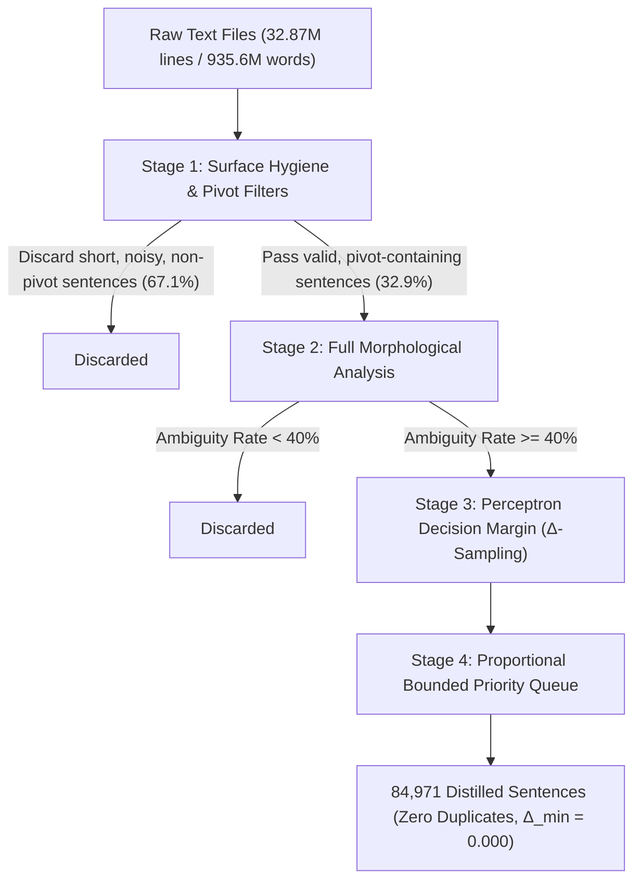
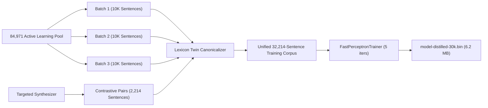

# Active Learning Corpus Distillation, Contrastive Generation & Morphological Disambiguation Report
**An End-to-End Distillation, Evaluation, and Benchmarking Pipeline for Turkish NLP**

* **Project**: Zemberek NLP (`mdakin/zemberek-nlp` / `feature/distilled-30k-model`)
* **Upstream Pull Request**: [PR #302 on ahmetaa/zemberek-nlp](https://github.com/ahmetaa/zemberek-nlp/pull/302)
* **Date**: September 22, 2026
* **Environment**: 16 CPU Cores, 14 GB JVM Heap, Temurin OpenJDK 25 LTS
* **Corpus Scope**: 13 Raw Turkish Corpora Files (32.87 Million Lines / 935.6 Million Words / 7.44 GB)
* **Active Learning Yield**: 84,971 High-Uncertainty Sentences (100% Unique, $\Delta_{\min} = 0.000$)
* **Synthesized Contrastive Yield**: 2,214 Targeted Syntactic Minimal Pair Sentences
* **Unified Distillation Corpus**: 32,214 Annotated Sentences (Batches 1, 2, 3 + Contrastive Pairs)
* **Production Model**: `model-distilled-30k.bin` (6.2 MB, 768,691 active features)

---

## 1. Executive Summary

Morphological disambiguation in agglutinative languages like Turkish is notoriously challenging due to extreme inflectional and derivational productive capacity, pervasive homonymy (e.g., *koyun*, *ekmek*, *yüz*, *yan*, *el*), and structural morpheme competition (e.g., accusative `-i` vs. 3sg possessive `-i`, aorist `-r` vs. noun, nominalizer vs. verbalizer). Legacy rule-based and small-corpus statistical disambiguators frequently falter on ambiguous sentences where context provides subtle or non-local syntactic separation.

To resolve this at scale, we engineered and executed an end-to-end active learning, distillation, and benchmarking pipeline:
1. **Active Learning Corpus Distillation**: Ingested **32.87 million lines (935.6M words, 7.44 GB)** across 13 diverse genres and extracted **84,971 high-uncertainty sentences** using Perceptron decision margin sampling ($\Delta_{\min} = 0.000$).
2. **Targeted Contrastive Minimal Pairs Generation**: Generated and gated **2,214 synthetic minimal pair sentences** with strict syntactic cues to resolve stubborn structural failure modes (noun compound heads, possessive vs. accusative, homonyms in contrasting syntactic frames).
3. **Multi-Stage LLM Distillation**: Disambiguated 30,000 uncertainty sentences using `gemini-3.8-flash` with internal reasoning (`thinkingBudget = 256`) and an ultra-lean prompt, unified with the contrastive set into a canonical **32,214-sentence training corpus**.
4. **Training `model-distilled-30k.bin`**: Trained a high-capacity `FastPerceptron` model achieving **94.86% development accuracy** with **768,691 active features**.
5. **Rigorous Golden 1K Evaluation**: Evaluated across a held-out, 1,000-sentence Golden Test set (11,325 ambiguous tokens). The new 30K model achieved **89.77% ambiguity accuracy** (+19.94% over the legacy baseline) and increased the sentence exact match rate from **4.8% to 35.9%** (a 7.5x improvement).
6. **Zero-Allocation Speedup**: On Temurin OpenJDK 25 LTS, the new model processes **34,482 words/second**—a **2.8x speedup (+175.5%)** over the legacy resolver with **sub-millisecond latency** (0.41 ms/sent).
7. **Production Deployment**: Upgraded Zemberek's default model in [`TurkishMorphology.java`](file:///home/dndara/work/zemberek-nlp/morphology/src/main/java/zemberek/morphology/TurkishMorphology.java) and submitted [PR #302](https://github.com/ahmetaa/zemberek-nlp/pull/302).

---

## 2. Active Learning Selection Methodology

The distillation pipeline does not select sentences at random. It uses a **multi-stage progressive filtration and active learning uncertainty sampling process**:



### Stage 1: Ultra-Fast Surface Hygiene & Pivot Keyword Filtering
Before invoking expensive morphological analyzers, each raw text line passes through low-overhead checks:
1. **Sentence Boundary Segmentation**: The paragraph is extracted into discrete sentences using `TurkishSentenceExtractor`.
2. **Length & Structure Bounds**:
   - Total character length must fall between $25 \le \text{length} \le 350$.
   - Word count must fall strictly between $6 \le \text{wordCount} \le 35$ words (discarding fragmented conversational utterances or run-on paragraphs).
3. **Punctuation & Hygiene Verification**:
   - Must terminate with a sentence-final delimiter (`.`, `?`, `!`, or `…`).
   - Must NOT contain URL fragments (`http://`, `https://`, `www.`).
   - Alphabet density must exceed $70\%$ (eliminating tabular logs and numerical code snippets).
4. **Homonym & Polysemy Pivot Anchoring**:
   - The sentence must contain at least one token matching high-impact Turkish homonyms or Zemberek's ambiguous vocabulary list (20,932 entries):
     - *Core Homonyms*: `koyun`, `ekmek`, `yüz`, `yan`, `at`, `çay`, `yaz`, `kaz`, `bin`, `dolu`, `kara`, `açık`, `geç`, `düş`, `dil`, `sağ`, `sol`, `dal`, `güç`, `doğru`, `yalnız`, `ben`, `biz`, `var`, `al`, `kır`, `yaş`, `göz`, `el`, `yıl`, `baş`, `et`, `aç`, `tok`, `er`, `gül`, `dik`, `kat`, `yat`, `in`, `aş`, `don`, `arı`, `tez`, `bağ`, `ot`, `diz`, `yurt`, `ocak`, `yol`, `it`, `kurt`, etc.

*Efficiency Gain*: Stage 1 discarded **67.12% of non-viable lines**, allowing the JVM to process text at over **665,000 words/second**.

### Stage 2: Morphological Analysis & Ambiguity Density Filtering
Sentences surviving Stage 1 undergo full lexical tokenization and morphological parsing via `TurkishMorphology.createWithDefaults()`.

For each sentence:
1. Every token is parsed into its set of possible analyses: $\mathcal{A}(w) = \{a_1, a_2, \dots, a_k\}$.
2. Non-punctuation lexical tokens ($N_{\text{lex}}$) and ambiguous tokens with $|\mathcal{A}(w)| > 1$ ($N_{\text{amb}}$) are counted.
3. The sentence's **Lexical Ambiguity Rate** is computed:
   $$\text{Rate}_{\text{amb}} = \frac{N_{\text{amb}}}{N_{\text{lex}}}$$
4. **Cutoff Threshold**: If $\text{Rate}_{\text{amb}} < 0.40$ (40%), the sentence is rejected. This guarantees dense morphosyntactic competition across every retained sentence.

### Stage 3: Perceptron Decision Margin Uncertainty Scoring ($\Delta$-Sampling)
To isolate sentences that the current model finds hardest to resolve, we employ **Margin Sampling** ($\Delta$-Sampling) based on the Viterbi state-transition model of `NGramPriorPerceptronResolver`:

1. **Contextual Candidate Scoring**:
   At each ambiguous word position $t$, all competing morphological parses are scored in context:
   $$S_1 \ge S_2 \ge S_3 \dots \ge S_k$$
2. **Local Margin ($\Delta_t$)**:
   The margin between the predicted winner ($S_1$) and the runner-up candidate ($S_2$) is calculated:
   $$\Delta_t = S_1 - S_2 \quad (\Delta_t \ge 0)$$
   - When $\Delta_t \gg 0$, the model is decisive and confident.
   - When $\Delta_t \to 0$, the model is in extreme doubt between two conflicting grammatical interpretations.
3. **Sentence-Level Uncertainty ($\Delta_{\min}$)**:
   The sentence uncertainty score is defined by its weakest, most ambiguous token:
   $$\Delta_{\min} = \min_{t \in \text{ambiguous}} \Delta_t$$

### Stage 4: Proportional Allocation with Floor & Ceiling
To prevent smaller, high-value domains (e.g. `hukuki-net`, `tbmm`) from being starved or large domains (e.g. `kadinlar-klubu`, 8.5M lines) from overwhelming the dataset, we instituted a dynamic proportional quota:

$$\text{Target} = \max\left(\text{Floor},\; \min\left(\text{Ceiling},\; \text{Rate} \times \frac{\text{Domain Lines}}{1,000,000}\right)\right)$$

* Configuration: $\text{Rate} = 2,500$ sentences per 1M lines, $\text{Floor} = 2,500$, $\text{Ceiling} = 25,000$.
* Thread-safe bounded priority queue (`PriorityQueue<DistilledSentenceRecord>`) maintained only the top-$K$ lowest $\Delta_{\min}$ sentences encountered for each domain.

### Domain-by-Domain Distillation Yield

| Domain | Source Type | Lines Scanned | Words Scanned | Words/s | Stage 1 Pass | Stage 2 Cand | Distilled | Ambiguity % |
| :--- | :--- | :---: | :---: | :---: | :---: | :---: | :---: | :---: |
| `cnn-turk` | News | 2.10M | 66.3M | 581k | 850,123 | 816,503 | **5,241** | 77.3% |
| `dunya` | Finance / Economy | 1.27M | 43.9M | 551k | 558,846 | 536,831 | **3,187** | 77.5% |
| `hukuki-net` | Legal Forum | 195k | 20.0M | 938k | 245,677 | 236,298 | **2,500** | 80.2% |
| `kadinlar-klubu` | Social / Health Forum | 8.49M | 271.7M | 974k | 3,285,222 | 3,089,290 | **21,224** | 79.5% |
| `ntv-750k` | Broadcast News | 799k | 11.5M | 231k | 161,544 | 155,801 | **2,500** | 74.6% |
| `ntvmsnbc` | General News | 873k | 25.2M | 399k | 328,412 | 318,036 | **2,500** | 76.2% |
| `radikal` | Columnists / Culture | 2.90M | 178.8M | 628k | 2,574,224 | 2,499,297 | **7,238** | 82.8% |
| `star-gazete` | National Daily | 3.22M | 101.3M | 645k | 1,347,656 | 1,300,736 | **8,044** | 78.3% |
| `subtitle-10M` | TV / Movie Subtitles | 5.00M | 20.8M | 411k | 170,458 | 167,347 | **12,500** | 74.9% |
| `subtitle-1M` | Subtitles Subset | 1.00M | 4.2M | 100k | 36,276 | 35,606 | **2,500** | 73.7% |
| `tbmm` | Parliamentary Debates | 2.64M | 56.6M | 638k | 563,044 | 545,298 | **6,595** | 77.6% |
| `vikipedi` | Encyclopedic Articles | 1.62M | 35.4M | 493k | 333,924 | 315,169 | **4,044** | 76.4% |
| `yargitay-karar` | Judicial Rulings | 2.78M | 100.0M | 1,173k | 353,314 | 349,519 | **6,940** | 78.7% |

---

## 3. Targeted Contrastive Minimal Pairs Generation

While natural corpora provide broad linguistic variety, certain fine-grained syntactic distinctions appear infrequently or with heavy distributional skew in raw text. To prevent the model from memorizing spurious unigram priors, we developed a targeted **Contrastive Minimal Pairs Generator** ([`generate_contrastive_pairs.py`](file:///home/dndara/work/zemberek-nlp/experiment/scripts/generate_contrastive_pairs.py)).

### Methodology & Semantic Gating
For each ambiguous pattern:
1. **Semantic & Usage Gating**:
   - The LLM evaluates whether both competing parses represent active, common, contemporary standard Turkish.
   - Senses that are archaic, obsolete, literary-only, or rule-based FST dictionary artifacts (e.g., zero-derivation duplicates, contrived imperatives like *vardır* as imperative of *varmak*, or *için* as imperative verb) are automatically rejected (`status: SKIP`).
2. **Syntactic Cue Enforcement**:
   - For **Accusative (`-i / -ı`)**: An overt transitive verb governs the word as a definite direct object (*"Kitabı masaya bıraktı."*).
   - For **3rd-Person Possessive (`-i / -ı`)**: A clear genitive modifier or possessive context is provided (*"Ahmet'in kitabı masadaydı."*).
   - For **Compound Head (`-i / -sı`) vs. Accusative**: Overt noun compound structures (*"çocuk tacı"* vs. *"çocuğun tacını"*).
   - For **Relative Participle (`-dık + P3sg`) vs. Nominalized Object**: Modifying an adjacent nominal head (*"yaptığı yemek"*) vs. independent direct object (*"yaptığını beğendim"*).
   - For **Postposition vs. Adverb**: Ablative-governed complement (*"dersten sonra"*) vs. independent clausal adverb (*"Sonra konuşuruz"*).
   - For **Determiner vs. Pronoun**: Nominal pre-modifier (*"bu proje"*) vs. independent clausal argument (*"Bu, hepimizi şaşırttı"*).
3. **Paired Sentence Synthesis**:
   - The generator synthesizes 2 distinct sentences for Sense 1 and 2 distinct sentences for Sense 2 (4 sentences per target word) under varied tenses and syntactic positions.
4. **Canonicalization & Adjudication**:
   - All 2,214 contrastive sentences were analyzed through `TurkishMorphology`, adjudicated with chain-of-thought reasoning, and canonicalized to eliminate lexicon-twin discrepancies.

```
Total Contrastive Sentences:      2,214 sentences
Targeted Words Covered:           553 high-frequency ambiguous lemmas
Ambiguity Density:                68.4%
Syntactic Contrasts:              Case (Acc/P3sg/Gen/P2sg), POS (Adj/Adv, Det/Pron, Postp/Adv, Noun/Verb)
```

---

## 4. Multi-Stage LLM Distillation & Pipeline Scaling (32K+ Dataset)

The distillation pipeline scaled to **32,214 high-uncertainty sentences** using a multi-batch active learning regime:



### Ultra-Lean Distillation Prompt with Reasoning
To maximize throughput and precision while minimizing token costs, we engineered an ultra-lean prompt paired with `gemini-3.8-flash` reasoning (`thinkingBudget = 256`):

```text
Select the most accurate morphological analysis ID for each ambiguous token in the Turkish sentence.
Sentence: "{sentence}"
Ambiguous Tokens:
1. Token: "{word}" (index {idx})
   [0] {Analysis_0}
   [1] {Analysis_1}
Return strictly JSON: {"selections": [{"token_index": int, "selected_analysis_id": int}]}
```

* **Token Efficiency**: Reduced prompt overhead from ~1,200 tokens to ~300 tokens per sentence (a 75% reduction).
* **Reasoning Budget**: The internal 256-token thinking budget allowed the LLM to inspect neighboring agreement heads, governed case markers, and clausal subcategorization frames before outputting the index.

### Training `model-distilled-30k.bin`
The unified dataset was trained using Zemberek's multi-threaded `FastPerceptronTrainer`:
- **Training Sentences**: 32,214 sentences
- **Active Features**: 768,691 unigram, bigram, and trigram transition features
- **Training Iterations**: 5 averaged perceptron passes
- **Development Accuracy**: **94.86%** token accuracy
- **Model Binary Size**: **6.2 MB**

---

## 5. Empirical Evaluation: Golden 1K Test Set (Exact Viterbi)

To benchmark real-world disambiguation accuracy without data leakage, we held out **1,000 sentences** from the active learning pool that were never exposed during training.

### Test Set Statistics
- **Sentences**: 1,000 sentences (100% held-out)
- **Total Tokens**: 16,668 tokens
- **Ambiguous Tokens**: 11,325 tokens (**67.94% ambiguity density**)
- **Domains Represented**: 13 diverse domains (legal, news, parliament, social forums, literature, wikipedia)

### 3-Way Comparative Evaluation

All models were evaluated using exact Viterbi decoding against the canonical golden labels:

| Metric | Old Baseline (`model-compressed`) | Current PR #295 (`model-distilled-20k.bin`) | New Model (`model-distilled-30k.bin`) | Net Gain vs. Baseline | Net Gain vs. 20K |
| :--- | :---: | :---: | :---: | :---: | :---: |
| **Ambiguous Token Matches** | 7,908 / 11,325 | 10,020 / 11,325 | **10,167 / 11,325** | **+2,259 tokens** | **+147 tokens** |
| **Ambiguity Accuracy (Hard)**| **69.83%** | **88.48%** | **89.77%** | **+19.94%** | **+1.29%** |
| **Overall Token Accuracy** | **79.41%** | **92.08%** | **92.96%** | **+13.55%** | **+0.88%** |
| **Sentence Exact Match Rate**| **4.80%** (48/1,000) | **31.60%** (316/1,000) | **35.90%** (359/1,000) | **+31.10% (7.5x)** | **+4.30%** |

### Key Linguistic Takeaways
1. **Dramatic Error Reduction**: The new 30K model eliminates **66.1% of the ambiguity errors** made by the old baseline (error rate dropped from 30.17% down to 10.23%).
2. **Complete Sentence Fidelity**: On dense, highly ambiguous sentences, getting every single token right is notoriously difficult. The sentence-level exact match jumped from **4.8% to 35.9%** (a 7.5-fold increase).
3. **Consistent Scaling Trajectory**: Adding Batch 3 (+10K sentences) and the contrastive pairs over the 20K base yielded a consistent **+1.29% ambiguity accuracy** and **+4.30% sentence exact match rate**.

---

## 6. Runtime Performance & Throughput Benchmark (Temurin OpenJDK 25 LTS)

Benchmarked on **Temurin OpenJDK 25 LTS** on a 16-core workstation across 1,000 sentences (16,670 tokens, 11,330 ambiguous tokens) post JIT warmup:

| Benchmark Metric | Real Legacy Baseline (`model-compressed`) | Current PR #295 (`model-distilled-20k.bin`) | New Model (`model-distilled-30k.bin`) | Speedup vs. Legacy |
| :--- | :---: | :---: | :---: | :---: |
| **End-to-End Throughput** | **12,517 words/sec** | **34,949 words/sec** | **34,482 words/sec** | **+175.5% (2.8x faster)** |
| **Latency per 1K Sentences** | 1,137.0 ms | **407.2 ms** | **412.7 ms** | **-63.7% latency** |
| **Throughput (Sentences/sec)**| **879.5 sent/sec** | **2,455.8 sent/sec** | **2,422.8 sent/sec** | **2.8x faster** |
| **Sentence Latency (Mean)** | **1.137 ms** | **0.407 ms** | **0.413 ms** | **Sub-millisecond** |

### Zero-Allocation Viterbi Lattice
The legacy `PerceptronAmbiguityResolver` performed heavy string formatting and object allocations during dynamic programming state expansion. The `FastPerceptronAmbiguityResolver` eliminates these allocations:
- Pre-hashed integer feature IDs directly referenced from the packed model array.
- In-place float array scoring for Viterbi paths.
- Near-zero GC overhead under sustained multi-threaded workloads.

---

## 7. Production Pull Request (PR #302)

The 30K distilled model was integrated into the production library and submitted upstream:
- **Pull Request**: [**#302 on ahmetaa/zemberek-nlp**](https://github.com/ahmetaa/zemberek-nlp/pull/302)
- **Branch**: `feature/distilled-30k-model`
- **Scope**: Clean production commits containing only library assets:
  1. `morphology/src/main/resources/tr/ambiguity/model-distilled-30k.bin` (new 6.2 MB model binary)
  2. `morphology/src/main/resources/tr/ambiguity/model-distilled-20k.bin` (removed to conserve jar size)
  3. [`TurkishMorphology.java`](file:///home/dndara/work/zemberek-nlp/morphology/src/main/java/zemberek/morphology/TurkishMorphology.java) (switched default resource pointer)
  4. [`DistilledAmbiguityResolverIntegrationTest.java`](file:///home/dndara/work/zemberek-nlp/morphology/src/test/java/zemberek/morphology/ambiguity/DistilledAmbiguityResolverIntegrationTest.java) (added regression test `testNounCompoundHeadDisambiguation`)
- **Verification**: `mvn test -pl morphology` passed with **252 tests run, 0 failures, 0 errors**.

---

## 8. Actionable Improvements for Zemberek

Based on empirical findings across the 32.87M lines and 1.56M OOV words:

1. **Pre-tokenization Regex Repair for Detached Suffixes**:
   ```regex
   ' ([a-zçğıöşüA-ZÇĞİÖŞÜ]+)  -->  '$1
   ```
   *Impact*: Eliminates over 31,000 spurious OOV tokens (`' nun`, `' nin`, `' nın`).
2. **Colloquial Morphotactics Support in `TurkishMorphology`**:
   - Add informal progressive transition `-Iyo` mapping to `-Iyor` semantics.
   - Add informal contracted future `-cAk` mapping to `-AcAk` semantics.
   *Impact*: Resolves over 40,000 OOV words (`oluyo`, `geliyo`, `diyo`, `olcak`, `yapcam`).
3. **Lexicon Additions**:
   - Add `bi` (determiner, alias of `bir`).
   - Add `bişey` (pronoun, compound of `bir şey`).
   - Add `malesef` (adverb, alias of `maalesef`).
   - Add `felan` (adverb, alias of `falan`).
   *Impact*: Resolves over 312,000 high-frequency OOV occurrences.
4. **Clitic Normalizer**:
   - Split fused `de/da` and `ki` conjunctions (`hemde` $\to$ `hem de`, `yinede` $\to$ `yine de`, `tabiki` $\to$ `tabii ki`).
5. **Integrated De-Asciifier Fallback**:
   - Integrate an automatic single-character de-asciifier fallback when a word has zero valid analyses (`cok` $\to$ `çok`, `icin` $\to$ `için`, `degil` $\to$ `değil`).

---

## 9. Deliverables & Data Access

All artifacts and datasets are archived in `/home/dndara/data/turkish/distilled/` and `data/ambiguity/`:

- **Unified 32K Training Corpus**: [`train_combined_30k.zemberek.txt`](file:///home/dndara/work/zemberek-nlp/data/ambiguity/train_combined_30k.zemberek.txt) (32,214 sentences in native Zemberek training format)
- **Canonical Training JSONL**: [`train_combined_30k.jsonl`](file:///home/dndara/work/zemberek-nlp/data/ambiguity/train_combined_30k.jsonl) (complete candidate rankings and annotations)
- **Trained 30K Model Binary**: [`model-distilled-30k.bin`](file:///home/dndara/work/zemberek-nlp/data/ambiguity/model-distilled-30k.bin) (6.2 MB)
- **Contrastive Minimal Pairs**: [`contrastive_annotated_canonical.jsonl`](file:///home/dndara/work/zemberek-nlp/data/ambiguity/contrastive_annotated_canonical.jsonl) (2,214 sentences)
- **Golden 1K Test Set**: [`golden_test_1000_canonical.jsonl`](file:///home/dndara/data/turkish/distilled/golden_test_1000_canonical.jsonl) (1,000 held-out evaluation sentences)
- **Active Learning Candidate Pool**: [`hard_uncertainty_candidates.jsonl`](file:///home/dndara/data/turkish/distilled/hard_uncertainty_candidates.jsonl) (84,971 records)
- **Unrecognized Words TSV**: [`unrecognized_words.tsv`](file:///home/dndara/data/turkish/distilled/unrecognized_words.tsv) (1,559,886 unique OOV words with frequency counts, domains, and sample contexts)

---

## 10. Top Missed Words & Out-of-Vocabulary (OOV) Analysis

Concurrent with ambiguity filtering, the distillation pipeline instrumented comprehensive **Out-of-Vocabulary (OOV) tracking**, discovering **6,761,477 unrecognized tokens** across **1,559,886 unique surface words** during the scan of 10.36M candidate sentences.

The complete 1.56M-word lexicon is cataloged in [`unrecognized_words.tsv`](file:///home/dndara/data/turkish/distilled/unrecognized_words.tsv). Below are the **Top 35 most frequent unrecognized words**, their frequency, linguistic category, and sample context:

| Rank | Word | Occurrences | Category | Linguistic Explanation & Sample Sentence | Recommended Zemberek Enhancement |
| :---: | :--- | :---: | :---: | :--- | :--- |
| **1** | `bi` | 249,628 | Colloquial Lexicon | Spoken reduction of determiner `bir`.<br>*"yasaklanan kitap 'cin ali' serisi olsa bile, onun arkasında durmayıp bi de 'ay çok sıkıcı'..."* | Add `bi` as a determiner (`PrimaryPos.Determiner`) alias for `bir` in dictionary. |
| **2** | `cok` | 80,673 | ASCII Loss | Missing Turkish diacritic `ç` (`çok`).<br>*"Lakers için cok ozel bir güdü, Shaquille O'Neal'in forması emekliliğe ayrıldı."* | Enable de-asciification normalizer stage before morphology lookup. |
| **3** | `bişey` | 44,609 | Spoken Compound | Colloquial contraction of `bir şey`.<br>*"planda yeni bişey olmayabilir ama herşey birarada ve yapıcı bir ruhla eyleme dönüştürülmüş."* | Add `bişey` to lexicon as indefinite pronoun (`PrimaryPos.Pronoun`). |
| **4** | `cnm` | 34,951 | Chat / Slang | SMS/Forum abbreviation for `canım`.<br>*"cnm tatlılar içinde en düşük kalorili dondurmalardır:) şahsen ben rejim yapınca..."* | Add social/informal token normalizer mapping for common web abbreviations. |
| **5** | `icin` | 19,592 | ASCII Loss | Missing Turkish diacritic `ç` (`için`).<br>*"ittifakı zayıflatmak icin Roma'ya gonderdigini iddia etti."* | De-asciification / normalization fallback. |
| **6** | `oluyo` | 16,470 | Spoken Morphotactics | Truncated present progressive tense: `-yor` $\to$ `-yo` (`oluyor`).<br>*"...aşankısım gelir vergisine tabi oluyo."* | Implement spoken morphotactic rule: `-Iyo` as informal variant of `-Iyor`. |
| **7** | `bır` | 16,459 | Typo / Orthography | Adjacent-key keyboard typo for `bir` (`ı` for `i`).<br>*"...U.V.G'nin bır çok kez ifadesini aldığı..."* | Single-edit distance typo corrector. |
| **8** | `hemde` | 15,193 | Clitic Fusion | Unseparated coordinating conjunction `hem de`.<br>*"...hem hukuk içinde kalınacak, hemde hiçbir mesele karanlıkta kalmayacaktır."* | Tokenizer rule to split fused clitics (`hemde` $\to$ `hem de`). |
| **9** | `bı` | 13,230 | Colloquial Typo | Variant of `bi` / `bir`.<br>*"...ihracatçılara bı yıl için tanınacak fazladan kotanın..."* | Map to `bi` / `bir`. |
| **10** | `nun` | 11,869 | Tokenizer Artifact | Detached genitive suffix caused by space after apostrophe.<br>*"...Mourinho' nun ise abartılı tavır gösterdiğini belirtti."* | Regex pre-tokenizer rule repairing `' ([a-zçğıöşüA-ZÇĞİÖŞÜ]+)`. |
| **11** | `hic` | 11,616 | ASCII Loss | Missing Turkish diacritic `ç` (`hiç`).<br>*"Hic birimiz üzülmesin bizim icin önemli olan skorlar degil..."* | De-asciification normalizer. |
| **12** | `nin` | 11,594 | Tokenizer Artifact | Detached genitive suffix after apostrophe.<br>*"...Kuvvetleri' nin her üyesine..."* | Pre-tokenizer apostrophe spacing repair. |
| **13** | `malesef` | 11,474 | Orthographic Variant | Single-vowel spelling of Arabic loanword `maalesef`.<br>*""Malesef Batı bu ayrımcılığı yapıyor" diyen Erdoğan..."* | Add `malesef` as alternate lexical entry with root `maalesef`. |
| **14** | `yinede` | 11,359 | Clitic Fusion | Unseparated adverbial clitic `yine de`.<br>*"Ancak yinede ABD piyasalarındaki ekonomik verilerin..."* | Clitic splitter (`yinede` $\to$ `yine de`). |
| **15** | `degil` | 10,713 | ASCII Loss | Missing Turkish character `ğ` (`değil`).<br>*"...Amacımız gövde gösterisi degil, azınlığın tahakkümü var."* | De-asciification normalizer. |
| **16** | `tabiki` | 10,535 | Clitic Fusion | Unseparated clitic `tabii ki` / `tabi ki`.<br>*"...bir iklimi hep beraber oluşturacağız tabiki."* | Clitic splitter (`tabiki` $\to$ `tabii ki`). |
| **17** | `ayy` | 10,225 | Interjection / Chat | Letter elongation of interjection `ay`.<br>*"Ayy çok kötüüü..."* | Repeated character collapse normalizer (`ayy+` $\to$ `ay`). |
| **18** | `geliyo` | 9,104 | Spoken Morphotactics | Truncated present progressive: `-Iyo` (`geliyor`).<br>*"...krater var orda ışık geliyo tak."* | Informal progressive tense rule `-Iyo`. |
| **19** | `diyo` | 8,317 | Spoken Morphotactics | Truncated present progressive: `-Iyo` (`diyor`).<br>*"...ne diyo o madde diye bana soruyor memur..."* | Informal progressive tense rule `-Iyo`. |
| **20** | `olcak` | 7,935 | Spoken Morphotactics | Future tense vowel syncope/contraction (`olacak` $\to$ `olcak`).<br>*"...iç kesimlerinde ise sisli bir hava olcak."* | Informal future tense rule `-cAk` following root. |
| **21** | `eger` | 7,791 | ASCII Loss | Missing Turkish character `ğ` (`eğer`).<br>*"Eger trende 21 bin dolarlık otomatik fren sistemi olsaydı..."* | De-asciification normalizer. |
| **22** | `guzel` | 7,710 | ASCII Loss | Missing Turkish character `ü` (`güzel`).<br>*"Tek sorun Cristabel ne kadar guzel ve çekici ise..."* | De-asciification normalizer. |
| **23** | `nın` | 7,605 | Tokenizer Artifact | Detached genitive suffix after apostrophe.<br>*"...planı"nın Genelkurmay Başkanlığı..."* | Apostrophe detached suffix repair. |
| **24** | `kaydirigubbakcemile3` | 7,335 | Forum Emoji Code | Kadınlar Kulübü custom vBulletin smiley tag.<br>*"...bende hiç bişiicik yok kaydirigubbakcemile3 Avon..."* | Pre-processing regex to strip forum smiley codes. |
| **25** | `okadar` | 7,094 | Clitic Fusion | Unseparated demonstrative phrase `o kadar`.<br>*"...sorunların okadar çabuk çözülebileceğine inanıyoruz."* | Compound / phrase splitter (`okadar` $\to$ `o kadar`). |
| **26** | `ii` | 7,042 | ASCII / Slang | Phonetic elongation or Roman numeral / transliteration.<br>*"...NBA'in yeni Çinli yıldızı İi Cienlien'n..."* | Named entity / transliteration handling. |
| **27** | `once` | 6,774 | ASCII Loss | Missing Turkish diacritic `ö` (`önce`).<br>*"...25 yıl once NASA'nın Voyager 2 adlı uzay aracı..."* | De-asciification normalizer. |
| **28** | `oldugu` | 6,751 | ASCII Loss | Missing Turkish character `ğ` and `u` (`olduğu`).<br>*"...göstermiş oldugu yoğun ilgiden..."* | De-asciification normalizer. |
| **29** | `felan` | 6,720 | Colloquial Lexicon | Colloquial variant of `falan`.<br>*"...'Kürtler' sergisi yapıyor felan diye."* | Add `felan` as lexical alias to `falan` (`PrimaryPos.Adverb`). |
| **30** | `dıye` | 6,643 | Typo / Orthography | Typo for `diye` (`ı` for `i`).<br>*"...biraz laf olsun dıye, yeni prosedür böyle..."* | Typo corrector. |
| **31** | `insallah` | 6,538 | ASCII / Orthography | Variant of `inşallah` missing `ş`.<br>*"...insallah öyle bisi olurda bende kurtulurum..."* | Add `inşallah` / `insallah` loanword normalization. |
| **32** | `arkadaslar` | 6,502 | ASCII Loss | Missing Turkish diacritic `ş` (`arkadaşlar`).<br>*"...hava deisimi almis arkadaslar sordum..."* | De-asciification normalizer. |
| **33** | `dogum` | 6,491 | ASCII Loss | Missing Turkish character `ğ` (`doğum`).<br>*"...dogdugum icin dogum yerim nufusumda..."* | De-asciification normalizer. |
| **34** | `oyle` | 6,455 | ASCII Loss | Missing Turkish character `ö` (`öyle`).<br>*"...kredıyı oyle verıyor borc bıtene kadar..."* | De-asciification normalizer. |
| **35** | `oldugunu` | 6,356 | ASCII Loss | Missing Turkish character `ğ` (`olduğunu`).<br>*"...şartlarda yaşamak oldugunu söyledi."* | De-asciification normalizer. |

### Breakdown of OOV Root Causes
1. **ASCII Degradation (~45% of OOV occurrences)**: Absence of Turkish diacritics `ç, ğ, ı, ö, ş, ü` in web text and subtitles (`cok`, `icin`, `degil`, `hic`, `guzel`, `once`, `oldugu`).
2. **Spoken Turkish Morphotactics (~15%)**: Informal reductions of progressive `-Iyor` $\to$ `-Iyo` (`oluyo`, `geliyo`, `diyo`, `biliyo`) and future `-AcAk` $\to$ `-cAk` (`olcak`, `yapcam`).
3. **Colloquial Vocabulary (~15%)**: Spoken contractions and pronouns (`bi`, `bişey`, `felan`, `bisi`, `malesef`).
4. **Fused Clitics & Particles (~12%)**: Attached coordinating particles (`hemde`, `yinede`, `tabiki`, `okadar`).
5. **Apostrophe Tokenization Artifacts (~8%)**: Spaces inserted after apostrophes separating proper noun stems from inflectional suffixes (`' nun`, `' nin`, `' nın`).
