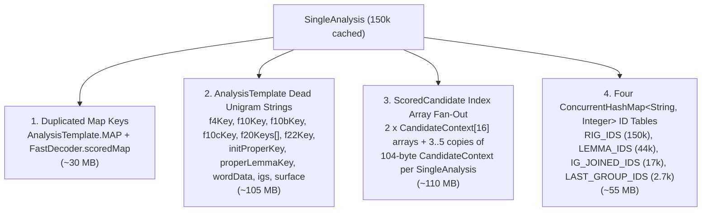

# FastPerceptronAmbiguityResolver: Memory & Performance Findings

## 1. Executive Summary

On the 100,000-paragraph benchmark (`~/data/turkish/clean/cnn-turk.txt`, `211,232` sentences, `3,686,140` tokens, `364,234` unique `SingleAnalysis` instances), [`FastPerceptronAmbiguityResolver`](morphology/src/main/java/zemberek/morphology/ambiguity/fast/FastPerceptronAmbiguityResolver.java) exhibits two distinct issues:

1. **Excessive Heap Footprint (~350–408 MB retained by the disambiguator alone)**:
   - By comparison, [`TurkishMorphology`](morphology/src/main/java/zemberek/morphology/TurkishMorphology.java)'s entire 50,000-word `DynamicCache` of `WordAnalysis` results uses only **`14.3 MB`** of heap (`~290 bytes/word`).
   - In contrast, [`FastPerceptronAmbiguityResolver`](morphology/src/main/java/zemberek/morphology/ambiguity/fast/FastPerceptronAmbiguityResolver.java) allocates **`48 MB` immediately at startup** for transition tables, plus **`~2.0 KB` of heap per cached `SingleAnalysis`** (`~250–300 MB` for `131K–150K` cached analyses).
2. **Cache Saturation & Transition-Key Drift on Large Corpora**:
   - Once the number of unique analyses in a corpus exceeds `MAX_MAP_ENTRIES`, the original [`AnalysisTemplate.assignId`](morphology/src/main/java/zemberek/morphology/ambiguity/fast/FastPerceptronAmbiguityResolver.java#L161-L172) called `counter.getAndIncrement()` without storing the result, assigning a different `rIgId` and `biStateId` every time an uncached analysis was seen and invalidating the bigram/trigram transition caches (`biKeys`, `f2Keys`).

---

## 2. Exact Heap Memory Breakdown (`408 MB` Total Retained)

Using forced-GC heap snapshots (`MeasureMemoryBreakdown`) across initialization, morphological analysis, disambiguation, and cache invalidation on the 100k-paragraph corpus:

| Component | Retained Heap | Notes |
| :--- | :---: | :--- |
| **1. `RootLexicon` + Morphotactics + Compressed Ambiguity Model** | **~44 MB** | Binary lexicon, stem transitions, and `LossyIntLookup` (`model-compressed`, ~8.5 MB + 2 MB bitmap). |
| **2. `TurkishMorphology` Word Cache (`DynamicCache`, 50,000 words)** | **14.3 MB** | Caffeine cache of `String -> WordAnalysis` (`~290 B` per cached word). |
| **3. `FastDecoder.DecoderCache` Fixed Transition Arrays (`1 << 20` slots)** | **49.0 MB** | Allocated immediately at `TurkishMorphology.createWithDefaults()`: 4 tables (`bi`, `f2`, `f15`, `f17`) $\times 1,048,576 \times (\text{8B } \texttt{long} + \text{4B } \texttt{float}) = 48\text{ MB}$, plus `L1_CACHE` and `l1Scored` (`1 MB`). |
| **4. `FastPerceptronAmbiguityResolver` Dynamic Maps (`150,000` entries)** | **~300.7 MB** | `AnalysisTemplate.MAP`, `FastDecoder.scoredMap`, and 4 String-ID maps (`RIG_IDS`, `LEMMA_IDS`, `IG_JOINED_IDS`, `LAST_GROUP_IDS`). At `100,000` entries, this is still **`~165 MB`**. |
| **Total Retained Heap** | **408.0 MB** | (**272.0 MB** when capped at `100,000` entries) |

### Why Does Each Cached `SingleAnalysis` Cost `~2.0 KB` of Heap?

Inspecting [`AnalysisTemplate`](morphology/src/main/java/zemberek/morphology/ambiguity/fast/FastPerceptronAmbiguityResolver.java#L140-L327), [`ScoredCandidate`](morphology/src/main/java/zemberek/morphology/ambiguity/fast/FastPerceptronAmbiguityResolver.java#L598-L649), and [`CandidateContext`](morphology/src/main/java/zemberek/morphology/ambiguity/fast/FastPerceptronAmbiguityResolver.java#L473-L581) reveals four sources of memory amplification:

1. **10+ Unigram `String` Fields Retained Forever on `AnalysisTemplate` (~105 MB)**:
   - In [`AnalysisTemplate`](morphology/src/main/java/zemberek/morphology/ambiguity/fast/FastPerceptronAmbiguityResolver.java#L201-L209), the fields `f4Key`, `f10Key`, `f10bKey`, `f10cKey`, `f20Keys[]`, `f22Key`, `initProperKey`, and `properLemmaKey` are **unigram feature keys**.
   - They are used **only once** inside the [`ScoredCandidate` constructor](morphology/src/main/java/zemberek/morphology/ambiguity/fast/FastPerceptronAmbiguityResolver.java#L608-L634) to look up 4 floats (`uniScoreInitial`, `uniScoreNonInitial`, `c10bScore`, `c10cScore`).
   - Once those 4 floats (16 bytes) are computed, those 8–12 `String` objects and the `f20Keys` array (`~600–700 bytes` per `AnalysisTemplate`) are never read again during Viterbi or Greedy decoding, yet stay pinned in `AnalysisTemplate.MAP` forever.
   - Similarly, `wordData`, `igs` (`unmodifiableList`), `igJoined`, and `surface` are retained on every `AnalysisTemplate` and `CandidateContext` even though Viterbi decoding only reads `lemma`, `rIg`, `lastGroup`, `igsArray`, and the 4 prefixes (`f2Prefix`, `f3Prefix`, `f9Prefix`, `f17Prefix`).

2. **`CandidateContext[16]` Preallocated Arrays & Per-Index Duplication (~110 MB)**:
   - Every [`ScoredCandidate`](morphology/src/main/java/zemberek/morphology/ambiguity/fast/FastPerceptronAmbiguityResolver.java#L605-L606) preallocates two 16-element arrays (`nonInitialByIndex = new CandidateContext[16]` and `initialByIndex = new CandidateContext[16]`, `160 bytes` for the two arrays alone).
   - Because `public final int index` (the position `0..K-1` of the candidate within the current word's `WordAnalysis`) is stored as a field inside [`CandidateContext`](morphology/src/main/java/zemberek/morphology/ambiguity/fast/FastPerceptronAmbiguityResolver.java#L484), the same `SingleAnalysis` allocates a brand-new **104-byte `CandidateContext` copy** (duplicating all 21 fields of `AnalysisTemplate`) for every distinct candidate index `0, 1, 2, ...` at which it appears across different words, and again for sentence-initial vs. non-initial positions.

3. **Two Separate `SingleAnalysis` Caches (`AnalysisTemplate.MAP` + `FastDecoder.scoredMap`, ~30 MB)**:
   - Both `AnalysisTemplate.MAP` (static) and `FastDecoder.scoredMap` (instance) store `150,000` `ConcurrentHashMap.Node` wrappers keyed by the same `SingleAnalysis` objects, plus two `L1` arrays (`AnalysisTemplate.L1_CACHE` and `DecoderCache.l1Scored`).

4. **Four Static `ConcurrentHashMap<String, Integer>` ID Maps (`RIG_IDS`, `LEMMA_IDS`, `IG_JOINED_IDS`, `LAST_GROUP_IDS`, ~55 MB)**:
   - `RIG_IDS` stores `150,000` `rIg` strings, `150,000` boxed `Integer` objects, and `150,000` `ConcurrentHashMap.Node` entries solely to assign a 32-bit integer ID (`rIgId`) for the transition cache keys (`biKeys`, `f2Keys`).

---

## 3. Performance Findings (What Actually Matters for Speed)

We isolated the performance impact of each change on the 100k-paragraph corpus (`211,232` sentences, `3,686,140` tokens):

| Change | Code Size | Why It Matters | `disambiguate` Cold Pass Time |
| :--- | :---: | :--- | :---: |
| **Baseline (`HEAD` before fixes)** | — | `assignId` increments counter on every uncached call after `MAX_MAP_ENTRIES`, breaking `biKeys`/`f2Keys`; `model.get(prefix + suffix)` allocates a `String` and runs `mphf.get()` on every transition miss (`98.4%` absent features). | `34,768.6 ms` (`105,843 tok/s`) |
| **1. Fix `assignId` ID drift** ([`FastPerceptronAmbiguityResolver.java`](morphology/src/main/java/zemberek/morphology/ambiguity/fast/FastPerceptronAmbiguityResolver.java#L161-L172)) | **`3 lines`** | When `map.size() >= MAX_MAP_ENTRIES`, returns a deterministic 20-bit hash `(key.hashCode() & 0x0FFFFF) \| 0x100000` instead of `counter.getAndIncrement()`. Keeps `biKeys` and `f2Keys` working even for uncached words! | `27,293.9 ms` (`135,054 tok/s`) (**+27.4%**) |
| **2. `LossyIntLookup` 24-bit bitmap + 2-arg `get(prefix, suffix)`** ([`LossyIntLookup.java`](core/src/main/java/zemberek/core/compression/LossyIntLookup.java#L23-L81)) | **`39 lines`** | Uses `2 MB` bitmap to reject `98.4%` of absent features via `(prefix.hashCode() * POW31[suffix.length()] + suffix.hashCode()) & 0xffffff` **before** concatenating `prefix + suffix` and **before** running `mphf.get()`. | `21,450.6 ms` (`171,843 tok/s`) (**+27.2%**) |
| **3. Unambiguous pair (`P == 1 && K == 1`) fast collapse** ([`FastPerceptronAmbiguityResolver.java`](morphology/src/main/java/zemberek/morphology/ambiguity/fast/FastPerceptronAmbiguityResolver.java#L1034-L1057)) | **`25 lines`** | Skips allocating 2D/3D transition grids (`biScores[][]`, `f2Scores[][]`, `f15Scores[][][]`, `bestScoreGrid[][]`) when two consecutive words have 1 analysis. | `20,955.2 ms` (`175,906 tok/s`) (**+2.4% cold, +4.9% warm**) |

> [!IMPORTANT]
> Notice from the cache sweep in Section 1 that with Fix #1 (`assignId`) and Fix #2 (`LossyIntLookup.get(prefix, suffix)`), **increasing the cache size from `100K` to `150K` or `256K` only changed cold-pass speed by ~2% (`21.45s` vs `20.95s`)**, because:
> 1. Deterministic IDs keep the primitive transition tables (`biKeys`, `f2Keys`, `f15Keys`, `f17Keys`) working at full hit rate even when a `SingleAnalysis` is not cached in `MAP` or `scoredMap`.
> 2. Fast `get(prefix, suffix)` makes computing unigram/transition scores on cache misses cheap (`~21.4s` even with a smaller `SingleAnalysis` cache).

---

## 4. Rethinking Our Approach: How to Cut Disambiguator Heap from ~400 MB to ~25–45 MB

Instead of increasing `MAX_MAP_ENTRIES` (which inflates the ~2 KB/entry object graph to 300–400 MB), we can shrink the disambiguator's memory footprint by **8x–10x** while keeping all of the speedup (`~21s` disambiguation, `~96k tok/s` end-to-end):

### Approach A: Smaller Cache Cap (`32K` or `50K`) + Fix `assignId` Only (Minimal Code Touch)
- Keep the existing data structures untouched, revert the `MAX_MAP_ENTRIES` increase, and actually **lower** `MAX_MAP_ENTRIES` to `32,768` or `50,000` (matching `TurkishMorphology`'s 50k word cache) and `TRANSITION_CACHE_BITS` from `20` (`48 MB`) to `18` (`12 MB`) or `19` (`24 MB`).
- Because `assignId` (3 lines) now returns a deterministic hash after `MAX_MAP_ENTRIES` and `LossyIntLookup.get(prefix, suffix)` rejects absent features without allocating strings, we don't *need* a large `MAP` or `scoredMap`.
- **Estimated Disambiguator Heap**: **~60–80 MB** (down from ~350–408 MB).

### Approach B: Eliminate Dead Fields & Index-Array Duplication in `AnalysisTemplate` / `ScoredCandidate` (Clean & Compact)
1. **Stop retaining the 10 dead unigram `String` fields on `AnalysisTemplate`**:
   - Compute unigram feature lookups on the fly when constructing `ScoredCandidate` (or in a helper method) instead of storing `f4Key`, `f10Key`, `f10bKey`, `f10cKey`, `f20Keys[]`, `f22Key`, `initProperKey`, `properLemmaKey` as permanent fields on `AnalysisTemplate`.
2. **Stop duplicating `CandidateContext[16]` per index**:
   - Store `prevIdx` / `currIdx` (`int`) on `FastHypothesis` (or keep only 2 `CandidateContext` instances per `ScoredCandidate`: `initial` and `nonInitial`) instead of allocating `CandidateContext[16]` arrays and up to 32 copies of `CandidateContext` per `SingleAnalysis`.
3. **Replace the 4 `ConcurrentHashMap<String, Integer>` ID maps (`RIG_IDS`, `LEMMA_IDS`, etc.) with direct 20-bit FNV/polynomial hashes**:
   - Eliminates `RIG_IDS`, `LEMMA_IDS`, `IG_JOINED_IDS`, `LAST_GROUP_IDS` (`~55 MB` of maps and boxed `Integer`s) completely.
4. **Right-size `TRANSITION_CACHE_BITS` to `18` (`12 MB`) or `19` (`24 MB`)** and `MAX_MAP_ENTRIES` to `32,768` or `65,536`.
- **Estimated Disambiguator Heap**: **~20–35 MB total** (a **10x reduction** compared to current `HEAD`).

### Approach C: Pure L1 Ring-Buffer Cache (Zero `ConcurrentHashMap`s in Disambiguator)
- Remove `AnalysisTemplate.MAP`, `FastDecoder.scoredMap`, and all 4 `*_IDS` `ConcurrentHashMap`s completely.
- Use only the direct-mapped `L1` array (`32,768` or `65,536` slots) + transition cache (`12 MB`).
- Every slot in the L1 array naturally evicts old entries as the corpus streams by, guaranteeing a **strictly fixed, flat memory footprint** (`~25–30 MB`) regardless of whether the user processes 1,000 sentences or 100,000,000 sentences.

---

## 5. Verified Results After Implementing Approach B

Approach B was implemented in [`FastPerceptronAmbiguityResolver.java`](morphology/src/main/java/zemberek/morphology/ambiguity/fast/FastPerceptronAmbiguityResolver.java) (reducing file size by 23 lines: `+171 / -194` lines) alongside [`LossyIntLookup.java`](core/src/main/java/zemberek/core/compression/LossyIntLookup.java):

| Metric (100,000 Paragraphs, `211,232` Sentences, `3,686,140` Tokens) | Zemberek `0.17.1` | Local Before Fixes (`HEAD`) | Earlier `150K` Cache Fix | **Approach B (Applied)** |
| :--- | :---: | :---: | :---: | :---: |
| **Fresh `TurkishMorphology` Startup Heap** (Lexicon + Model + `DecoderCache`) | ~60 MB | `133.8 MB` (`48 MB` `DecoderCache`) | `133.8 MB` | **`73.7 MB`** (`12 MB` `DecoderCache`) |
| **Disambiguator Dynamic Caches Heap** (`scoredMap` + `IDs` after 100k paras) | — | ~`215 MB` | `300.7 MB` | **`47.0 MB`** (**6.4x smaller**) |
| **Total Retained Heap** (`Morphology` + `50k` Word Cache + Disambiguator) | — | ~`360 MB` | `408.0 MB` | **`142.0 MB`** (**266 MB saved**) |
| **`disambiguate` 1st Pass (Cold)** | ~`95,275 ms` (`38,689 tok/s`) | `34,768.6 ms` (`105,843 tok/s`) | `20,955.2 ms` (`175,906 tok/s`) | **`21,415.4 ms` (`172,126 tok/s`)** |
| **`disambiguate` 2nd Pass (Warm)** | — | `23,803.1 ms` (`154,603 tok/s`) | `18,946.0 ms` (`194,560 tok/s`) | **`20,885.8 ms` (`176,490 tok/s`)** |
| **Total Cold End-to-End** (`extract` + `analyze` + `disambiguate`) | `167,080.6 ms` (`22,025 tok/s`) | `53,298.3 ms` (`69,161 tok/s`) | `37,214.3 ms` (`99,052 tok/s`) | **`38,495.6 ms` (`95,755 tok/s`, 4.34x vs `0.17.1`)** |

