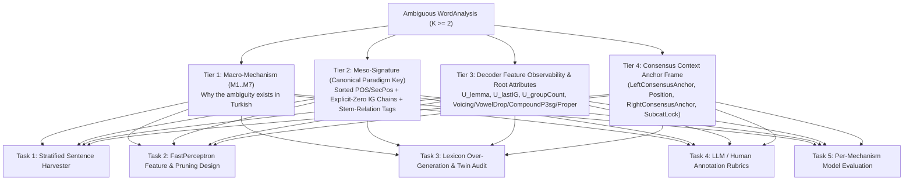

# Turkish Morphological Ambiguity Taxonomy & Multi-Task Profiling Architecture (`ZAS-v3`)

- **Reference Legacy Data**: `~/data/turkish/zemberek_shared/` (`ambiguity_groups_empty_visible(1).txt`, `ambiguity_groups.txt`, `significant-bigrams.txt`, `unambiguous_bigrams.txt`, `unambiguous_trigrams.txt`, `no_parse.txt`, Dec 2012)
- **Target Refined Corpus**: `~/data/turkish/refined/` (`127,645,345` clean sentences, `1,277,763,410` parseable words, `819,786,514` ambiguous words)
- **Document Location**: [`experiment/docs/model/TURKISH_AMBIGUITY_TAXONOMY_PROPOSAL.md`](experiment/docs/model/TURKISH_AMBIGUITY_TAXONOMY_PROPOSAL.md)

---

## 1. Forensic Review of the 2012 `zemberek_shared` Files

In `~/data/turkish/zemberek_shared/`, your 2012 analysis over a `5.73M`-word corpus produced four interconnected artifacts:
1. **`ambiguity_groups_empty_visible(1).txt` & `ambiguity_groups.txt`**:
   - Grouped surface tokens by their candidate tag chains (`[(PrimaryPos,SecondaryPos;InflectionalMorphemes)(DerivedPos;DerivedMorphemes)]`), stripping out the lemma.
   - `ambiguity_groups_empty_visible(1).txt` made default/zero nominal morphemes explicit (`A3sg+Pnon+Nom` rather than empty `(Noun;)`), which was essential for distinguishing bare nouns from stems.
2. **`significant-bigrams.txt`**:
   - Listed high-frequency immediate left/right surface word bigrams for the top ambiguity groups (e.g., `önemli bir`, `bir şekilde`).
3. **`unambiguous_bigrams.txt` & `unambiguous_trigrams.txt`**:
   - Extracted n-grams where every word had a single morphological parse (`söz konusu`, `bugüne kadar`, `meydana geldi`).

### Five Limitations in the 2012 Format We Must Overcome

1. **Order-Sensitive Group Keys Split Identical Paradigms**:
   - Candidate tag strings were concatenated in the order emitted by Zemberek's morphotactic graph rather than sorted canonically:
     - `[(Noun;A3sg+Pnon+Acc)] / [(Noun;A3sg+P3sg+Nom)]` (`58,071`: `grubu`, `sonucu`, `sistemi`) was separated from `[(Noun;A3sg+P3sg+Nom)] / [(Noun;A3sg+Pnon+Acc)]` (`30,648`: `sahibi`, `fiyatı`, `adı`).
     - `Gen / P2sg` (`19,799`) was separated from `P2sg / Gen` (`13,128`).
     - `[(Adj)] / [(Adv)]` (`17,777`) was separated from `[(Adv)] / [(Adj)]` (`13,244`).
2. **Lemma & Stem-Boundary Blindness (Same-Tag Root Collisions Were Invisible)**:
   - Stripping the lemma completely meant two candidates with **different roots/stems** that produced the **exact same POS+IG tag** either collapsed or looked like duplicate tags:
     - *Circumflex / Orthographic Twins*: `kar` ("snow", `Noun;A3sg+Pnon+Nom`) vs. `kâr` ("profit", `Noun;A3sg+Pnon+Nom`).
     - *CompoundP3sg Twins*: `zeytinyağı` (`zeytinyağı_Noun;A3sg+Pnon+Nom` vs. `zeytinyağ_Noun;A3sg+P3sg+Nom`).
     - *Lexicalized Voice vs. Productive Voice*: `belirterek` (`belir-t-erek` [`lemma=belirmek`, Causative] vs. `belirt-erek` [`lemma=belirtmek`]), where both end in `[Adv;ByDoingSo]`.
     - *Stem-Suffix Collisions*: `karın` (`kar+P2sg` "your snow" vs. `karı+P2sg` "your wife" — both `Noun;A3sg+P2sg+Nom` — vs. `karın+Nom` "abdomen").
3. **Conflation of Closed-Class Function Words with Open-Class Productive Paradigms**:
   - Group #1 (`3.92%`) is a single word (`bir`), Group #3 (`2.81%`) is 3 words (`bu`, `şu`, `o`), and Group #5 (`1.43%`) is 2 words (`de`, `da`), whereas Group #4 (`Acc` vs `P3sg+Nom`, `3.15%` combined) spans **40,000+ open-class nouns**.
4. **Unused Native Zemberek Lexicon & Token Metadata**:
   - Modern Zemberek exposes [`RootAttribute`](core/src/main/java/zemberek/core/turkish/RootAttribute.java) (`Voicing`, `LastVowelDrop`, `Doubling`, `CompoundP3sg`, `CompoundP3sgRoot`, `InverseHarmony`, `Runtime`, `Ext`), [`SecondaryPos`](core/src/main/java/zemberek/core/turkish/SecondaryPos.java) (including postposition case government `PCDat`, `PCAbl`, `PCIns`, `PCNom`, `PCGen`, plus `ProperNoun`, `Time`, `Demons`, `Pers`, `Quant`, `Ques`, `Card`, `Ord`), and [`Token.Type`](tokenization/src/main/java/zemberek/tokenization/Token.java).
5. **Surface Bigrams Instead of Consensus Morphosyntactic Context Frames**:
   - Surface word bigrams (`significant-bigrams.txt`) do not generalize across open-class nouns/verbs, and requiring neighbors to be 100% unambiguous (`K == 1`, `35.84%` of tokens) misses the additional **`~40%` of neighbor tokens that are partially unambiguous (Consensus-Anchored)**—i.e., tokens with $K \ge 2$ analyses where *all* candidates agree on their final POS or case suffix (e.g., every analysis of `aldığını` is a `Verb` participle ending in `+P3sg+Acc`, and every analysis of `Ankara'nın` ends in `+Gen`).

---

## 2. Reassessing Your Hypothesis & Connecting It to `FastPerceptronAmbiguityResolver`

### 2.1 Why Profiling Ambiguity Types Is Essential for Training Set Selection
Random sentence selection from a corpus falls into a **Double Zipfian Trap**:
1. **Cross-Signature Zipf Skew**: ~20 closed-class words (`bir`, `bu`, `de/da`, `için`, `ile`, `o`, `ne`, `gibi`, `kadar`, `daha`, `çok`, `var`) account for ~35%–40% of all ambiguous token occurrences. Random sampling wastes annotation capacity repeating `bir` and `bu` thousands of times while under-sampling hundreds of medium-frequency grammatical ambiguities.
2. **Intra-Signature Sense Skew (Majority-Sense Collapse)**: Even within a high-frequency open-class ambiguity like `Noun;A3sg+P3sg+Nom || Noun;A3sg+Pnon+Acc`, natural text is ~78% `P3sg+Nom` (possessive/compound head) and only ~22% `Acc` (bare direct object). Sampling by ambiguity frequency alone without **syntactic context stratification** causes the model to over-predict the majority tag whenever the context is nontrivial.

### 2.2 The Mathematical Link to `FastPerceptronAmbiguityResolver` (Feature Discriminability)
A crucial insight emerges when we inspect the exact feature templates in [`FastPerceptronAmbiguityResolver.java`](morphology/src/main/java/zemberek/morphology/ambiguity/fast/FastPerceptronAmbiguityResolver.java):

| Feature Group in `FastPerceptronAmbiguityResolver` | Exact Template | Depends on `lemma`? | Depends on `rIg` (Full IG Chain)? | Depends on `lastGroup` (Final IG)? |
| :--- | :--- | :---: | :---: | :---: |
| **Unigram Lexical + Full IG** | `F4: 4:<lemma>+<igJoined>` | **Yes** | **Yes** | Yes |
| **Unigram Lemma** | `F10: 10:<lemma>`, `10b`, `10c` | **Yes** | No | No |
| **Unigram IG Position & Count** | `F20: 20:<k>-<ig_k>`, `F22: 22:<groupCount>` | No | **Yes** | Yes |
| **Bigram & Skip-Trigram Lexical+IG** | `F2: 2:<w1.rIg>-<w3.rIg>`, `F3: 3:<w2.rIg>-<w3.rIg>`, `F9: 9:<w2.lemma>-<w3.lemma>` | **Yes** | **Yes** | Yes |
| **Bigram & Trigram Morphotactic** | `F15: 15:<w1.lastGroup>-<w2.lastGroup>-<w3.ig>`, `F17: 17:<w2.lastGroup>-<w3.ig>` | **No** | On $w_3$ only | **On $w_1, w_2$ (`lastGroup` only!)** |
| **Surface Orthographic Rules** | `P:PROPER`, `P:INIT_PROPER:<lemma>`, `P:LOWER_PROPER`, `P:ENDSVERB` | Partial | No | `PrimaryPos.Verb` / `ProperNoun` |

Look at what this table reveals about how `FastPerceptronAmbiguityResolver` scores competing candidates $c_1, \dots, c_K$ of word $w_t$:

1. **When all candidates of $w_t$ share the same `lemma` ($U_{\text{lemma}} = 1$, e.g., `kararı`, `evleri`, `olduğu`, `yapma`)**:
   - Features `F9`, `F10`, `F10b`, `F10c`, `P:PROPER:<lemma>`, and `P:INIT_PROPER:<lemma>` produce the **exact same constant value** for every candidate of $w_t$! Their net score difference between $c_1$ and $c_2$ is **identically zero (`0.0`)**.
   - Furthermore, because `F2`, `F3`, and `F4` are lexicalized on `lemma+igs`, they only fire if that exact noun/verb lemma was seen during training. For any unseen or low-frequency open-class noun/verb, **100% of the disambiguation signal comes from the unlexicalized features `F15`, `F17`, `F20`, `F22`!**
2. **When two candidates of $w_t$ have the same `lastGroup` ($U_{\text{lastIG}} < K$, e.g., `belirterek` [`belir+Caus+ByDoingSo` vs `belirt+ByDoingSo`], `kar` vs `kâr`, `zeytinyağı` compound twins)**:
   - When the decoder advances to $w_{t+1}$ and $w_{t+2}$, the unlexicalized transition features `F15` and `F17` only inspect `w_t.lastGroup`! Because `w_t.lastGroup` is identical (`Adv+ByDoingSo` or `Noun+A3sg+Pnon+Nom`), **the right-context morphotactic transitions `F15` and `F17` at $t+1$ and $t+2$ have zero discriminative power (`0.0` difference) between those candidates!**
3. **When disambiguating $w_t$ requires right-context syntax ($w_{t+1}, w_{t+2}$) on unseen open-class words**:
   - In the current decoder, when stepping from $w_t$ to $w_{t+1}$, `F17` scores `17:<w_t.lastGroup>-<w_{t+1}.ig>` and `F15` scores `15:<w_{t-1}.lastGroup>-<w_t.lastGroup>-<w_{t+1}.ig>`. That means `FastPerceptronAmbiguityResolver` **does** capture unlexicalized 1-token and 2-token right context via Viterbi lookahead at $t+1$ and $t+2$—**provided** the training set contains sentences where the right-context transition `(w_t.lastGroup, w_{t+1}.lastGroup, w_{t+2}.ig)` was observed!

---

## 3. Enriched Multi-Task Architecture: Zemberek Ambiguity Signature v3 (`ZAS-v3`)

To make our ambiguity analysis useful across **all five downstream tasks** (1. Training/Test Sentence Selection, 2. Feature/Decoder Engineering, 3. Safe Candidate Pruning & Lexicon Cleanup, 4. LLM/Human Annotation Guidance, and 5. Per-Class Model Benchmarking), we define a **3-Tier Signature + Consensus Context Architecture (`ZAS-v3`)**:



---

### Tier 1: The 7 Macro-Mechanisms of Turkish Ambiguity (`MacroMechanism`)

Every ambiguous token ($K \ge 2$) is deterministically classified by inspecting `sa.getDictionaryItem()`, `sa.getStem()`, `sa.groupCount()`, and `sa.getGroup(g)` across its $K$ candidates:

| ID | Macro-Mechanism | Native Zemberek Condition | Linguistic & Model Meaning | Canonical Examples |
| :--- | :--- | :--- | :--- | :--- |
| **`M1_INFLECTIONAL_SYNCRETISM`** | Pure Inflectional Suffix Syncretism | Same `DictionaryItem` (`U_item = 1`), same `groupCount` and intermediate group POSs | Suffix homophony (`-I`, `-In`, `-lArI`, `-dI`, `-dAn`). Lemma features (`F9`/`F10`) cancel out (`0.0`); 100% resolved by `F15`/`F17`/`F20` context transitions. | `kararı` (`Acc` vs `P3sg`), `evin` (`Gen` vs `P2sg`), `evleri` (4-way `-lArI`) |
| **`M2_DERIVATIONAL_SHIFT`** | Derivational vs. Inflectional / Participle Shift | Same `DictionaryItem` (`U_item = 1`), different `groupCount()` or different derived group `PrimaryPos` | Suffix changes word class (`Verb|PastPart->Adj` vs `Noun`, `Verb+Neg+Imp` vs `Verb|Inf2->Noun`). Resolved by syntactic role of final IG (`lastGroup`). | `olduğu` (`Adj` vs `Noun+Acc/P3sg`), `yapma` (`Neg+Imp` vs `Inf2`), `gider` |
| **`M3_LEXICAL_POS_POLYSEMY`** | Zero-Derivation / Functional Category Shift | Different `DictionaryItem`s, identical normalized `lemma` and `getStem()`, different `primaryPos` or `secondaryPos` (excluding `ProperNoun`) | Same word listed under multiple POS tags in lexicon (`Adj`/`Noun`, `Adj`/`Adv`, `Det`/`Pron`, `Adv`/`Noun,Time`). | `büyük` (`Adj`/`Noun`), `bir` (`Det`/`Num`/`Adv`/`Adj`), `bu` (`Det`/`Pron`), `sabah` (`Adv`/`Noun,Time`) |
| **`M4_PROPER_VS_COMMON`** | Proper Noun vs. Common Word Collision | Different `DictionaryItem`s where $\ge 1$ has `SecondaryPos.ProperNoun` or `Abbreviation` and $\ge 1$ does not | Capitalized words (especially sentence-initial or titles) that are both proper names and common nouns/verbs/adjectives. Governed by `P:PROPER`, `P:INIT_PROPER`, and context. | `Ocak`, `Dünya`, `Gül`, `Barış`, `Türk`, `Bakanlığı`, `Hanım` |
| **`M5_STEM_SUFFIX_COLLISION`** | Stem-Boundary Split (Root vs. Suffix) | Different `DictionaryItem`s with **different stem lengths** (`getStem().length()`), non-Proper | Part of the root in Candidate A is analyzed as a suffix in Candidate B:<ul><li>**`M5a_VOICE_LEXICALIZED`**: Same final IG (`belir-t-erek` vs `belirt-erek`, `kal-dır-dı` vs `kaldır-dı`) — **`F15`/`F17` are blind!**</li><li>**`M5b_CROSS_POS_SPLIT`**: Different final IG (`koy+un` vs `koyun`, `yaş+a+ma` vs `yaşa+ma`, `iç+in` vs `için`)</li></ul> | `belirterek`, `kaldırdı`, `koyun`, `boyun`, `yaşama`, `için`, `göre` |
| **`M6_ROOT_HOMONYMY_AND_TWINS`** | Same-Length Root Homonymy & Lexicon Twins | Different `DictionaryItem`s with **identical stem length** (`getStem().length()`), different `lemma`/`root` or duplicate POS, non-Proper | <ul><li>**`M6a_HOMONYM_DIFF_POS`**: Unrelated homonymous roots (`yüz` [`Num`/`Noun`/`Verb`], `bin`, `var`, `at`, `al`)</li><li>**`M6b_ORTHO_OR_COMPOUND_TWIN`**: Circumflex twins (`kar`/`kâr`, `hala`/`hâlâ`), `CompoundP3sg` twins (`zeytinyağı`), `LastVowelDrop` twins (`oğul`/`oğul`)</li></ul> | `yüz`, `var`, `bin`, `kar`/`kâr`, `hala`/`hâlâ`, `zeytinyağı` |
| **`M7_HYBRID_MULTI_LOCUS`** | Multi-Locus Compound Ambiguity | Combines root/POS collision (`M3`–`M6`) with inflectional/derivational syncretism (`M1`–`M2`) across $\ge 3$ candidates | High-branching tokens ($K \ge 3$) where both root selection and suffix syncretism must be solved simultaneously. | `yaşı` (`yaş_Noun+Acc/P3sg` vs `yaş_Adj->Noun+Acc/P3sg` vs `yaşı_Verb`), `biri` |

---

### Tier 2: Canonical Meso-Signature (`MesoSignature`)

For each candidate `SingleAnalysis sa` in a `WordAnalysis`, we build a canonical morphemics string that preserves **all** morphosyntactic information while normalizing away root-specific lexicon IDs:

```text
<StemRel><PrimaryPos>(,<SecondaryPos>):<IG_0_Morphemes>[ -> <DerivedPos>:<IG_k_Morphemes>]*
```

1. **Explicit Zero Morphemes (`empty_visible` rule)**:
   - Every `MorphemeGroup` outputs its full morpheme sequence (`A3sg+Pnon+Nom`, `Pos+Imp+A2sg`), never hiding default morphemes.
2. **Explicit `<StemRel>` Prefix When Candidates Diverge in Stem or DictionaryItem**:
   - If all candidates come from the **same `DictionaryItem`** (`M1` and `M2`): `<StemRel>` is empty (e.g., `Noun:A3sg+P3sg+Nom || Noun:A3sg+Pnon+Acc`).
   - If candidates come from **different `DictionaryItem`s** (`M3`–`M7`):
     - Let $L_{\max} = \max_i \text{sa}_i.\text{getStem().length()}$.
     - If $\text{sa}_i.\text{getStem().length()} < L_{\max}$, prefix with `STEM(-d)|` where $d = L_{\max} - \text{sa}_i.\text{getStem().length()}$ (e.g., for `koyun`, `koyun_Noun` has `STEM(0)|Noun:A3sg+Pnon+Nom`, while `koy_Verb+Imp+A2pl` has `STEM(-2)|Verb:Pos+Imp+A2pl` and `koy_Noun+Gen` has `STEM(-2)|Noun:A3sg+Pnon+Gen`).
     - If two candidates have the exact same `<StemRel>` and `<POS:IG>` string (which happens on `kar` vs `kâr` or `CompoundP3sg` twins!), append `@CIRC` (if lemma contains `â/î/û`), `@COMP_P3SG` (if `RootAttribute.CompoundP3sg`), `@VOWEL_DROP` (if `RootAttribute.LastVowelDrop`), or `@ALT_ROOT` so they **never** collide into an identical string.
3. **Canonical Sorting**:
   - Sort all $K$ candidate strings lexicographically and join with ` || `.

---

### Tier 3: Decoder Feature Observability & Lexicon Attribute Profile (`ObservabilityProfile`)

Attached to every `MesoSignature` in the catalog are exact model-diagnostic fields:
- **`candidateCount` ($K$)**: Number of competing analyses.
- **`uniqueItems` ($U_{\text{item}}$)**: Number of distinct `DictionaryItem`s.
- **`uniqueLemmas` ($U_{\text{lemma}}$)**: Number of distinct `item.lemma` strings.
- **`uniqueLastGroups` ($U_{\text{lastIG}}$)**: Number of distinct `lastGroup` strings (as seen by `FastPerceptronAmbiguityResolver`'s `F15` and `F17` features!).
- **`observabilityClass`**:
  - `FULL_MORPHO_OBSERVABLE` ($U_{\text{lastIG}} == K$): Every candidate has a distinct `lastGroup`; `F15` and `F17` can distinguish all $K$ candidates using unlexicalized context transitions.
  - `PARTIAL_MORPHO_OBSERVABLE` ($1 < U_{\text{lastIG}} < K$): `F15`/`F17` narrow down the candidates to a subset, after which `F2`/`F3`/`F4`/`F20` must break the tie.
  - `LEXICAL_ONLY_OBSERVABLE` ($U_{\text{lastIG}} == 1$): All $K$ candidates have the **exact same `lastGroup`**! `F15` and `F17` cannot distinguish them at all; resolution depends 100% on `F2`/`F3`/`F4`/`F9`/`F10`/`F20`/`F22`.
- **`activeRootAttributes`**: Counts of `Voicing`, `LastVowelDrop`, `Doubling`, `CompoundP3sg`, `InverseHarmony`, `Runtime`, `Ext` across tokens in this group.

---

### Tier 4: Consensus Context Anchor Frames (`ConsensusAnchorFrame`) — Extracting Certain Context Without a Disambiguator

In your 2012 work, `unambiguous_bigrams.txt` used words with $K = 1$ (`35.84%` of tokens). We can dramatically expand context coverage **without using any disambiguator** via **Candidate Consensus Intersection**:

For any neighbor token $w_{t-1}$ or $w_{t+1}$ (even when it has $K \ge 2$ analyses!):
1. **Exact Unambiguous Neighbor (`K == 1`, `35.84%` of words)**:
   - Its `PrimaryPos`, `SecondaryPos`, and final case/inflectional tag are 100% known (`e.g., Det`, `Conj`, `Noun:Gen`, `Postp,PCDat`).
2. **Consensus-POS / Consensus-Case Neighbor (`K >= 2`, an additional `~40%` of words!)**:
   - Compute the intersection of `finalPos = sa.getGroup(sa.groupCount() - 1).getPos()` and `lastMorpheme = sa.getMorphemes().get(last)` across all $K$ analyses of the neighbor:
   - Example 1: `Ankara'nın` has multiple proper-noun analyses (`Place`, `Org`, etc.), but **100% of its analyses** have `finalPos = Noun` and `lastMorpheme = Gen`! So its consensus anchor is `CONS:Noun:Gen` with **100% certainty**!
   - Example 2: `aldığını` has multiple participle analyses, but **100% of its analyses** start with `rootPos = Verb`, contain `PastPart`, and end in `Acc`!
   - Example 3: `göre` has `Postp,PCDat` vs `gör+Opt`, while `rağmen`, `dolayı`, `itibaren`, `birlikte` are 100% `Postp,PCDat` / `PCAbl` / `PCIns`!
3. **Sentence Boundary Anchors (`<S>` at $t=0$, `</S>` at $t=n-1$, `PRE_</S>` at $t=n-2$)**:
   - 100% deterministic.

Combining `(LeftConsensusAnchor, PositionRole, RightConsensusAnchor)` gives every ambiguous token a **high-certainty syntactic context frame** without running any disambiguator!

---

## 4. Concrete Multi-Task Applications of `ZAS-v3`

### Application 1: Submodular / Stratified Training & Test Sentence Selection
When selecting $N$ training sentences (e.g., $N = 50,000$ or $100,000$) from the `127.6M` refined sentences in `~/data/turkish/refined`:
- Instead of sampling sentences at random, we allocate sentence quotas across `MesoSignature`s using **Square-Root Smoothed Frequency ($\propto \sqrt{\text{count}}$)** so head patterns don't drown out medium-frequency patterns:
  - For **`OPEN_PARADIGM`** signatures (`uniqueLemmas > 50`, `M1`/`M2`/`M3`): stratify the quota across distinct **`(LeftConsensusAnchor, RightConsensusAnchor)` frames** (e.g., ensuring `Noun:Acc || Noun:P3sg` is sampled both when preceded by `Noun:Gen` + followed by `Verb:Finite`, and when preceded by `Det` + followed by `Verb:PastPart+P3sg+Acc`).
  - For **`CLOSED_LEXICAL`** and **`M4/M5/M6` Root-Collision** signatures (`uniqueLemmas <= 50` or `LEXICAL_ONLY_OBSERVABLE`): stratify the quota across **`(Lemma × ConsensusAnchorFrame)`** so every competing root (`yüz`, `yaş`, `koyun`, `belirterek`, `Ocak`, `kar/kâr`) gets balanced contextual exemplars.

### Application 2: Guided Feature Engineering for `FastPerceptronAmbiguityResolver`
The `ObservabilityProfile` directly tests whether `FastPerceptronAmbiguityResolver` needs any new low-cost features:
- If `LEXICAL_ONLY_OBSERVABLE` groups (`M5a_VOICE_LEXICALIZED` like `belirterek`, `M6b` like `CompoundP3sg`) represent a significant share of errors or corpus ambiguities, we know immediately that `F15`/`F17` cannot see them because `lastGroup` only includes the *last* IG (`sa.getGroup(groupCount - 1)`), not `groupCount` or `igJoined`.
- If `M1_INFLECTIONAL_SYNCRETISM` (`Acc` vs `P3sg`, `-lArI`) has high entropy across `RightConsensusAnchor` frames (`Verb:PastPart+P3sg` vs `Verb:Finite`), we can quantify how much 1-token vs 2-token lookahead (`F17` vs `F15`) resolves them.

### Application 3: Deterministic Lexicon Twin & Over-Generation Audit
The profiler automatically outputs a dedicated table of **`LEXICAL_ONLY_OBSERVABLE` Twins** (`@COMP_P3SG`, `@CIRC`, `M5a_VOICE_LEXICALIZED`):
- Whenever Zemberek's lexicon generates two analyses for the same word where one is a productive voice derivation of a root (`belir+Caus`, `kal+Caus`, `boz+Pass`) and the other is a separate lexicalized dictionary entry (`belirt`, `kaldır`, `bozul`) with identical surface semantics and identical `lastGroup`, we get an exact list of all such lemmas in the corpus so we can canonicalize them cleanly.
