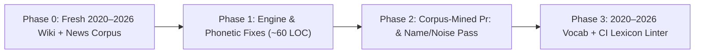

# Zemberek Lexicon Audit & Modernization Report (Beyond PR `#386`)

## Executive Summary

To evaluate Zemberek's lexicon **after** applying `ahmetaa`'s PR `#386` (*Dictionary audit and modern words*) **plus** the 5 bug fixes from [PR386_DICTIONARY_AUDIT_REVIEW.md](PR386_DICTIONARY_AUDIT_REVIEW.md), we audited **all `20` resource files** in `morphology/src/main/resources/tr/`, ran a **self-parse test across all `68,035` lexicon items**, and scanned **`270,000` clean Turkish sentences** (`4.46M` tokens):
- **`200,000` formal sentences** (`www.cnnturk.com.txt`, `www.dunya.com.txt`, `www.haberturk.com.txt`, `www.defenceturk.com.txt`, `vikipedi.txt` — *note: these formal dumps on disk date to ~2015–2018*).
- **`70,000` LLM-cleaned normalization sentences** (`noisy_tr_v2/full_110k/general/`), of which **`~25,000` (`36%`) come from genuinely 2020–2025 public HuggingFace datasets** (`trendyol_2025`, `eksisozluk_2024`, `eksisozluk_2025_tech` & `finance`, `ForumSohbetleri` / `donanimarsivi`, `offenseval2020`, `winvoker`, `sikayetler`) and **`~45,000` (`64%`)** come from older local forums.

### Headline Takeaways

1. **PR `#386` Only Audited Half of `lexicon.bin`**:
   - PR `#386` audited `master-dictionary.dict`, `non-tdk.dict`, and `abbreviations.dict` (`~34.1K` entries), **leaving the other half of `lexicon.bin` (`~33.0K` entries across `proper.dict`, `proper-from-corpus.dict`, and `person-names.dict`) completely untouched since 2018**.
2. **Being in `proper-from-corpus.dict` *Without* `[Pr:...]` Actively Breaks Foreign Names & Brands**:
   - Out of **`28,611` proper nouns** (`proper.dict` + `proper-from-corpus.dict` = **42% of `lexicon.bin`**), **only `27` (`0.09%`) have a `Pr:` pronunciation tag**.
   - As a result, **`Trump`**, **`Biden`**, **`Musk`**, **`Google`**, **`Apple`**, **`Youtube`**, **`Iphone`**, **`Netflix`**, **`Spotify`**, **`Cambridge`**, **`Shakespeare`**, **`Starbucks`**, **`Peugeot`**, and **`Renault`** ARE in `lexicon.bin`, yet Zemberek **rejects their actual Turkish inflected forms** (`Trump'ın` `#1` failing apostrophe word in Turkish news with `231` hits, `Google'da`, `Apple'ın`, `YouTube'dan`, `iPhone'un`, `Netflix'te`, `Spotify'da`, `Biden'ın`, `Musk'ın`) because it infers vowel/consonant harmony from raw English/French spelling (`*Trump'un`, `*Google'de`, `*Apple'nin`, `*Netflix'de`, `*Biden'in`)!
3. **`person-names.dict` Lost Collateral-Damage Names (`Salih`, `Ecrin`, `Elif`, `Kerem`) During a 2018 Disambiguation Prune**:
   - In commit `cc81cfd2` (`2018-06-26`), `person-names.dict` was pruned from `~6,943` entries to `4,383` alongside a disambiguation update because `RuleBasedAnalyzer` emits `[X:Noun,Prop]` candidates even on lowercase mid-sentence words, so common-noun names (`Su`, `Gül`, `Deniz`, `Yağmur`, `Ada`, `Eylül`) confused the legacy disambiguator.
   - However, that prune also wiped out **non-clashing / archaic-collision Turkish given names** — most notably **`Salih` (`NO_PARSE`, `81` corpus OOV hits!)**, **`Ecrin` (parsed only as archaic `ecir+in` "of reward"!)**, **`Elif`**, and **`Kerem`** — while `proper.dict` is also missing `6` Büyükşehir central districts (`Kahramankazan` `NO_PARSE`, `Karesi`, `Efeler`, `Şehzadeler`, `Menteşe`, `Kapaklı`).
4. **Six Small Engine/Phonetic Bugs Block Thousands of Valid Tokens**:
   - **`31` dictionary entries fail to parse their own lemma** (`morph.analyze(item.lemma) == NO_PARSE`), including **all `19` hyphenated lemmas** (`e-posta`, `sıfat-fiil`, `zarf-fiil`, `Hint-Avrupa`, `Ural-Altay`, `part-time`) and `LocaleEn` uppercase ASCII-`I` acronyms (`API`, `AI`, `GIF`, `PIN`, `WIFI`).
   - **100% of `-x` proper nouns** (`Netflix`, `Linux`, `Firefox`, `Yandex`, `Ajax`, `SpaceX`) reject `-ta/-te/-tan/-ten` because `'x'` is not mapped to voiceless `/ks/`.
   - **TDK's own official `-K` acronym rule (`TDK'nin`, `TSK'nin`, `BJK'nin`)** returns `NO_PARSE` because `PronunciationGuesser.java` (`L47`) hardcodes `K → "ka"`.
   - **19 of the 24 hours of TDK `.00` clock times** (`20.00'de`, `15.00'te`, `21.00'de`) return `NO_PARSE` because `.00` is read as `"sıfır"` (`*20.00'da`, `*15.00'da`) instead of the hour.

---

## Complete Inventory of All `20` Resource Files in `morphology/src/main/resources/tr/`

> [!NOTE]
> **How Runtime & Informal Mode Actually Load Resources:**
> - **Default runtime (`TurkishMorphology.createWithDefaults()`)** deserializes **only `tr/lexicon.bin`** (plus `turkish-letter-names.txt` and `turkish-ordinal-numbers.txt` for `UnidentifiedTokenAnalyzer`, and lazily `model_10k_argon_v24.bin` when disambiguating). It **never** parses `.dict` text files at runtime, even though the 6 raw `.dict` files (`~798 KiB`) are also packaged inside `zemberek-morphology.jar`.
> - **Informal mode (`TurkishMorphology.builder().useInformalAnalysis().build()`)** swaps `TurkishMorphotactics` for `InformalTurkishMorphotactics` (`-Iyo`, `-ycAk`, `-yom`, `-cam`, `-mIcAk`, `-yAk`) **purely in Java code on top of `lexicon.bin`**. It loads **zero extra resource files** (`tr/informal.dict` is completely unused).

| # | Resource Path (`tr/...`) | Entries / Lines | Size | Role in Morphological Analysis | `Pr:` Tags | Last Updated | Audit Notes |
| :-: | :--- | ---: | ---: | :--- | ---: | :---: | :--- |
| **A** | **Actively Loaded at Runtime (`4` files)** | | | | | | |
| 1 | `lexicon.bin` | `67,750` items (`68,035` in `#386`) | `1,238.0 KiB` | **Primary runtime lexicon** (`RootLexicon.getDefault()` in `RootLexicon.java:259`) | — | Nov 2026 | Protobuf bundle compiled offline from files `#5–#10` |
| 2 | `ambiguity/model_10k_argon_v24.bin` | binary | `2,215.6 KiB` | **Default disambiguation model** (`FastPerceptronAmbiguityResolver.java:45`) | — | Nov 2026 | Loaded lazily on `disambiguate()` / `analyzeAndDisambiguate()` |
| 3 | `phonetics/turkish-letter-names.txt` | `32` | `0.2 KiB` | **Runtime OOV/abbrv phonetics** (`PronunciationGuesser.java:19`) | — | May 2018 | Spells out vowelless/alphanumeric stems (`PTT'den`, `F16'dan`) |
| 4 | `turkish-ordinal-numbers.txt` | `25` | `0.4 KiB` | **Runtime ordinal suffixes** (`TurkishNumbers.java:64`) | — | Apr 2018 | Used by `UnidentifiedTokenAnalyzer` (`2.'si`, `5'inci`) |
| **B** | **Offline Text Sources Compiled Into `lexicon.bin` (`6` files, `~798 KiB` in JAR)** | | | | | | |
| 5 | `master-dictionary.dict` | `28,876` | `360.1 KiB` | Offline source #1 (`DEFAULT_DICTIONARY_RESOURCES`) | `3` | Nov 2026 (`#386`) | Audited in `#386`; needs 5 bug fixes + science/circumflex pass |
| 6 | `non-tdk.dict` | `3,467` | `86.7 KiB` | Offline source #2 (`DEFAULT_DICTIONARY_RESOURCES`) | `10` | Nov 2026 (`#386`) | Audited in `#386`; missing `anakart`, `kargolamak`, `covid`, `spam` |
| 7 | `proper.dict` | `1,921` | `20.8 KiB` | Offline source #3 (`DEFAULT_DICTIONARY_RESOURCES`) | **`0`** | **Jun 2018** | **Untouched 8+ yrs**; `0` `Pr:` tags; missing modern brands & districts |
| 8 | `proper-from-corpus.dict` | `26,690` | `209.9 KiB` | Offline source #4 (`DEFAULT_DICTIONARY_RESOURCES`) | **`27`** | **Oct 2018** | **40% of `lexicon.bin`!** `99.9%` lack `Pr:`; has English stopwords & `Googleın` |
| 9 | `abbreviations.dict` | `1,478` | `23.3 KiB` | Offline source #5 (`DEFAULT_DICTIONARY_RESOURCES`) | `207` | Nov 2026 (`#386`) | Missing `BİM`, `OHAL` harmony, `-K` `ke` forms, `yy`, hardware acronyms |
| 10 | `person-names.dict` | `4,383` | `96.9 KiB` | Offline source #6 (`DEFAULT_DICTIONARY_RESOURCES`) | **`0`** | **Jun 2018** | **Untouched 8+ yrs** (`cc81cfd2`); missing `Salih`, `Ecrin`, `Elif`, `Kerem` |
| **C** | **Loaded Into `static` Maps at Startup, Never Read (`2` files — Dead Code)** | | | | | | |
| 11 | `phonetics/english-letter-names.txt` | `26` | `0.2 KiB` | Loaded on `PronunciationGuesser.java:20`, **0 reads** | — | May 2018 | `englishLetterProns` map is private and never referenced |
| 12 | `phonetics/english-phones-to-turkish.txt` | `69` | `0.5 KiB` | Loaded on `PronunciationGuesser.java:21`, **0 reads** | — | May 2018 | `englishPhonesToTurkish` map is private and never referenced |
| **D** | **Completely Unreferenced Anywhere in Runtime or Build (`8` files — `~381 KiB` Dead Weight)** | | | | | | |
| 13 | `locations-tr.dict` | `27,813` | `283.2 KiB` | **Unused** (`0` references in `core`/`morphology`/`ner`/`apps`) | `0` | Oct 2018 | Turkish towns/villages; ships unused inside `zemberek-morphology.jar` |
| 14 | `first-10K` | `10,000` | `86.0 KiB` | **Unused** (`0` references anywhere in repo) | — | Mar 2018 | Frequency list; safe to move to `experiment/` |
| 15 | `tdk-obsolete.dict` | `555` | `7.1 KiB` | **Unused** (`0` code references; header `# Do not use it fo r now.`) | `0` | Apr 2018 | Old circumflex spellings (`kanunî`, `kamuflâj`, `katî`) |
| 16 | `proper-ignore` | `203` | `1.9 KiB` | **Unused** (`0` main/test references outside old scratchpad) | — | Jan 2017 | Old filter list (`Appleın`, etc.) from corpus proper-noun harvesting |
| 17 | `informal.dict` | `46` | `1.4 KiB` | **Unused** (`0` loader calls; **not** used by `useInformalAnalysis()`) | `0` | Nov 2018 | Mentioned only in a comment in `RootAttribute.java` |
| 18 | `phonetics/turkish-letter-pronunciation.txt` | `55` | `0.5 KiB` | **Unused** (`0` references anywhere in repo) | — | Jan 2017 | Superseded by `turkish-letter-names.txt` |
| 19 | `item-groups.txt` | `27` | `0.4 KiB` | **Unused** (`0` references anywhere in repo) | — | Mar 2018 | Superseded by hardcoded lists in `TurkishMorphotactics` |
| 20 | `special-dictionary-item-root-suffix-data` | `5` | `0.3 KiB` | **Unused** (`0` references anywhere in repo) | — | Nov 2017 | Legacy root-suffix table (`su`, `ne`, etc. now handled in morphotactics) |

---

## Part 1 — Six Systemic Engine & Phonetic Bugs Beyond PR `#386`

### 1.1 The Foreign Proper-Noun `Pr:` Trap (`proper-from-corpus.dict` + `proper.dict`)

> [!IMPORTANT]
> When a foreign name or brand is in `proper-from-corpus.dict` **without** `[Pr:...]`, `TurkishDictionaryLoader.java` (`L331–333`) sets `pronunciation = cleanWord` (raw English/French spelling). That locks in the **wrong Turkish vowel and consonant harmony**, causing Zemberek to reject real Turkish suffixes across millions of sentences!

Live verification on **PR `#386` + our fixes** (`NO_PARSE` = **0 valid analyses**):

| Proper Noun in Lexicon | Stored `pronunciation` | Real Turkish Forms (**ALL FAIL!**) | Ungrammatical Forms Zemberek Demands Instead | Fix Needed |
| :--- | :--- | :--- | :--- | :--- |
| **`Trump`** (`231` corpus fails!) | `trump` (rounded `u`) | **`Trump'ın`**, **`Trump'ı`**, **`Trump'tır`** = `FAIL` | `*Trump'un`, `*Trump'u` | `Trump [Pr:tramp]` |
| **`Biden`** | `biden` (front `e`) | **`Biden'ın`**, **`Biden'a`**, **`Biden'da`** = `FAIL` | `*Biden'in`, `*Biden'e` | `Biden [Pr:baydın]` |
| **`Musk`** | `musk` (rounded `u`) | **`Musk'ın`**, **`Musk'ı`** = `FAIL` | `*Musk'un`, `*Musk'u` | `Musk [Pr:mask]` |
| **`Google`** (`191` corpus fails!) | `google` (final vowel `e`) | **`Google'da`**, **`Google'ın`**, **`Google'a`**, **`Google'dan`** = `FAIL` | `*Google'de`, `*Google'nin` | `Google [Pr:gugıl]` |
| **`Apple`** (`97` corpus fails!) | `apple` (final vowel `e`) | **`Apple'da`**, **`Apple'ın`**, **`Apple'a`** = `FAIL` | `*Apple'de`, `*Apple'nin` | `Apple [Pr:epıl]` |
| **`Youtube` / `YouTube`** (`54` fails) | `youtube` (final vowel `e`) | **`YouTube'da`**, **`YouTube'dan`**, **`YouTube'a`** = `FAIL` | `*Youtube'de`, `*Youtube'den` | `YouTube [Pr:yutub]` |
| **`Iphone` / `iPhone`** (`23` fails) | `ıphone` (`I→ı` + final `e`) | **`iPhone'da`**, **`iPhone'un`**, **`iPhone'dan`** = `FAIL` | `*Iphone'de`, `*Iphone'nin` | `iPhone [Pr:ayfon; A:LocaleEn]` |
| **`Spotify`** | `spotify` (front `i`) | **`Spotify'da`**, **`Spotify'dan`**, **`Spotify'ın`** = `FAIL` | `*Spotify'de`, `*Spotify'in` | `Spotify [Pr:spotifay]` |
| **`Nike`** | `nike` (final vowel `e`) | **`Nike'ın`**, **`Nike'ta`**, **`Nike'tan`** = `FAIL` | `*Nike'nin`, `*Nike'de` | `Nike [Pr:nayk]` |
| **`Skype`** | `skype` (final vowel `e`) | **`Skype'ta`**, **`Skype'tan`**, **`Skype'a`** = `FAIL` | `*Skype'de`, `*Skype'ye` | `Skype [Pr:skayp]` |
| **`Cambridge`** | `cambridge` (final `e`) | **`Cambridge'in`**, **`Cambridge'e`** = `FAIL` | `*Cambridge'nin`, `*Cambridge'ye` | `Cambridge [Pr:kembriç]` |
| **`Shakespeare`** (`14` fails) | `shakespeare` (final `e`) | **`Shakespeare'in`**, **`Shakespeare'e`** = `FAIL` | `*Shakespeare'nin` | `Shakespeare [Pr:şekspir]` |
| **`Starbucks`** | `starbucks` (rounded `u`) | **`Starbucks'ın`** = `FAIL` | `*Starbucks'un` | `Starbucks [Pr:starbaks]` |
| **`Peugeot` / `Renault`** | `peugeot` / `renault` (`t`) | **`Peugeot'nun`**, **`Peugeot'da`**, **`Renault'nun`** = `FAIL` | `*Peugeot'un`, `*Renault'ta` | `[Pr:pejo]`, `[Pr:reno]` |

Plus high-frequency foreign names failing in our `200K` news/Wikipedia scan for the exact same reason: `Einstein'ın (52)`, `Wittgenstein'ın (48)`, `Chomsky'nin (44)`, `Beckett'ın (35)`, `Angeles'ta (22)`, `Mercury'nin (22)`, `Reuters'ın (21)`, `Wilde'ın (21)`, `Clinton'ın (20)`, `Jackson'ın (20)`, `Michael'ın (18)`, `Saussure'ün (18)`, `United'ın (16)`, `Yellen'ın (15)`, `Beatles'ın (14)`, `Jefferson'ın (13)`.

---

### 1.2 Systemic `-x` Voicing Failure (`Netflix'te`, `Linux'ta`, `Firefox'tan`, `Yandex'te`, `Ajax'ta`)
- **Root Cause**: In Turkish, every foreign stem ending in `-x` is pronounced `/ks/` (ending in voiceless `/s/`), requiring voiceless suffixes `-ta/-te/-tan/-ten`. However, `TurkishDictionaryLoader.java` (`L331–333`) and `UnidentifiedTokenAnalyzer.java` (`L243–248`) only invoke `PronunciationGuesser` when `!alphabet.containsVowel(cleanWord)`. Because `"netflix"`, `"linux"`, `"firefox"`, `"ajax"`, `"yandex"`, `"spacex"` contain vowels, `pronunciation` keeps literal `'x'`, which is **not** in `TurkishAlphabet`'s voiceless consonant set (`ç, f, h, k, p, s, ş, t`).
- **Impact**: **100% of `-x` proper nouns** reject valid Turkish (`Netflix'te=FAIL`, `Linux'ta=FAIL`, `Firefox'tan=FAIL`, `Ajax'ta=FAIL`, `Yandex'te=FAIL`) and accept only ungrammatical `*Netflix'de`, `*Linux'da`, `*Ajax'da`!
- **1-Line Engine Fix**: Always pass foreign letters (`w → v`, `q → k`, `x → ks`) through `PronunciationGuesser.replaceEnglishSpecificChars()` when `pronunciation` is inferred.

---

### 1.3 `person-names.dict` Two-Tier Policy & Missing Büyükşehir Districts (`proper.dict`)
- **Historical Context (`cc81cfd2`, `2018-06-26`)**: `person-names.dict` was intentionally pruned from `~6,943` entries down to `4,383` during disambiguator training because `RuleBasedAnalyzer` emits `[X:Noun,Prop]` candidates even on lowercase mid-sentence occurrences, so everyday common-noun names (`Su`, `Gül`, `Deniz`, `Yağmur`, `Ada`, `Eylül`) created heavy POS ambiguity.
- **Clean Two-Tier Policy Going Forward**:
  1. **Tier A — Safe Collateral-Damage Restorations (`person-names.dict`)**: Restore popular Turkish given names that have **zero** or **archaic-only** common-noun usage — specifically **`Salih` (`NO_PARSE` everywhere, `81` corpus failures!)**, **`Ecrin` (currently misanalyzed only as archaic `ecir+in` "of reward")**, **`Elif` (`elif` only denotes the Arabic letter)**, and **`Kerem`** — verifying zero regression on UD BOUN/IMST and Golden disambiguation sets.
  2. **Tier B — Common-Noun Homographs (`Deniz`, `Yağmur`, `Barış`, `Eylül`, `Doğa`, `Ada`, `Masal`, `Su`, `Kaya`)**: Keep excluded from `person-names.dict` by default (unless explicitly validated against `model_10k_argon_v24`), since `TurkishMorphology` (`shouldAddProperNounForApostrophe`) already synthesizes `Noun,Prop` dynamically whenever they carry an apostrophe (`"Deniz'in"`, `"Barış'a"`).
  3. **Missing Turkish Districts (`proper.dict`)**: Add **`Kahramankazan`** (`NO_PARSE`, renamed from Kazan in late 2016) and evaluate Büyükşehir central districts (`Karesi`, `Efeler`, `Şehzadeler`, `Menteşe`, `Kapaklı`).

---

### 1.4 `31` Dictionary Items That Cannot Parse Their Own Lemma (Hyphens & `LocaleEn`)
Running `morph.analyze(item.lemma)` across all `68,035` non-dummy items uncovered **31 broken items**:
1. **All `19` Hyphenated Dictionary Lemmas Return `NO_PARSE`**:
   - Items in `master-dictionary.dict` & `proper.dict`: `e-posta` (`122` corpus failures!), `bağ-fiil`, `sıfat-fiil`, `zarf-fiil`, `görsel-işitsel`, `gün-tün`, `Hint-Avrupa` (`66` corpus failures!), `Ural-Altay`, `Fin-Ugor`, `part-time`, `half-time`, `self-servis`, `self-determinasyon`, `stand-by`, `snack-bar`, `fuel-oil`, `pipe-line`, `post-scriptum`.
   - **Why**: `TurkishDictionaryLoader.java` (`L389`) strips `-` from `item.root` (`e-posta` → `eposta`), whereas `TurkishMorphology.java` (`L170`) strips `.` (`s.replace(".", "")`) **but keeps `-`**! So `"e-posta"` fails (`NO_PARSE`) while `"eposta"` parses!
   - **Bonus**: Fixing hyphen normalization/matching in `TurkishMorphology` / `StemTransitions` also unlocks modern hyphenated words (`Ar-Ge` `193` hits, `e-ticaret` `52` hits, `e-Devlet`, `e-Nabız`, `Wi-Fi`, `Bağ-Kur`, `Türk-İş`, `COVID-19`, `F-16` `118` hits, `F-35` `73` hits, `S-400` `23` hits).
2. **The `LocaleEn` Uppercase-`I` Paradox (`10` Acronyms)**:
   - In `TurkishMorphology.java` (`L168–169`, `// TODO: This may cause problems for some foreign words with letter I`), input is unconditionally lowercased with `Turkish.LOCALE` (`"API" → "apı"`). When an item has `A:LocaleEn` (`root = "api"`), lowercase `"api"` works **but uppercase `"API"` fails (`NO_PARSE`)**!
   - **Fix**: Register both `Locale.ENGLISH` (`"api"`) and `Turkish.LOCALE` (`"apı"`) stem surfaces in `StemTransitionsMapBased` when `item.hasAttribute(RootAttribute.LocaleEn)` (alongside the `DictionarySerializer.java:141` locale fix).

---

### 1.5 TDK Official `-K` Acronyms (`TDK'nin`, `TSK'nin`, `BJK'nin`) & `OHAL'in`
- **`TDK'nin` and `TSK'nin` Return `NO_PARSE`!**:
  - Under official TDK rules, the Turkish letter `K` is pronounced **`ke`** (`TDK'nin`, `TSK'nin`, `BJK'nin`, `PKK'ye`), while colloquial usage also writes `ka` (`TDK'nın`, `BJK'nın`). Because `PronunciationGuesser.java` (`L47`) hardcodes `k → "ka"`, Zemberek **rejects TDK's own official spelling of `TDK'nin`**. Allowing both `[Pr:...ke]` and `[Pr:...ka]` (or dual pronunciation generation on `-K` Turkish acronyms) fixes all official news/academic text immediately.
- **`OHAL'in` (`18` corpus failures)**:
  - `OHAL` (*Olağanüstü Hal*) ends in `hâl` (`[A:InverseHarmony]`), taking front-vowel suffixes (`OHAL'in`, `OHAL'de`, `OHAL'den`), which currently return `NO_PARSE`. Fix: `OHAL [P:Abbrv; A:InverseHarmony]`.

---

### 1.6 TDK `.00` Clock-Time Harmony Bug & Asymmetric Circumflex Gate
- **19 out of 24 Hours Fail on TDK `.00` Clock Times (`20.00'de` `27` hits, `21.00'de` `20` hits, `15.00'te` `9` hits, `11.00'de` `10` hits)**:
  - TDK mandates dots in clock times (`20.00'de`, `15.00'te`) and specifies that `.00` is silent (*saat yirmide*, *saat on beşte*). `TurkishNumeralEndingMachine` reads `00` as `"sıfır"`, demanding ungrammatical `*20.00'da` and `*15.00'da`!
- **Asymmetric Circumflex Rejection (`ahlâk` `24` hits, `ahlâkî` `15`, `unvânı` `41`, `İslamî` `18`)**:
  - When a dictionary lemma has `^` (`hikâye`), `RuleBasedAnalyzer` accepts both `hikâye` and `hikaye`. When a dictionary lemma lacks `^` (`ahlak`, `ahlaki`, `İslami`), `matchesCircumflex` (`RuleBasedAnalyzer.java:140`) **hard-rejects** `ahlâk`, `ahlâkî`, and `İslamî` (`NO_PARSE`)!

---

## Part 2 — Empirical Vocabulary & Entity Gaps (Even After PR `#386`)

### 2.1 Missing Common Words, Tech, Health & Scientific Stems (`master-dictionary.dict` / `non-tdk.dict`)
- **Everyday Tech & E-Commerce (from 2020–2025 Ekşi/Trendyol/DonanımArşivi slices)**:
  - `anakart` (`58` hits — *motherboard*, completely missing!), `kargolamak` (`28` hits — *kargolama*, *kargolandı*), `spam` (`25` hits — `#386` added `spamlamak` without base noun `spam`!), `coin` (`60`), `stablecoin`, `blockchain` (`18`), `token`, `prompt`, `webmaster` (`34`), `backlink` (`18`), `popup` (`17`), `ping` (`17`), `entry` (`47` — Ekşi Sözlük), `fav` (`15`), `scrollamak`, `zamlamak`.
- **Health, Pandemic & Fitness**:
  - `covid` / `kovid` (lowercase common usage; `#386` only added uppercase `COVID` `[P:Abbrv]`), `filyasyon`, `apne` (`17` hits — *uyku apnesi*), `ketojenik`, `nöroçeşitlilik`, `epidural` (`9`), `dambıl` (`14`).
- **Science, Biology, Physics & Defense (`200K` news/Wikipedia/defense top hits)**:
  - `askorbik` (`78` hits — *askorbik asit*), `nükleotit` (`28`), `fermiyon` (`24`), `polimeraz` (`24`), `aviyonik` (`21`), `guanin` (`20`), `urasil` (`17`), `lançer` (`16`), `replikasyon` (`15`), `sitozin` (`15`), `kanonik` (`15`), `servo` (`15`), `domine` (`15` — *domine etmek*).

### 2.2 Missing Modern Brands, AI/Tech Entities & World Figures (`proper.dict`)
- **AI & Modern Tech (`0` added in PR `#386`)**:
  - `ChatGPT [Pr:çetcipiti]`, `OpenAI [Pr:opınay]`, `Claude [Pr:klod]` (`Claude` is in `proper-from-corpus` without `Pr:`, so `Claude'un` fails!), `DeepSeek [Pr:dipsik]`, `Copilot [Pr:kopaylıt]`, `Midjourney [Pr:midcörni]`, `Starlink`, `TikTok` (`TikTok` bare fails!), `LinkedIn [Pr:linktin]`, `GitHub [Pr:githab]`, `Telegram`, `Discord`, `Airbnb [Pr:eyirbienbi]`, `Steam [Pr:stim]`, `Chrome [Pr:krom]`, `Firefox [Pr:fayrfoks]`, `AdSense [Pr:edsens]`, `AdWords [Pr:edvörds]`, `Ryzen [Pr:rayzın]` (`47` hits!), `Valorant` (`14`), `Cyberpunk`, `Corsair`, `Gigabyte [Pr:gigabayt]`.
- **Global Brands, Pandemic Entities & Contemporary World Figures**:
  - `Honda` (`36` hits!), `BYD [Pr:biyadi]`, `Enpara`, `Tefal [A:InverseHarmony]` (`Tefal'in` `11` hits — French `-al` front harmony!), `Loreal [A:InverseHarmony]`.
  - `Covid` / `Kovid`, `Omicron`, `Biontech [Pr:biyontek]`, `Sinovac [Pr:sinovak]`.
  - `Zelenski`, `Elon`, `Starmer`, `Meloni`, `Milei` (plus `[Pr:...]` tags on existing `Trump`, `Biden`, `Musk`, `Macron`, `Putin`, `Obama`).

### 2.3 Missing Turkish Retail, Finance, Defense & Hardware Acronyms (`abbreviations.dict`)
- **Turkish Daily/Finance/Defense**:
  - **`BİM`** (Turkey's largest supermarket chain — `BİM` returns `NO_PARSE`!), **`YTD`** (`22` hits — *Yatırım Tavsiyesi Değildir*), **`ENAG`**, **`GSYİH [Pr:geseyihe]`** (`8` hits), **`OSB [Pr:osebe]`** (`13` hits), **`TEI [Pr:tei]`** (`37+14` hits), **`TAI [Pr:tai]`** (`19` hits), **`STM [Pr:seteme]`** (`36` hits), **`UMTAS`** (`19` hits), **`TUIK`** / `TÜİK` sync, **`OHAL [A:InverseHarmony]`**.
- **Units & Consumer Tech Acronyms (`70K` modern forum/e-commerce hits)**:
  - `yy [Pr:yüzyıl; P:Abbrv]` (`84` combined hits: `yy'da`, `yy'ın`, `yy'dan`!), `GB [Pr:cigabayt]`, `MB [Pr:megabayt]`, `TB [Pr:terabayt]`, `PSU [Pr:pesu]` (`44`), `RTX` (`39`), `GTA` (`37`), `GTX` (`21`), `MSI [Pr:emesay]` (`18`), `APU` (`17`), `VPS` (`16`), `IPS` (`15`), `PUBG [Pr:pabci]` (`12`), `SSD`, `NVMe`, `UEFI`, `OLED`.

---

## Part 3 — Noise & Dead-Weight Cleanup

1. **Purging `proper-from-corpus.dict` Scraping Artifacts**:
   - **Capitalized English Stopwords (`63+` entries)**: `About`, `After`, `Best`, `From`, `Full`, `Good`, `Great`, `Have`, `High`, `Into`, `Last`, `More`, `Next`, `Only`, `Open`, `Other`, `Real`, `Small`, `Some`, `Cheese`, `Cheesecake`, `Chocolate`, `Climate` — scraped from English web headers/titles in pre-2018 corpora and stored as Turkish proper nouns.
   - **Apostrophe-Stripped Inflected Ghosts**: Entries like `Googleın` (`proper-from-corpus.dict:9619`), `Angelesın`, `Angelesta`, `Clilerin`, where missing apostrophes in old news corpora created fake base lemmas.
2. **Cleaning Up Unused Resource Files in `morphology/src/main/resources/tr/`**:
   - Remove the 2 dead `static Map` loads in `PronunciationGuesser.java` (`L20–21`) (or wire `english-phones-to-turkish.txt` into actual foreign G2P fallback!).
   - Move the **8 completely unreferenced files** (`first-10K`, `tdk-obsolete.dict`, `proper-ignore`, `informal.dict`, `turkish-letter-pronunciation.txt`, `item-groups.txt`, `special-dictionary-item-root-suffix-data`, and either move `locations-tr.dict` to `experiment/` or expose it as an opt-in gazetteer) to save **`~381 KiB`** in `zemberek-morphology.jar`.

---

## Part 4 — Recommended 4-Step Modernization Roadmap

### Phase 0 — Fresh 2020–2026 Formal Corpus Acquisition (`~/data/turkish/`)
- Because all current formal news/Wikipedia files in `~/data/turkish/clean/` are pre-2019 (while our 2020–2025 data on disk is informal Ekşi/Trendyol/forums), download a **fresh 2025/2026 Turkish Wikipedia dump** (`trwiki-latest` / `wikimedia/wikipedia`) plus a **recent 2022–2026 edited Turkish news slice** before running large-scale OOV and pronunciation mining.

### Phase 1 — High-Leverage Engine & Phonetic Fixes (`morphology`, minimal code)
1. **Fix PR `#386`'s 5 Bugs + Dual-Locale `LocaleEn` Indexing**:
   - Fix `DictionarySerializer.java:141` locale symmetry, add `!= SecondaryPos.Abbreviation` on `TurkishDictionaryLoader.java:526` (`TOGG'un`), and register both `Locale.ENGLISH` and `Turkish.LOCALE` stems for `RootAttribute.LocaleEn` so **both `"API"` and `"api"` + `"API'ye"`** work.
2. **Foreign Character Phonetic Normalization (`w → v`, `q → k`, `x → ks`)**:
   - Apply `replaceEnglishSpecificChars()` whenever pronunciation is inferred so `-x` words (`Netflix'te`, `Linux'ta`, `Firefox'tan`, `Ajax'ta`, `Yandex'te`, `SpaceX'te`) automatically get voiceless `/ks/` harmony.
3. **Hyphenated Lemma Matching (`e-posta`, `Ar-Ge`, `e-ticaret`, `e-Devlet`, `Wi-Fi`, `Hint-Avrupa`)**:
   - Align hyphen handling between `TurkishDictionaryLoader` and `TurkishMorphology` so all `19` existing hyphenated lemmas + modern `e-*` / `Ar-Ge` words parse cleanly.
4. **Dual `-ke / -ka` Pronunciation on Turkish `-K` Abbreviations + `.00` Clock Harmony**:
   - Unlock `TDK'nin`, `TSK'nin`, `BJK'nin`, `PKK'ye` alongside `TDK'nın`, and fix `.00` clock suffixes (`20.00'de`, `15.00'te`, `21.00'de`) in `TurkishNumeralEndingMachine`.

### Phase 2 — Corpus-Attested `Pr:` Mining & Proper-Noun Hygiene
> [!TIP]
> **Automatic Corpus-Attested Phonology Mining (`Pr:` Without Manual Guessing):**
> To inflect *any* foreign proper noun after an apostrophe in Turkish, Zemberek only needs **3 phonological bits**:
> 1. Final sound: **vowel vs. consonant** (`'nın` vs `'ın`, `'ya` vs `'a`)
> 2. Last vowel harmony class: **`a/ı` vs `e/i` vs `o/u` vs `ö/ü`** (4-way)
> 3. Final consonant voicing: **voiceless (`'ta/'te`) vs voiced (`'da/'de`)**
>
> Across our `18 GiB` clean corpus + fresh 2026 Wikipedia/news, thousands of foreign names and brands appear dozens to thousands of times with apostrophe suffixes (`Trump'ın: 99%`, `Google'da: 99%`, `Apple'ın: 98%`, `Shakespeare'in: 97%`, `Peugeot'nun: 96%`, `Tefal'in: 98%`). We can **automatically mine empirical suffix harmony profiles** for all `28,611` entries in `proper.dict` + `proper-from-corpus.dict` (plus top unparsed foreign names like `Einstein`, `Chomsky`, `Reuters`, `ChatGPT`, `OpenAI`), cross-check low-count items with a lightweight LLM verifier, and populate verified `[Pr:...]` tags systematically.

- Restore non-clashing Tier A given names (`Salih`, `Ecrin`, `Elif`, `Kerem`) to `person-names.dict` and `Kahramankazan` (+ validated Büyükşehir districts) to `proper.dict`.
- Purge English stopwords (`About`, `From`, `Have`, `More`, `Only`, `Some`, etc.) and inflected ghosts (`Googleın`, `Angelesın`, `Angelesta`) from `proper-from-corpus.dict`.

### Phase 3 — Curated 2020–2026 Vocabulary, Resource Cleanup & Permanent Lexicon Linter
1. **Curated Modern Stems (`~400–600` high-frequency verified entries)**:
   - Add corpus-verified common stems (`anakart`, `kargolamak`, `spam`, `covid`, `filyasyon`, `apne`, `askorbik`, `nükleotit`, `polimeraz`, `aviyonik`, `dambıl`, `prompt`, `stablecoin`, etc.), modern tech/AI proper nouns (`ChatGPT`, `OpenAI`, `DeepSeek`, `TikTok`, `YouTube`, `iPhone`, `LinkedIn`, `GitHub`, `Telegram`, `Discord`, `Steam`, `Ryzen`, `Honda`, `Biontech`), and Turkish/tech acronyms (`BİM`, `OHAL`, `yy`, `GSYİH`, `OSB`, `TEI`, `TAI`, `STM`, `YTD`, `PSU`, `RTX`, `GB`, `MB`, `TB`).
2. **Optional Permissive Circumflex Mode**:
   - Allow `RuleBasedAnalyzer` (by default or via builder flag) to accept conservative circumflex spellings (`ahlâk`, `ahlâkî`, `İslamî`, `kanunî`, `unvân`) mapped onto standard TDK lemmas when no homograph conflict exists.
3. **Permanent CI `LexiconIntegrityTest`**:
   - Enforce on every build: (a) **100% self-parse rate** (`morph.analyze(item.lemma)` succeeds for every non-dummy item), (b) zero broken `Ref:` / duplicate `A:` / malformed `Roots:`, (c) `Noun`/`Adj`/`Adv` phonetic consistency, and (d) an apostrophe-harmony regression suite covering top Turkish & foreign proper nouns/acronyms (`Trump'ın`, `Google'da`, `Apple'ın`, `YouTube'dan`, `Netflix'te`, `TDK'nin`, `OHAL'in`, `API'ye`, `TOGG'un`, `20.00'de`).
