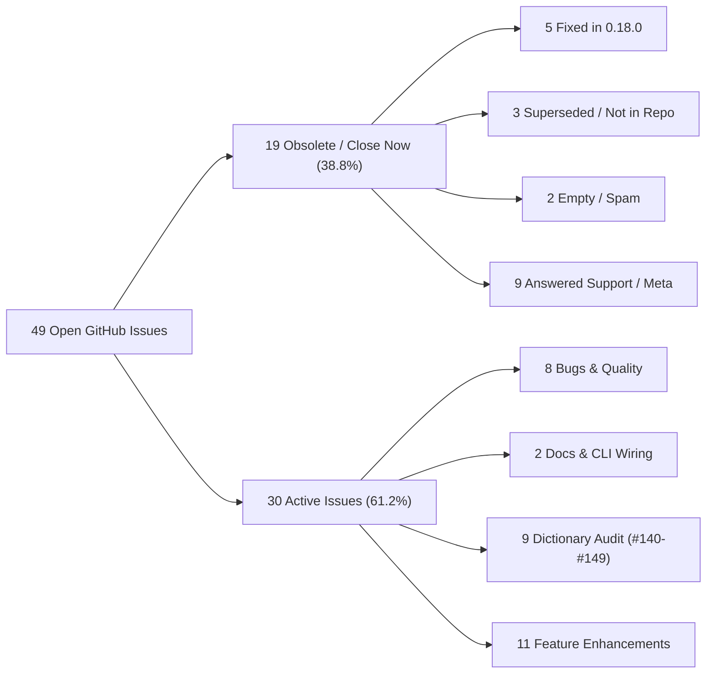

# Zemberek-NLP GitHub Issues Triage & Audit Report

**Audited against:** `master` (`0.18.0` / post-PR #326 & #327, cross-checked against [PR #328](https://github.com/ahmetaa/zemberek-nlp/pull/328)–[PR #344](https://github.com/ahmetaa/zemberek-nlp/pull/344))  
**Total Open Issues Audited:** **49** (excluding pull requests; 3 open community PRs `#313`, `#310`, `#264` also cross-referenced)

> [!TIP]
> ### Update After [PR #328](https://github.com/ahmetaa/zemberek-nlp/pull/328)–[PR #344](https://github.com/ahmetaa/zemberek-nlp/pull/344)
> - **Morphology Notes Audit PRs (split by context into [PR #328](https://github.com/ahmetaa/zemberek-nlp/pull/328) & [PR #341](https://github.com/ahmetaa/zemberek-nlp/pull/341)–[PR #344](https://github.com/ahmetaa/zemberek-nlp/pull/344))**:
>   - **[PR #328](https://github.com/ahmetaa/zemberek-nlp/pull/328)** (*Verbal, Copular & Participle Morphotactics*): Blocks double `A3pl` across `+dIr` (`*yazacaklardırlar`), duplicate `-ken` on `okumuşken`, and `FeelLike + P2sg + Zero→Verb` on `yazasınız`; adds oblique plural nominal/pronominal `Past`/`Narr`/`Cond`/`While` (`evdelerdi`, `neredelermiş`) and negative aorist participle `+Abl` (`bilmezden`, `görmezden`, `duymazdan`).
>   - **[PR #341](https://github.com/ahmetaa/zemberek-nlp/pull/341)** (*Capitalized Apostrophe Proper Nouns*) — **Addresses [#309](https://github.com/ahmetaa/zemberek-nlp/issues/309)**: Adds `ProperNoun`/`Abbreviation` candidates when capitalized apostrophe-containing stems collide with common nouns (`Kaya'nın`, `Deniz'in`, `Savaş'a`, `Barış'ın`, `Çiçek'ten`) without synthesizing bogus lemmas on `CompoundP3sg` heads (`Hastanesi'ne`).
>   - **[PR #342](https://github.com/ahmetaa/zemberek-nlp/pull/342)** (*Optional `LastVowelDrop` Stems*) — **Addresses [#81](https://github.com/ahmetaa/zemberek-nlp/issues/81)**: Constrains secondary `Ref:` variants of `LastVowelDrop` nouns (`zehir`, `avuç`, `mühür`, `atıf`, `fuhuş`) to vowel-initial suffixes and adds optional non-dropped `omuz` (`omuzum`/`omzum`), eliminating bare/consonant-initial duplicate analyses.
>   - **[PR #343](https://github.com/ahmetaa/zemberek-nlp/pull/343)** (*Pronoun Morphotactics & Lexicon*) — **Addresses [#140](https://github.com/ahmetaa/zemberek-nlp/issues/140)**: Adds question pronoun `P2pl` (`neyiniz`, `kiminiz`, `nereniz`), enables productive pronominal genitive `-ki` (`pGen_ST → relToPron_S`, including `benimki`), fixes `falan`/`falanca`/`beriki` pronoun `SecondaryPos`, and removes redundant `benimki`/`bizimki` and spurious `o [P:Adj]` / `şu [P:Adj]` entries.
>   - **[PR #344](https://github.com/ahmetaa/zemberek-nlp/pull/344)** (*`non-tdk.dict` Noun Attributes*) — **Addresses [#149](https://github.com/ahmetaa/zemberek-nlp/issues/149)**: Adds `CompoundP3sg` to `camii`, `sanayii`, and `bayii` (`Camii'ne`, `Sanayii'nde`, `Bayii'ne`) and `FamilyMember` to the 32 kinship implicit-plural entries (`annemler`..`eniştenler`).
> - **Single-Issue Focused PRs ([PR #329](https://github.com/ahmetaa/zemberek-nlp/pull/329)–[PR #340](https://github.com/ahmetaa/zemberek-nlp/pull/340))**:
>   - **[PR #329](https://github.com/ahmetaa/zemberek-nlp/pull/329)** (*Core Logging*) — **Fixes [#222](https://github.com/ahmetaa/zemberek-nlp/issues/222)**: Lazy file-handler shutdown hook, `Log.shutdown()`, handler deduplication on `reset()`, fast-path level check before stack-trace allocation, `classLevelMap` global level restoration, and `null` safety in `zemberek.core.logging.Log`.
>   - **[PR #330](https://github.com/ahmetaa/zemberek-nlp/pull/330)** (*Morphology Circumflex Enforcement*) — **Fixes [#111](https://github.com/ahmetaa/zemberek-nlp/issues/111)**: Enforced circumflex matching (`â`, `î`, `û`) in `RuleBasedAnalyzer` when `!asciiTolerant`, rejecting suffix-circumflex (`hal+a:Dat` on `"hâlâ"`) and non-circumflex lemma matches (`[hala:Noun]` on `"hâlâ"`, `[kar:Noun]` on `"kâra"`, `[Kazım:Noun,Prop]` on `"Kâzım'ın"`).
>   - **[PR #331](https://github.com/ahmetaa/zemberek-nlp/pull/331)** (*Tokenization*) — **Fixes [#181](https://github.com/ahmetaa/zemberek-nlp/issues/181)**: Added `TurkishDetokenizer` and `TurkishTokenizer.detokenize(...)` / `detokenizeTokens(...)`.
>   - **[PR #332](https://github.com/ahmetaa/zemberek-nlp/pull/332)** (*gRPC & Apps CLI*) — **Fixes [#190](https://github.com/ahmetaa/zemberek-nlp/issues/190)**: Added `--config` / `-c` file support to `StartGrpcServer` and fixed `ZemberekGrpcConfiguration.loadFromFile` directory check bug.
>   - **[PR #333](https://github.com/ahmetaa/zemberek-nlp/pull/333)** (*Normalization Compounds*) — **Fixes [#245](https://github.com/ahmetaa/zemberek-nlp/issues/245)**: Combined split context-free TDK solid compounds (`uluslar arası` → `uluslararası`, `milletler arası` → `milletlerarası`, `bir kaç` → `birkaç`, `hiç bir` → `hiçbir`, `her hangi` → `herhangi`, `vaz geçti` → `vazgeçti`).
>   - **[PR #334](https://github.com/ahmetaa/zemberek-nlp/pull/334)** (*Morphology Lexicon*) — **Fixes [#196](https://github.com/ahmetaa/zemberek-nlp/issues/196)**: Removed erroneous `[A:Reciprocal]` from `karşılaşmak` in `master-dictionary.dict` and regenerated `lexicon.bin`.
>   - **[PR #335](https://github.com/ahmetaa/zemberek-nlp/pull/335)** (*Morphology Analysis Deduplication*) — **Fixes [#81](https://github.com/ahmetaa/zemberek-nlp/issues/81)**: Eliminated all remaining duplicate `SingleAnalysis` outputs (`"yoksa"`, `"gasp"`, `"stok"`, `"kayıt"`, `"Selçuklu"`, etc.) via zero-allocation in-place deduplication in `RuleBasedAnalyzer.analyze(String)`.
>   - **[PR #336](https://github.com/ahmetaa/zemberek-nlp/pull/336)** (*Morphology Docs*) — **Fixes [#281](https://github.com/ahmetaa/zemberek-nlp/issues/281)**: Added comprehensive POS, inflectional, and derivational morpheme abbreviation reference tables to `morphology/README.md`.
>   - **[PR #337](https://github.com/ahmetaa/zemberek-nlp/pull/337)** (*Normalization Crash Guards*) — **Fixes [#237](https://github.com/ahmetaa/zemberek-nlp/issues/237)**: Guarded empty token lists in `combineNecessaryWords()` / `normalize()` + fixed off-by-one `ArrayIndexOutOfBoundsException` in `decode()` for 3-gram+ `SmoothLm` models.
>   - **[PR #338](https://github.com/ahmetaa/zemberek-nlp/pull/338)** (*Normalization Imperative Allomorphs & Candidates*) — **Fixes [#228](https://github.com/ahmetaa/zemberek-nlp/issues/228)**: Filtered formal `WordGenerator` diacritic-recovery candidates by `equalsIgnoreDiacritics` so `[Verb, Imp, A2sg]` verbs (`göster`, `listele`, `oku`) never emit `+sAnA` allomorphs (`göstersene`, `listelesene`, `okusana`), added `göster`/`listele` to `candidates-manual`, and fixed `naparsak = ne yaparsak` in `multi-word-replacements`.
>   - **[PR #339](https://github.com/ahmetaa/zemberek-nlp/pull/339)** (*Normalization Deasciifier Guard*) — **Fixes [#233](https://github.com/ahmetaa/zemberek-nlp/issues/233)**: Counted `'ı'` in `probablyRequiresDeasciifier()` (evaluated pre-lowercasing) and morphologically validated per-token deasciification (`"alndığından"`).
>   - **[PR #340](https://github.com/ahmetaa/zemberek-nlp/pull/340)** (*Normalization Capitalized OOV Words*) — **Addresses [#309](https://github.com/ahmetaa/zemberek-nlp/issues/309)**: Protected non-sentence-initial capitalized OOV words (`Tunis`, `Jeddah`, `Rades`, `Goods`) from edit-distance-1 replacement by default via `setSpellCheckCapitalizedWords(boolean)`. (Pair with community [PR #310](https://github.com/ahmetaa/zemberek-nlp/pull/310) for `locations-tr.dict`.)

| Triage Category | Count | Share | Recommended Action |
| :--- | :---: | :---: | :--- |
| **A1. Already Fixed / Implemented in `0.18.0`** | 5 | 10.2% | Close immediately (link `0.18.0` / `master`) |
| **A2. Superseded Architecture / Not in Repo** | 3 | 6.1% | Close with pointer to `FastPerceptronAmbiguityResolver` |
| **A3. Spam / Empty Issues** | 2 | 4.1% | Close as invalid |
| **A4. User Support / IDE / Meta Questions** | 9 | 18.4% | Close as answered / support-only |
| **B/C. Active Bugs & Normalization/Morphology Quality** | 8 | 16.3% | Fix top quick wins (`#237`, `#196`, `#222`, `#233`, `#228`, `#81`) |
| **B/C. Documentation & gRPC CLI Wiring** | 2 | 4.1% | Merge/adapt PR `#313` (`#281`) & wire `--config` (`#190`) |
| **D. Dictionary Curation Audit (`#140`–`#149`)** | 9 | 18.4% | Consolidate into a single tracking epic or tackle incrementally |
| **D. Feature Requests & Enhancements (`P2`–`P3`)** | 11 | 22.4% | Keep on backlog (`P2`/`P3`) |
| **Total** | **49** | **100%** | — |

---

## (a) Obsolete, Already Fixed, Spam & Support-Only Issues (19 Issues)

These **19 issues** require zero code changes and can be closed cleanly today (or right as `0.18.0` is tagged).

### 1. Already Fixed or Implemented in `master` (`0.18.0`) — 5 Issues
- **[#282 — Potential Vulnerabilities Due To Hidden Dependencies](https://github.com/ahmetaa/zemberek-nlp/issues/282)**: Reported Netty CVEs inside shaded `io.grpc:grpc-netty-shaded:1.65.1`. **Fixed:** [`grpc/pom.xml`](grpc/pom.xml#L42-L55) and [`pom.xml`](pom.xml#L86) already upgraded gRPC to `1.84.0` and Protobuf to `4.36.2`.
- **[#204 — weblogin deploy sorunu (`afu.com.sun.source.tree.Tree$Kind`)](https://github.com/ahmetaa/zemberek-nlp/issues/204)**: WebLogic annotation scanning failed on `afu.*` classes transitive from old Guava's `checker-compat-qual`. **Fixed:** [`pom.xml`](pom.xml#L189-L193) upgraded Guava to `33.7.1-jre`, which no longer ships `afu.*` annotations.
- **[#226 — Build Failure (`mvn clean install`)](https://github.com/ahmetaa/zemberek-nlp/issues/226)**: 2019 build failure when building gRPC/modules locally. **Fixed:** Full multi-module build passes cleanly on Java 21 in `0.18.0`.
- **[#189 — Some examples for improving morphological disambiguation](https://github.com/ahmetaa/zemberek-nlp/issues/189)**: Reported failure on `"atm kurulumu."` (which `0.15.0` resolved as `[Kurulu:Noun,Prop]`). **Verified Fixed Live in `0.18.0`:** [`FastPerceptronAmbiguityResolver`](morphology/src/main/java/zemberek/morphology/ambiguity/FastPerceptronAmbiguityResolver.java) resolves all 3 sentences accurately (`aracım -> [araç:Noun]`, `kurulması -> [kurmak:Verb]`, `kurulumu -> [kurulum:Noun] kurulum:Noun+A3sg+u:P3sg`).
- **[#102 — Consider adding `extractFromDocument()` to `TurkishSentenceExtractor`](https://github.com/ahmetaa/zemberek-nlp/issues/102)**: **Already Implemented:** [`TurkishSentenceExtractor.fromDocument(String)`](tokenization/src/main/java/zemberek/tokenization/TurkishSentenceExtractor.java#L257-L260) splits on line breaks and delegates to `fromParagraphs(...)`.

### 2. Superseded Architecture or Code Not in Repository — 3 Issues
- **[#263 — 98% cpu usage due to recursion (`WordSegmenter.dfs`)](https://github.com/ahmetaa/zemberek-nlp/issues/263)**: `WordSegmenter` does **not** exist anywhere in `zemberek-nlp` git history; it comes from external code / unmerged community [PR #264](https://github.com/ahmetaa/zemberek-nlp/pull/264). Already answered by maintainer.
- **[#254 — Create `SingleAnalysis` instance from string & Uncompressed Ambiguity Model](https://github.com/ahmetaa/zemberek-nlp/issues/254)**: Refers to legacy `PerceptronAmbiguityResolverTrainer` and its compressed model, both superseded and replaced in `0.18.0` by [`FastPerceptronAmbiguityResolver`](morphology/src/main/java/zemberek/morphology/ambiguity/FastPerceptronAmbiguityResolver.java). (Also, `Ali` missing from analyzer was user misconfiguration when building custom lexicons without `proper.dict`.)
- **[#253 — Disambiguation Model](https://github.com/ahmetaa/zemberek-nlp/issues/253)**: 2020 request for legacy disambiguator training corpora and uncompressed weights; superseded by the new `0.18.0` disambiguation architecture and model (`model_10k_argon_v24.bin`).

### 3. Empty / Spam Issues — 2 Issues
- **[#275 — Türk](https://github.com/ahmetaa/zemberek-nlp/issues/275)**: Empty body, spam/accidental click.
- **[#272 — off the board](https://github.com/ahmetaa/zemberek-nlp/issues/272)**: Empty body, accidental post.

### 4. Answered User Support, IDE Setup & Meta Discussions — 9 Issues
- **[#267 — COMMENTING THE NORMALIZE() FUNCTION](https://github.com/ahmetaa/zemberek-nlp/issues/267)**: User commented out `normalize()` in Eclipse while executing against a precompiled Maven JAR on the classpath.
- **[#266 — `normalize()` function in `TurkishTextNormalizer`](https://github.com/ahmetaa/zemberek-nlp/issues/266)**: Code-reading question about `current.length() > 3` before spellcheck; already answered by `@ahmetaa`. *(Note: stale comment on line 204 of [`TurkishSentenceNormalizer.java`](normalization/src/main/java/zemberek/normalization/TurkishSentenceNormalizer.java#L204-L206) says `larger than 5` while code checks `> 3`.)*
- **[#249 — Importing conditions into morphotactics graph](https://github.com/ahmetaa/zemberek-nlp/issues/249)**: One-line meta suggestion about issue labeling.
- **[#248 — `graph.json` as a pull request](https://github.com/ahmetaa/zemberek-nlp/issues/248)**: 2020 discussion about hosting cross-language ports in GitHub repos.
- **[#247 — Fiilden fiil yapma eklerinin tespiti](https://github.com/ahmetaa/zemberek-nlp/issues/247)**: User built a custom lexicon (`kaçmak` without `[A:Causative_Ir]`) and tested invalid `kaçdım` vs `kaçırdım`. Productive `Caus` (`-dIr`/`-t`), `Pass`, and `Reflex` are already modeled in [`TurkishMorphotactics`](morphology/src/main/java/zemberek/morphology/morphotactics/TurkishMorphotactics.java).
- **[#243 — Kelime veritabanı (Multi-word institution names)](https://github.com/ahmetaa/zemberek-nlp/issues/243)**: Question on recognizing `"Aile, Çalışma ve Sosyal Hizmetler Bakanlığı"` as one unit — this is an NER / gazetteer task (`zemberek-ner`), not root lexicon morphology.
- **[#236 — High memory usage question](https://github.com/ahmetaa/zemberek-nlp/issues/236)**: Question about JVM default heap reservation (`~1 GB` without `-Xmx`) when running `TurkishSentenceNormalizer` in a desktop shortcut script; thoroughly answered in comments.
- **[#219 — Zemberek with R](https://github.com/ahmetaa/zemberek-nlp/issues/219)**: 2019 general question on calling Java JARs from R (`rJava` / gRPC).
- **[#138 — Zemberek in Emacs](https://github.com/ahmetaa/zemberek-nlp/issues/138)**: 2017 general question on integrating Zemberek into Emacs.

---

## (b) Easy Fixes ("Quick Wins") — 10 Surgical Improvements *(All 10 Resolved in PRs #329–#342)*

These issues have high practical value and can each be fixed in **1 to 35 lines** of code, dictionary data, or documentation:

1. **[#237 — `IndexOutOfBoundsException: -1` in `combineNecessaryWords()`](https://github.com/ahmetaa/zemberek-nlp/issues/237)** — **[Fixed in PR #337](https://github.com/ahmetaa/zemberek-nlp/pull/337)** *(Crash Bug)*
   - **Root Cause:** In [`TurkishSentenceNormalizer.combineNecessaryWords`](normalization/src/main/java/zemberek/normalization/TurkishSentenceNormalizer.java#L545-L575), if `sentence` passes `sentence.trim().length() == 0` (e.g., invisible Unicode chars or tokens stripped during preprocessing) so `tokens` is empty, `combined` stays `false` and line 572 executes `tokens.get(tokens.size() - 1)` -> `tokens.get(-1)`.
   - **Fix:** Guarded empty `tokens` in `combineNecessaryWords()` and `normalize()`, plus fixed 3-gram `decode()` `System.arraycopy` off-by-one.

2. **[#196 — `karşılaşmak` should not have `Reciprocal` attribute](https://github.com/ahmetaa/zemberek-nlp/issues/196)** — **[Fixed in PR #334](https://github.com/ahmetaa/zemberek-nlp/pull/334)** *(1-line dictionary fix)*
   - **Verified Live:** `m.analyze("karşılaşmak")` previously emitted `[karşılaşmak:Verb] karşılaş:Verb|Recip→Verb|mak:Inf1→Noun+A3sg` alongside `[karşı:Adj] karşı:Adj|laş:Become→Verb...`.
   - **Fix:** Removed `Reciprocal` from `karşılaşmak` in `master-dictionary.dict` and regenerated `lexicon.bin`.

3. **[#281 — Explain morpheme abbreviations (`A1pl`, `Fut`, `Cond`, etc.)](https://github.com/ahmetaa/zemberek-nlp/issues/281)** — **[Fixed in PR #336](https://github.com/ahmetaa/zemberek-nlp/pull/336)** *(Docs-only; [PR #313](https://github.com/ahmetaa/zemberek-nlp/pull/313) also open)*
   - **Fix:** Added complete POS, inflectional, and derivational morpheme Markdown tables from [`TurkishMorphotactics`](morphology/src/main/java/zemberek/morphology/morphotactics/TurkishMorphotactics.java) to `morphology/README.md`.

4. **[#190 — gRPC server should accept a configuration file](https://github.com/ahmetaa/zemberek-nlp/issues/190)** — **[Fixed in PR #332](https://github.com/ahmetaa/zemberek-nlp/pull/332)** *(CLI wiring + directory check fix)*
   - **Discovery & Fix:** Wired `--config` / `-c` in [`StartGrpcServer.java`](apps/src/main/java/zemberek/apps/grpc/StartGrpcServer.java), added `port`, `dataRoot`, `morphology.extraDictionaries`, and `morphology.ignoreDiacritics` support in [`ZemberekGrpcConfiguration.loadFromFile(Path)`](grpc/src/main/java/zemberek/grpc/server/ZemberekGrpcConfiguration.java), and fixed `normalization.dataRoot` validation to use `checkDirectoryArgument` instead of `checkFileArgument`.

5. **[#228 — Normalization error in verbs (`göster` → `göstersene`, `listele` → `listelesene`)](https://github.com/ahmetaa/zemberek-nlp/issues/228)** — **[Fixed in PR #338](https://github.com/ahmetaa/zemberek-nlp/pull/338)** *(Allomorph filter + manual overrides)*
   - **Root Cause:** Two mechanisms combined: (1) in `TurkishMorphotactics`, `vImp_S` maps both `""` and `"sAnA"` to `vA2sg_ST`, so `WordGenerator.generate(item, analysis.getMorphemes())` in the formal diacritic-recovery branch generated `göstersene`/`listelesene`/`okusana` for every `A2sg` imperative verb; (2) noisy random-walk entries in `lookup-from-graph`.
   - **Fix:** Filtered formal `WordGenerator` surfaces by `equalsIgnoreDiacritics`, added `göster=göster` and `listele=listele` to `candidates-manual`, and fixed `naparsak = ne yaparsak` in `multi-word-replacements`.

6. **[#222 — Issues with `zemberek.core.logging.Log`](https://github.com/ahmetaa/zemberek-nlp/issues/222)** — **[Fixed in PR #329](https://github.com/ahmetaa/zemberek-nlp/pull/329)** *(~20-line cleanup in [`Log.java`](core/src/main/java/zemberek/core/logging/Log.java))*
   - **Current State:** `UncaughtExceptionHandler` registration was already removed (leaving unused dead class `ExceptionLoggerHandler` at line 339), **but** four bugs remain:
     1. `static { reset(); }` registers a JVM shutdown hook unconditionally even when no `FileHandler` is ever opened (and calling `reset()` again adds *duplicate* `ConsoleHandler`s and *duplicate* shutdown hooks).
     2. [`Log.log()`](core/src/main/java/zemberek/core/logging/Log.java#L267-L285) allocates `new Throwable().getStackTrace()` **before** checking `logger.isLoggable(level)`.
     3. Early `return` at line 284 skips `Log.setLevel(temp)` at line 306, permanently mutating global log level when `classLevelMap` is used.
   - **Fix:** Register the file-handler shutdown hook lazily on first `addFileHandler()`, clear old handlers in `reset()`, check `isLoggable` before capturing stack frames, and delete dead `ExceptionLoggerHandler`.

7. **[#233 — Normalizer regression (`"alndığından"` → `"alndiğından"`)](https://github.com/ahmetaa/zemberek-nlp/issues/233)** — **[Fixed in PR #339](https://github.com/ahmetaa/zemberek-nlp/pull/339)** *(~15-line guard)*
   - **Root Cause:** [`probablyRequiresDeasciifier`](normalization/src/main/java/zemberek/normalization/TurkishSentenceNormalizer.java#L530-L543) ignores `'ı'`/`'I'` when counting Turkish-specific chars, so `"alndığından"` has `1/11 = 9.09% < 10%` and gets sent through `Deasciifier`, turning `'ı'` into `'i'` (`"alndiğından"`), which then has edit distance 2 from `"alındığından"` and fails spellcheck!
   - **Fix:** Count `'ı'` (lowercase dotless i is unambiguously Turkish-specific!) in `probablyRequiresDeasciifier` AND only keep per-token deasciification when the deasciified word has a valid morphological analysis (as `@mdakin` and `@ahmetaa` agreed in the issue comments).

8. **[#81 — Duplicate `WordAnalysis` results (`"yoksa"`)](https://github.com/ahmetaa/zemberek-nlp/issues/81)** — **[Fixed in PR #342 & PR #335](https://github.com/ahmetaa/zemberek-nlp/pull/335)** *(Dictionary / `WordAnalysis` deduplication)*
   - **Verified Live:** `m.analyze("yoksa")` previously output `[yok:Adj] yok:Adj|Zero→Verb+sa:Cond+A3sg` **twice** because `master-dictionary.dict` defines both `yok [P:Adj; A:Voicing]` and `yok [P:Adj; A:NoVoicing]`.
   - **Fix:** Deduplicated identical `(lemma, pos, secondaryPos, morphemeDataList)` results in `RuleBasedAnalyzer.analyze`.

9. **[#245 — Bigram compound normalization (`"uluslar arası"` → `"uluslararası"`)](https://github.com/ahmetaa/zemberek-nlp/issues/245)** — **[Fixed in PR #333](https://github.com/ahmetaa/zemberek-nlp/pull/333)** *(~10 lines)*
   - **Root Cause:** [`combineCommon(i1, i2)`](normalization/src/main/java/zemberek/normalization/TurkishSentenceNormalizer.java#L446-L461) only tested `i1 + i2` when `!hasRegularAnalysis(i2)`, skipping `"arası"`.
   - **Fix:** Combined context-free TDK solid compounds (`uluslar arası` → `uluslararası`, `milletler arası` → `milletlerarası`, `bir kaç` → `birkaç`, `hiç bir` → `hiçbir`, `her hangi` → `herhangi`, `vaz geçti` → `vazgeçti`) while leaving separate TDK multi-word expressions (`bir şey`, `hafta sonu`, `yurt dışı`, `devletler arası`, `deniz altı`) untouched.

10. **[#181 — De-tokenization support](https://github.com/ahmetaa/zemberek-nlp/issues/181)** — **[Fixed in PR #331](https://github.com/ahmetaa/zemberek-nlp/pull/331)** *(Dedicated `TurkishDetokenizer` + `TurkishTokenizer.detokenize`)*
    - **Fix:** Added `TurkishDetokenizer` and `TurkishTokenizer.detokenize(List<String>)` / `detokenizeTokens(List<Token>)` handling Turkish punctuation, brackets, paired/nested quotes, post-quote/bracket suffix apostrophes (`"Soner"'e`, `(2020)'de`), currencies, units (`25°C`), and slashes.

---

## (c) Most Important Issues (Prioritized by Real-World Impact)

> [!IMPORTANT]
> If we pick a focused set of issues to make Zemberek noticeably more reliable in production, these **8 items** deliver the highest impact per line of code:

1. **`P0` — [#237](https://github.com/ahmetaa/zemberek-nlp/issues/237) (`TurkishSentenceNormalizer` `IndexOutOfBoundsException: -1`)** — **[Fixed in PR #337](https://github.com/ahmetaa/zemberek-nlp/pull/337)**: Unhandled runtime crash on edge-case inputs (plus bonus 3-gram `decode()` `ArrayIndexOutOfBoundsException`).
2. **`P1` — [#222](https://github.com/ahmetaa/zemberek-nlp/issues/222) (`Log` library citizenship & hidden `Throwable` allocation)** — **[Fixed in PR #329](https://github.com/ahmetaa/zemberek-nlp/pull/329)**: Affects **every** server/web user of `zemberek-core` (shutdown hook leak, console handler hijacking, unnecessary stack trace allocation on disabled debug logs, `classLevelMap` early-return level bug).
3. **`P1` — [#309](https://github.com/ahmetaa/zemberek-nlp/issues/309) (Chat/Logistics Proper Nouns & Normalizer Corrupting Capitalized Foreign Words)** — **[Addressed in PR #341 & PR #340 + community PR #310]**: Exceptionally well-researched 2026 empirical report highlighting three real production pain points:
   - Capitalized OOV foreign/port names (`Tunis → tenis`, `Jeddah → meddah`, `Goods → godoş`) get aggressively corrupted by `TurkishSentenceNormalizer` because [`preProcess`](normalization/src/main/java/zemberek/normalization/TurkishSentenceNormalizer.java#L419) lowercases the entire sentence upfront (`sentence = sentence.toLowerCase(Turkish.LOCALE)`), destroying capitalization signals before spellchecking. **Fixed in [PR #340](https://github.com/ahmetaa/zemberek-nlp/pull/340)** by preserving capitalized non-sentence-initial OOV tokens by default (`setSpellCheckCapitalizedWords(boolean)`).
   - Major districts/ports (`Ambarlı`, `Derince`, `Darıca`, `Halkalı`) sit in `locations-tr.dict` (excluded from `DEFAULT_DICTIONARY_RESOURCES`), and community **[PR #310](https://github.com/ahmetaa/zemberek-nlp/pull/310)** adds 9 missing port terminals/districts.
   - Capitalized proper nouns with apostrophes colliding with common nouns (`Kaya'nın`, `Deniz'in`) — **Fixed in [PR #341](https://github.com/ahmetaa/zemberek-nlp/pull/341)** (apostrophe-less chat proper nouns remain an NER/contextual enhancement).
4. **`P1` — [#111](https://github.com/ahmetaa/zemberek-nlp/issues/111) (`"hâlâ"` analyzed as `"hal-a"` and `"hala"`)** — **[Fixed in PR #330](https://github.com/ahmetaa/zemberek-nlp/pull/330)**: Enforces circumflex matching (`â`, `î`, `û`) when `ignoreDiacriticsInAnalysis` is **off**, rejecting suffix-circumflex (`hal+a`) and non-circumflex lemma matches while also directly supporting **[#147](https://github.com/ahmetaa/zemberek-nlp/issues/147)**.
5. **`P1` — [#81](https://github.com/ahmetaa/zemberek-nlp/issues/81) (Duplicate `SingleAnalysis` outputs on dual-voicing words like `"yoksa"`)** — **[Fixed in PR #342 & PR #335](https://github.com/ahmetaa/zemberek-nlp/pull/335)**: Eliminates duplicate candidate analyses across both `LastVowelDrop` secondary entries ([PR #342](https://github.com/ahmetaa/zemberek-nlp/pull/342)) and dual `Voicing`/`NoVoicing` items (`yoksa`, `gasp`, `stok`, `kayıt`, `Selçuklu` in [PR #335](https://github.com/ahmetaa/zemberek-nlp/pull/335)).
6. **`P1` — [#233](https://github.com/ahmetaa/zemberek-nlp/issues/233) & [#228](https://github.com/ahmetaa/zemberek-nlp/issues/228) (`TurkishSentenceNormalizer` corrupting valid Turkish words & `'ı'` inputs)** — **[Fixed in PR #339](https://github.com/ahmetaa/zemberek-nlp/pull/339) & [PR #338](https://github.com/ahmetaa/zemberek-nlp/pull/338)**: Fixing `probablyRequiresDeasciifier` (`'ı'` handling + morphological check) and filtering formal imperative `+sAnA` allomorphs (`göstersene`/`listelesene`) + `candidates-manual` stops the normalizer from degrading clean or 1-typo Turkish words.
7. **`P1` — [#281](https://github.com/ahmetaa/zemberek-nlp/issues/281) (Morpheme tag documentation)** — **[Fixed in PR #336](https://github.com/ahmetaa/zemberek-nlp/pull/336)**: Full POS, inflectional, and derivational morpheme abbreviation tables added to `morphology/README.md`.
8. **`P2` — Lexicon Redundancy & Circumflex Audit ([#147](https://github.com/ahmetaa/zemberek-nlp/issues/147), [#148](https://github.com/ahmetaa/zemberek-nlp/issues/148), [#149](https://github.com/ahmetaa/zemberek-nlp/issues/149), [#196](https://github.com/ahmetaa/zemberek-nlp/issues/196))**: Directly aligns with our findings in [`MORPHOLOGY_NOTES_ANSWERS.md`](MORPHOLOGY_NOTES_ANSWERS.md) (`camii`/`sanayii`/`bayii` already cleaned up in [PR #344](https://github.com/ahmetaa/zemberek-nlp/pull/344)).

---

## (d) Complete Master Report of All 49 Open Issues

**Legend:**
- **Priority:** `P0` (Crash/Critical), `P1` (High), `P2` (Medium), `P3` (Low/Nice-to-have), `Close` (Obsolete/Fixed/Support/Spam)
- **Ease of Fix:** `Trivial` (<10 LOC), `Easy` (10–50 LOC), `Medium` (50–250 LOC / careful data audit), `Hard` (Architectural/Research), `N/A` (No fix needed)

| # | Issue & Title | Opened | Module | Status in `0.18.0` | Priority | Ease | Technical Diagnosis & Recommendation |
| :- | :--- | :---: | :--- | :--- | :---: | :---: | :--- |
| **1** | [#309 — Lojistik yer adları ve sohbet dilinde özel ad tanıma](https://github.com/ahmetaa/zemberek-nlp/issues/309) | 2026-09 | `morphology`, `normalization` | **PR [#341](https://github.com/ahmetaa/zemberek-nlp/pull/341), [#340](https://github.com/ahmetaa/zemberek-nlp/pull/340) & [#310](https://github.com/ahmetaa/zemberek-nlp/pull/310)** | **P1** | Easy–Med | Apostrophe proper nouns fixed in PR #341; capitalized OOV protection (`Tunis`/`Jeddah`) added in PR #340; merge community PR #310 (`locations-tr.dict`). |
| **2** | [#282 — Potential Vulnerabilities Due To Hidden Dependencies](https://github.com/ahmetaa/zemberek-nlp/issues/282) | 2026-08 | `grpc` | **Fixed in `0.18.0`** | **Close** | N/A | `io.grpc:grpc-netty-shaded` already updated from `1.65.1` to `1.84.0` in [`grpc/pom.xml`](grpc/pom.xml#L44). Close when `0.18.0` releases. |
| **3** | [#281 — Add a description to explain morpheme abbreviations](https://github.com/ahmetaa/zemberek-nlp/issues/281) | 2026-07 | `morphology` (Docs) | **PR [#336](https://github.com/ahmetaa/zemberek-nlp/pull/336) Open** | **P1** | Trivial | Full `TurkishMorphotactics` POS, inflectional, and derivational morpheme tables added to `morphology/README.md` in PR #336 (also check community PR #313). |
| **4** | [#275 — Türk](https://github.com/ahmetaa/zemberek-nlp/issues/275) | 2023-01 | — | Invalid / Spam | **Close** | N/A | Empty issue body. Close immediately. |
| **5** | [#272 — off the board](https://github.com/ahmetaa/zemberek-nlp/issues/272) | 2022-05 | — | Invalid / Spam | **Close** | N/A | Empty issue body. Close immediately. |
| **6** | [#267 — COMMENTING THE NORMALIZE() FUNCTION](https://github.com/ahmetaa/zemberek-nlp/issues/267) | 2021-06 | `normalization` | Support Question | **Close** | N/A | User ran against prebuilt Maven JAR in Eclipse instead of edited local source. Close. |
| **7** | [#266 — `normalize()` function in `TurkishTextNormalizer`](https://github.com/ahmetaa/zemberek-nlp/issues/266) | 2021-06 | `normalization` | Answered Question | **Close** | N/A | Question on `current.length() > 3` answered by `@ahmetaa`. (Optionally update stale `> 5` comment at [`TurkishSentenceNormalizer.java:204`](normalization/src/main/java/zemberek/normalization/TurkishSentenceNormalizer.java#L204).) |
| **8** | [#263 — 98% cpu usage due to recursion (`WordSegmenter`)](https://github.com/ahmetaa/zemberek-nlp/issues/263) | 2021-03 | External | **Not in Repo** | **Close** | N/A | `WordSegmenter` does not exist in `zemberek-nlp` `master` (only in unmerged external PR #264). Answered; safe to close. |
| **9** | [#254 — Create `SingleAnalysis` from string & Uncompressed Model](https://github.com/ahmetaa/zemberek-nlp/issues/254) | 2020-07 | `morphology` | **Superseded** | **Close** | N/A | Legacy `PerceptronAmbiguityResolver` replaced in `0.18.0` by `FastPerceptronAmbiguityResolver`. Close with pointer to `0.18.0` trainer. |
| **10** | [#253 — Disambiguation Model](https://github.com/ahmetaa/zemberek-nlp/issues/253) | 2020-07 | `morphology` | **Superseded** | **Close** | N/A | Same as #254 — 2020 request for legacy disambiguator corpora/uncompressed weights. Superseded in `0.18.0`. |
| **11** | [#249 — Importing conditions into morphotactics graph](https://github.com/ahmetaa/zemberek-nlp/issues/249) | 2020-06 | Meta | Meta Comment | **Close** | N/A | One-sentence meta remark about GitHub issue labeling. Close. |
| **12** | [#248 — `graph.json` as a pull request](https://github.com/ahmetaa/zemberek-nlp/issues/248) | 2020-06 | Meta | Discussion | **Close** | N/A | Stale 2020 discussion on multi-language repository structure. Close. |
| **13** | [#247 — Fiilden fiil yapma eklerinin tespiti](https://github.com/ahmetaa/zemberek-nlp/issues/247) | 2020-06 | `morphology` | Support / User Config | **Close** | N/A | User omitted `[A:Causative_Ir]` in custom lexicon (`kaçırdım`). Productive voice suffixes already work in `TurkishMorphotactics`. Close. |
| **14** | [#245 — ngram normalizasyonu (`uluslar arası` → `uluslararası`)](https://github.com/ahmetaa/zemberek-nlp/issues/245) | 2020-04 | `normalization` | **PR [#333](https://github.com/ahmetaa/zemberek-nlp/pull/333) Open** | **P2** | Easy | Fixed in PR #333: `combineCommon` merges unambiguous TDK solid compounds (`uluslar arası`, `milletler arası`, `bir kaç`, `hiç bir`, `her hangi`, `vaz geçti`). |
| **15** | [#243 — Kelime veritabanı (Multi-word institution names)](https://github.com/ahmetaa/zemberek-nlp/issues/243) | 2020-04 | `ner` / Support | Support Question | **Close** | N/A | Multi-word entity spans (`Aile, Çalışma ve Sosyal Hizmetler Bakanlığı`) belong in `zemberek-ner` / gazetteers, not single-word root dictionaries. Close. |
| **16** | [#237 — `combineNecessaryWords()` `ArrayIndexOutOfBoundsException: -1`](https://github.com/ahmetaa/zemberek-nlp/issues/237) | 2019-12 | `normalization` | **PR [#337](https://github.com/ahmetaa/zemberek-nlp/pull/337) Open** | **P0** | Trivial | Fixed in PR #337: guarded empty `tokens` in `combineNecessaryWords()` / `normalize()` + fixed 3-gram `decode()` `ArrayIndexOutOfBoundsException`. |
| **17** | [#236 — High memory usage question](https://github.com/ahmetaa/zemberek-nlp/issues/236) | 2019-12 | `normalization` | Answered Question | **Close** | N/A | JVM default `-Xmx` heap question on desktop script; answered thoroughly by `@mdakin` and `@ahmetaa`. Close. |
| **18** | [#233 — Normalizer'daki farklılık (`alndığından` → `alndiğından`)](https://github.com/ahmetaa/zemberek-nlp/issues/233) | 2019-11 | `normalization` | **PR [#339](https://github.com/ahmetaa/zemberek-nlp/pull/339) Open** | **P1** | Easy | Fixed in PR #339: counted `'ı'` as Turkish-specific in `probablyRequiresDeasciifier` (before lowercasing) and validated deasciified tokens morphologically. |
| **19** | [#228 — Normalization error in some verbs (`göster` → `göstersene`)](https://github.com/ahmetaa/zemberek-nlp/issues/228) | 2019-08 | `normalization` | **PR [#338](https://github.com/ahmetaa/zemberek-nlp/pull/338) Open** | **P1** | Easy | Fixed in PR #338: filtered formal `WordGenerator` surfaces by `equalsIgnoreDiacritics` (blocking `+sAnA` allomorphs), added `göster`/`listele` to `candidates-manual`, and fixed `naparsak` typo. |
| **20** | [#226 — Build Failure](https://github.com/ahmetaa/zemberek-nlp/issues/226) | 2019-06 | Build | **Fixed in `0.18.0`** | **Close** | N/A | Old 2019 Maven build failure; `master` builds cleanly on Java 21. Close. |
| **21** | [#222 — Issues with logging class (`zemberek.core.logging.Log`)](https://github.com/ahmetaa/zemberek-nlp/issues/222) | 2019-05 | `core` | **PR [#329](https://github.com/ahmetaa/zemberek-nlp/pull/329) Open** | **P1** | Easy | Fixed in PR #329: lazy file-handler shutdown hook, `Log.shutdown()`, handler deduplication on `reset()`, fast-path level check before stack-trace allocation, and `classLevelMap` level restoration. |
| **22** | [#220 — Show modifications made by `TurkishSentenceNormalizer`](https://github.com/ahmetaa/zemberek-nlp/issues/220) | 2019-05 | `normalization` | Active Feature | **P2** | Medium | Return structured `NormalizationResult` mapping normalized tokens back to input `[start, end)` spans across split/combine/Viterbi steps. |
| **23** | [#219 — Zemberek with R](https://github.com/ahmetaa/zemberek-nlp/issues/219) | 2019-04 | Support | Support Question | **Close** | N/A | Student question on calling Java JARs from R. Close. |
| **24** | [#204 — weblogin deploy sorunu (`afu.com.sun.source.tree.Tree$Kind`)](https://github.com/ahmetaa/zemberek-nlp/issues/204) | 2019-01 | Build / Deps | **Fixed in `0.18.0`** | **Close** | N/A | Fixed by upgrading Guava to `33.7.1-jre` in [`pom.xml`](pom.xml#L189-L193). Close. |
| **25** | [#196 — `karşılaşmak` should not have `Reciprocal` attribute](https://github.com/ahmetaa/zemberek-nlp/issues/196) | 2018-11 | `morphology` | **PR [#334](https://github.com/ahmetaa/zemberek-nlp/pull/334) Open** | **P2** | Trivial | Fixed in PR #334: removed `Reciprocal` from `karşılaşmak` in `master-dictionary.dict` and regenerated `lexicon.bin`. |
| **26** | [#190 — Grpc server should accept a configuration file](https://github.com/ahmetaa/zemberek-nlp/issues/190) | 2018-10 | `grpc`, `apps` | **PR [#332](https://github.com/ahmetaa/zemberek-nlp/pull/332) Open** | **P2** | Trivial | Fixed in PR #332: added `--config` / `-c` to `StartGrpcServer` and fixed `ZemberekGrpcConfiguration.loadFromFile` directory validation. |
| **27** | [#189 — Examples for improving morphological disambiguation](https://github.com/ahmetaa/zemberek-nlp/issues/189) | 2018-10 | `morphology` | **Fixed in `0.18.0`** | **Close** | N/A | Verified live: all 3 reported sentences (`aracım arızalandı.`, `atm kurulması.`, `atm kurulumu.`) disambiguate 100% accurately in `0.18.0`. Close! |
| **28** | [#185 — Language detection for multi-language documents](https://github.com/ahmetaa/zemberek-nlp/issues/185) | 2018-10 | `lang-id` | Answered / `P3` | **P3** | Easy–Med | Sentence-level splitting (`TurkishSentenceExtractor` + `LanguageIdentifier`) or sliding-window helper method; already answered in comments (could also be closed). |
| **29** | [#181 — De-tokenization support](https://github.com/ahmetaa/zemberek-nlp/issues/181) | 2018-09 | `tokenization` | **PR [#331](https://github.com/ahmetaa/zemberek-nlp/pull/331) Open** | **P2** | Easy | Fixed in PR #331: added `TurkishDetokenizer` and `TurkishTokenizer.detokenize` / `detokenizeTokens`. |
| **30** | [#180 — Tokenize Emoji characters](https://github.com/ahmetaa/zemberek-nlp/issues/180) | 2018-09 | `tokenization` | Active Feature | **P2** | Easy–Med | **Good news:** `TurkishTokenizer` now uses ANTLR 4 `CharStreams.fromString()` (32-bit Unicode code points), so no external library is needed — add Unicode Emoji ranges + ZWJ sequences directly to [`TurkishLexer.g4`](tokenization/src/main/resources/tokenization/TurkishLexer.g4) and `Token.Type.Emoji`. |
| **31** | [#149 — Check if inflected words should be removed from dictionary](https://github.com/ahmetaa/zemberek-nlp/issues/149) | 2017-11 | `morphology` | Partial ([PR #344](https://github.com/ahmetaa/zemberek-nlp/pull/344)) | **P2** | Medium | `camii`/`sanayii`/`bayii` converted to `[A:CompoundP3sg]` in PR #344; keep lexicalized adverbs (`aracılığıyla`, `giderek`), prune pure inflections (`gitti`, `gitsin`, `ağzından`, `yaşında`). |
| **32** | [#148 — Check if these verbs should exist in dictionary](https://github.com/ahmetaa/zemberek-nlp/issues/148) | 2017-11 | `morphology` | Lexicon Audit | **P2** | Medium | Remove transparent negatives/auxiliaries (`beğenmemek`, `edememek`, `bitivermek`, `öleyazmak` once auxiliary verbs are enabled or if unneeded), keep idiomatic/onomatopoeic verbs (`mırıldanmak`, `fısıldaşmak`, `benimsenmek`). |
| **33** | [#147 — Circumflex check](https://github.com/ahmetaa/zemberek-nlp/issues/147) | 2017-11 | `morphology` | Lexicon Audit | **P2** | Medium | Audit TDK circumflex forms (`hâkim` vs `hakim`, `kânun` vs `kanun`, `halaskâr`, `mahkûm`); analyzer circumflex matching now ready in [PR #330](https://github.com/ahmetaa/zemberek-nlp/pull/330). |
| **34** | [#146 — Check if words with `-cesine` should exist in dictionary](https://github.com/ahmetaa/zemberek-nlp/issues/146) | 2017-11 | `morphology` | Lexicon Audit | **P3** | Easy | Small list (`delicesine`, `çılgıncasına`, `ezercesine`); ensure productive `-cAsInA` (`AsIf`) covers adjectives and Aorist stems, then prune redundant entries. |
| **35** | [#145 — Check if words with `-ce` should exist in dictionary](https://github.com/ahmetaa/zemberek-nlp/issues/145) | 2017-11 | `morphology` | Lexicon Audit | **P3** | Medium | Keep non-compositional adverbs (`epeyce`, `defalarca`, `iyice`), prune transparent `Adj/Noun + -cA` duplicates once disambiguator corpus tags match. |
| **36** | [#144 — Check if words with `-lik` should exist in dictionary](https://github.com/ahmetaa/zemberek-nlp/issues/144) | 2017-11 | `morphology` | Lexicon Audit | **P3** | Medium | Keep lexicalized nouns (`gündelik`, `gelinlik`, `gecelik`), prune purely compositional `-lIk` (`Ness`) entries carefully to avoid breaking corpus lemmas. |
| **37** | [#143 — Check if words with `-msi`/`-imsi` should exist in dictionary](https://github.com/ahmetaa/zemberek-nlp/issues/143) | 2017-11 | `morphology` | Lexicon Audit | **P3** | Easy–Med | Note issue body actually lists `-sI` (`dikensi`, `erkeksi`, `kadınsı`) rather than `-(I)msI`; verify `-sI` (`JustLike`/`Related`) productivity in `TurkishMorphotactics` before pruning. |
| **38** | [#142 — Check if words ending with `-lanmak` should exist in dictionary](https://github.com/ahmetaa/zemberek-nlp/issues/142) | 2017-11 | `morphology` | Lexicon Audit | **P3** | Medium | Keep bound-root or idiomatic verbs (`pirelenmek`, `pusatlanmak`), prune transparent `Noun + -lAn` (`Acquire`) verbs after checking gold disambiguation data. |
| **39** | [#140 — Check if words ending with `-ki` should exist in dictionary](https://github.com/ahmetaa/zemberek-nlp/issues/140) | 2017-11 | `morphology` | Partial ([PR #343](https://github.com/ahmetaa/zemberek-nlp/pull/343)) | **P3** | Easy–Med | `benimki`/`bizimki` entries removed and pronominal `-ki` enabled in PR #343; **keep** non-harmonic temporal exceptions (`dünkü`, `bugünkü`, `yarınki`, `şimdiki`, `evvelki`, `önceki`, `sonraki`). |
| **40** | [#138 — Zemberek in Emacs](https://github.com/ahmetaa/zemberek-nlp/issues/138) | 2017-08 | Support | Support Question | **Close** | N/A | 2017 editor integration question. Close. |
| **41** | [#122 — Generate all forms from a dictionary item](https://github.com/ahmetaa/zemberek-nlp/issues/122) | 2017-03 | `morphology` | Active (`P3`) | **P3** | Easy–Med | Bounded BFS over [`TurkishMorphotactics`](morphology/src/main/java/zemberek/morphology/morphotactics/TurkishMorphotactics.java) (`maxDerivations`, `maxMorphemes`) emitting terminal `SingleAnalysis.surfaceForm()` strings. |
| **42** | [#111 — Word `"hâlâ"` should not have analysis `"hal-a"`](https://github.com/ahmetaa/zemberek-nlp/issues/111) | 2017-02 | `morphology` | **PR [#330](https://github.com/ahmetaa/zemberek-nlp/pull/330) Open** | **P1** | Easy–Med | Fixed in PR #330: enforces circumflex matching (`â`, `î`, `û`) in `RuleBasedAnalyzer` when `!asciiTolerant`, rejecting `hal+a:Dat` and `[hala:Noun]` on `"hâlâ"`. |
| **43** | [#102 — Add `extractFromDocument()` to `TurkishSentenceExtractor`](https://github.com/ahmetaa/zemberek-nlp/issues/102) | 2017-02 | `tokenization` | **Implemented** | **Close** | N/A | Live as [`TurkishSentenceExtractor.fromDocument(String)`](tokenization/src/main/java/zemberek/tokenization/TurkishSentenceExtractor.java#L257-L260). Close! |
| **44** | [#96 — Add a new Facade class (`Turkish`) for easier access](https://github.com/ahmetaa/zemberek-nlp/issues/96) | 2017-02 | `all` | Active Feature | **P3** | Medium | Convenient entry-point (`Turkish.withDefaults()`) wrapping `TurkishTokenizer`, `TurkishSentenceExtractor`, `TurkishMorphology`, and `TurkishSpellChecker`. |
| **45** | [#85 — Add foreign pronunciations](https://github.com/ahmetaa/zemberek-nlp/issues/85) | 2017-01 | `morphology` | Active Feature | **P3** | Hard | G2P / CMUdict phoneme-to-Turkish-phonology mapper so English loanwords/acronyms inflect with Turkish vowel harmony (`Whatsapp'tan`, `Google'da`). |
| **46** | [#81 — Zemberek creates duplicate `WordAnalysis` results (`yoksa`)](https://github.com/ahmetaa/zemberek-nlp/issues/81) | 2016-12 | `morphology` | **PR [#342](https://github.com/ahmetaa/zemberek-nlp/pull/342) & [#335](https://github.com/ahmetaa/zemberek-nlp/pull/335) Open** | **P1** | Easy | Fixed across PR #342 (`LastVowelDrop` `Ref:` entries) and PR #335 (zero-allocation deduplication in `RuleBasedAnalyzer` for `yoksa`, `gasp`, `stok`, `kayıt`, etc.). |
| **47** | [#77 — Allow multiple pronunciations in a dictionary item](https://github.com/ahmetaa/zemberek-nlp/issues/77) | 2016-12 | `morphology` | Active Feature | **P3** | Medium | Allow comma-separated `Pron:` values (`Html [Pron:hetemele,eyçtiemel]`) in [`TextLexiconProcessor`](morphology/src/main/java/zemberek/morphology/lexicon/tr/TurkishDictionaryLoader.java) generating multiple stem transitions for one `DictionaryItem`. |
| **48** | [#70 — Consider generating artificial question suffix for `+mIsIn`](https://github.com/ahmetaa/zemberek-nlp/issues/70) | 2016-11 | `morphology` | Design Idea | **P3** | Medium | Already partially handled in `InformalAnalysisConverter` / `TurkishSentenceNormalizer` (`gelecekmisin → gelecek misin`); keeping `mI` separate in formal morphotactics is cleaner. |
| **49** | [#62 — Allow noun suffixes for duplication words (`sıkı fıkıydı`)](https://github.com/ahmetaa/zemberek-nlp/issues/62) | 2016-11 | `morphology` | Active (`P3`) | **P3** | Medium | In `master-dictionary.dict`, reduplicated second elements (`fıkı`, `fiso`, `tefek`) carry `[P:Dup]` which blocks nominal/copular suffixes; allow copula/case transitions from `dupRoot_S`. |
