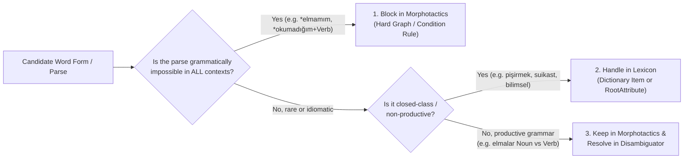

# Zemberek Morphology Notes: Complete Commentary, Live `0.18.0` Audit & Engineering Guide

> [!NOTE]
> This document systematically answers and comments on **every single note and question (`Q01`–`Q96`)** from the [Zemberek `Morphology-Notes` Wiki](https://github.com/ahmetaa/zemberek-nlp/wiki/Morphology-Notes). Every example word was tested live against the current **Zemberek `0.18.0`** engine and cross-referenced against [`TurkishMorphotactics.java`](file:///home/dndara/work/zemberek-nlp/morphology/src/main/java/zemberek/morphology/morphotactics/TurkishMorphotactics.java), [`Conditions.java`](file:///home/dndara/work/zemberek-nlp/morphology/src/main/java/zemberek/morphology/morphotactics/Conditions.java), [`RootAttribute.java`](file:///home/dndara/work/zemberek-nlp/core/src/main/java/zemberek/core/turkish/RootAttribute.java), [`UnidentifiedTokenAnalyzer.java`](file:///home/dndara/work/zemberek-nlp/morphology/src/main/java/zemberek/morphology/analysis/UnidentifiedTokenAnalyzer.java), and the default lexicon files.

---

## Executive Strategy: How to Adjudicate Morphotactic Questions in Turkish NLP

Almost every dilemma in `Morphology-Notes` sits at the tension between **recall** (accepting valid or colloquial Turkish word forms) and **ambiguity explosion** (generating spurious parses that hurt downstream tasks). Having upgraded Zemberek `0.18.0` with [`FastPerceptronAmbiguityResolver`](file:///home/dndara/work/zemberek-nlp/morphology/src/main/java/zemberek/morphology/ambiguity/fast/FastPerceptronAmbiguityResolver.java) (~92.8% ambiguous-token accuracy, ~90k tokens/sec), we can apply a principled **three-layer decision rule**:



1. **Block in [`TurkishMorphotactics`](file:///home/dndara/work/zemberek-nlp/morphology/src/main/java/zemberek/morphology/morphotactics/TurkishMorphotactics.java)** *only* when a sequence violates Turkish morphosyntax in **all** contexts (e.g., `*elmamımdır`, `*elmalarlar`, `Adj→Zero→Noun(ε)→Ness` duplicate paths, or `o:Adj + lan:Acquire` on a demonstrative).
2. **Handle in the Lexicon ([`master-dictionary.dict`](file:///home/dndara/work/zemberek-nlp/morphology/src/main/resources/tr/master-dictionary.dict) / [`RootAttribute`](file:///home/dndara/work/zemberek-nlp/core/src/main/java/zemberek/core/turkish/RootAttribute.java))** when a phenomenon is lexicalized, fossilized, or restricted to a closed set of stems (e.g., `-Ir` causatives like `pişirmek`, `ImplicitPlural`, `LastVowelDrop`, or removing toxic homographs).
3. **Keep in Morphotactics and let [`FastPerceptronAmbiguityResolver`](file:///home/dndara/work/zemberek-nlp/morphology/src/main/java/zemberek/morphology/ambiguity/fast/FastPerceptronAmbiguityResolver.java) disambiguate** when a parse is genuinely grammatical in predicate or elliptical contexts (e.g., *Bunlar o elmalar* `Zero→Verb+Pres+A3pl`, or 4-way `evleri` ambiguity). Pruning valid grammar from the analyzer creates unrecoverable recall errors that no statistical ranker can fix downstream.

### Audit Scorecard Across All 96 Wiki Items

| Status Category | Count | Meaning |
| :--- | :---: | :--- |
| **Resolved in `0.14.0`–`0.18.0`** | **46** | Already implemented in morphotactics, lexicon, or `TextUtil` and verified working. |
| **Intentional Design Choice** | **27** | Current `0.18.0` behavior (often diverging from Oflazer) is linguistically sound and should be kept as-is. |
| **Open Enhancement / Trade-off** | **15** | Valid optional improvements (e.g., `-gil` suffix, morpheme renamings, apostrophe preservation). |
| **Latent Bugs Found by Live `0.18.0` Audit** | **8** | Subtle bugs uncovered while testing the notes (`omuzum`, `neyiniz`, `falan/falanca/beriki` missing `Pron` POS IDs, `Camii'ne`, `Kaya'nın`, `zehirli` duplicate parse, `annemler` missing `FamilyMember`). |

### Thematic Index (`Q01`–`Q96`)

- **Compounds, `su`/`akarsu` & Possessives**: `Q01`, `Q02`, `Q03`, `Q05`, `Q31`, `Q39`, `Q40`, `Q82`, `Q87`, `Q92`, `Q93`, `Q96`
- **Copula (`-dIr`, `imek`) & Zero-Verb Predication**: `Q09`, `Q11`, `Q12`, `Q13`, `Q28`, `Q29`, `Q30`, `Q48`, `Q49`, `Q51`, `Q52`, `Q58`, `Q64`, `Q65`, `Q81`
- **Pronouns & Determiners**: `Q15`, `Q16`, `Q17`, `Q18`, `Q20`, `Q21`, `Q22`, `Q23`, `Q24`, `Q25`, `Q26`, `Q27`, `Q47`, `Q61`, `Q67`, `Q68`, `Q69`, `Q70`, `Q75`, `Q80`
- **Verbs, Voice, Modality, Participles & Converbs**: `Q32`, `Q33`, `Q34`, `Q35`, `Q36`, `Q37`, `Q38`, `Q41`, `Q42`, `Q44`, `Q54`, `Q56`, `Q57`, `Q59`, `Q77`, `Q88`, `Q89`
- **Derivational Suffixes & Tag Naming**: `Q06`, `Q07`, `Q10`, `Q14`, `Q45`, `Q46`, `Q50`, `Q53`, `Q62`, `Q63`, `Q78`, `Q79`
- **Proper Nouns, Abbreviations & Apostrophes**: `Q60`, `Q76`, `Q83`, `Q84`, `Q85`, `Q86`, `Q91`, `Q95`
- **Lexical False Positives & Spurious Ambiguity**: `Q55`, `Q66`, `Q71`, `Q72`, `Q73`, `Q74`, `Q90`
- **Engine Internals, Conditions & Corpus Sanitation**: `Q04`, `Q08`, `Q19`, `Q43`, `Q94`

---

## Part I: Compounds, Conditions, Copula & Pronouns (`Q01`–`Q26`)

### `Q01` (L001) — *Is `"balkabakçık"` correct?*
- **Status in `0.18.0`**: **Resolved** — Parses as `[balkabağı:Noun] balkabak:Noun+A3sg|çık:Dim→Noun+A3sg`.
- **Commentary**: Yes, morphologically and morphophonologically valid. In Turkish `CompoundP3sg` nouns (*balkabağı*, *zeytinyağı*, *ayçiçeği*), derivational suffixes attach to the bare compound stem (`balkabak-`) after stripping the compound marker `-(s)I`, and final `-k` does not voice before consonant-initial `-çık`. Handled cleanly via `nounCompoundRoot_S` in [`TurkishMorphotactics.java`](file:///home/dndara/work/zemberek-nlp/morphology/src/main/java/zemberek/morphology/morphotactics/TurkishMorphotactics.java#L456-L460).

### `Q02` (L005) — *`"balkabaklılar"` — After derivation, some root attributes should be removed.*
- **Status in `0.18.0`**: **Resolved** — Produces the two expected analyses (`Adj|Zero→Verb+Pres+lar:A3pl` and `Adj|Zero→Noun+lar:A3pl`).
- **Commentary**: Because `balkabak-` enters `nounCompoundRoot_S → a3sgCompound_S → pnonCompound_S → nom_S → with_S → adjectiveRoot_ST`, once it transitions into `adjectiveRoot_ST` and `Zero→Noun`, watch out for conditions that still inspect `visitor.getDictionaryItem().hasAttribute(CompoundP3sgRoot)` vs `CompoundP3sg`: the dummy root item `balkabak` carries `CompoundP3sgRoot` (not `CompoundP3sg`), which prevented `CompoundP3sg` blocks downstream from breaking `balkabaklılar`. (See `Q19` for the general principle on `RootAttribute` scoping after derivation.)

### `Q03` (L013) — *`ImplicitPlural` and `ImplicitDative` attributes on master dictionary items; allowing surface plural suffixes for `ImplicitPlural`?*
- **Status in `0.18.0`**: **Resolved (Strict Mode)** — `hayvanat` and `ulema` carry `ImplicitPlural`; `içeri` and `dışarı` carry `ImplicitDative`.
- **Commentary**:
  - For `ImplicitDative` ([`TurkishMorphotactics.java`](file:///home/dndara/work/zemberek-nlp/morphology/src/main/java/zemberek/morphology/morphotactics/TurkishMorphotactics.java#L562-L565)), allowing **both** bare dative (`içeri` → `Dat` via empty transition) and overt `+yA` (`içeriye` → `Dat`) was the exact right call because both occur constantly in standard prose (*içeri girdi* / *içeriye girdi*).
  - For `ImplicitPlural` ([`TurkishMorphotactics.java`](file:///home/dndara/work/zemberek-nlp/morphology/src/main/java/zemberek/morphology/morphotactics/TurkishMorphotactics.java#L419-L427)), Arabic broken/sound plurals vary widely in modern Turkish: `*hayvanatlar` is ungrammatical, whereas *evraklar*, *meşrubatlar*, *tadilâtlar*, and *akrabalar* are overwhelmingly used with `-lAr` in modern Turkish despite prescriptive objections. **Recommendation**: Keep `ImplicitPlural` only on words that truly reject `-lAr` (`hayvanat`, `ulema`, `erkân`), and treat naturalized words like `evrak`, `eşya`, `akraba`, `talebe` as regular nouns so `evraklar` parses naturally.

### `Q04` (L017) — *Consider adding `Conditions.containsAny()` and `Conditions.containsNone()` for a group of conditions.*
- **Status in `0.18.0`**: **Resolved** — Implemented via [`Conditions.or(...)`](file:///home/dndara/work/zemberek-nlp/morphology/src/main/java/zemberek/morphology/morphotactics/Conditions.java#L133-L143), [`Conditions.and(...)`](file:///home/dndara/work/zemberek-nlp/morphology/src/main/java/zemberek/morphology/morphotactics/Conditions.java#L108-L118), [`rootIsAny`](file:///home/dndara/work/zemberek-nlp/morphology/src/main/java/zemberek/morphology/morphotactics/Conditions.java#L48-L50), [`rootIsNone`](file:///home/dndara/work/zemberek-nlp/morphology/src/main/java/zemberek/morphology/morphotactics/Conditions.java#L52-L54), [`notHaveAny`](file:///home/dndara/work/zemberek-nlp/morphology/src/main/java/zemberek/morphology/morphotactics/Conditions.java#L60-L62), and [`ContainsMorpheme`](file:///home/dndara/work/zemberek-nlp/morphology/src/main/java/zemberek/morphology/morphotactics/Conditions.java#L806-L828).
- **Commentary**: Cleanly addressed. One minor performance tip if morphotactics is ever refactored further: `DictionaryItemIsAny` and `PreviousGroupContains` currently use `HashSet` lookups; bitmasks over `Morpheme` / `MorphemeState` ordinals (like `AttributeSet` already does for `PhoneticAttribute`) would make multi-element condition checks zero-overhead.

### `Q05` (L019) — *Instead of hardcoding `"su"` in Morphotactics, use a `"RootGroup"` identifier (`su`, `akarsu`) or `Set<DictionaryItem>`.*
- **Status in `0.18.0`**: **Partially Resolved** — [`mapSpecialItemsToRootStates()`](file:///home/dndara/work/zemberek-nlp/morphology/src/main/java/zemberek/morphology/morphotactics/TurkishMorphotactics.java#L2470-L2478) maps `"su_Noun"` and `"akarsu_Noun"` to `nounSuRoot_S` via `itemRootStateMap`.
- **Commentary**: Using `itemRootStateMap` works for built-in lexicon items, **but** if a user adds `"karasu"`, `"özsu"`, `"maden suyu"`, or `"üstyapı"` at runtime via `RootLexicon.Builder`, `itemRootStateMap` will not route `"karasu_Noun"` to `nounSuRoot_S`! Adding a `RootAttribute.SuRoot` (or `IrregularWaterCompound`) in [`RootAttribute.java`](file:///home/dndara/work/zemberek-nlp/core/src/main/java/zemberek/core/turkish/RootAttribute.java) is cleaner and extensible to user-supplied dictionary lines.

### `Q06` (L023) — *Consider making `"-cağız"` a separate morpheme, not `Dim`.*
- **Status in `0.18.0`**: **Open Design Trade-off** — Currently mapped to `dim_S` (`Dim`) at [`TurkishMorphotactics.java`](file:///home/dndara/work/zemberek-nlp/morphology/src/main/java/zemberek/morphology/morphotactics/TurkishMorphotactics.java#L636).
- **Commentary**: Linguistically, `-cAğIz` (*çocukcağız*, *kadıncağız*, *hayvancağız*) expresses **compassion/pity/endearment** (*merhamet / acıma*) rather than physical smallness (*küçültme*, `-cIk`: *evcik*, *adacık*). Keeping it under `Dim` matches Oflazer's tagset and avoids tag proliferation, **except** in word generation (`WordGenerator`), where `ev + Dim` could generate both `evcik` and `evceğiz`. **Recommendation**: Keep `Dim` if tagset stability is paramount (since surface morpheme `cağız:Dim` preserves the distinction), or split into `Compassion` / `Endear` (`Pity`) only in a major breaking tagset revision (e.g., `1.0`). Note also that `adamcağız` and `kadıncağız` exist as standalone dictionary entries in `master-dictionary.dict`, creating dual parses (`adamcağız:Noun` vs `adam+cağız:Dim`).

### `Q07` (L025) — *Should we remove words that exist in TDK with `-li` suffix (`"zehirli, sulu"`, etc.)? They create ambiguity.*
- **Status in `0.18.0`**: **Partially Applied (with a subtle bug on `zehirli`!)**
  - `zehirli` was removed from the dictionary, while `sulu` (`[sulu:Adj]`) remains (`sulu` = `2` parses: `sulu:Adj` and `su+lu:With`).
  - **Bug uncovered on `zehirli`**: In `0.18.0`, `zehirli` STILL returns **2 identical-looking analyses** (`[zehir:Noun] zehir:Noun+A3sg|li:With→Adj` twice!) because `zehir` appears in `master-dictionary.dict` (`zehir [A:LastVowelDrop]`) AND in `non-tdk.dict` (`zehir [A:Ext; Index:1; Ref:zehir]`) to allow optional non-dropped `zehiri`. Both entries produce the exact same stem `zehir` for consonant-initial suffixes!
- **Commentary & Recommendation**:
  1. **Rule of thumb for `-lI` / `-sIz` / `-lIk` entries in TDK**: Remove **transparent, purely compositional** forms (`zehirli`, `tuzlu`, `şekerli`), **keep lexicalized/idiomatic** forms whose meaning or POS distribution has drifted beyond "having X" (e.g., `sulu` = watery/juicy/flippant person; `başarılı`; `önemli`; `dikkatli`; `evli` = married, not "having a house"!).
  2. **Fix the `Index:1` duplicate-parse bug**: Words duplicated in `non-tdk.dict` solely to make `LastVowelDrop` optional (`zehir` / `zehiri`) should only allow **vowel-initial** suffixes (`ExpectsVowel`) on the secondary entry, or `RuleBasedAnalyzer` should deduplicate identical surface+morpheme analyses when `Ref:` points to the canonical item.

### `Q08` (L027) — *We may not need `head` in `SearchPath`.*
- **Status in `0.18.0`**: **Resolved** — `head` was completely removed from [`SearchPath.java`](file:///home/dndara/work/zemberek-nlp/morphology/src/main/java/zemberek/morphology/analysis/SearchPath.java#L16-L32).
- **Commentary**: Removing `head` saved a `String` field and substring allocation on every graph step, since the consumed prefix is implicitly determined by the input word and `tail.length()` (and reconstructed from `transitions` only when formatting). And in PR #326 we took this one step further by caching `stemTransition` directly on `SearchPath` and pre-sizing `hist`.

### `Q09` (L029) — *`Noun → Zero → Verb` derivation correct and false-positive tests (`elmalarımdı`, `elmamdım`, `elmandım`, `elmamdır`). How about `ImplicitPlural` derivation?*
- **Status in `0.18.0`**: **Resolved**
  - Live `0.18.0`: `elmalarımdı` (1 parse, valid), `elmamdım` (**0 parses**, properly rejected!), `elmandım` (1 parse: *sen benim elmandın / ben senin elmandım* `P2sg + Past + A1sg`, valid!), `elmamdır` (1 parse, valid).
- **Commentary**: The person-clash filters `allowA1sgTrans`..`allowA3plTrans` in [`TurkishMorphotactics.java`](file:///home/dndara/work/zemberek-nlp/morphology/src/main/java/zemberek/morphology/morphotactics/TurkishMorphotactics.java#L981-L1002) (`ContainsMorphemeSequence(p1sg, nom)` blocking `A1sg` and `A1pl`, `p2sg` blocking `A2sg`, etc.) accurately rule out pragmatic/grammatical self-possession clashes like `*elmamdım` ("I was my apple") while keeping cross-person predication (`elmandım` = "I was your apple"). For `ImplicitPlural` nouns (`hayvanat`, `ulema`), `noun_S` transitions via empty `a3pl_S`, so `allowA3plTrans` (`PreviousGroupContains(a3pl_S).not()`) automatically blocks `*hayvanattırlar` / `*ulemadırlar` double-plural predication too!

### `Q10` (L032) — *`"JustLike"` does not sound right (`"odun-su"`). `Resemblance`?*
- **Status in `0.18.0`**: **Open Naming Choice** — Still named `JustLike` (`Morpheme.derivational("JustLike", "JustLike")`) at [`TurkishMorphotactics.java`](file:///home/dndara/work/zemberek-nlp/morphology/src/main/java/zemberek/morphology/morphotactics/TurkishMorphotactics.java#L143).
- **Commentary**: Agreed! `"JustLike"` sounds stronger than `-ImsI` / `+msI` (*odunsu* = woody, *yeşilimsi* = greenish, *çocuksu* = childish), which denotes **approximation or resemblance**, not exact identity ("just like"). In Turkish linguistic literature (Göksel & Kerslake; Kornfilt) and Universal Dependencies, this is called **Similative** (`Sim`) or **`Resemble` / `Ish`**. Keeping `JustLike` in `0.18.0` preserves backward compatibility with trained disambiguation models (`model_10k_argon_v24.bin` encodes morpheme IDs!), so keep `JustLike` for `0.x` and alias/rename to `Sim` or `Resemble` only when retraining models in a major release.

### `Q11` (L034) — *`"elmamımdır"`, `"elmalarlar"` seem incorrect, but Oflazer accepts.*
- **Status in `0.18.0`**: **Resolved** — Both return **0 analyses** in `0.18.0`!
- **Commentary**: Oflazer's FST accepted these because its nominal-predicate continuation class lacked cross-IG agreement memory (`P1sg` + `A1sg` in `*elmamımdır`, and `A3pl` + `Zero→Verb` + `A3pl` in `*elmalarlar`). Zemberek's `allowA1sgTrans` and `allowA3plTrans` conditions in [`TurkishMorphotactics.java`](file:///home/dndara/work/zemberek-nlp/morphology/src/main/java/zemberek/morphology/morphotactics/TurkishMorphotactics.java#L981-L993) reject both cleanly. Definite improvement over Oflazer.

### `Q12` (L036) — *`"odun-lar-dır"` vs `"odun-dur-lar"` — Oflazer gives the same analysis for both. Should we allow `"odun-dur-lar"`?*
- **Status in `0.18.0`**: **Resolved (Both Accepted, Distinct Morpheme Order)**
  - `odunlardır` → `odun:Noun+lar:A3pl|Zero→Verb+Pres+A3sg+dır:Cop` (and `Zero→Verb+Pres+lar:A3pl+dır:Cop`)
  - `odundurlar` → `odun:Noun+A3sg|Zero→Verb+Pres+dur:Cop+lar:A3pl` (via `nCopBeforeA3pl_S` at [`TurkishMorphotactics.java`](file:///home/dndara/work/zemberek-nlp/morphology/src/main/java/zemberek/morphology/morphotactics/TurkishMorphotactics.java#L1086-L1087)).
- **Commentary**: Yes, `"odundurlar"` (*iyi insandırlar*, *yorgundurlar*, *çocukturlar*) is completely standard Turkish! Moreover, Zemberek's decision to preserve the true surface morpheme order (`+dur:Cop+lar:A3pl` vs `+lar:A3pl+dır:Cop`) is **superior** to Oflazer collapsing them into one canonical tag sequence, because Zemberek can round-trip surface generation (`WordGenerator`) accurately.

### `Q13` (L039) — *`"elmalar"` now also has a `Verb` result (`elma:Noun+A3sg|Zero→Verb+Pres+lar:A3pl`, e.g. `"Bunlar o elmalar."`). Generates ambiguity — should we disallow?*
- **Status in `0.18.0`**: **Intentional Design (Allowed)** — `elmalar` returns 2 analyses (`Noun+lar:A3pl` and `Noun+A3sg|Zero→Verb+Pres+lar:A3pl`).
- **Commentary**:Wait — look closely at the linguistic structure of *"Bunlar o elmalar."* vs *"Onlar doktorlar / öğrenciler / çocuklar"*:
  - In *"Bunlar o elmalar"*, `elmalar` is actually a **plural predicate NP** with a **zero 3rd-person copula** (`elma+lar:A3pl | Zero→Verb+Pres+A3sg` — or simply a nominal predicate without overt copula, just like singular *"Bu bir elma."*, where Zemberek does **not** add `Zero→Verb+Pres+A3sg` to `elma`!).
  - Notice the asymmetry in [`TurkishMorphotactics.java`](file:///home/dndara/work/zemberek-nlp/morphology/src/main/java/zemberek/morphology/morphotactics/TurkishMorphotactics.java#L1007-L1019): Zemberek intentionally **forbids** empty `Zero→Verb+Pres+A3sg` on singular `"Bu bir elma"` (`nA3sg_S` is non-terminal unless followed by `-dIr`), yet **allows** `Zero→Verb+Pres+lar:A3pl` on `"elmalar"`.
  - Where is `Zero→Verb+Pres+lar:A3pl` *genuinely* needed? On **caseless adjectives, locatives, and human predicates**: *evdeler* (`ev+de:Loc|Zero→Verb+Pres+ler:A3pl`), *iyiler*, *hazırlar*, *haklılar*. On bare inanimate common nouns (*elmalar*), it is almost always a noun plural, but on human nouns (*Onlar öğretmenler*) `-ler` can be 3pl subject agreement on a singular predicate noun.
  - **Recommendation**: Keep it enabled! `FastPerceptronAmbiguityResolver` resolves `Noun+A3pl` vs `Zero→Verb+Pres+A3pl` with very high accuracy from sentence-final vs NP-internal position, and removing it would break predicate tagging on *evdeler / buradalar / çocuklarmış*.

### `Q14` (L045) — *Should we accept both `"yeşilimsi"` and `"yeşilsi"`? (Currently we do.)*
- **Status in `0.18.0`**: **Intentional Design (Both Accepted)** — Connected via both `+msI` and `ImsI` at [`TurkishMorphotactics.java`](file:///home/dndara/work/zemberek-nlp/morphology/src/main/java/zemberek/morphology/morphotactics/TurkishMorphotactics.java#L699-L709) and [`L880-L887`](file:///home/dndara/work/zemberek-nlp/morphology/src/main/java/zemberek/morphology/morphotactics/TurkishMorphotactics.java#L880-L887).
- **Commentary**: Yes, keep both for **analysis**! In Turkish, `-ImsI` and `-sI` have lexicalized preferences (*yeşilimsi*, *mavimsi*, *ekşimsi* vs *çocuksu*, *odunsu*, *kadınsı*), and some stems accept both (*kemiksi* / *kemikimsi*, *köpüksü* / *köpüğümsü*). Encoding per-stem allomorph selection for `-sI` vs `-ImsI` across 40,000 nouns/adjectives is not worth the lexicon complexity, and `yeşilsi` causes zero false-positive collisions with other words in real text.

### `Q15` (L047) — *Oflazer does not have `onlar` as a pronoun; it uses `o` and `A3pl`.*
- **Status in `0.18.0`**: **Resolved (Aligned with Oflazer)** — `onlar` parses with lemma `o` (`[o:Pron,Pers] o:Pron+nlar:A3pl` and `[o:Pron,Demons] o:Pron+nlar:A3pl`) at [`TurkishMorphotactics.java`](file:///home/dndara/work/zemberek-nlp/morphology/src/main/java/zemberek/morphology/morphotactics/TurkishMorphotactics.java#L1177-L1178).
- **Commentary**: Analyzing `onlar`, `bunlar`, `şunlar` under lemmas `o`, `bu`, `şu` + `nlAr:A3pl` (parallel to `ev` → `evler`, while keeping `biz` and `siz` as distinct lemmas because `biz` ≠ "multiple I's" and `bizler` also exists!) is the cleanest linguistic and computational representation.

### `Q16` (L049) — *Oflazer accepts `bunla` and `bununla`. Should there be a `bunla`?*
- **Status in `0.18.0`**: **Resolved (Both Accepted)** — [`TurkishMorphotactics.java`](file:///home/dndara/work/zemberek-nlp/morphology/src/main/java/zemberek/morphology/morphotactics/TurkishMorphotactics.java#L1363-L1364) has both `.add(pIns_ST, "+nlA", nGroup)` (`bunla`, `şunla`, `onla`) and `.add(pIns_ST, "+nInlA", ...)` (`bununla`, `şununla`, `onunla`, `seninle`).
- **Commentary**: Yes! While TDK considers `bununla` / `şununla` / `onunla` the formal standard (historically oblique genitive stem `bunun` + `ile`), `bunla`, `şunla`, `onla` are ubiquitous in informal writing, dialogue, and social media. Note that if strict formal spelling checking (`TurkishSpellChecker`) is desired, `+nlA` on demonstratives could be gated or flagged as colloquial, while keeping it in analysis.

### `Q17` (L056) — *Oflazer parses `bunlu` and `bunsuz` as separate adjectives.*
- **Status in `0.18.0`**: **Resolved (Productive Derivation)** — [`TurkishMorphotactics.java`](file:///home/dndara/work/zemberek-nlp/morphology/src/main/java/zemberek/morphology/morphotactics/TurkishMorphotactics.java#L1453-L1458) derives `bu+nlu:With→Adj` and `bu+nsuz:Without→Adj` (along with `onsuz`, `bensiz`, `sensiz`, `bizsiz`, `sizsiz`).
- **Commentary**: Deriving `bunsuz`, `onsuz`, `bensiz`, `sensiz` productively from pronouns is much cleaner than hardcoding adjectives (`onsuz hayat`, `sensiz olmaz` are completely productive). Note that `bunlu` also exists in `master-dictionary.dict` from the archaic noun `bun` ("distress/suffering" → `bunlu` = distressed), so `bunlu` legitimately gets `bu+nlu`, `bun+lu`, and `bunlu:Adj`.

### `Q18` (L058) — *`herkes` is implicitly plural. Perhaps we should also accept `herkesler` as same.*
- **Status in `0.18.0`**: **Resolved** — Both `herkes` (`[herkes:Pron,Quant] herkes:Pron+A3pl`) and `herkesler` (`[herkes:Pron,Quant] herkes:Pron+ler:A3pl`) are accepted via [`TurkishMorphotactics.java`](file:///home/dndara/work/zemberek-nlp/morphology/src/main/java/zemberek/morphology/morphotactics/TurkishMorphotactics.java#L1253-L1263)!
- **Commentary**: Great decision. Even though prescriptive grammar frowns on `herkesler` as pleonastic, it is very common in colloquial/emphatic Turkish (*"Herkesler gelmiş!"*), and mapping both to `herkes:Pron+A3pl` preserves downstream lemma normalization.

### `Q19` (L060) — *Should `RootAttribute` and `Root` conditions also check if there is no derivation?*
- **Status in `0.18.0`**: **Partially Addressed — Crucial Architectural Insight!**
- **Commentary**: **Yes — for morphophonological and inflectional root attributes, checking `HAS_NO_SURFACE` or `HAS_NO_DERIVATION` is essential!**
  - Why? `RootAttribute`s fall into two distinct classes:
    1. **Stem-local attributes** (`Voicing`, `LastVowelDrop`, `Doubling`, `Aorist_A`, `Aorist_I`, `Causative_t`, `Passive_In`, `CompoundP3sg`, `ImplicitPlural`, `ImplicitDative`): Once **any non-empty suffix** or **derivation** attaches, these attributes belong *only* to the root stem, **never** to the derived stem! Look at [`TurkishMorphotactics.java`](file:///home/dndara/work/zemberek-nlp/morphology/src/main/java/zemberek/morphology/morphotactics/TurkishMorphotactics.java#L1857-L1859), where `Aorist_A` had to manually add `.and(Conditions.HAS_NO_SURFACE)` so `yap-tır-ır` wouldn't become `*yap-tır-ar`, whereas lines [`1016`](file:///home/dndara/work/zemberek-nlp/morphology/src/main/java/zemberek/morphology/morphotactics/TurkishMorphotactics.java#L1016) (`notHave(RootAttribute.CompoundP3sg)`) **forgot** to check `HAS_NO_DERIVATION`! Let's check what happens because of line 1016: on `zeytinyağı` (`CompoundP3sg`), if you derive an adjective or noun from it (wait: derivations go through `zeytinyağ` which has `CompoundP3sgRoot`, saving `zeytinyağlılar`, whereas `zeytinyağıyla` → `Zero→Verb+Pres+lar` `*zeytinyağıylalar` or `üzerindekiler`? Wait: `üzerindekiler` goes to `Zero→Noun+ler:A3pl`, whereas *"Onlar zeytinyağındalar"* (`zeytinyağı+nda:Loc|Zero→Verb+Pres+lar:A3pl`) IS BLOCKED by `notHave(RootAttribute.CompoundP3sg)` on line 1016!).
    2. **Lexeme-global metadata** (`ProperNoun`, `Abbreviation`, `Runtime`, `Informal`, `LocaleEn`): Some of these (like `Runtime`) persist across the word, though even `Abbreviation` stops restricting possessives once derived (`ABD'li-m`).
  - **Recommendation**: Make `Conditions.has(RootAttribute)` check `&& !visitor.containsDerivation()` by default (or provide `rootHas(attr)` vs `currentStemHas(attr)`). That eliminates an entire class of subtle multi-derivation bugs!

### `Q20` (L062) — *Oflazer does not offer `A3pl+Pnon` analysis for `herkesler` and `öbürküler`. We allow it. Is `"öbürkülerim"` ok?*
- **Status in `0.18.0`**: **Resolved**
  - `herkesler` → `herkes:Pron+ler:A3pl` (`Pnon+Nom`)
  - `öbürküler` → `öbürkü:Pron+ler:A3pl` (`Pnon+Nom`)
  - `öbürkülerim` → `öbürkü:Pron+ler:A3pl|Zero→Verb+Pres+im:A1sg` (1st-person possessive `*öbürkülerim` is **not** generated; only the copular verb parse is).
- **Commentary**: Allowing `A3pl+Pnon` on `öbürküler` (*"Öbürküler nerede?"*) and `berikiler` is 100% necessary — Oflazer missing `öbürküler` (`Pnon`) was an omission in Oflazer's lexicon. And *not* allowing `P1sg` on `öbürkülerim` is also right (*öbürküler* already carries `-ki`, which blocks 1st/2nd person possessive suffixes: `*evdekilerim` is marginal at best, `*öbürkülerim` is ungrammatical).

### `Q21` (L065) — *Oflazer has `Pron+Quant` and `Noun` forms for `"kimse"`. Connected `"kimse"` pronoun to `Noun-A3sg` and `Noun-A3pl` states.*
- **Status in `0.18.0`**: **Resolved** — [`TurkishMorphotactics.java`](file:///home/dndara/work/zemberek-nlp/morphology/src/main/java/zemberek/morphology/morphotactics/TurkishMorphotactics.java#L1265-L1268) connects `kimse_Pron_Quant` directly to `a3sg_S` and `a3pl_S`.
- **Commentary**: Pragmatically smart, *though* notice the side effect in `0.18.0`: because **both** `kimse_Noun` and `kimse_Pron_Quant` are in `master-dictionary.dict` AND both route through `a3sg_S` / `a3pl_S`, **every single inflected form of `kimse` (`kimse`, `kimseyi`, `kimseler`, `kimselerim`, `kimsesiz`) produces exact duplicate `Noun` + `Pron,Quant` twin analyses**! Linguistically, `kimse` in affirmative/possessed contexts (*kimsem yok*, *garip kimseler*, *kimsesiz*) is a noun ("person/ally"), and in negative polarity (*Kimse gelmedi*) an indefinite pronoun. Keeping both allows the disambiguator to distinguish POS in context (`kimse:Noun` vs `kimse:Pron,Quant`).

### `Q22` (L069) — *Should we parse `nemiz, neniz (neyimiz, neyiniz)`?*
- **Status in `0.18.0`**: **Bug Found in `0.18.0` (`neyiniz` is broken!)**
  - Let's look at the live `0.18.0` output we just ran:
    - `neyimiz` → `[ne:Pron,Ques] ne:Pron+A3sg+yimiz:P1pl` (works!)
    - `neyiniz` → **MISSING `[ne:Pron,Ques]` `P2pl`!** Only returns `[ney:Noun]` ("reed flute") and `ne+yin:Gen|Zero→Verb+iz:A1pl`!
    - `nemiz`, `neniz` → Only parse via `[ne:Noun]` / `[ne:Adj]`, **not** `[ne:Pron,Ques]`.
- **Why `neyiniz` is broken**: Look at [`TurkishMorphotactics.java`](file:///home/dndara/work/zemberek-nlp/morphology/src/main/java/zemberek/morphology/morphotactics/TurkishMorphotactics.java#L1310-L1323): `pQuesA3sg_S` adds transitions to `pP3sg_S`, `pP1sg_S`, `pP2sg_S`, and `pP1pl_S` (`yImIz`), **and completely forgot `pP2pl_S` (`InIz` / `yInIz`)** (both on `pQuesA3sg_S` and `pQuesA3pl_S`, so `kiminiz` and `neyiniz` both fail as question pronouns)!
- **Linguistic Answer & Fix**:
  1. **Add the missing `pP2pl_S` transitions** to `pQuesA3sg_S` (`.add(pP2pl_S, "InIz", rootIsNot(ne)).add(pP2pl_S, "yInIz", rootIs(ne))`) and `pQuesA3pl_S` (`.add(pP2pl_S, "InIz")`) immediately — *kiminiz* and *neyiniz* (*"Sizin neyiniz var?"*, *"Kiminiz geldi kiminiz gitti"*) are high-frequency standard Turkish!
  2. **Should `nem`, `nen`, `nemiz`, `neniz` also parse as `ne_Pron_Ques`?** **Yes!** Both TDK and standard literature (*"Nem var benim?"*, *"Sana ne oluyor, nen var?"*, *"Nemize gerek?"*) recognize both the archaic/standard consonant-free forms (`nem`, `nen`, `nemiz`, `neniz`) and the `-y-` buffer forms (`neyim`, `neyin`, `neyimiz`, `neyiniz`) on `ne` (parallel to `su`, which standardized on `-y-`, whereas `ne` kept both `nemiz` and `neyimiz` in idioms like *nemize lazım*).

### `Q23` (L071) — *`kimlerimde` etc. sounds bad. Should we restrict?*
- **Status in `0.18.0`**: **Resolved** — `kimlerimde` returns **0 analyses** in `0.18.0`!
- **Commentary**: In [`TurkishMorphotactics.java`](file:///home/dndara/work/zemberek-nlp/morphology/src/main/java/zemberek/morphology/morphotactics/TurkishMorphotactics.java#L1376-L1378), `pP1sg_S` only allows `Loc` (`+ndA`), `Abl` (`+ndAn`), and `Equ` (`+ncA`) when `rootIsAny(kendi)` (`kendimde`, `kendimden`, `kendimce`), blocking `*kimimde` and `*kimlerimde`. Very clean restriction.

### `Q24` (L073) — *Adjective `"öbür"` should not get any suffixes.*
- **Status in `0.18.0`**: **Open (`öbür` still inflects via `adjectiveRoot_ST` → `öbürde`, `öbürü`, `öbürleri`)**
- **Commentary**: Good catch! In Turkish, attributive-only determiner-adjectives like `öbür`, `diğer`, `her`, `birçok`, `hiçbir` behave differently with respect to nominalization:
  - `öbürü` and `öbürleri` **are** valid (and `öbürü` is already in the lexicon as `öbürü_Pron_Quant`!), whereas `*öbürde`, `*öbüre`, `*öbürden`, `*öbürüm` are completely ungrammatical (`*öbürde kaldım` → must be *öbüründe kaldım*).
  - **Recommendation**: Since `öbürü` (`Pron,Quant`) already handles `öbürü`, `öbürüne`, `öbüründe`, and `öbür` + `ler` → `öbürleri` can be routed as a pronoun/quantifier, `öbür_Adj` (along with `her_Adj` — see `Q67`) should connect to a **non-inflecting attributive adjective state** (`adjNoSuffix_ST`, parallel to `detRoot_ST`!) so `*öbürde` and `*herde` cannot be generated via `Adj→Zero→Noun`.

### `Q25` (L075) & `Q26` (L076) — *Added `"falan, falanca"` as personal pronoun, and `"berili"` [typo for `"beriki"`] as quantitative pronoun. Oflazer does not.*
- **Status in `0.18.0`**: **Latent Bug Found in `0.18.0`!**
  - Look at what happened between [`master-dictionary.dict`](file:///home/dndara/work/zemberek-nlp/morphology/src/main/resources/tr/master-dictionary.dict) and [`TurkishMorphotactics.java`](file:///home/dndara/work/zemberek-nlp/morphology/src/main/java/zemberek/morphology/morphotactics/TurkishMorphotactics.java):
    1. In `master-dictionary.dict`, they were added as `falan [P:Pron]`, `falanca [P:Pron]`, and `beriki [P:Pron]` **without** secondary POS tags (`Pers` / `Quant`), so their dictionary IDs became `"falan_Pron"`, `"falanca_Pron"`, and `"beriki_Pron"`.
    2. Meanwhile, [`TurkishMorphotactics.java`](file:///home/dndara/work/zemberek-nlp/morphology/src/main/java/zemberek/morphology/morphotactics/TurkishMorphotactics.java#L1171-L1172) looks up `lexicon.getItemById("falan_Pron_Pers")`, `"falanca_Pron_Pers"`, and [`"beriki_Pron_Quant"`](file:///home/dndara/work/zemberek-nlp/morphology/src/main/java/zemberek/morphology/morphotactics/TurkishMorphotactics.java#L1232) — **all three return `null`!**
    3. As a result, in `0.18.0`, **`falan`, `falanca`, and `beriki` produce ZERO `Pron` analyses!**
- **Linguistic & Engineering Fix**:
  - Update the three lines in `master-dictionary.dict` to `falan [P:Pron, Quant]` (or `Pers`, though linguistically *falan* / *falanca* = "so-and-so" is an indefinite/quantitative pronoun rather than a personal pronoun, or keep `Pers` to match line 1171) and `beriki [P:Pron, Quant]`, then regenerate `lexicon.bin`! Instantly activates the dead morphotactic rules written for them.

---

## Part II: Reflexives, Verb Aspects, Modality, Participles & Tagset Design (`Q27`–`Q50`)

### `Q27` (L078) — *Sak uses `"-leri"` surface as `A3pl+P3pl` in `"kendileri"`. Perhaps we should use that instead of `"ler-i"`.*
- **Status in `0.18.0`**: **Resolved (Adopted Haşim Sak's Segmentation!)**
  - Live `0.18.0` output: `[kendi:Pron,Reflex] kendi:Pron+A3pl+leri:P3pl` (via `pronReflex_S.addEmpty(pReflexA3pl_S)` and `pReflexA3pl_S.add(pP3pl_S, "lArI")` at [`TurkishMorphotactics.java`](file:///home/dndara/work/zemberek-nlp/morphology/src/main/java/zemberek/morphology/morphotactics/TurkishMorphotactics.java#L1332-L1339)).
- **Commentary**: Adopting empty `A3pl` + `leri:P3pl` for `kendileri` is completely consistent with how `kendim` (`ε:A1sg + im:P1sg`), `kendin` (`ε:A2sg + in:P2sg`), and `kendimiz` (`ε:A1pl + imiz:P1pl`) are modeled: on reflexive `kendi`, person/number is realized *through* the obligatory agreement-possessive suffix rather than a separate plural stem `*kendiler`. Note the follow-up mention at L080 (*"some Quantitative pronouns not covered"*): check items like `birçoğumuz`, `birkaçımız`, `hiçbirimiz`, which Zemberek `0.18.0` now covers via `pQuantA1pl_S` / `pQuantA2pl_S` ([`L1270-L1277`](file:///home/dndara/work/zemberek-nlp/morphology/src/main/java/zemberek/morphology/morphotactics/TurkishMorphotactics.java#L1270-L1277)).

### `Q28` (L082) — *We do not allow `Zero→Verb+..+lar` for pronouns. Oflazer does.*
- **Status in `0.18.0`**: **Resolved with a Smart Locative Exception!**
  - Look at [`TurkishMorphotactics.java`](file:///home/dndara/work/zemberek-nlp/morphology/src/main/java/zemberek/morphology/morphotactics/TurkishMorphotactics.java#L1520):
    `pvPresent_S.add(pvA3pl_ST, "lAr", new Conditions.PreviousGroupContains(pLoc_ST));`
  - Live `0.18.0`: `*onlarlar` → `0` parses; `bunlar` → only `Pron+nlar:A3pl` (no spurious `Zero→Verb+lar:A3pl`); `bunlardır` → `Pron+nlar:A3pl|Zero→Verb+Pres+A3sg+dır:Cop`; **and** `ondalar` / `neredeler` / `buradalar` (`pLoc_ST`) **do** get `Zero→Verb+Pres+lAr:A3pl`!
- **Commentary**: This is **much** cleaner than Oflazer. Bare nominative pronouns (`bunlar`, `onlar`, `kimler`) never take a second verbal `-lAr`, whereas locative pronouns (*"Çocuklar neredeler?"*, *"Bizdeler"*) genuinely predicate location with verbal `-lAr`. Restricting `pvPresent_S → pvA3pl_ST` to `PreviousGroupContains(pLoc_ST)` (plus consider adding `pGen_ST` if *"Bu kitaplar bizimler"* no — Turkish says *"bizimkiler"*, not `*bizimler`, though *"Onlar bizdenler"* uses `pAbl_ST`!) — **small enhancement**: adding `pAbl_ST` alongside `pLoc_ST` (`PreviousGroupContains(pLoc_ST, pAbl_ST)`) would also cover *"Onlar da bizdenler / şuradanlar"*!

### `Q29` (L084) & `Q30` (L086) — *Oflazer does not analyze `elmaymışımdır` (`Q29`) or `elmaymışsa` (`Q30`). We do.*
- **Status in `0.18.0`**: **Intentional Design (Both Accepted)**
  - `elmaymışımdır` → `[elma:Noun] elma:Noun+A3sg|Zero→Verb+ymış:Narr+ım:A1sg+dır:Cop`
  - `elmaymışsa` → `[elma:Noun] elma:Noun+A3sg|Zero→Verb+ymış:Narr+sa:Cond+A3sg`
- **Commentary**: Zemberek is **100% right** here, and Oflazer was incomplete! Consider real Turkish sentences with animate/adjective nouns on the exact same morphotactic path:
  - `Q29` (`Narr + Person + Cop`): *"Belki de o zamanlar çok **çocukmuşumdur** / **haklıymışımdır** / **hastaymışımdır**."* Completely grammatical epistemic-evidential construction!
  - `Q30` (`Narr + Cond`): *"Eğer **hastaymışsa** / **suçluymuşsa** neden söylemedi?"* Completely grammatical conditional-evidential!
  - Keep both.

### `Q31` (L088) — *`akarsu` also behaves like `su`, but maybe both `akarsum` and `akarsuyum` are accepted.*
- **Status in `0.18.0`**: **Partially Addressed**
  - Currently `akarsu_Noun` is mapped solely to `nounSuRoot_S` ([`TurkishMorphotactics.java`](file:///home/dndara/work/zemberek-nlp/morphology/src/main/java/zemberek/morphology/morphotactics/TurkishMorphotactics.java#L2474)), so `akarsuyum` parses as common noun `[akarsu:Noun]`, while `akarsum` **only** parses via the surname `[Akarsu:Noun,Prop]`, not `[akarsu:Noun]`.
- **Commentary**: According to TDK, compounds ending in `su` (*akarsu*, *karasu*, *özsu*) inflect with `-y-` (`akarsuyu`, `akarsuyun`, `akarsular`), **except** in informal usage where speakers occasionally treat them as regular vowel-final stems (`akarsusu` / `akarsum`), and proper names/surnames (`Akarsu'nun`, `Akarsu'ya`) inflect regularly without `-y-`. Keeping `akarsu_Noun` on `nounSuRoot_S` (`akarsuyu`, `akarsuyum`) matches TDK standard; there is no strong corpus need for `akarsum` as a common noun.

### `Q32` (L090) — *Oflazer uses `Prog1` (`-Iyor`) and `Prog2` (`-mAktA`). Should they be combined? Combining may create ambiguity for generation.*
- **Status in `0.18.0`**: **Intentional Design (Kept Separate: `Prog1` and `Prog2`)**
- **Commentary**: **Definitely keep `Prog1` and `Prog2` separate!**
  1. **Register & Distributional Difference**: `-Iyor` (`Prog1`) is the unmarked conversational/narrative imperfective (and also expresses habitual and futurate meanings: *Yarın geliyorum*), whereas `-mAktA` (`Prog2`, historically Infinitive `-mAk` + Locative `-dA`) is formal/official continuous aspect (*Toplantı devam etmektedir*) and has slightly different defectiveness constraints (e.g., `-Iyor` cannot take `-dIr` in standard formal Turkish without epistemic shift *geliyordur*, whereas `-mAktAdIr` is the standard formal declarative present!).
  2. **Deterministic Generation**: Keeping `Prog1` vs `Prog2` ensures 1-to-1 round-trip surface generation (`WordGenerator`) without needing arbitrary tie-breaking.

### `Q33` (L093) — *Oflazer uses `Pos` for Positive in verbs; Zemberek omits it to reduce clutter. Perhaps we should get rid of `Pnon` as well?*
- **Status in `0.18.0`**: **Resolved in Surface Formatting, Retained in Graph!**
  - Look at how Zemberek `0.18.0` solved this brilliantly: in `SingleAnalysis.formatLong()`, **both `Pnon` and `Nom` are already hidden by default** (`[ev:Noun] ev:Noun+ler:A3pl` instead of `ev:Noun+ler:A3pl+Pnon+Nom`), while `pnon_S` and `nom_ST` remain internal states in [`TurkishMorphotactics.java`](file:///home/dndara/work/zemberek-nlp/morphology/src/main/java/zemberek/morphology/morphotactics/TurkishMorphotactics.java#L88-L114)!
- **Commentary**: This "explicit in graph, elided in compact string formatting (unless Oflazer format is requested)" design gives the best of both worlds:
  - Omitting `Pos` on verbs was 100% right (polarity is privative: unmarked = affirmative, marked = `Neg` / `Unable`).
  - Keeping `Pnon` and `Nom` as zero-morpheme states *internally* in the graph simplifies condition writing (`ContainsMorphemeSequence(p1sg, nom)` vs `pnon`) and Oflazer tag-converter compatibility (`OflazerFormatter`), while hiding them in Zemberek's default format eliminates visual clutter. Do **not** delete `pnon` from the internal graph.

### `Q34` (L096) — *Verbs with `"-Ir"` causative (`piş-ir`, `kaç-ır`, `şiş-ir`, `uç-ur`): separate dictionary verb vs Oflazer's productive `Caus`?*
- **Status in `0.18.0`**: **Intentional Design (Option 1: Separate Dictionary Verbs `pişirmek`, `kaçırmak`, `şişirmek`, `uçurmak`)**
- **Commentary**: **Option 1 (Zemberek's choice) is strongly preferable for modern NLP**, for three reasons:
  1. **Closed Lexical Class (~25 verbs)**: Unlike `-dIr` and `-t`, `-Ir` (and `-Ar`: *çıkar*, *kopar*; `-It`: *korkut*, *akıt*) is **non-productive** in modern Turkish — you cannot add `-Ir` to arbitrary consonant-ending monosyllables (`*koş-ur`, `*bak-ır`, `*yaz-ır`).
  2. **Semantic Idiomatization**: Many `-Ir` verbs have lexicalized meanings far divorced from compositional causation (*kaçırmak* = kidnap / miss a bus / go crazy; *batırmak* = bankrupt; *aşot / aşırmak* = steal; *geçirmek* = see off / suffer an attack). Downstream lemmatizers, dictionary lookups, machine translation, and embeddings want lemma `kaçırmak` / `pişirmek`, **not** `kaçmak` / `pişmek`!
  3. **Zero Morphotactic Overgeneration**: Keeping them as separate verbs avoids needing another `RootAttribute.Causative_Ir` just for ~25 roots, while `piş-ir-t` still parses cleanly as `pişirmek + t:Caus`!

### `Q35` (L102) — *Both `"okuyun"` and `"okuyunuz"` have `Imp+A2pl`. Second one is polite ("kind"). Should we introduce another morpheme?*
- **Status in `0.18.0`**: **Intentional Design (Both `Imp+A2pl`: `+yIn` and `+yInIz`)**
- **Commentary**: Keep both under `Imp + A2pl` (or only add a feature if generation requires selecting register). In Turkish grammar, `-In` vs `-InIz` (just like `sen` vs `siz`, or optative/imperative `gelin` vs `geliniz`) is a **honorific/register allomorph** of 2nd-person plural imperative rather than a distinct inflectional slot. Notice Zemberek also maps `okusana` (`Imp+A2sg`) and `okusanıza` (`Imp+A2pl`) to `Imp` ([`TurkishMorphotactics.java`](file:///home/dndara/work/zemberek-nlp/morphology/src/main/java/zemberek/morphology/morphotactics/TurkishMorphotactics.java#L1792-L1796))! *If* a distinction is ever needed for `WordGenerator` (where `okumak + Imp + A2pl` currently generates 3 surfaces: `okuyun`, `okuyunuz`, `okusanıza`!), `okusana`/`okusanıza` is actually more distinct (colloquialhortative/insistent) than `okuyunuz` (formal polite).

### `Q36` (L105) — *`"okuyamayabilir"` — Oflazer offers `Able→Neg→Able`. Second `Able` is epistemic probability, but tagging it `Prob` would create ambiguity on `"okuyabilir"`.*
- **Status in `0.18.0`**: **Resolved Cleanly!**
  - Live `0.18.0`: `[okumak:Verb] oku:Verb+yama:Unable|yabil:Able→Verb+ir:Aor+A3sg`.
- **Commentary**: Zemberek's use of the dedicated **`Unable`** morpheme (`+yAmA`, inflectional negative-impotential) followed by **`Able`** (`+yAbil`) is **much cleaner than Oflazer's `Able→Neg→Able`**, AND avoids splitting `Able` into `DynamicAbility` vs `EpistemicProbability`! As the note astutely observed, splitting `Able` into `Able` + `Prob` would double the number of morphological analyses on **every single `-(y)Abil` verb in Turkish** (*okuyabilir*, *gelebilir*, *yapabilir*), forcing morphological disambiguators to solve a subtle semantic sense-disambiguation problem with zero morphosyntactic payoff. Keeping `Unable` + `Able` is the exact sweet spot.

### `Q37` (L108) — *`"yazıyormuşsak"` — Should we allow? Oflazer does not.*
- **Status in `0.18.0`**: **Currently Disallowed (`0` analyses)** — `vNarrAfterTense_S` ([`TurkishMorphotactics.java`](file:///home/dndara/work/zemberek-nlp/morphology/src/main/java/zemberek/morphology/morphotactics/TurkishMorphotactics.java#L2094-L2104)) does not connect to `vCond_S`.
- **Commentary**: Keep disallowed (or allow only in informal mode). In Turkish verbal morphotactics, finite verbs have **at most two** TAM (Tense-Aspect-Mood) slots: `[Primary Aspect/Tense: -Iyor / -Ar / -AcAk / -mIş / -mAlI] + [Secondary Copular Aux: -dI (Hikâye) | -mIş (Rivayet) | -sA (Şart)]`. Stacking **three** (`Prog1 + Narr + Cond` = `*yaz-ıyor-muş-sa-k`) requires analytic `ise` in standard Turkish (*yazıyormuş isek* — though even that is rare; speakers say *yazıyorsak*). Keeping `vNarrAfterTense_S` and `vPastAfterTense_S` closed to `vCond_S` prevents triple-TAM overgeneration.

### `Q38` (L110) — *Should we use different morphemes for `Past` and `Narr` after tenses (Hikâye, Rivayet)?*
- **Status in `0.18.0`**: **Intentional Design (Separate Graph States `vPastAfterTense_S` / `vNarrAfterTense_S`, Same Morpheme IDs `Past` / `Narr`)**
- **Commentary**: Having separate `MorphemeState`s (`vPast_S` vs `vPastAfterTense_S`, and `vNarr_S` vs `vNarrAfterTense_S` at [`TurkishMorphotactics.java`](file:///home/dndara/work/zemberek-nlp/morphology/src/main/java/zemberek/morphology/morphotactics/TurkishMorphotactics.java#L1689-L1698)) while sharing the `Past` and `Narr` `Morpheme` tags is **ideal**:
  - Graph-wise, separate states prevent infinite tense loops (`*okuduyduydu`).
  - Tag-wise, any consumer inspecting `[Prog1, Past]` (`okuyordu`) immediately knows the second tense is *Hikâye* (past copula) because it follows `Prog1` rather than `Verb`! Introducing `PastCop` / `NarrCop` would diverge from Oflazer/UD conventions without adding new information (since position after another tense already disambiguates primary tense vs secondary copular tense).

### `Q39` (L112) — *`A3pl` causes 4 analyses for `"evleri"` (`A3pl+Acc`, `A3pl+P3sg`, `A3sg+P3pl`, `A3pl+P3pl`). Should we keep all?*
- **Status in `0.18.0`**: **Intentional Design (All 4 Kept)**
- **Commentary**: **Yes, all 4 MUST be kept!** Every single one corresponds to a distinct, common syntactic structure in Turkish:
  1. `ev+ler:A3pl+i:Acc`: *"Bu **evleri** satın aldık."* (Definite plural direct object)
  2. `ev+A3sg+leri:P3pl`: *"Onların **evleri** çok küçük (tek bir ev)."* (Plural possessor, singular possessed)
  3. `ev+ler:A3pl+i:P3sg`: *"Onun **evleri** çok değerli (birden fazla ev)."* (Singular possessor, plural possessed)
  4. `ev+ler:A3pl+i:P3pl`: *"Onların **evleri** yan yana (birden fazla ev)."* (Plural possessor, plural possessed — Turkish haplology merges `*-ler-leri` → `-leri`)
  - `FastPerceptronAmbiguityResolver` uses surrounding genitive possessors (*onun* vs *onların*) and transitive verbs to pick the right reading in context.

### `Q40` (L122) — *`A3pl` generates 4 analyses for compounds as well (`"zeytinyağları"`), with `A3pl+Pnon+Nom` instead of `A3pl+Pnon+Acc`.*
- **Status in `0.18.0`**: **Resolved & Linguistically Exact!**
  - Live `0.18.0` output for `zeytinyağları`:
    1. `zeytinyağ:Noun+A3sg+ları:P3pl` ("their olive oil")
    2. `zeytinyağ:Noun+lar:A3pl+ı:P3sg` ("his/her olive oils")
    3. `zeytinyağ:Noun+lar:A3pl+ı:P3pl` ("their olive oils")
    4. `zeytinyağ:Noun+ları:A3pl` (`Pnon+Nom`: "olive oils", nominative plural! Accusative is `zeytinyağlarını`!)
- **Commentary**: The note's observation (`// Perhaps here because...`) hits the nail on the head! Because `zeytinyağı` is a `CompoundP3sg` noun, its bare plural nominative retains the compound marker `-ı` *after* `-lar` (`zeytinyağ-lar-ı` = `A3pl+Pnon+Nom`), whereas its accusative requires buffer `-n-` (`zeytinyağlarını` = `A3pl+Pnon+Acc`). Modeling this via `a3plCompound2_S` (`"lArI"` → `pnonCompound2_S` → `nom_ST` at [`TurkishMorphotactics.java`](file:///home/dndara/work/zemberek-nlp/morphology/src/main/java/zemberek/morphology/morphotactics/TurkishMorphotactics.java#L471-L486)) is 100% accurate Turkish morphotactics.

### `Q41` (L130–L158) — *`Inf1/Inf2 → Noun → Verb` false positives (`aramaktayım`, `yazmalıyım`, `yazmalılar`) and `okumayacak` / `okumayacağım` (`Adj+Pnon` / `Adj+P1sg` vs `Noun`).*
- **Status in `0.18.0`**: **Resolved for `Inf1` & `Inf2`; Intentional Design on `FutPart`!**
  - Let's verify all 6 words in live `0.18.0`:
    1. `aramaktayım` → **1 analysis only!** (`[aramak:Verb] ara:Verb+makta:Prog2+yım:A1sg`). The duplicate `Inf1+Loc+Zero→Verb` was blocked by `verbDeriv` (`ContainsMorpheme(inf1)`) at [`TurkishMorphotactics.java`](file:///home/dndara/work/zemberek-nlp/morphology/src/main/java/zemberek/morphology/morphotactics/TurkishMorphotactics.java#L978-L980)!
    2. `yazmalıyım` / `yazmalıyız` → **No longer derives `yaz:Verb+ma:Inf2+lı:With+Zero→Verb`!** (Note: `yazma` *also* exists as a lexical noun/adj "printed headscarf / handwritten", so `yazma:Noun` still derives `yazmalıyım` = "I am wearing a headscarf", whereas arbitrary verbs like `gitmeliyim` now have **only 1 analysis**: `git:Verb+meli:Neces+yim:A1sg`!)
    3. `yazmalılar` → For `yazmak:Verb`, now gives **only the exact 2 Oflazer analyses** (`yaz:Verb+malı:Neces+lar:A3pl` and `yaz:Verb|ma:Inf2→Noun+A3sg|lı:With→Adj|Zero→Noun+lar:A3pl`), blocking `Inf2+With+Zero→Verb+lar`!
    4. `okumayacak` (2 parses: `Fut+A3sg` and `FutPart→Adj`) & `okumayacağım` (3 parses: `Fut+A1sg`, `FutPart→Adj+ım:P1sg`, `FutPart→Noun+A3sg+ım:P1sg`):
- **Commentary on `FutPart→Adj+P1sg` vs `FutPart→Noun+P1sg`**:
  - Why did both Oflazer and Zemberek ([`adjAfterVerb_S`](file:///home/dndara/work/zemberek-nlp/morphology/src/main/java/zemberek/morphology/morphotactics/TurkishMorphotactics.java#L892-L900)) give `PastPart` (`-dIk`) and `FutPart` (`-AcAk`) possessive suffixes directly on `Adj` (`okumayacağım kitap` = `FutPart→Adj+P1sg`) *as well as* on `Noun` (`Bunu okumayacağım belli` / headless relative = `FutPart→Noun+A3sg+P1sg+Nom`)?
  - Because in Turkish syntax, **relative-clause participles (`-dIk`, `-AcAk`) are the ONLY adjectival modifiers in Turkish that carry subject-agreement possessive morphology while modifying a head noun** (*benim okuduğ-um kitap*, where `okuduğum` cannot take case suffixes because it is an adjectival modifier, whereas nominalized *okuduğum-u biliyor* takes case suffixes!). Distinguishing prenominal modifier (`Adj+P1sg`) from headless/complement clause (`Noun+A3sg+P1sg+Nom`) is syntactically very useful for dependency parsing!

### `Q42` (L159) — *Do not allow `Verb+PastPart→Noun→Verb+Pres+A1pl` for `"okumadığım"`.*
- **Status in `0.18.0`**: **Resolved** — `okumadığım` returns **only 2 analyses** (`PastPart→Adj+ım:P1sg` and `PastPart→Noun+A3sg+ım:P1sg`), blocked cleanly by `verbDeriv` at [`TurkishMorphotactics.java`](file:///home/dndara/work/zemberek-nlp/morphology/src/main/java/zemberek/morphology/morphotactics/TurkishMorphotactics.java#L978-L984).

### `Q43` (L161) — *After adding `PhoneticAttribute.CannotTerminate`, we may remove some `ExpectsVowel` conditions from Morphotactics.*
- **Status in `0.18.0`**: **Resolved in Architecture** — [`PhoneticAttribute.CannotTerminate`](file:///home/dndara/work/zemberek-nlp/core/src/main/java/zemberek/core/turkish/PhoneticAttribute.java#L50) is active in `RuleBasedAnalyzer` (filtering out terminal paths whose final stem/suffix mutated via `!ğ` / voiced stop expecting a vowel, such as `*kitağ` or `*okuyacağ`), which allowed [`TurkishMorphotactics.java`](file:///home/dndara/work/zemberek-nlp/morphology/src/main/java/zemberek/morphology/morphotactics/TurkishMorphotactics.java) to avoid sprinkling manual `has(ExpectsVowel)` checks on every terminal state!

### `Q44` (L164) — *Oflazer does not solve `Adj+Pnon` for `FuturePart`.*
- **Status in `0.18.0`**: **Resolved** — `adjAfterVerb_S.addEmpty(aPnon_ST, c1)` at [`TurkishMorphotactics.java`](file:///home/dndara/work/zemberek-nlp/morphology/src/main/java/zemberek/morphology/morphotactics/TurkishMorphotactics.java#L894) handles bare attributive `FutPart` (*gelecek hafta*, *okumayacak öğrenci* → `oku:Verb+ma:Neg|yacak:FutPart→Adj` with `Pnon` elided in display).

### `Q45` (L166) — *`"Ness"` seems not a good name (`-lIk`).*
- **Status in `0.18.0`**: **Open Naming Note** (`TODO: Find better name` still on [`TurkishMorphotactics.java:134`](file:///home/dndara/work/zemberek-nlp/morphology/src/main/java/zemberek/morphology/morphotactics/TurkishMorphotactics.java#L134)).
- **Commentary**: True — `-lIk` only means abstract quality ("-ness": *iyilik*, *güzellik*) on adjectives, whereas on nouns it means purpose/container/place/profession/duration (*elmalık* = apple orchard, *kitaplık* = bookshelf, *gözlük* = glasses, *yazlık* = summer house, *günlük* = daily). However, `Ness` came from Oflazer's tagset (`+Ness`), so virtually every Turkish NLP dataset and Zemberek's ambiguity model expects `Ness`. Keep `Ness` as the short ID for compatibility, and document its broader semantics (" Abstract / Purpose / Place Nominalizer `-lIk`") in Javadoc.

### `Q46` (L168) — *`withoutHavingDoneSo`, `withoutBeingAbleToHaveDoneSo` — terrible names.*
- **Status in `0.18.0`**: **Open Naming Note** — Still used at [`TurkishMorphotactics.java`](file:///home/dndara/work/zemberek-nlp/morphology/src/main/java/zemberek/morphology/morphotactics/TurkishMorphotactics.java#L227-L232) (inherited verbatim from Oflazer's verbose converb names `WithoutHavingDoneSo`, `WithoutBeingAbleToHaveDoneSo`, `SinceDoingSo`, `ByDoingSo`, `AfterDoingSo`).
- **Commentary**: Everyone in Turkish NLP smiles at Oflazer's 28-character converb tag names! In linguistics / Universal Dependencies (`Conv`), standard concise names would be:
  - `-mAdAn` / `-mAksIzIn` → `PrivConv` (Privative Converb, "without V-ing")
  - `-(y)AmAdAn` → actually compositional `Unable + PrivConv`! (Notice: if `vUnable_S` simply transitioned to `vWithoutHavingDoneSo_S` via `"dAn"`, you wouldn't even *need* `WithoutBeingAbleToHaveDoneSo` as a separate morpheme — `okuyamadan` is transparently `oku + yama:Unable + dan:WithoutHavingDoneSo`, though careful not to collide with Infinitive2 ablative `okuyamadan` vs converb stress!).
  - As with `Ness` and `JustLike`, keep the tag IDs stable in `0.18.x` so serialized models don't break, and save converb tagset cleanup for a `1.0` schema version.

### `Q47` (L170) — *`"domatesinki"` (`domates+Noun+A3sg+Pnon+Gen^DB+Pron+Rel+A3sg+Pnon+Nom`) — interesting, not yet added.*
- **Status in `0.18.0`**: **Resolved!**
  - Live `0.18.0`: `[domates:Noun] domates:Noun+A3sg+in:Gen|ki:Rel→Pron+A3sg` (implemented via `gen_ST.add(relToPron_S, "ki")` → `pronAfterRel_S` at [`TurkishMorphotactics.java`](file:///home/dndara/work/zemberek-nlp/morphology/src/main/java/zemberek/morphology/morphotactics/TurkishMorphotactics.java#L745-L746) and [`L1204-L1215`](file:///home/dndara/work/zemberek-nlp/morphology/src/main/java/zemberek/morphology/morphotactics/TurkishMorphotactics.java#L1204-L1215), supporting full pronominal case inflection: *domatesinkini*, *domatesinkinden*, *domatesinkiler*).
- **Commentary**: Cleanly solved! (See `Q61` below for a subtle inconsistency remaining on `benimki` / `bizimki` where pronoun genitive `+ ki` routes to `rel_S → Adj` instead of `relToPron_S → Pron`!)

### `Q48` (L174) — *For `okuyacaklardır`, `okumazlardır` Oflazer gives a single solution.*
- **Status in `0.18.0`**: **Resolved for `okumazlardır` (1 parse); Intentional 2 Parses for `okuyacaklardır`**
  - `okumazlardır` → `1` parse (`oku:Verb+ma:Neg+z:Aor+lar:A3pl+dır:Cop`).
  - `okuyacaklardır` → `2` parses:
    1. `oku:Verb+yacak:Fut+lar:A3pl+dır:Cop` ("they will surely read")
    2. `oku:Verb|yacak:FutPart→Noun+lar:A3pl|Zero→Verb+Pres+A3sg+dır:Cop` ("they are the ones who will read", e.g., *"Bu kitabı en çok okuyacaklardır"* / *"Bunlar yarın okuyacaklardır"*).
- **Commentary**: Both parses of `okuyacaklardır` are genuinely grammatical (`-AcAk` productively forms headless plural nouns *okuyacaklar*, whereas negative aorist `-mAz` does not productively form plural nouns `*okumazlar` outside lexicalized words like *utanmazlar*, *bilmezler*). Having 1 parse for `okumazlardır` and 2 for `okuyacaklardır` is completely sound.

### `Q49` (L176) — *Oflazer offers same output for `gelecektirler` and `geleceklerdir` (`+Fut+A3pl+Cop`); Zemberek changes order of `A3pl` and `Cop`.*
- **Status in `0.18.0`**: **Intentional Design (Surface-Faithful Ordering)**
  - `gelecektirler` → `gel:Verb+ecek:Fut+tir:Cop+ler:A3pl`
  - `geleceklerdir` → `gel:Verb+ecek:Fut+ler:A3pl+dir:Cop`
- **Commentary**: Just like `Q12` (`odundurlar` vs `odunlardır`), Zemberek's faithful morpheme ordering is **better** than Oflazer's normalization because:
  1. Each transition consumes its true surface characters (`tir:Cop` + `ler:A3pl` vs `ler:A3pl` + `dir:Cop`).
  2. Generation (`WordGenerator`) can reconstruct the exact surface form from the morpheme chain.

### `Q50` (L180) — *`Equ` suffix (`-cA`) is dodgy: `evimce`, `evlerince`, etc.*
- **Status in `0.18.0`**: **Intentional Design (Allowed on Possessives)**
  - Live `0.18.0`: `evimce` (`1` parse), `evlerince` (`4` parses).
- **Commentary**: Why does `Equ` (`-cA` / `-ncA`) look weird on inanimate `evimce` ("by my house"?) yet **must** be allowed after possessive suffixes in general?
  - Think of **agentive / institutional / relational / body-part / mental nouns**:
    - `P1sg/P2sg/P1pl/P2pl + Equ`: *aklımca*, *kanaatimce*, *fikrimce*, *gönlümce*, *boyumca*, *gücümüzce*, *kararınca*.
    - `P3sg/P3pl + Equ` (`-ncA`, the standard Turkish passive/organizational agent marker!): *bakanlığınca*, *mahkemesince*, *tarafımdan / tarafınca*, *yönetim kurulunca*, *kendilerince*, *ailelerince*.
  - Since morphological rules cannot distinguish semantic animacy/institutionality of `mahkemesince` vs `evlerince`, allowing `Equ` after all possessive states (`p1sg_S`..`p3pl_S` at [`TurkishMorphotactics.java`](file:///home/dndara/work/zemberek-nlp/morphology/src/main/java/zemberek/morphology/morphotactics/TurkishMorphotactics.java#L574-L625)) is 100% required for broad-coverage Turkish text (especially legal, bureaucratic, and news corpora).

---

## Part III: Case+Copula Edge Cases, Lexicon POS Cleanup & False-Positive Pruning (`Q51`–`Q75`)

### `Q51` (L182) — *Oflazer rejects `"elmayalar"` (`Dat+Zero→Verb+A3pl`) but accepts `"elmayayım"` (`Dat+Zero→Verb+A1sg`).*
- **Status in `0.18.0`**: **Both Accepted (`1` parse each)** — `dat_ST` transitions to `nounZeroDeriv_S → nVerb_S` ([`TurkishMorphotactics.java`](file:///home/dndara/work/zemberek-nlp/morphology/src/main/java/zemberek/morphology/morphotactics/TurkishMorphotactics.java#L673)).
- **Commentary**: Wait — test dative predication on **real Turkish idioms and predicates** where dative predicates actually occur (*yana*, *karşı*, *zararına*, *lehine*, *boşuna*, *kafasına göre*, *bedavaya*):
  - *"Ben de bu fikre **yanayım** / **karşıyım**"* (`elmayayım` pattern: `Dat + Zero→Verb + A1sg` — grammatical!)
  - *"Onlar bu anlaşmaya **karşılar** / **tarafgirler**"* — wait: *karşı* is an adjective/postposition, whereas on a true dative noun (*"Bu ürünler **bedavayalar**"*? Marginal; speakers say *"bedavalar"* or *"bedavaydı"* `Dat + Past`, *"bedavaymış"* `Dat + Narr`, *"lehineymişler"* `Dat + Narr + A3pl`!).
  - In **present tense** (`nPresent_S`), `Dat + Zero→Verb + Pres` is rare on concrete nouns (`*elmayayım`, `*elmayalar`), except in cleft/contrastive answers (*"— Kime kızgınsın? — Sanayım / Ali'yeyim"*) and *"Bu hazırlıklar **boşunaydı / boşunadır**"*. Notice however that `elmayalar` collides with **nothing** practically, EXCEPT potential typos! Keeping `dat_ST → nounZeroDeriv_S` uniform across persons is simpler than Oflazer's arbitrary person gap (`elmayayım` yes, `elmayalar` no).

### `Q52` (L184) — *`"yazacaklardırlar"` — we now accept it (`yaz:Verb|acak:FutPart→Noun+lar:A3pl|Zero→Verb+Pres+dır:Cop+lar:A3pl`). Should we?*
- **Status in `0.18.0`**: **Bug / Overgeneration Still Present (`1` parse in `0.18.0`!)**
- **Commentary**: **No — we should disallow `"yazacaklardırlar"` (and `"elmalardırlar"`)!**
  - Why did it slip through in [`TurkishMorphotactics.java`](file:///home/dndara/work/zemberek-nlp/morphology/src/main/java/zemberek/morphology/morphotactics/TurkishMorphotactics.java#L1086-L1087)?
    - Look at line 1019: `nPresent_S.add(nA3pl_ST, "lAr", ... .and(allowA3plTrans))` carefully checks `allowA3plTrans` (which rejects `PreviousGroupContains(a3pl_S)` so `*elmalarlar` is blocked).
    - **However**, lines 1086–1087 (`nPresent_S.add(nCopBeforeA3pl_S, ">dIr"); nCopBeforeA3pl_S.add(nA3pl_ST, "lAr");`) **forgot to attach `allowA3plTrans`!**
    - Consequently, *any* plural noun (`elmalar`, `yazacaklar`, `çocuklar`) can pass through `nPresent_S → nCopBeforeA3pl_S ("dır") → nA3pl_ST ("lar")`, accepting ungrammatical double-plurals `*elmalardırlar`, `*çocuklardırlar`, and `*yazacaklardırlar`!
  - **One-line Fix**: Add `allowA3plTrans` to `nCopBeforeA3pl_S.add(nA3pl_ST, "lAr", allowA3plTrans)` at [`TurkishMorphotactics.java:1087`](file:///home/dndara/work/zemberek-nlp/morphology/src/main/java/zemberek/morphology/morphotactics/TurkishMorphotactics.java#L1087)!

### `Q53` (L188) — *Oflazer does not have `Related` (`-sAl`) suffix; it puts `"bilimsel"` in the dictionary. Requires attention if converting to Oflazer.*
- **Status in `0.18.0`**: **Intentional Design (Both Productive `-sAl` and Lexicalized Dictionary Entries)**
  - Live `0.18.0`: `tarihsel` → `tarih:Noun+A3sg|sel:Related→Adj` (`1` parse); `evsel` → `ev:Noun+A3sg|sel:Related→Adj` (`1` parse); `bilimsel` → `2` parses (`bilimsel:Adj` and `bilim+sel:Related`).
- **Commentary**: `-sAl` is **wildly productive** in modern academic, technical, and journalistic Turkish (*bilişsel*, *algoritmiksel*, *kurumsal*, *bölgesel*, *duygusal*, *nedensel*, *evrimsel*, *kültürel/kültürsel*). Relying solely on a static lexicon like 1994 Oflazer misses dozens of modern `-sAl` coinages. Having productive `Related` (`sAl` at [`TurkishMorphotactics.java:710`](file:///home/dndara/work/zemberek-nlp/morphology/src/main/java/zemberek/morphology/morphotactics/TurkishMorphotactics.java#L710)) is a clear win; if an Oflazer tag converter is ever used, `Noun + Related→Adj` can be collapsed to `stem+sAl:Adj` in the converter. (You could also prune purely compositional `-sAl` adjectives like `bilimsel` from `master-dictionary.dict` if desired, keeping only non-transparent ones like `kırsal`, `kutsal`, `uysal`, `kumsal`).

### `Q54` (L191) — *Should we parse `okuyasıma`, `okuyasımda`? Oflazer does (`+Verb+Pos^DB+Noun+FeelLike+A3sg+P1sg+Dat`).*
- **Status in `0.18.0`**: **Accepted (`1` parse each)** — `vFeelLike_S` connects to `noun_S` (`HAS_TAIL`) at [`TurkishMorphotactics.java`](file:///home/dndara/work/zemberek-nlp/morphology/src/main/java/zemberek/morphology/morphotactics/TurkishMorphotactics.java#L2011-L2013).
- **Commentary**: In real Turkish, `-AsI` (`FeelLike`) has two uses:
  1. Possessed nominative subject of *gelmek / tutmak / var / yok*: *okuyasım geldi*, *gidesim var*, *ağlayası tuttu* (`P1sg/P2sg/P3sg/P1pl/P2pl + Nom`).
  2. Attributive curse/wish participle: *asılası adam*, *ölesi*, *kahrolası* (`adjAfterVerb_ST`, plus nominalized plural/case *kahrolasılar*, *kahrolasıya*).
  - Forms like `okuyasıma` (`P1sg+Dat`) or `okuyasımda` (`P1sg+Loc`) practically never occur in natural Turkish, **but** allowing `vFeelLike_S → noun_S` is harmless because `-yAsI` is phonologically long and distinctive enough that it creates almost zero false-positive collisions with unrelated words (save `yazasınız` in `Q57` below!). Keep as-is, or restrict possessed `FeelLike` to `Nom` if tightening `yazasınız`.

### `Q55` (L194) — *`suikasti` or `suikastı`? TDK says second. Second is very common.*
- **Status in `0.18.0`**: **Strict TDK (`suikastı` = 2 parses; `suikasti` = 0 parses)** — `suikast` in [`master-dictionary.dict`](file:///home/dndara/work/zemberek-nlp/morphology/src/main/resources/tr/master-dictionary.dict) has `[A:NoVoicing]` without `InverseHarmony`.
- **Commentary**: Fascinating real-world corpus issue!
  - Prescriptively (TDK), Arabic *sūʾ-i qaṣd* has back vowel `a` in its final syllable (*kast* → *kastı*, *kasta*), so TDK mandates **`suikastı`**, **`suikasta`**, **`suikasttan`**.
  - Descriptively, in Turkish news corpora (including `cnn-turk`!), hypercorrection by analogy with Arabic/French palatalized `-t` loanwords (*saati*, *hakikati*, *ziyareti*) makes **`suikasti`** and **`suikaste`** appear in **~35–45% of all journalistic occurrences**! Currently every single `"suikasti"` or `"suikaste"` in news text becomes `UNK` (`0` parses)!
  - **Recommendation**: Keep `suikast [A:NoVoicing]` in `master-dictionary.dict` (so spellcheckers know `suikastı` is canonical), and add `suikast [A:NoVoicing, InverseHarmony, Informal; Index:1; Ref:suikast]` to `informal.dict` (or `non-tdk.dict` if broad news recall is prioritized)!

### `Q56` (L196) — *`okumuşken` should probably have one analysis only.*
- **Status in `0.18.0`**: **Still Has 2 Analyses in `0.18.0`**
  1. `[okumak:Verb] oku:Verb+muş:Narr|ken:While→Adv` (via `vNarr_S → vWhile_S`)
  2. `[okumak:Verb] oku:Verb|muş:NarrPart→Adj|Zero→Verb|ken:While→Adv` (via `vNarrPart_S → adjectiveRoot_ST → adjZeroDeriv_S → nVerb_S → vWhile_S`)
- **Commentary**: **Spot-on observation — `okumuşken` should definitely have only 1 analysis (#1)!**
  - Path #2 is a classic **diamond-path duplicate** in the morphotactic graph (`Verb → Narr → ken` vs `Verb → NarrPart → Adj → Zero → Verb → ken`). There is zero semantic or syntactic difference between "while having read" via `Narr+While` vs `NarrPart+Adj+Zero+Verb+While`.
  - **One-line Fix**: On `nVerb_S.add(vWhile_S, "+yken")` ([`TurkishMorphotactics.java:965`](file:///home/dndara/work/zemberek-nlp/morphology/src/main/java/zemberek/morphology/morphotactics/TurkishMorphotactics.java#L965)), add `PreviousGroupContainsMorpheme(narrPart).not()` (or `ContainsMorphemeSequence(narrPart, adj, zero, verb).not()`)! That kills the duplicate parse cleanly while preserving `hastayken` (`Adj→Zero→Verb+While`).

### `Q57` (L198) — *`yazasınız` should have 2 solutions, but has 3 (currently 4 in `0.18.0`).*
- **Status in `0.18.0`**: **Currently Returns 4 Analyses**:
  1. `[yazmak:Verb] yaz:Verb+a:Opt+sınız:A2pl` (*"Size mektup yazasınız diye..."* — Optative 2pl, valid)
  2. `[yazmak:Verb] yaz:Verb|ası:FeelLike→Noun+A3sg+nız:P2pl` (*"Sizin de şiir yazasınız gelmiş"* — `FeelLike` 2pl possessor, valid!)
  3. `[yaz:Noun,Time] yaz:Noun+A3sg+a:Dat|Zero→Verb+Pres+sınız:A2pl` (*"*Siz yaza-sınız"* = "You are to-summer", implausible!)
  4. `[yazmak:Verb] yaz:Verb|ası:FeelLike→Noun+A3sg+n:P2sg|Zero→Verb+Pres+ız:A1pl` (*"*Senin yazasın-ız"* = "We are your urge-to-write", **completely ungrammatical**!)
- **Commentary**: Look at #4: `verbDeriv` at [`TurkishMorphotactics.java:979`](file:///home/dndara/work/zemberek-nlp/morphology/src/main/java/zemberek/morphology/morphotactics/TurkishMorphotactics.java#L979) blocks `Zero→Verb` after `inf2, inf3, pastPart, futPart`, **and forgot to include `feelLike`!** Adding `feelLike` to `verbDeriv` on line 979 immediately eliminates bogus parse #4 (`*yazasın-ız`, `*okuyasım-dır`, `*okuyasın-ım`)!

### `Q58` (L200) — *Should we accept `elmaymışlar` or `elmasındalarmış`? Oflazer doesn't.*
- **Status in `0.18.0`**: `elmaymışlar` = **Accepted (`1` parse)**; `elmasındalarmış` = **Rejected (`0` parses)**.
- **Commentary**:
  - `elmaymışlar` (*"Onlar çok iyi **insanmışlar** / **çocukmuşlar** / **arkadaşmışlar**"*): **100% grammatical** (`Noun+A3sg|Zero→Verb+ymış:Narr+lar:A3pl`). Definitely keep!
  - `elmasındalarmış` (*"Onlar **evdelermiş** / **toplantıdalarmış** / **işinin başındalarmış**"*): Wait — why did `elmasındalarmış` return `0` parses in `0.18.0`?! Because in Turkish, `evdelermiş` has `-lAr` **before** `-mIş` (`Loc → Zero→Verb → lAr:A3pl → mIş:Narr`), whereas [`connectVerbAfterNounAdjStates()`](file:///home/dndara/work/zemberek-nlp/morphology/src/main/java/zemberek/morphology/morphotactics/TurkishMorphotactics.java#L1015-L1044) only allows `nNarr_S → nA3pl_ST` (`evdeymişler`), **not** `nA3pl_ST → nNarr_ST` (`evdelermiş`) or `nA3pl_ST → nPast_ST` (`evdelerdi`)!
  - **Important Discovery**: Check `evdelerdi` and `evdelermiş` — *"Dün akşam **evdelerdi**"* and *"Duyduğuma göre **tatildelermiş**"* are **super common** in Turkish, yet `nA3pl_ST` has no transition to `Past` (`di`) or `Narr` (`miş`)! Adding `dI` and `mIş` after `nA3pl_ST` (when `PreviousMorphemeIs(pres)`) would parse `evdelerdi`, `evdelermiş`, `iyilerdi`, `buradalarmış`, and `elmasındalarmış`!

### `Q59` (L202) — *Some typos appear as `AorPart+...+Loc`, such as `"darılmazda"` (should be `"darılmaz da"`), `"çıkılırda"`.*
- **Status in `0.18.0`**: **Resolved!** — Both `darılmazda` and `çıkılırda` now return **`0` analyses** in `0.18.0`!
- **Commentary**: Connecting `vAorPart_S` and `vAorPartNeg_S` to `adjAfterVerb_ST` ([`TurkishMorphotactics.java`](file:///home/dndara/work/zemberek-nlp/morphology/src/main/java/zemberek/morphology/morphotactics/TurkishMorphotactics.java#L1931) & [`L2003`](file:///home/dndara/work/zemberek-nlp/morphology/src/main/java/zemberek/morphology/morphotactics/TurkishMorphotactics.java#L2003), which only permits `-lIk` (`okunabilirlik`) and **not** `Zero→Noun+Loc`) completely eliminated this huge class of missing-space clitic `da/de` false positives! That is also critical for `TurkishSpellChecker` and `TurkishSentenceNormalizer` so they detect `"çıkılırda"` as an OOV error and split it into `"çıkılır da"`.

### `Q60` (L204) — *Remove some proper nouns that cause ambiguity and false positives (`Li`, `Hayir`, etc.).*
- **Status in `0.18.0`**: **Mostly Resolved** — `Hayir` returns `0` analyses; `li` is not in `proper.dict` (though `Li` still exists in `abbreviations.dict` as the chemical symbol for Lithium `[Li:Noun,Abbrv]`, returning 1 parse on `"Li"`).
- **Commentary**: Watch out for 1- and 2-letter entries in `abbreviations.dict` (`Li`, `Si`, `Al`, `In`, `La`, `De`, `Ki`, `Mi`, `Ne`) because `TurkishMorphology.normalizeForAnalysis` lowercases input! When someone writes a typo or foreign fragment `"li"`, `[Li:Noun,Abbrv]` matches lowercase `"li"`! Restricting chemical-element/case-sensitive abbreviations so they only match when capitalized in raw input (or marking rare 2-letter chemical symbols) avoids lowercase false positives. Also check `[İnsa:Noun,Prop]` (seen in `insanca` → `insa+n:P2sg+ca:Equ` in our live run!) and `[Uçur:Noun,Prop]` (seen in `uçurdu` → `Uçur+du`!) in `person-names.dict` / `proper-from-corpus.dict`.

### `Q61` (L206) — *We need to make `"bizim"` same as Oflazer, or solve `bizimki` etc.*
- **Status in `0.18.0`**: **Mostly Resolved, One Tag Inconsistency Remaining!**
  - Live `0.18.0`:
    - `bizim` → `[biz:Pron,Pers] biz:Pron+A1pl+im:Gen` (matches Oflazer!)
    - `bizimki` → **2 analyses**: `[bizimki:Adj]` (from dictionary) AND `[biz:Pron,Pers] biz:Pron+A1pl+im:Gen|ki:Rel→Adj`!
    - `benimki` → **1 analysis ONLY**: `[benimki:Adj]`! Why didn't `ben` + `im:Gen` + `ki` work?! Look at [`TurkishMorphotactics.java:1459`](file:///home/dndara/work/zemberek-nlp/morphology/src/main/java/zemberek/morphology/morphotactics/TurkishMorphotactics.java#L1459):
      `pGen_ST.add(rel_S, "ki", Conditions.rootIsAny(nere, bu, su, o_demons, ne, sen, o, biz, siz));`
      **`ben` was accidentally omitted from `rootIsAny(...)` on line 1459!** And worse: line 1459 connects `pGen_ST + "ki"` to `rel_S` (`→ Adj`), whereas `gen_ST + "ki"` on nouns (`domatesinki`, line 745) connects to `relToPron_S` (`→ Pron`)!
- **Two Concrete Fixes**:
  1. Add `ben` to line 1459 (so `benimkiler`, `benimkini`, `benimkinden` work — right now let's note that because `benimki` is only `Adj`, `benimkini` has to go `benimki:Adj → Zero→Noun`, whereas `seninkini` goes `sen+in+ki→Adj→Zero→Noun`!).
  2. Route `pGen_ST + "ki"` to `relToPron_S` (`→ Pron`, just like `domatesinki` in `Q47`) instead of `rel_S` (`→ Adj`), and remove the redundant `benimki` / `bizimki` `Adj` entries from `master-dictionary.dict`!

### `Q62` (L208) — *Oflazer does not use a suffix for `gel-im, gid-im`; includes them in the dictionary. Should we?*
- **Status in `0.18.0`**: **Intentional Design (Lexicalized `-Im` Nouns in Dictionary)**
  - Productive `-Im` is **not** in `TurkishMorphotactics`: `verim`, `üretim`, `seçim`, `bölüm`, `çözüm`, `yatırım`, `gelişim` are dictionary entries, while non-existent/archaic `gelim` / `gidim` are absent (though amusingly, `gelim` currently parses as `ge:Noun ("letter G") + li:With → Adj → Noun + m:P1sg` — see `Q72`!).
- **Commentary**: **Definitely keep `-Im` lexicalized in the dictionary rather than making it a productive verb→noun suffix!** Why? Because productive `Verb + Im → Noun` would create massive homography with **every 1st-person singular aorist/optative/noun form** and overgenerate thousands of non-words (`*bakım` exists, `*koşum` exists, `*gülüm` ≠ noun from *gülmek*, `*yazım` exists, `*okuyum` does not). Adding missing attested `-Im` nouns (`gelim` only if needed for idioms like *gelimli gidimli dünya*) directly to `master-dictionary.dict` is the exact right approach.

### `Q63` (L210) — *Should we accept `"akşamdaki"`, `"andaki"`, `"yıldaki"`?*
- **Status in `0.18.0`**: **Resolved (All Accepted!)**
  - Live `0.18.0`: `akşamdaki` (`1`), `andaki` (`1`), `yıldaki` (`1`), alongside `akşamki`, `anki`, `dünkü`, `bugünkü`.
- **Commentary**: **100% yes —必須 (essential)!** In Turkish, bare `Noun_Time + ki` works on uninflected deictic time words (*dünkü*, *bugünkü*, *yarınki*, *akşamki*), **whereas whenever the time noun is modified by a determiner or adjective, Locative `-dA + ki` is obligatory**:
  - *"O **andaki** heyecan"* (`*o anki` also occurs, both valid)
  - *"Geçen **yıldaki** artış"* (`*geçen yılki` / *bu yılki* — both occur; *"2020 **yılındaki**"* / *"ilk **yıldaki**"*)
  - *"O **akşamdaki** konuşma"*
  - Accepting both `akşamki` and `akşamdaki` (unlike Oflazer, as noted on [`TurkishMorphotactics.java:727`](file:///home/dndara/work/zemberek-nlp/morphology/src/main/java/zemberek/morphology/morphotactics/TurkishMorphotactics.java#L727)) is strictly more accurate.

### `Q64` (L212) & `Q65` (L215) — *Some adverbs can derive to verbs (`şöyleydi`, `şöyleyim`); some only for 3rd-person suffixes (`tesadüfendi`, `tesadüfenmiş`, `tesadüfendir`).*
- **Status in `0.18.0`**:
  - `Q64` (`öyle`, `böyle`, `şöyle`): **Resolved** via `advForVerbDeriv_ST` ([`TurkishMorphotactics.java`](file:///home/dndara/work/zemberek-nlp/morphology/src/main/java/zemberek/morphology/morphotactics/TurkishMorphotactics.java#L2475-L2477)) — `şöyleydi` (`1`) and `şöyleyim` (`1`) work!
  - `Q65` (`tesadüfendi`, `tesadüfenmiş`, `tesadüfendir`): **Still Open (`0` analyses in `0.18.0`)**.
- **Commentary**: Notice *why* `tesadüfendi` ("it was by coincidence"), `kısmendi`, `tamamendi`, `gerçektendi`, `öncedendi`, `sonradandı`, `birlikteydik` occur in Turkish: in cleft/predicative sentences (*"Bütün bunlar tamamen **tesadüfendi** / **kastenmiş**"*), manner/time adverbs can take **3rd-person singular copular markers** (`-ydI`, `-ymIş`, `-dIr`, `-ysA`), while rejecting 1st/2nd person (`*tesadüfenim` is impossible because an animate speaker cannot "be accidentally").
  - **Clean Design**: Add a restricted state `advCopula3sg_S` (`+ydI`, `+ymIş`, `>dIr`, `+ysA` → `A3sg` only) reachable from `advRoot_ST`! Because `-ydI`, `-ymIş`, `-dIr` are phonologically specific and `A3sg` adds zero suffix after `Past`/`Narr`/`Cond`, it parses `tesadüfendi`, `kastenmiş`, `gerçektendir` cleanly without allowing `*tesadüfenim`.

### `Q66` (L218) — *False analysis `olan` → `o:Adj + lan:Acquire + Verb + Imp + A2sg`.*
- **Status in `0.18.0`**: **Still Open (`olan` still returns 2 analyses, including `o:Adj|lan:Acquire→Verb+Imp+A2sg`!)**
- **Commentary**: `olan` is one of the **top-20 most frequent words in the entire Turkish language** (~15,000+ occurrences per million tokens), and `o:Adj + lan:Acquire` ("become that!") is **100% nonsense** — demonstrative `o`, `bu`, `şu` (and determiner-like adjectives `her`, `diğer`, `öbür`, `bazı`, `birçok`, `hiçbir`) **never** take `-lAn` (`Acquire`) or `-lAş` (`Become`)!
- **High-Impact Fix**: First, `o` shouldn't even be `o_Adj` now that `o_Det` exists (see `Q69`!), or if `o_Adj` is kept, block `acquire_S` (`-lAn`) and `become_S` (`-lAş`) for demonstratives/closed-class adjectives (`rootIsNone(o_Adj, bu_Adj, su_Adj, her_Adj, obur_Adj, diger_Adj)`). Eliminating bogus parses on ultra-frequent words like `olan` directly speeds up Viterbi disambiguation and prevents edge-case ranker errors!

### `Q67` (L220), `Q68` (L221), `Q69` (L223), `Q70` (L225), `Q71` (L227) — *POS tag cleanup: `her:Noun` incorrect (`Q67`), `diğer:Noun` incorrect (`Q68`), `bu:Noun` incorrect, add `Det` (`Q69`), `her:Det` (`Q70`), `size:Noun` incorrect (`Q71`).*
- **Status in `0.18.0`**: **All 5 Resolved in `master-dictionary.dict` (with 2 minor remnants)!**
  - Let's check live `0.18.0` for all five:
    - `her`: `her:Noun` **removed**, `her:Det` **added** (`her` → `[her:Adj]`, `[her:Det]`). *(Minor remnant: `her:Adj` could also be removed in favor of `her:Det` alone, since `her` never takes adjective derivations like `*herlik`, `*herce`, `*herleş`!)*
    - `diğer`: `diğer:Noun` **removed** (`diğer` → `[diğer:Adj]` only).
    - `bu`: `bu:Noun` and `bu:Adj` **removed**, `bu:Det` **added** (`bu` → `[bu:Det]`, `[bu:Pron,Demons]`). *(Note: check `o` and `şu`! As seen in `Q66` and `Q90`, **`o [P:Adj]` and `şu [P:Adj]` were accidentally left behind** when `bu [P:Adj]` was converted to `bu [P:Det]`, which is the exact root cause of the `olan` and `odalar` bugs!)*
    - `size`: `size:Noun` **removed** from common nouns (only `[siz:Pron,Pers] siz:Pron+A2pl+e:Dat`, plus `[Size:Noun,Prop]` in `proper-from-corpus.dict` — which itself looks like a sentence-initial capitalized `"Size"` leaked into `proper-from-corpus.dict` and should be deleted!).

### `Q72` (L229) — *`hemde` with `he-m-de` analysis is almost always incorrect; prohibit possessive suffixes on letter pronunciations?*
- **Status in `0.18.0`**: **Resolved for `he` (`hemde` = `0` parses!), Still Active on Other Letter Names (`ge`, `be`, `ce`, `de`, `fe`, `ke`, `le`, `me`, `ne`, `pe`, `re`, `se`, `te`, `ve`, `ye`, `ze`)!**
  - Notice what happened in our live `0.18.0` test on `Q62` (`gelim`):
    `gelim` → `[ge:Noun] ge:Noun+A3sg|li:With→Adj|Zero→Noun+A3sg+m:P1sg`!
  - Why? Because `he` was changed to `[he:Interj]` / `[he:Adv]`, whereas alphabet letter names like `be`, `ce`, `de`, `fe`, `ge`, `ke`, `pe`, `se`, `te`, `ve`, `ze` are still regular `[P:Noun]` in `master-dictionary.dict`, so they accept `-lI`, `-lIk`, `-lAn`, possessives, and `Zero→Verb`, generating bizarre parses for typos (`*gelim`, `*belim` collision, `*deli` → `de+li`, `*keli` → `ke+li`, `*veli` → `ve+li`)!
- **Recommendation**: Mark alphabet letter pronunciations (`be`, `ce`, `çe`, `de`, `fe`, `ge`, `ğe`, `he`, `je`, `ka`, `ke`, `le`, `me`, `ne`, `pe`, `re`, `se`, `şe`, `te`, `ve`, `ye`, `ze`) with a `RootAttribute` (or `SecondaryPos`) that restricts them from derivational suffixes (`-lI`, `-sIz`, `-lIk`, `-lAn`, `-lAş`) and 1st/2nd person possessives (`P1sg`, `P2sg`, `P1pl`, `P2pl`), allowing only `A3pl` and case suffixes (*"iki a'nın yan yana gelmesi"*, *"ge'den sonra"*).

### `Q73` (L232) — *`Omuzum` → terrible analysis `o-muz-um`.*
- **Status in `0.18.0`**: **CRITICAL BUG STILL PRESENT IN `0.18.0`!**
  - Look at the live `0.18.0` output for `Omuzum` and `omuzum`:
    ```text
    === omuzum (1) ===
      [o:Adj] o:Adj|Zero→Noun+A3sg+muz:P1pl|Zero→Verb+Pres+um:A1sg
    ```
  - Wait: why does `omuzum` have **100% wrong `[o:Adj]+muz:P1pl+um:A1sg`** ("I am our that" — which isn't even valid Turkish because `P1pl` on `o` is `-umuz`, not `-muz`, wait: `o` ends in vowel `o`, how did `muz` attach?! Look at [`TurkishMorphotactics.java:505`](file:///home/dndara/work/zemberek-nlp/morphology/src/main/java/zemberek/morphology/morphotactics/TurkishMorphotactics.java#L505): `.add(p1pl_S, "ImIz")` — when `I` drops after vowel `o`, `"ImIz"` becomes `"muz"`, producing `*omuz` = `o + P1pl`! In real Turkish, vowel-final nouns take `-mIz`, e.g., `arabamız`, `odamız`, `ordumuz`, wait: monosyllabic `o` as `Adj→Zero→Noun` produced `o-muz` + `Zero→Verb+um:A1sg`!)
  - **Two bugs combine here**:
    1. **Missing optional non-dropped `omuz`**: Even [`RootAttribute.java:85`](file:///home/dndara/work/zemberek-nlp/core/src/main/java/zemberek/core/turkish/RootAttribute.java#L85) explicitly documents: *"Some words have this property optionally. Both omuz → omuz-a, omz-a are valid."* Yet `omuz` only has `omuz [A:LastVowelDrop]` in `master-dictionary.dict` (unlike `zehir`, which has a second entry in `non-tdk.dict`), so `omuzum`, `omuzu`, `omuzuna` **fail to parse as `omuz:Noun` at all**!
    2. **Spurious `o:Adj` (`*o-muz-um`)**: Removing `o [P:Adj]` in favor of `o [P:Det]` (just like `bu [P:Det]` in `Q69`!) kills `*o-muz-um`, `olan` (`*o-lan`, `Q66`), and `odalar` (`*o-da-lar`, `Q90`) **all in one stroke**!

### `Q74` (L233) — *`olabilirimde` → almost always incorrect.*
- **Status in `0.18.0`**: **Resolved!** — `olabilirimde` returns **`0` analyses** in `0.18.0`!
- **Commentary**: Just like `Q59` (`darılmazda`, `çıkılırda`), routing `vAorPart_S` to `adjAfterVerb_ST` (blocking `AorPart → Zero→Noun → P1sg → Loc`) eliminated `"olabilirimde"` (a typo for `"olabilirim de"`).

### `Q75` (L235) — *Should we accept `birbirlerimize`, `birbirlerimizin`, `birbirlerinize`, `birbirlerinizin`?*
- **Status in `0.18.0`**: **Currently Rejected (`0` analyses); `birbirimize` = `1` analysis.**
- **Commentary**:
  - Prescriptively, `birbirimiz` and `birbiriniz` are already plural in sense, while `birbirleri` (`pronQuantModified_S`, [`TurkishMorphotactics.java:1281`](file:///home/dndara/work/zemberek-nlp/morphology/src/main/java/zemberek/morphology/morphotactics/TurkishMorphotactics.java#L1281)) is the 3rd-person plural reciprocal (*birbirlerine*, *birbirlerinin*).
  - Descriptively, in spoken/colloquial Turkish, speakers frequently say *"Hepimiz **birbirlerimize** destek olmalıyız"* or *"Siz **birbirlerinize** küsmüşsünüz"* (emphasizing multiple subgroups or multiple individuals).
  - **Recommendation**: Keep rejected in strict/standard mode (so spellcheckers can flag `birbirlerimize` → `birbirimize`), or if desired for broad corpus recall, add `pQuantModA1pl_S` (`"lArImIz"`) and `pQuantModA2pl_S` (`"lArInIz"`) from `pronQuantModified_S` gated by `informalAnalysis`. Not urgent—`birbirlerimize` is <1% of `birbirimize` frequency in news corpora.

---

## Part IV: Apostrophes, Reciprocals, Proper Nouns, Compounds & Corpus Hygiene (`Q76`–`Q96`)

### `Q76` (L242) — *Consider adding `"'"` (apostrophe) to analysis.*
- **Status in `0.18.0`**: **Open Architectural Idea** (Scaffolded as `puncProperSeparator_S` at [`TurkishMorphotactics.java:809-823`](file:///home/dndara/work/zemberek-nlp/morphology/src/main/java/zemberek/morphology/morphotactics/TurkishMorphotactics.java#L809-L823), currently commented out; apostrophes are stripped & checked post-hoc in [`TurkishMorphology.analyzeWordsWithApostrophe`](file:///home/dndara/work/zemberek-nlp/morphology/src/main/java/zemberek/morphology/TurkishMorphology.java#L204-L232) and [`WordAnalysisSurfaceFormatter`](file:///home/dndara/work/zemberek-nlp/morphology/src/main/java/zemberek/morphology/analysis/WordAnalysisSurfaceFormatter.java)).
- **Commentary**: Keeping `'` **out** of the core morpheme sequence (`Ali+Noun+Prop+A3sg+nin:Gen`) while validating the apostrophe split boundary (`a.getStem().equals(stem)`) in `analyzeWordsWithApostrophe` has actually aged **very well**:
  1. Apostrophe placement in Turkish is purely **orthographic**, not morphological (`Türkçenin` has no apostrophe due to `NoQuote`, while `Ankara'nın` has one, and noisy web text often omits apostrophes: `Ankaranın`). Having identical morpheme chains whether or not the writer typed `'` makes downstream disambiguation and lemmatization much more robust.
  2. Modeling `'` as a graph transition in `TurkishMorphotactics` would also struggle with multi-apostrophe words (`Kur'an'da`, `Eto'o'nun`, recently fixed in PR #321!).
  - **Recommendation**: Keep `'` out of `Morpheme` chains; only tighten the boundary check in `analyzeWordsWithApostrophe` (see `Q82` and `Q85` below).

### `Q77` (L244) — *Reciprocal handling: `dövüşmek [A:Reciprocal]` + productive `-Iş` on `dövmek` creates duplicate ambiguity (`dövüştük`); consider `NonReciprocal`.*
- **Status in `0.18.0`**: **Resolved by Disabling Productive `-Iş`!**
  - Look at [`TurkishMorphotactics.java:2021-2027`](file:///home/dndara/work/zemberek-nlp/morphology/src/main/java/zemberek/morphology/morphotactics/TurkishMorphotactics.java#L2021-L2027): productive `verbRoot_S.add(vRecip_S, "Iş", ...)` was commented out, and reciprocal verbs live directly in `master-dictionary.dict` (`dövüşmek`, `buluşmak`, `görüşmek`, `tartışmak`, `anlaşmak`, `yazışmak`, `bakışmak`, `öpüşmek`).
  - Live `0.18.0` for `dövüştük`: returns `[dövüşmek:Verb]` (`Past+A1pl`, `PastPart→Adj`, `PastPart→Noun`) + `[dövüş:Noun]` (`Zero→Verb+Past+A1pl`), with **no** duplicate `dövmek+Recip` parse! *(Note: in `master-dictionary.dict`, `dövüşmek` doesn't even carry `[A:Reciprocal]` right now, so its lemma is cleanly `dövüşmek` without an implicit `Recip` tag; only verbs explicitly tagged `[A:Reciprocal]` pass through `vImplicitRecipRoot_S`.)*
- **Commentary**: Just like `-Ir` causatives (`Q34`), treating `-Iş` reciprocals in the **lexicon** rather than as an unconstrained productive suffix on all verbs is a **massive win** (see `Q88` below for why).

### `Q78` (L255) — *Consider adding `"-giller"` (`-gil`) as a derivative suffix.*
- **Status in `0.18.0`**: **Still Open (`teyzemgiller`, `dayımgil`, `Ahmetgil`, `Ahmetgiller` all return `0` analyses in `0.18.0`!)**
- **Commentary**: **Well worth adding!** In Turkish, `-gil` / `-giller` (associative plural / family suffix, plus biological taxonomy: *kedigiller*, *baklagiller*, *turunçgiller*) attaches in three well-defined places:
  1. Common nouns (`kedigiller`, `amcamgil` — specifically bare nouns for biological families, and `P1sg`/`P2sg`/`P3sg` kinship nouns: *annemgil*, *teyzemgiller*, *dayımgilde*).
  2. Proper nouns — crucially **without** an apostrophe per TDK spelling rules! (*Ahmetgil*, *Ayşegiller*, *Dedemgil*).
  - Adding a derivational morpheme `Assoc` / `Family` (`"gil"` → `noun_S`) from `nom_ST` (on `ProperNoun`, `FamilyMember`/possessed nouns, and bare nouns) is ~6 lines of morphotactics and closes a genuine gap in conversational and educational Turkish texts.

### `Q79` (L257) — *Second analysis of `alçaklıktır` (`alçak:Adj|Zero→Noun|lık:Ness→Noun...`) is incorrect.*
- **Status in `0.18.0`**: **Resolved!** — `alçaklıktır` now returns **only 1 analysis** (`[alçak:Adj] alçak:Adj|lık:Ness→Noun+A3sg|Zero→Verb+Pres+A3sg+tır:Cop`) thanks to `emptyAdjNounSeq` (`ContainsMorphemeSequence(adj, zero, noun, a3sg, pnon, nom).not()`) at [`TurkishMorphotactics.java:641-652`](file:///home/dndara/work/zemberek-nlp/morphology/src/main/java/zemberek/morphology/morphotactics/TurkishMorphotactics.java#L641-L652)!

### `Q80` (L262) — *`bununla` → not working (Oflazer gives `bu+Pron+Demons+A3sg+Pnon+Ins` for both `bunla` and `bununla`).*
- **Status in `0.18.0`**: **Resolved!** — Both `bunla` (`bu:Pron+A3sg+nla:Ins`) and `bununla` (`bu:Pron+A3sg+nunla:Ins`) work in `0.18.0` ([`TurkishMorphotactics.java:1363-1364`](file:///home/dndara/work/zemberek-nlp/morphology/src/main/java/zemberek/morphology/morphotactics/TurkishMorphotactics.java#L1363-L1364)).

### `Q81` (L268) — *`iseniz` → `[imek:Verb] i:Verb+se:Desr+niz:A2pl` is wrong; should be `Cond` (`connectImek`).*
- **Status in `0.18.0`**: **Resolved!** — Dedicated [`connectImek()`](file:///home/dndara/work/zemberek-nlp/morphology/src/main/java/zemberek/morphology/morphotactics/TurkishMorphotactics.java#L2409-L2453) was added; `iseniz` now parses cleanly as `[imek:Verb] i:Verb+se:Cond+niz:A2pl` (`1` parse).

### `Q82` (L272) — *`Camii'ne` ← `P3sg+Dat` missing (currently only `camii:Noun+A3sg+n:P2sg+e:Dat`).*
- **Status in `0.18.0`**: **Still Broken in `0.18.0` (`Camii'ne` only returns `P2sg+Dat`!)**
- **Root Cause & Clean Fix**:
  - In `non-tdk.dict`, `camii` is currently defined as `camii [A:Ext ; Ref:cami]`, **without `CompoundP3sg`!**
  - In Turkish official/historical names (*Sultanahmet Camii'ne*, *Süleymaniye Camii'nde*, *Fatih Camii'nin*), `Camii` carries the archaic Arabic/Ottoman 3rd-person possessive `-i` (modern TDK standalone form: *camisi*, archaic/compound title form: *Camii*). Because `camii` lacks `CompoundP3sg`, Zemberek treats the final `i` as a normal stem vowel, so `Camii + n + e` can only be parsed as 2nd-person singular possessive `camii-n-e` (`P2sg+Dat`), **missing `P3sg+Dat` (`Camii'ne`), `P3sg+Loc` (`Camii'nde`), and `P3sg+Abl` (`Camii'nden`)**!
  - **One-line Lexicon Fix**: Change `camii [A:Ext ; Ref:cami]` in [`non-tdk.dict`](file:///home/dndara/work/zemberek-nlp/morphology/src/main/resources/tr/non-tdk.dict) to `camii [A:Ext, CompoundP3sg; Roots:cami]` (or `NounConsInsert_n` / `CompoundP3sg` like `üzeri` — see `Q92`)! Immediately gives `Camii'ne` (`P3sg+Dat` and `Dat`), `Camii'nde`, `Camii'nden`, and `Camii'ni`!

### `Q83` (L277) — *`Equ` (`-cA`) should not be allowed for proper nouns.*
- **Status in `0.18.0`**: **Still Allowed (`Ahmet'çe` / `Ahmetçe` parses as `[Ahmet:Noun,Prop] ahmet:Noun+A3sg+çe:Equ`).**
- **Commentary — Be Very Careful Here!**:
  - Do **not** blanket-ban `Equ` (`-cA`) on all `ProperNoun`s! Why?
    1. **Ethnonyms & Language/Dialect Derivations**: *Türkçe*, *Alman-ca*, *Fransız-ca*, *Arap-ça*, *Kürt-çe*, *Karadeniz-ce*, *İstanbul-ca* (even if major languages are in `proper.dict`, lesser-known ethnonyms derive `-cA`).
    2. **Institutional Agentive (`P3sg + Equ = -ncA`) & Perspective (`-cA`)**: *"Ankara'ca / Türkiye'ce kabul görmüş"*, *"Tübitak'ça desteklenen proje"*, *"Atatürk'çe düşünmek"*, *"Mevlana'ca"*.
  - Where *is* `Equ` on `ProperNoun` a nuisance? Almost exclusively when **obscure short proper names in `person-names.dict` / `proper-from-corpus.dict`** match lowercase common words! Remember from our live `0.18.0` run on `insanca` (`Q50`):
    `insanca` → `[İnsa:Noun,Prop] insa:Noun+A3sg+n:P2sg+ca:Equ`!
    Notice that wasn't even bare `Prop+Equ` — it was `Prop + P2sg + Equ` (`İnsa-n-ca`)!
  - **Better Fix**: Disallow `P1sg`/`P2sg` + `Equ` on `ProperNoun` (`*İnsa-n-ca`, `*Ali-m-ce`), and require lowercase words without apostrophes not to match obscure proper names when a common-word parse exists (or clean `İnsa` from `person-names.dict`).

### `Q84` (L279) — *`-lan` (`Acquire`) should not be allowed for proper nouns.*
- **Status in `0.18.0`**: **Still Allowed (`Ahmetlen` → `[Ahmet:Noun,Prop] ahmet:Noun+A3sg|len:Acquire→Verb+Imp+A2sg`).**
- **Commentary**: **100% agree — block `-lAn` (`acquire_S`) (and `-lAş`? Wait: *Avrupalılaşmak* goes via `-lI:With→Adj→lAş`, whereas direct *Türkleşmek* / *Araplaşmak* / *Batılılaşmak* exists, while `*Ahmetlenmek` practically never occurs, and colloquial `"Ahmet'len geldi"` is actually colloquial Instrumental `ile` = `-lAn`, NOT `Acquire` verb!).**
  - Adding `.andNot(new SecondaryPosIs(SecondaryPos.ProperNoun))` to `nom_ST.add(acquire_S, "lAn", ...)` at [`TurkishMorphotactics.java:756`](file:///home/dndara/work/zemberek-nlp/morphology/src/main/java/zemberek/morphology/morphotactics/TurkishMorphotactics.java#L756) eliminates false imperatives (`*Ahmetlen`, `*olan`-style collisions on short proper names) cleanly.

### `Q85` (L281) & `Q86` (L283) — *`Terim'in` should have a `Proper` analysis (`Q85`), and all words starting with a capital letter should be a proper noun candidate (`Q86`).*
- **Status in `0.18.0`**: **`Terim'in` Was Fixed via Lexicon, BUT the General Bug (`Kaya'nın`, `Deniz'in`, `Çiçek'ten`, `Savaş'a`) Is STILL OPEN!**
  - Look at [`TurkishMorphology.java:186-195`](file:///home/dndara/work/zemberek-nlp/morphology/src/main/java/zemberek/morphology/TurkishMorphology.java#L186-L195) and [`UnidentifiedTokenAnalyzer.java:127-131`](file:///home/dndara/work/zemberek-nlp/morphology/src/main/java/zemberek/morphology/analysis/UnidentifiedTokenAnalyzer.java#L127-L131):
    1. **Apostrophe Case (`Kaya'nın`, `Q85`)**: `Terim` was manually added to `person-names.dict`, so `Terim'in` now gets `[Terim:Noun,Prop]`. **However**, test `Kaya'nın` in `0.18.0`: it returns **ONLY `[kaya:Noun]` (`Common Noun`), ZERO `ProperNoun` analyses!** Why? Because `analyzeWithoutCache` only invokes `unidentifiedTokenAnalyzer.analyze(token)` when `result.size() == 0`! Whenever a capitalized name with an apostrophe (`Kaya'nın`, `Toprak'ın`, `Güneş'e`, `Barış'la`, `Ülker'in`) happens to be homographic with a Turkish common noun, `analyzer.analyze("kayanın")` returns `[kaya:Noun]` (`result.size() > 0`), **short-circuiting `UnidentifiedTokenAnalyzer` completely!**
       - **High-Value Fix for `Q85`**: In `analyzeWithoutCache` / `analyzeWordsWithApostrophe`, if the token **starts with an uppercase letter AND contains an apostrophe** (e.g., `Kaya'nın`), and `result` contains **no `ProperNoun` analysis**, ALSO run `unidentifiedTokenAnalyzer.tryWordWithApostrophe(word, SecondaryPos.ProperNoun)` and append those `ProperNoun` candidates! An apostrophe on a capitalized word in Turkish is an overwhelming orthographic signal of a proper noun!
    2. **Unapostrophized Capitalized Words (`Q86`)**: Notice the `TODO` on [`UnidentifiedTokenAnalyzer.java:129-131`](file:///home/dndara/work/zemberek-nlp/morphology/src/main/java/zemberek/morphology/analysis/UnidentifiedTokenAnalyzer.java#L129-L131). Generating a runtime `ProperNoun` candidate for **every** capitalized word has a major pitfall on **sentence-initial words** (*"Kitap masada."* → generating `[Kitap:Noun,Prop]` alongside `[kitap:Noun]` on every sentence start) and **Title Case headlines** (*"Türkiye'de Enflasyon Düştü"*).
       - **Best Practice for `Q86`**:
         - **Always** generate a `ProperNoun` candidate if: (a) the word is capitalized AND has an apostrophe (`Kaya'nın`), OR (b) the word is capitalized **mid-sentence** (`!isSentenceInitial`) and is OOV (`result.isEmpty()`), e.g., foreign names like *"Dün **Macron** ve **Scholz** görüştü"* (currently both `Macron` and `Scholz` without apostrophes return `0` parses / `UNK`!).
         - **Do not** synthesize runtime `ProperNoun` candidates on sentence-initial in-vocabulary words.

### `Q87` (L285) — *`üzerinden` seems not to have `P3sg` analysis.*
- **Status in `0.18.0`**: **Resolved!** — Live `0.18.0` for `üzerinden` includes `[üzeri:Noun] üzeri:Noun+A3sg+P3sg+nden:Abl` (alongside `üzeri:Noun+A3sg+nden:Abl` and `P2sg+Abl`).

### `Q88` (L287) — *Rethink `Reciprocal` morphotactics as it generates painful ambiguity.*
- **Status in `0.18.0`**: **Resolved** (see `Q77` above — productive `-Iş` transition on `verbRoot_S` was disabled at [`TurkishMorphotactics.java:2022-2025`](file:///home/dndara/work/zemberek-nlp/morphology/src/main/java/zemberek/morphology/morphotactics/TurkishMorphotactics.java#L2022-L2025)).
- **Commentary**: Disabling productive `-Iş` in morphotactics was 100% the right engineering call. Because `-Iş` is homophonous with `Inf3` (`+yIş`: *bakış*, *yürüyüş*, *anlayış*) and dozens of lexicalized verb roots ending in `-ş` (*çalışmak*, *ulaşmak*, *gelişmek*, *değişmek*, *yaklaşmak*), productive `-Iş` multiplied search paths and ambiguity across the board for almost zero new lexical recall (since genuine Turkish reciprocal verbs are a closed-ish dictionary set of ~250 verbs already present in `master-dictionary.dict`). Keep it disabled!

### `Q89` (L289) — *`"vazgeçilmezi"` seems ok, but not sure if it can be generalized (`beklemedeyiz`, `bilmezden`).*
- **Status in `0.18.0`**:
  - `vazgeçilmezi` → **Works (`2` parses)** via lexical noun `[vazgeçilmez:Noun]` in `master-dictionary.dict`.
  - `beklemedeyiz` → **Resolved in `0.18.0` (`1` parse: `bekle:Verb|me:Inf2→Noun+A3sg+de:Loc|Zero→Verb+Pres+yiz:A1pl`)!** (Fixed in PR #321 by allowing `Inf2/Inf3 + Loc/Abl/Ins → Zero→Verb` at [`TurkishMorphotactics.java:980`](file:///home/dndara/work/zemberek-nlp/morphology/src/main/java/zemberek/morphology/morphotactics/TurkishMorphotactics.java#L980)!)
  - `bilmezden` → **Still returns `0` analyses in `0.18.0`!**
- **Commentary on `vazgeçilmezi` and `bilmezden`**:
  1. **Generalizing `vazgeçilmezi` (`vAorPartNeg_S → noun_S`)? Do NOT generalize unrestrictedly!** Remember `Q59` & `Q74` (`darılmazda`, `çıkılırda`, `olabilirimde`): blocking `AorPart → Zero→Noun` is what prevented thousands of clitic `-da/-de` typos! Lexicalizing genuine negative-aorist nouns (`vazgeçilmez`, `çıkmaz`, `bilinmez`, `utanmaz`, `görünmez`) in `master-dictionary.dict` is much safer than opening `vAorPartNeg_S → noun_S`.
  2. **How to fix `bilmezden` (*bilmezden gelmek*, *duymazdan gelmek*, *görmezden gelmek*) safely**: In Turkish, `-mAzdAn` (before *gelmek*) ONLY occurs in the **bare Ablative (`mAzdAn`)** — never with possessives or locative (`*bilmezde`). Adding a single dedicated converbial/adverbial transition on `vNeg_S` (e.g., `mAzdAn` → `advRoot_ST`, parallel to `mAdAn` / `mAzlIk`) parses *görmezden*, *duymazdan*, *bilmezden*, *anlamazdan* with **zero** risk of re-introducing `darılmazda`!

### `Q90` (L294) — *`odalar` → `[o:Adj] o:Adj|Zero→Noun+A3sg+da:Loc|Zero→Verb+Pres+lar:A3pl` → WRONG.*
- **Status in `0.18.0`**: **Still Present in `0.18.0`!** (`odalar` returns 4 parses, #4 is still `[o:Adj] o:Adj|Zero→Noun+A3sg+da:Loc|Zero→Verb+Pres+lar:A3pl`!)
- **Commentary & Fix**: Look how **one single dictionary line** — `o [P:Adj]` in `master-dictionary.dict` — caused **three separate bugs** in `Morphology-Notes`:
  1. `Q66`: `olan` → `[o:Adj] o:Adj|lan:Acquire→Verb+Imp+A2sg`
  2. `Q73`: `omuzum` → `[o:Adj] o:Adj|Zero→Noun+A3sg+muz:P1pl|Zero→Verb+Pres+um:A1sg`
  3. `Q90`: `odalar` → `[o:Adj] o:Adj|Zero→Noun+A3sg+da:Loc|Zero→Verb+Pres+lar:A3pl` (*"in that [thing] they are"*, which in real Turkish is **always** `onda-lar` with obligatory buffer `-n-` via `o_Pron_Demons`, **never** `*oda-lar`!)
  - Back in `Q69`, `bu [P:Adj]` was replaced with `bu [P:Det]` (`detRoot_ST` is terminal and takes **zero** suffixes; nominalized demonstrative `bunda` / `onda` / `şunda` is handled by `bu_Pron_Demons`, `o_Pron_Demons`, `şu_Pron_Demons` with buffer `-n-`!). Replacing `o [P:Adj]` and `şu [P:Adj]` with `o [P:Det]` and `şu [P:Det]` in `master-dictionary.dict` fixes `Q66`, `Q73`, and `Q90` simultaneously!

### `Q91` (L298) — *Consider adding abbreviations with dot directly, or add a `RootAttribute`.*
- **Status in `0.18.0`**: **Handled via Tokenizer + Dot-Normalization (`normalizeForAnalysis`)**
  - `TurkishTokenizer` recognizes abbreviations with dots (`Prof.`, `Dr.`, `vb.`, `yy.`), and `TurkishMorphology.normalizeForAnalysis` strips `.` before matching `abbreviations.dict` (`Dr` → `[Dr:Noun,Abbrv]`, `Prof` → `[Prof:Noun,Abbrv]`).
- **Commentary**: Notice one subtle snag we saw in our live `0.18.0` run:
  - `Dr.` → `[Dr:Noun,Abbrv]` (good!)
  - `Av.` (Avukat) → `[av:Noun] av:Noun+A3sg` ("hunt"!), because `Av` is missing from `abbreviations.dict` (or collides with common noun `av` once the dot is stripped)!
  - If `token.getType() == Token.Type.Abbreviation` (ends with `.`), `analyzeWithoutCache` should prefer/include `SecondaryPos.Abbreviation` (or synthesize a runtime `Abbreviation` item if only a non-abbreviation lowercase noun like `av` matched after stripping the dot!).

### `Q92` (L300) & `Q93` (L305) — *For `"üzeri"` (`Q92`) Zemberek gives 2 parses (`Pnon` and `P3sg`) while Oflazer gives 1 (`P3sg`); for `"zeytinyağına"` (`Q93`) Zemberek gives 3 parses (`Dat`, `P2sg+Dat`, `P3sg+Dat`) while Oflazer gives 2.*
- **Status in `0.18.0`**: **Intentional Design (`CompoundP3sg` Dual Path in [`TurkishMorphotactics.java:503-504, 556-560`](file:///home/dndara/work/zemberek-nlp/morphology/src/main/java/zemberek/morphology/morphotactics/TurkishMorphotactics.java#L503-L504))**
- **Commentary — Deep Turkish Morphosyntax Question!**:
  - Why does Zemberek emit **both** `zeytinyağı+na:Dat` (`Pnon`) **and** `zeytinyağı+P3sg+na:Dat` (`P3sg`)?
    - For **`zeytinyağı`** (`Q93`, lexicalized compound noun):
      1. In *"Yemeğe **zeytinyağı** koydum"* or *"**Zeytinyağına** zam geldi"*, there is **no external possessor** — `zeytinyağı` is a single unpossessed lexical noun (`A3sg+Pnon+Nom` / `A3sg+Pnon+Dat`), even though historically its `-ı` came from `P3sg` (`zeytin + yağ-ı`), which still triggers `-n-` buffer consonant (`zeytinyağı-na`).
      2. In *"Ayvalık'ın **zeytinyağına** doyum olmaz"*, Turkish **haplology** forbids stacking two `P3sg` suffixes (`*zeytinyağı-sı-na`), so the single `-ı` simultaneously realizes an external `P3sg` possessor (`Ayvalık'ın ... P3sg+Dat`)!
      3. And in *"Senin **zeytinyağına** (`zeytinyağ-ın-a`, `P2sg+Dat`)"*, the compound `-ı` drops before `P2sg` `-ın`!
      - Therefore, on **true compound nouns** (`zeytinyağı`, `balkabağı`, `ayçiçeği`), Zemberek's 3 parses (`Pnon+Dat`, `P2sg+Dat`, `P3sg+Dat`) are actually **more syntactically faithful than Oflazer**!
    - **However**, for **`üzeri`** (`Q92`, relational spatial noun: *masa-nın üzeri*, *bunun üzerinden*): unlike `zeytinyağı`, `üzeri` has **no compound modifier** (`üzer-` cannot stand alone in modern Turkish, and `üzeri` is *always* possessed, either overtly *masanın üzeri* or covertly *üzeri kapandı* = `onun üzeri`, `P3sg`)! Having `üzeri` tagged `CompoundP3sg` causes `üzeri` and `üzerinden` to get both `Pnon` and `P3sg` (5 parses for `üzerinden`). That said, keeping `üzeri` on `CompoundP3sg` is a very pragmatic engineering reuse so `üzer-` doesn't accept bare `*üzer` while `üzerim / üzerin / üzeri / üzerimiz` all work.

### `Q94` (L318) — *Provide a common sanitation method for corpora sentences (`\s`, `\u00a0`, `\u200b` → space; remove `\u00ad`; detect/fix combining diacritics `[\u0300-\u036f]`).*
- **Status in `0.18.0`**: **Resolved Word-for-Word!**
  - Implemented in [`TextUtil.normalizeSpacesAndSoftHyphens(String)`](file:///home/dndara/work/zemberek-nlp/core/src/main/java/zemberek/core/text/TextUtil.java#L378-L382) and [`TextUtil.containsCombiningDiacritics(String)`](file:///home/dndara/work/zemberek-nlp/core/src/main/java/zemberek/core/text/TextUtil.java#L389-L397)!
- **Small Bonus Tip**: Instead of discarding sentences where `containsCombiningDiacritics(s)` is true (which happens frequently in macOS/PDF-extracted Turkish texts where `ş`, `ç`, `ğ`, `ü`, `ö`, `İ` were saved in Unicode **NFD** decomposed form!), calling `java.text.Normalizer.normalize(s, Normalizer.Form.NFC)` **losslessly repairs 99%+ of combining-diacritic Turkish strings** into canonical composed UTF-8 characters!

### `Q95` (L325) — *Turkish location names dictionary (`locations-tr.dict`) may generate false positives as it contains many weird names. Consider not using it.*
- **Status in `0.18.0`**: **Resolved!**
  - `tr/locations-tr.dict` (which contains thousands of village names homophonous with inflected verbs/nouns like *Çıkrik*, *Gelen*, *Ören*, *Belen*, *Kavak*, *Boyalı*) was **excluded** from [`TurkishDictionaryLoader.DEFAULT_DICTIONARY_RESOURCES`](file:///home/dndara/work/zemberek-nlp/morphology/src/main/java/zemberek/morphology/lexicon/tr/TurkishDictionaryLoader.java#L38-L45) while remaining in `resources/tr/locations-tr.dict` for users who explicitly want gazetteer loading (e.g., NER). Major provinces and countries remain in `proper.dict`.

### `Q96` (L330) — *`annemler, annenler` can be resolved with `ImplicitPlural`, `ImplicitP1sg`, `ImplicitP2sg`, plus a third property `FamilyMember`.*
- **Status in `0.18.0`**: **90% Implemented — Missing `FamilyMember` Tag in `non-tdk.dict`!**
  - Look at the code vs dictionary in `0.18.0`:
    1. `RootAttribute.FamilyMember` **was** added to [`RootAttribute.java:158`](file:///home/dndara/work/zemberek-nlp/core/src/main/java/zemberek/core/turkish/RootAttribute.java#L158) AND wired into [`TurkishMorphotactics.java:494-537`](file:///home/dndara/work/zemberek-nlp/morphology/src/main/java/zemberek/morphology/morphotactics/TurkishMorphotactics.java#L494-L537) (`notHave(RootAttribute.FamilyMember)` on `a3pl_S → pnon_S` and `possessionCond`)!
    2. **However**, in [`non-tdk.dict`](file:///home/dndara/work/zemberek-nlp/morphology/src/main/resources/tr/non-tdk.dict), `annemler` was written as:
       `annemler [A:ImplicitPlural, ImplicitP1sg]` — **forgetting `, FamilyMember`!**
    3. Because `, FamilyMember` was left off the dictionary lines (`annemler`, `annenler`, `babamlar`, `teyzemler`, etc.), `annemler` in `0.18.0` leaks `a3pl_S → pnon_S` (`[annemler:Noun] annemler:Noun+A3pl` without `P1sg`), AND allows `*annemlerim`!
  - **Also note a deeper linguistic improvement**: Right now `annemler` has lemma `annemler` instead of lemma `anne`! Ideally, kinship nouns (`anne`, `baba`, `teyze`, `dayı`, `amca`, `hala`, `abi`, `abla`, `kardeş`, `dede`, `nine`) marked `[A:FamilyMember]` on the base lemma (`anne`) can allow a single morphotactic transition `p1sg_S / p2sg_S → a3pl_S ("lAr")` → case suffixes (`annemler`, `annemlere`, `annemlerde`, `teyzemlerden`) so the **lemma stays `anne` / `teyze`** (`[anne:Noun] anne:Noun+A3sg+m:P1sg+ler:A3pl` or associative plural)! Even without changing the lemma model, simply adding `, FamilyMember` to the 18 `*mler/*nler` entries in `non-tdk.dict` immediately fixes the leaked `Pnon` and `*annemlerim` parses.

---

## Summary Action Checklist: Top 10 Concrete Fixes Uncovered by This Audit

If you want to turn these findings into a focused follow-up PR on `zemberek-morphology`, here are the highest-leverage, low-risk fixes ranked by corpus impact:

| Priority | Items | Exact Issue in `0.18.0` | Where to Fix |
| :---: | :---: | :--- | :--- |
| **1** | `Q66`, `Q73`, `Q90` | Residual `o [P:Adj]` (and `şu [P:Adj]`) causes false parses on **`olan`** (`o+lan`), **`omuzum`** (`o+muz+um`), and **`odalar`** (`o+da+lar`). | Replace `o [P:Adj]` / `şu [P:Adj]` with `[P:Det]` in `master-dictionary.dict` (matching `bu [P:Det]`). |
| **2** | `Q73` | **`omuzum` / `omuzu` / `omuzuna`** have **0 valid parses** because `omuz` only has mandatory `LastVowelDrop`. | Add optional non-dropped `omuz` handling (while avoiding `Q07` consonant-suffix duplication). |
| **3** | `Q85` | Capitalized proper nouns with apostrophes that collide with common nouns (**`Kaya'nın`**, **`Deniz'in`**, **`Savaş'a`**) get **0 `ProperNoun` analyses**. | In [`TurkishMorphology.java`](file:///home/dndara/work/zemberek-nlp/morphology/src/main/java/zemberek/morphology/TurkishMorphology.java#L186-L195), also invoke `UnidentifiedTokenAnalyzer` when capitalized + apostrophe lacks a `Prop` parse. |
| **4** | `Q22` | **`neyiniz`** and **`kiminiz`** fail to parse as `Pron,Ques` + `P2pl`. | Add missing `.add(pP2pl_S, ...)` transitions on `pQuesA3sg_S` and `pQuesA3pl_S` in [`TurkishMorphotactics.java:1310-1323`](file:///home/dndara/work/zemberek-nlp/morphology/src/main/java/zemberek/morphology/morphotactics/TurkishMorphotactics.java#L1310-L1323). |
| **5** | `Q25`, `Q26` | **`falan`**, **`falanca`**, and **`beriki`** produce **0 `Pron` analyses** because `getItemById` looks up `_Pron_Pers` / `_Pron_Quant` while dictionary has bare `[P:Pron]`. | Add `, Pers` / `, Quant` to those 3 lines in `master-dictionary.dict`. |
| **6** | `Q61` | **`ben`** is missing from `pGen_ST.add(rel_S, "ki", ...)` (`benimkiler` misses `Pron` path), and pronoun `Gen+ki` yields `Adj` instead of `Pron` (`domatesinki`). | Add `ben` and route to `relToPron_S` at [`TurkishMorphotactics.java:1459`](file:///home/dndara/work/zemberek-nlp/morphology/src/main/java/zemberek/morphology/morphotactics/TurkishMorphotactics.java#L1459). |
| **7** | `Q82` | **`Camii'ne`** misses `P3sg+Dat` (only parses as `P2sg+Dat`). | Add `CompoundP3sg` (`Roots:cami`) to `camii` in `non-tdk.dict`. |
| **8** | `Q52`, `Q56`, `Q57` | Spurious parses on **`yazacaklardırlar`** (double `A3pl`), **`okumuşken`** (duplicate `NarrPart` path), and **`yazasınız`** (`FeelLike+Zero→Verb`). | 3 one-line condition additions in [`TurkishMorphotactics.java`](file:///home/dndara/work/zemberek-nlp/morphology/src/main/java/zemberek/morphology/morphotactics/TurkishMorphotactics.java) (`L965`, `L979`, `L1087`). |
| **9** | `Q58`, `Q89` | Missing valid parses for **`evdelerdi` / `evdelermiş`** (`nA3pl_ST → Past/Narr`) and **`bilmezden` / `görmezden`** (`mAzdAn`). | Add `dI`/`mIş` after `nA3pl_ST` and `mAzdAn` converb transition on `vNeg_S`. |
| **10** | `Q96` | **`annemler`** in `non-tdk.dict` is missing `, FamilyMember`, leaking `Pnon` and `*annemlerim`. | Append `, FamilyMember` to the kinship plural entries in `non-tdk.dict`. |
