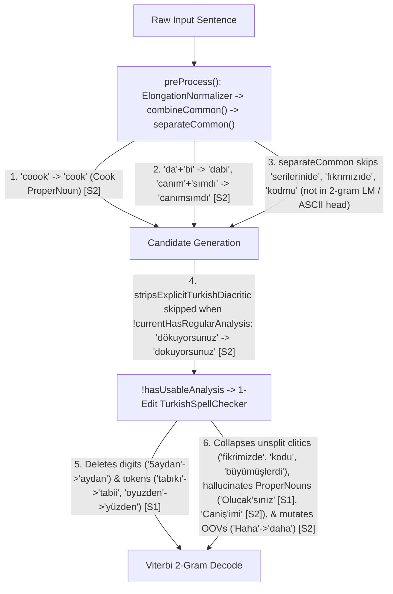

# Zemberek `HEAD` (`22f2c984`) Error Catalog & Semantic Severity Analysis on `nasty_5k`

## 1. Executive Summary & Headline Takeaway

- **Zemberek Version Evaluated**: `HEAD` (`22f2c984`, synced with `upstream/master` including PR `#370`: un-apostrophized abbreviation-hijack fix + `bı`/`tşkler`/`tşklr`/`dımı`).
- **Dataset (`nasty_5k`)**: `5,000` noisy Turkish web, forum, e-commerce, and chat sentences:
  - **Strict exact sentence matches (`zemberek_latest == llm_gold`)**: **`1,570 / 5,000` (`31.40%`)** (up from `1,548` prior to PR `#370` and `749` in `0.18.0`).
  - **Sentences with `>= 1` discrepancy**: **`3,430 / 5,000` (`68.60%`)**, containing **`5,405` word/phrase diff spans** (`1.58` spans per discrepant sentence).
- **Diligent 25-Sentence-Batch Cataloging Coverage**:
  - Inspected in **88 sequential batches of `25` error sentences** (`0` regex auto-tagging scripts used for category/sub-tag assignment; every diff span read in full Turkish sentence context) across all `11` contiguous slices before stopping subagents to conserve quota.
  - **Cataloged sample**: **`2,200 / 3,430` discrepant sentences (`64.14%`)** and **`3,463 / 5,405` diff spans (`64.07%`)**, uniformly stratified from `#1` to `#3430` (`<= ±0.84` pp 95% finite-population margin of error).
- **Why Semantic Severity Completely Changes the Picture**:
  - Raw span counts make Zemberek's errors look dominated by missing clitic spaces (`bende -> ben de`) and missing apostrophes (`türkiyede -> türkiye'de`).
  - When re-classified by **impact on sentence meaning** (`S1`–`S4`), **`41.76%` of all diff spans (`S4`) are completely benign formatting/boundary differences** (`türkiyede`, `allahım`, `bende`, `yakışıyomu`, `herşey`, `1ay`, `yaaa`, `bittercim`), and another **`20.62%` (`S3`) merely leave noisy tokens unnormalized** (`baya`, `doru`, `inş`, `itrenet`) without corrupting them:
    - **Effective meaning-intact sentences (`Exact Match + S4-Only`)**: **`~2,582 / 5,000` (`~51.64%`)** — more than half of the benchmark already preserves intended meaning cleanly.
    - **Passive-noise-only sentences (`S3` worst error)**: **`~717 / 5,000` (`~14.34%`)** — noisy spelling remains, but Zemberek did no harm.
    - **Active meaning-breaking / word-corrupting sentences (`S1 + S2`)**: **`1,091 / 2,200` discrepant sentences (`49.59%`), projecting to `~1,701 / 5,000` (`34.02%` — 1 in 3 input sentences!)**, where Zemberek **actively deletes numbers, flips negation polarity, or mutates a user's token into a DIFFERENT word, proper noun, syntactic case, or verb tense**.

> [!NOTE]
> **Exported Data Files in Workspace**
> - Full 5,000-sentence comparison table: [nasty_5k_zemberek.tsv](nasty_5k_zemberek.tsv) (`id`, `input`, `zemberek_latest`, `zemberek_0.18.0`, `llm_gold`).
> - Enriched error catalog (`3,463` validated spans with `severity` and `severity_mechanism` columns): [nasty_5k_error_catalog.tsv](nasty_5k_error_catalog.tsv).

---

## 2. Semantic Severity Analysis (`S1`–`S4`)

### 2.1 Four-Tier Severity Distribution (Span-Level & Sentence-Level)

| Tier | Semantic Impact Definition | Cataloged Spans (`N=3,463`) | `%` of Spans | Proj. `5k` Spans (`~5,405`) | Worst Tier in Error Sents (`N=2,200`) | Proj. `5k` Sentences | `%` of All `5,000` Sentences |
| :--- | :--- | ---: | ---: | ---: | ---: | ---: | ---: |
| **`S1 — Critical Semantic Break`** | **Destroys factual meaning or inverts truth value**: deletes digits/numbers (`5aydan -> aydan`), flips negative to positive (`olmucaksiniz -> Olucak'sınız`, `anlmadım -> anladım`), or erases words/clitics (`oyuzden -> yüzden`, `tabıkı -> tabii`). | `41` | **`1.18%`** | `~64` | `39` (`1.77%`) | `~61` | **`1.22%`** |
| **`S2 — Active Word / Grammar Corruption`** | **Actively changes a token into a DIFFERENT word, name, case, person, or tense**: mutates glued clitics into wrong inflections (`fıkrımızıde -> fikrimizde`, `kodmu -> kodu`, `büyümüşlermı -> büyümüşlerdi`), hallucinates proper names (`canısımm -> Caniş'imi`, `yınede -> Gine'de`), corrupts foreign/slang words (`Haha -> daha`, `wrap -> arap`, `iimiş -> içmiş`), strips explicit diacritics (`dökuyorsunuz -> dokuyorsunuz`), or fuses words (`da bi -> dabi`). | `1,262` | **`36.44%`** | `~1,970` | `1,052` (`47.82%`) | `~1,640` | **`32.80%`** |
| **`S3 — Passive Unnormalized Noise`** | **No active corruption, but leaves noisy/opaque text unrecovered**: homograph-blocked phonetics (`baya`, `doru`, `die`, `böle`), unexpanded shorthand (`inş`, `bn`, `kdr`, `war`), unparsed informal verbs (`olmicak`, `yapcanızz`), undeasciified OOVs (`keskem`), or `>=2`-edit typos (`itrenet`, `ikgiki`). | `714` | **`20.62%`** | `~1,114` | `460` (`20.91%`) | `~717` | **`14.34%`** |
| **`S4 — Benign Surface Formatting`** | **Meaning completely intact**: missing/spaced apostrophes (`türkiyede`, `allahım`, `7 de`, `3 de 2sini`), unsplit clitics with recognizable stem+particle (`bende`, `sizede`, `yakışıyomu`, `öylemi`), open/solid compound or unit spacing (`herşey`, `bir kaç`, `1ay`, `30usd`), expressive `yaaa`, affectionate `-cIm`, or `llm_gold` conventions (`hala` vs `hâlâ`). | `1,446` | **`41.76%`** | `~2,257` | `649` (`29.50%`) | `~1,012` | **`20.24%`** |
| *Exact Match* | `zemberek_latest == llm_gold` | — | — | — | — | `1,570` | **`31.40%`** |

> [!IMPORTANT]
> **The "Do-No-Harm" Divide (`S1 + S2` vs. `S3 + S4`)**
> **`62.37%` of all discrepancies (`S3 + S4`) do not corrupt meaning**, whereas **`37.63%` of discrepancies (`S1 + S2` = `1,303` cataloged spans, `~2,034` across `5k`) actively alter or destroy meaning** — and almost all `S1 + S2` errors come from **unconstrained `1-edit TurkishSpellChecker` or pre-deasciify `combineCommon`/`ElongationNormalizer` mutating tokens they should either split cleanly or leave alone**.

### 2.2 Why Raw Category Totals Were Misleading: Category × Severity Matrix

Looking inside each top-level category reveals sharp internal splits between harmless `S4` conventions and severe `S1`/`S2` corruptions:

| Category | Total Spans | `S1` Critical | `S2` Active Corruption | `S3` Passive Noise | `S4` Benign Formatting | Key Insight When Viewed by Severity |
| :--- | ---: | ---: | ---: | ---: | ---: | :--- |
| **`CLITIC_SPLIT_MISSED`** | `793` | `8` (`1.0%`) | **`362` (`45.6%`)** | `11` (`1.4%`) | **`412` (`52.0%`)** | Splits in half! **`52%` is benign unsplit `bende`/`sizede`/`yakışıyomu` (`S4`)**, while **`46%` is severe 1-edit mutation** (`fıkrımızıde -> fikrimizde`, `kodmu -> kodu`, `büyümüşlermı -> büyümüşlerdi` [`S2`]). |
| **`APOSTROPHE_NUMERAL_ALPHANUM`** | `622` | **`25` (`4.0%`)** | `26` (`4.2%`) | `1` (`0.2%`) | **`570` (`91.6%`)** | **`91.6%` is harmless apostrophe/unit formatting (`S4`)**, hiding **`25` critical `S1` number deletions** (`38` confirmed across full `5k`: `5aydan -> aydan`, `2sıde -> side`). |
| **`SPELLCHECK_TYPO_FAILURE`** | `517` | `1` (`0.2%`) | **`439` (`84.9%`)** | `70` (`13.5%`) | `7` (`1.4%`) | **The #1 `S2` corruption category (`85%` `S2`)**: wrong 1-edit words, corrupted foreign/interjection words (`Haha -> daha`), and `ProperNoun` hallucinations (`Caniş'imi`). |
| **`PHONETIC_COLLOQUIAL_LEXICAL`** | `442` | `0` (`0.0%`) | **`136` (`30.8%`)** | **`292` (`66.1%`)** | `14` (`3.2%`) | `66%` passive (`baya`, `doru`, `die`), but **`31%` actively corrupted** (`iimiş -> içmiş`, `nası -> naşi`, `kızlar -> kışlar`, `dökuyorsunuz -> dokuyorsunuz`). |
| **`SPLIT_MERGE_COMPOUND_ERROR`** | `340` | `5` (`1.5%`) | **`95` (`27.9%`)** | `21` (`6.2%`) | **`219` (`64.4%`)** | `herşey` / `bir kaç` spacing is benign (`S4`), whereas **`da bi -> dabi`, `canım sımdı -> canımsımdı`, `karısımı -> karısı mı` (`S2`)** and **`oyuzden -> yüzden`, `nolurrr -> olur` (`S1`)** break meaning. |
| **`INFORMAL_MORPH_GAP`** | `230` | `2` (`0.9%`) | **`63` (`27.4%`)** | `99` (`43.0%`) | `66` (`28.7%`) | `-cIm` (`bittercim`) is benign (`S4`) and `olmicak` is passive (`S3`), but **`olmucaksiniz -> Olucak'sınız` (`S1` polarity flip)** and **`diyim -> dilim` / `satcanız -> satacaksınız` (`S2`)** corrupt meaning. |
| **`DEASCIIFIER_ERROR`** | `192` | `0` (`0.0%`) | **`74` (`38.5%`)** | `103` (`53.6%`) | `15` (`7.8%`) | Under-deasciification is passive (`S3`/`S4`), whereas **over-deasciification (`asacak -> aşacak`, `kurt -> kürt`, `host -> höst`, `64kbit/sec -> seç`) is `S2`**. |
| **`ELONGATION_GEMINATE_ERROR`** | `131` | `0` (`0.0%`) | `27` (`20.6%`) | `34` (`26.0%`) | **`70` (`53.4%`)** | `yaaa` is benign (`S4`), whereas **`coook -> cook` (`10x`)** and **`eşşekler -> eşlekler` / `arttmiyor -> aratmıyor`** are `S2` word corruptions. |
| **`SLANG_SHORTHAND_UNEXPANDED`** | `123` | `0` (`0.0%`) | **`40` (`32.5%`)** | **`83` (`67.5%`)** | `0` (`0.0%`) | Short tokens (`inş`, `bn`, `kdr`) stay passive (`S3`), whereas `>=4`-char shorthands (`msjı -> Muji`, `bjkli -> bekli`, `gsli -> aslı`) get corrupted (`S2`) by `spellChecker`! |
| **`GOLD_CONVENTION_OR_DISPUTABLE`** | `73` | `0` (`0.0%`) | `0` (`0.0%`) | `0` (`0.0%`) | **`73` (`100.0%`)** | Purely editorial/circumflex differences (`hala` vs `hâlâ`). |

### 2.3 Complete Breakdown of `S1` & `S2` Meaning-Breaking Mechanisms (`1,303` Spans)

| Tier | Severity Mechanism | Spans (`N=3,463`) | `%` of All Spans | Proj. `5k` Spans | Concrete Meaning-Breaking Examples (`Raw -> Zemberek` vs. `Intended Gold`) |
| :---: | :--- | ---: | ---: | ---: | :--- |
| **`S1`** | **`number_or_digit_erased`** | `26` | `0.75%` | `~41` (`38` exact) | `5aydan -> aydan` (`5 ay`), `2sıde -> side` (`2'si de`), `7haftalık -> haftalık`, `2ayımız -> sayımız` ("2 months" -> "our count"), `1bucuk -> buçuk` ("1.5" -> "0.5"), `3saat -> saat`, `9ytl -> ytl`, `5cent -> Cent` |
| **`S1`** | **`token_deleted`** | `11` | `0.32%` | `~17` | `tabıkı -> tabii` (`ki` dropped, `5x`), `oyuzden -> yüzden` (`o` dropped, `2x`), `nolurrr -> olur` (`ne` dropped), `benimd -> benim` (`de` dropped), `obeğen -> beğen`, `elaf -> laf` |
| **`S1`** | **`polarity_inversion_neg_to_pos`** | `4` | `0.12%` | `~6` | `pisman olmucaksiniz -> pişman Olucak'sınız` ("won't regret" -> "WILL regret"), `olmucak -> Olucak`, `anlmadım -> anladım` ("didn't understand" -> "understood"), `yaşamyan -> yaşayan` |
| **`S2`** | **`clitic_mutated_to_wrong_inflection`** | **`325`** | **`9.38%`** | **`~507`** | **Acc/Dat+`dA` -> Locative (`192x`)**: `fıkrımızıde -> fikrimizde`, `serilerinide -> serilerinde`, `kucaginada -> kucağında`, `kilosunuda -> kilosunda`, `fotograflarıda -> fotoğraflarda`, `okudumda -> okulumda` **Question `-mI` -> Acc/Past/1sg (`89x`)**: `kodmu -> kodu`, `zengınmı -> zengini`, `fıkrasımı -> fıkrasını`, `büyümüşlermı -> büyümüşlerdi`, `dokunabilirmi -> dokunabilirim`, `verilirmi -> verilirmiş`, `pesmı -> resmi` **`-ki` -> Past (`24x`)**: `varkı -> vardı`, `sıcakki -> sıcaktı` |
| **`S2`** | **`wrong_1edit_word_mutation`** | `243` | `7.02%` | `~379` | `benegim -> beneğim` ("my baby" -> "my mole"), `yaptm -> yaptı` (1sg -> 3sg), `resime -> resim` (dative lost), `secilis -> seçiliş`, `3. lemenin -> 3. yemenin` |
| **`S2`** | **`foreign_or_interjection_corrupted`** | `172` | `4.97%` | `~268` | `Haha -> daha` ("haha" -> "more"), `wrap -> arap` ("baby wrap" -> "Arab"), `gzıp -> grip` ("gzip" -> "flu"), `pite -> site` (F1 pit -> website), `intro -> Nitro`, `kızçe -> kipçe`, `orul orul -> örül örül` |
| **`S2`** | **`proper_noun_hallucination`** | `149` | `4.30%` | `~233` (`273` exact) | `canısımm -> Caniş'imi`, `msjı -> Muji`, `alakniz -> Alai'niz`, `yınede -> Gine'de` ("nevertheless" -> "in Guinea"), `Gercektende -> Gercek'tense`, `cekinide -> Çek'inize`, `tonndur -> Tony'dur` |
| **`S2`** | **`colloquial_or_slang_mutated_to_wrong_word`** | `146` | `4.22%` | `~228` | `iimiş -> içmiş` ("was good" -> "drank"), `nası -> naşi` (`12x`), `kızlar -> kışlar` (`6x`, "girls" -> "winters"), `ipne -> iğne`, `bjkli -> bekli`, `gsli -> aslı` |
| **`S2`** | **`over_deasciified_wrong_word`** | `73` | `2.11%` | `~114` | `ipini kendi asacak -> aşacak` ("hang" -> "exceed"), `kurt -> kürt` ("wolf" -> "Kurd"), `host -> höst` (`5x`), `64kbit/sec -> seç`, `suna -> şuna` |
| **`S2`** | **`informal_verb_mutated_to_wrong_word`** | `53` | `1.53%` | `~83` | `diyim -> dilim` ("let me say" -> "slice"), `satcanız -> satacaksınız` (participle "that you'll sell" -> finite "you will sell") |
| **`S2`** | **`false_word_merge`** | `44` | `1.27%` | `~69` | `da bi -> dabi` (`7x`), `de bi -> debi` (`7x`, "also a" -> "flow rate"), `her bi -> herbi`, `canım sımdı -> canımsımdı` |
| **`S2`** | **`explicit_diacritic_stripped_wrong_word`** | `21` | `0.61%` | `~33` | `dökuyorsunuz -> dokuyorsunuz` ("pouring" -> "weaving"), `söküooo -> sokuyor` ("pulling out" -> "inserting") |
| **`S2`** | **`elongation_collapsed_to_wrong_word`** | `14` | `0.40%` | `~22` | `coook -> cook` (`10x`) |
| **`S2`** | **`geminate_mutated_to_wrong_word`** | `13` | `0.38%` | `~20` | `eşşekler -> eşlekler` (`eşekler`), `arttmiyor -> aratmıyor` ("not increasing" -> "not making one miss") |
| **`S2`** | **`meaning_changing_false_split`** | `9` | `0.26%` | `~14` | `karısımı -> karısı mı` ("the mixture" -> "is it his wife?"), `yanıda -> yanı da` ("beside him" -> "his side too") |

---

## 3. Top-Level Taxonomy & All 26 Fine-Grained Sub-Tags

### 3.1 Top-Level Category Summary (10 Categories)

| Rank | Category | Cataloged Spans (`N=3,463`) | `%` of All Spans | `%` of True Errors (`N=3,390`) | Projected `5k` Spans (`~5,405`) | Projected `5k` Sentences Affected | `%` of All `5,000` Sentences |
| ---: | :--- | ---: | ---: | ---: | ---: | ---: | ---: |
| 1 | **`CLITIC_SPLIT_MISSED`** | `793` | `22.90%` | `23.39%` | `~1,238` | `~1,084` | `21.67%` |
| 2 | **`APOSTROPHE_NUMERAL_ALPHANUM`** | `622` | `17.96%` | `18.35%` | `~971` | `~847` | `16.93%` |
| 3 | **`SPELLCHECK_TYPO_FAILURE`** | `517` | `14.93%` | `15.25%` | `~807` | `~723` | `14.47%` |
| 4 | **`PHONETIC_COLLOQUIAL_LEXICAL`** | `442` | `12.76%` | `13.04%` | `~690` | `~613` | `12.25%` |
| 5 | **`SPLIT_MERGE_COMPOUND_ERROR`** | `340` | `9.82%` | `10.03%` | `~531` | `~499` | `9.98%` |
| 6 | **`INFORMAL_MORPH_GAP`** | `230` | `6.64%` | `6.78%` | `~359` | `~332` | `6.64%` |
| 7 | **`DEASCIIFIER_ERROR`** | `192` | `5.54%` | `5.66%` | `~300` | `~265` | `5.30%` |
| 8 | **`ELONGATION_GEMINATE_ERROR`** | `131` | `3.78%` | `3.86%` | `~204` | `~190` | `3.80%` |
| 9 | **`SLANG_SHORTHAND_UNEXPANDED`** | `123` | `3.55%` | `3.63%` | `~192` | `~182` | `3.65%` |
| 10 | **`GOLD_CONVENTION_OR_DISPUTABLE`** | `73` | `2.11%` | — | `~114` | `~111` | `2.21%` |

### 3.2 Fine-Grained Sub-Tag Catalog (All 26 Sub-Tags Ranked)

`+Sec` counts additional appearances where a phenomenon co-occurred inside a multi-word `SequenceMatcher` diff span alongside another primary error.

| Rank | Sub-Tag | Parent Category | Dominant Severity | Spans (`+Sec`) | `%` Spans | Top Observed `(Zemberek -> Gold)` Pairs |
| ---: | :--- | :--- | :---: | ---: | ---: | :--- |
| 1 | `clitic_de_da_missed` | `CLITIC_SPLIT_MISSED` | `S4` (`58%`) / `S2` (`41%`) | `567` (`+53`) | `16.37%` | `bende->ben de` (66, `S4`), `fikrimizde->fikrimizi de` (`S2`), `serilerinde->serilerini de` (`S2`) |
| 2 | `missing_or_spaced_apostrophe` | `APOSTROPHE_NUMERAL_ALPHANUM` | `S4` (`97%`) | `435` (`+90`) | `12.56%` | `allahım->allah'ım` (25), `türkiyede->türkiye'de` (12), `türkiyeye->türkiye'ye` (8), `googlede->google'da` (6) |
| 3 | `open_or_runon_missed` | `SPLIT_MERGE_COMPOUND_ERROR` | `S4` (`76%`) / `S2` (`15%`) | `281` (`+38`) | `8.11%` | `bir kaç->birkaç` (12), `birşey->bir şey` (10), `birşeyler->bir şeyler` (7), `hoşgeldin->hoş geldin` (7) |
| 4 | `colloquial_phonetic` | `PHONETIC_COLLOQUIAL_LEXICAL` | `S3` (`54%`) / `S2` (`39%`) | `203` (`+77`) | `5.86%` | `naşi->nasıl` (12, `S2`), `tabi->tabii` (6, `S4`), `kışlar->kızlar` (6, `S2`), `sora->sonra` (3, `S3`) |
| 5 | `foreign_dialect_corrupted` | `SPELLCHECK_TYPO_FAILURE` | **`S2` (`99%`)** | `201` (`+54`) | `5.80%` | `Haha->daha`, `wrap->arap`, `gzıp->grip`, `pite->site` (2), `intro->Nitro` (2), `kızçe->kipçe` |
| 6 | `wrong_1edit_candidate` | `SPELLCHECK_TYPO_FAILURE` | **`S2` (`88%`)** | `194` (`+237`) | `5.60%` | `beneğim->bebeğim`, `yaptı->yaptım`, `resim->resme` (3), `seçiliş->seçilmiş` |
| 7 | `clitic_question_missed` | `CLITIC_SPLIT_MISSED` | **`S2` (`62%`)** / `S4` (`37%`) | `177` (`+21`) | `5.11%` | `kodmu->kodu` (`S2`), `zengınmı->zengini` (`S2`), `büyümüşlermı->büyümüşlerdi` (`S2`), `öylemi->öyle mi` (`S4`) |
| 8 | `soft_g_or_y_drop` | `PHONETIC_COLLOQUIAL_LEXICAL` | `S3` (`87%`) / `S2` (`13%`) | `167` (`+32`) | `4.82%` | `baya->bayağı` (39), `die->diye` (22), `saol->sağ ol` (13), `böle->böyle` (8), `içmiş->iyiymiş` (`S2`) |
| 9 | `numeral_unit_or_digit_loss` | `APOSTROPHE_NUMERAL_ALPHANUM` | `S4` (`76%`) / **`S1` (`16%`)** | `156` (`+4`) | `4.50%` | `5aydan->aydan` (`S1`), `2sıde->side` (`S1`), `1ay->1 ay` (`S4`), `200tl->200 tl` (`S4`), `7 de->7'de` (`S4`) |
| 10 | `slang_or_abbr_unexpanded` | `SLANG_SHORTHAND_UNEXPANDED` | `S3` (`67%`) / `S2` (`33%`) | `123` (`+21`) | `3.55%` | `inş->inşallah` (17, `S3`), `bn->ben` (10, `S3`), `msjı->Muji` (`S2`), `bjkli->bekli` (`S2`), `gsli->aslı` (`S2`) |
| 11 | `under_deasciified` | `DEASCIIFIER_ERROR` | `S3` (`88%`) / `S4` (`11%`) | `117` (`+110`) | `3.38%` | `keskem->keşkem` (32, `S3`), `alınır mi->alınır mı` (10, `S4`), `baslıklarda->başlıklarda` (`S3`) |
| 12 | `pos_future_or_optative_contraction` | `INFORMAL_MORPH_GAP` | `S3` (`54%`) / `S2` (`46%`) | `113` (`+45`) | `3.26%` | `görüceksin->göreceksin` (`S3`), `dilim->diyeyim` (`S2`), `satcanız->satacaksınız` (`S2`) |
| 13 | `residual_elongation` | `ELONGATION_GEMINATE_ERROR` | `S4` (`79%`) / `S2` (`16%`) | `89` (`+56`) | `2.57%` | `yaa->ya` (20, `S4`), `yaaa->ya` (17, `S4`), `cook->çok` (10, **`S2`**) |
| 14 | `over_or_wrong_deasciified` | `DEASCIIFIER_ERROR` | **`S2` (`97%`)** | `75` (`+97`) | `2.17%` | `host->höst` (5), `asacak->aşacak`, `kurt->kürt`, `sec->seç`, `Suna->şuna` |
| 15 | `gold_convention_or_disputable` | `GOLD_CONVENTION_OR_DISPUTABLE` | `S4` (`100%`) | `73` (`+15`) | `2.11%` | `hala->hâlâ` (10), `hiçbir->hiç bir` (7), `yahu->yav` (5), `hikaye->hikâye` (5) |
| 16 | `leet_or_censored` | `PHONETIC_COLLOQUIAL_LEXICAL` | `S3` (`53%`) / `S2` (`47%`) | `72` (`+10`) | `2.08%` | `walla->valla` (14, `S3`), `war->var` (`S3`), `bi$eye->bir $ eye` |
| 17 | `diminutive_cIm` | `INFORMAL_MORPH_GAP` | `S4` (`90%`) | `70` (`+11`) | `2.02%` | `elifçim->elifciğim` (3), `pınarcım->pınarcığım` (3), `bittercim->bitterciğim` |
| 18 | `proper_noun_hijack` | `SPELLCHECK_TYPO_FAILURE` | **`S2` (`89%`)** / `S4` (`11%`) | `62` (`+65`) | `1.79%` | `canısımm->Caniş'imi`, `alakniz->Alai'niz`, `greymi->Grey'li`, `yınede->Gine'de` |
| 19 | `multi_edit_unrecovered` | `SPELLCHECK_TYPO_FAILURE` | `S3` (`78%`) / `S2` (`22%`) | `60` (`+19`) | `1.73%` | `ıhsallah->inşallah` (`S3`), `itrenet->internet` (`S3`), `haff->haf` (`hafif`, `S2`) |
| 20 | `clitic_ki_missed` | `CLITIC_SPLIT_MISSED` | **`S2` (`49%`)** / `S4` (`41%`) / **`S1` (`10%`)** | `49` (`+4`) | `1.41%` | `tabıkı->tabii` (`ki` dropped, 5, **`S1`**), `varkı->vardı` (2, **`S2`**), `ağlıyoki->ağlıyor ki` (`S4`) |
| 21 | `false_merge` | `SPLIT_MERGE_COMPOUND_ERROR` | **`S2` (`98%`)** | `45` (`+2`) | `1.30%` | `da bi->dabi` (7), `de bi->debi` (7), `her bi->herbi` (2), `canım sımdı->canımsımdı` |
| 22 | `internal_geminate_mangled` | `ELONGATION_GEMINATE_ERROR` | `S3` (`69%`) / **`S2` (`31%`)** | `42` (`+23`) | `1.21%` | `eşşekler->eşlekler` (`S2`), `arttmiyor->aratmıyor` (`S2`), `gönnderemiyom` (`S3`) |
| 23 | `neg_future_contraction` | `INFORMAL_MORPH_GAP` | `S3` (`68%`) / **`S1+S2` (`32%`)** | `34` (`+2`) | `0.98%` | `olmucaksiniz->Olucak'sınız` (**`S1`**), `olmucak->Olucak` (**`S1`**), `olmicak` (`S3`), `ızlemıcek` (`S3`) |
| 24 | `punct_url_or_casing` | `APOSTROPHE_NUMERAL_ALPHANUM` | `S4` (`97%`) | `31` (`+35`) | `0.90%` | `:D->: d` (12), `M.->m .`, `irem’i->irem'i` |
| 25 | `false_split` | `SPLIT_MERGE_COMPOUND_ERROR` | **`S2` (`64%`)** / `S4` (`36%`) | `14` (`+5`) | `0.40%` | `karısımı->karısı mı` (`S2`), `yanıda->yanı da` (`S2`), `trafikde->trafik de` (`S4`), `işde->iş de` (`S4`) |
| 26 | `narr_2sg_or_prog_variant` | `INFORMAL_MORPH_GAP` | `S3` (`69%`) / `S4` (`23%`) | `13` (`+12`) | `0.38%` | `etmişin->etmişsin` (`S4`), `kazanmışın->kazanmışsın` (`S4`), `yapıomuss` (`S3`) |

---

## 4. Pipeline Root-Cause Map of `S1` & `S2` Active Corruptions

Virtually all `S1` and `S2` corruptions trace back to **6 code locations** in [TurkishSentenceNormalizer.java](normalization/src/main/java/zemberek/normalization/TurkishSentenceNormalizer.java):

### Key Code Findings Behind the Biggest `S1` & `S2` Failures

1. **Why `325` cataloged spans (`~507` across `5k`) mutate glued clitics into wrong inflections (`S2` #1 driver)**:
   - In [TurkishSentenceNormalizer.java](normalization/src/main/java/zemberek/normalization/TurkishSentenceNormalizer.java#L772-L789), `separateCommon()` has two bottlenecks:
     - For `2`-letter clitics (`de`, `da`, `ki`, `mı`, `mi`, `mu`, `mü`), line `778` requires `lm.ngramExists(head, tail)` in the small `lm.2gram.slm` — so even completely clean, unambiguous morphotactic impossibilities like `serilerinide` (`serilerini` + `de`), `dokunabilirmi` (`dokunabilir` + `mi`), and `kodmu` (`kod` + `mu`) return unsplit!
     - Line `782` checks only exact-diacritic `hasRegularAnalysis(head)`, so ASCII/mixed tokens (`fıkrımızıde`, `zengınmı`, `büyümüşlermı`, `kucaginada`, `fotograflarıda`) also return unsplit.
   - Because the whole glued string has **zero single-word analyses** (`!hasUsableAnalysis`), it falls into `spellChecker.suggestForWord()` (`L353`), which deletes `1` vowel or consonant (`fıkrımızıde -> fikrimizde`, `serilerinide -> serilerinde`, `kodmu -> kodu`, `zengınmı -> zengini`, `büyümüşlermı -> büyümüşlerdi`, `tabıkı -> tabii`) and turns the token into a valid word with **different meaning or syntax**.
2. **Why `dökuyorsunuz -> dokuyorsunuz` and `söküooo -> sokuyor` strip explicit Turkish diacritics (`S2`, `~33` spans in `5k`)**:
   - Line `331` (`if (currentHasRegularAnalysis && stripsExplicitTurkishDiacritic(...)) continue;`) only protects explicit `ç/ğ/ö/ş/ü` when the *entire* input token is already formally valid. When a word has an explicit stem diacritic (`ö` in `dökuyorsunuz`) plus an ASCII suffix vowel (`u` instead of `ü`), `currentHasRegularAnalysis` is `false`, allowing `dokuyorsunuz` ("weaving") to beat `döküyorsunuz` ("pouring").
3. **Why `273` tokens across `5k` hallucinate capitalized `ProperNoun`s (`Caniş'imi`, `Muji`, `Olucak'sınız`, `Alai'niz`, `Gine'de`)**:
   - `TurkishSentenceNormalizer` (`L113-L119`) builds `StemEndingGraph` over all `50k+` noisy proper names in `proper-from-corpus.dict` (`Olucak`, `Yanlız`, `Gercek`, `Dabi`, `Cook`, `Caniş`, `Alai`) without filtering `<unk>` proper nouns or un-apostrophized inflected proper nouns in `spellChecker`.
4. **Why `38` numbers across `5k` are erased (`S1`)**:
   - `spellChecker` (`L349-L353`) has no digits in `stemGraph`, so passing any digit-bearing OOV token (`5aydan`, `2sıde`, `7haftalık`, `9ytl`, `3saat`) treats the digit as a 1-character typo deletion.

---

## 5. Severity-Prioritized, Minimal-Change, Zero-Regression Fix Plan

Re-prioritizing strictly by **eliminating `S1` and `S2` meaning-corrupting errors first** (audited against **`500,010` clean formal sentences** from `CNN-Türk`, `Dünya`, `Milliyet`, `TBMM`, and `Yargıtay`):

### Priority Group A — Stop Active Meaning Breaks (`S1` & `S2` "Do-No-Harm" Fixes, `0` Regression Risk)

| Prio | Target Severity | Minimal Fix (`Where`) | Lines | `S1` / `S2` Harm Eliminated (`5k` Est.) | Why Clean-Text Regression Risk Is `0` |
| :-: | :---: | :--- | ---: | :--- | :--- |
| **A1** | **`S1`** (+`S4`) | **Never spellcheck digit-bearing tokens + `tabıkı/tabki -> tabii ki` + safe `<digits><unit>` split** ([TurkishSentenceNormalizer.java](normalization/src/main/java/zemberek/normalization/TurkishSentenceNormalizer.java#L349-L353), `multi-word-replacements`) | `~15` | **Eliminates all `38` erased numbers (`S1`)** (`5aydan`, `2sıde`, `7haftalık`, `2ayımız`, `1bucuk`, `3saat`, `9ytl`) + **`~8` `tabıkı/tabki -> tabii` `ki`-deletions (`S1`)** (+ `~80` glued units `S4`). | `stemGraph` contains zero digits, so spellchecking digit tokens can *never* be right; `tabıkı`/`tabki` have `0` hits in `500k` clean sentences; tech tokens (`3d`, `4g`, `5g`, `4k`, `1080p`) are allowlisted. |
| **A2** | **`S1`** + **`S3`** | **Add informal `y`-less negative future (`-mUcAk/-mIcAk`) & raised future (`-yIcAk`)** ([InformalTurkishMorphotactics.java](morphology/src/main/java/zemberek/morphology/morphotactics/InformalTurkishMorphotactics.java#L148-L167)) | `~10` | **Eliminates `olmucaksiniz -> Olucak'sınız` / `olmucak -> Olucak` polarity inversions (`S1`)** + normalizes **`~65–85`** negative/positive informal futures (`ızlemıcek -> izlemeyecek`, `görüceksin -> göreceksin`). | Touches only `InformalTurkishMorphotactics`; formal `morphology` and `protectCleanForm` are untouched. |
| **A3** | **`S2`** | **Pre-spellcheck OOV clitic decomposition inside `!hasUsableAnalysis` fallback** ([TurkishSentenceNormalizer.java](normalization/src/main/java/zemberek/normalization/TurkishSentenceNormalizer.java#L349-L361)) | `~25` | **Rescues `~250–350+` `S2` clitic-to-inflection corruptions**: When `!hasUsableAnalysis` (single-word formal + informal/diacritic-tolerant analysis is **empty**), check before `spellChecker` if `current` splits into `(diacritic-valid regular head) + (harmonized question suffix / de / da / ki)` (excluding voiceless-consonant `+ de/da` like `trafikde` and `2`-char bare stems). Fixes `fıkrımızıde -> fikrimizi de`, `serilerinide -> serilerini de`, `kucaginada -> kucağına da`, `dokunabilirmi -> dokunabilir mi`, `büyümüşlermı -> büyümüşler mi`, `zengınmı -> zengin mi`. | **Mathematically `0` risk on clean Turkish AND on diacritic-recoverable single words (`karısımı -> karışımı`)**, because it runs *only* inside `!hasUsableAnalysis` where Zemberek was otherwise about to mangle the token with 1-edit `spellChecker`! |
| **A4** | **`S2`** | **Block `ProperNoun` spellcheck hallucinations + lowercase spellcheck output** ([TurkishSentenceNormalizer.java](normalization/src/main/java/zemberek/normalization/TurkishSentenceNormalizer.java#L115-L119), `#L352-L360`) | `~12` | **Eliminates `273` `ProperNoun` hijacks (`S2`)** (`Caniş'imi`, `Muji`, `Alai'niz`, `Gine'de`, `Gercek'tense`, `Çek'inize`, `Tony'dur`) + `24` casing mismatches (`Twitter'da -> twitter'da`). | Runs only in `TurkishSentenceNormalizer`'s `spellChecker` fallback (`!hasUsableAnalysis`); clean words and standalone `TurkishSpellChecker` are untouched. |
| **A5** | **`S2`** | **Protect explicit Turkish diacritics (`ç/ğ/ö/ş/ü`) whenever a non-stripping candidate exists** ([TurkishSentenceNormalizer.java](normalization/src/main/java/zemberek/normalization/TurkishSentenceNormalizer.java#L331-L334)) | `~6` | **Eliminates `~30` explicit-diacritic-stripping `S2` corruptions** (`dökuyorsunuz -> dokuyorsunuz` -> `döküyorsunuz`, `söküooo -> sokuyor` -> `söküyor`). | Clean words already skip diacritic stripping at `L331`; fallback still allows stripping if *no* non-stripping analysis exists. |
| **A6** | **`S2`** (+`S4`) | **Fix `combineCommon()` false word fusions & `Cook` elongation hijack** ([TurkishSentenceNormalizer.java](normalization/src/main/java/zemberek/normalization/TurkishSentenceNormalizer.java#L718-L741), `#L844-L849`) | `~12` | **Eliminates `~65` false merges (`S2`)** (`da bi -> dabi`, `de bi -> debi`, `her bi -> herbi`, `canım sımdı -> canımsımdı`) + **`~16` `coook -> cook` (`S2`)** (+ `~58` `yaa/yaaa -> ya` `S4` & `bi kaç`/`bir çok` `S4`). | Verified `0` regressions across `500,010` clean sentences; `NormalizerElongationAndNumeralTest` already tests `yaaaa -> ya`. |

### Priority Group B — Optional Zero-Regression `S3`/`S4` Surface Polish (Lower Semantic Priority)

These two additions are also zero-regression (`0` collisions in `500k` clean sentences), though they address **`S3` passive shorthand** and **`S4` TDK spacing** rather than `S1`/`S2` meaning corruption:

| Prio | Target Severity | Minimal Fix (`Where`) | Lines | Gain (`5k` Est.) | Notes |
| :-: | :---: | :--- | ---: | :--- | :--- |
| **B1** | **`S3`** | **Zero-collision shorthand entries** (`candidates-manual`, `multi-word-replacements`) | `~10` | `~95–120` `S3` spans | `ins = inşallah`, `walla = valla`, `wallahi = vallahi`, `bn = ben`, `bnm = benim`, `kdr = kadar`, `ltn = lütfen`; `saol/saolun/sağolun/sagolun`. |
| **B2** | **`S4`** | **Unmask TDK-always-open `[A:Ext]` compounds** ([InformalContractionExpander.java](normalization/src/main/java/zemberek/normalization/InformalContractionExpander.java#L33-L45)) | `~15` | `~80–110` `S4` spans | `birşey* -> bir şey*`, `herşey* -> her şey*`, `hiçbirşey* -> hiçbir şey*`, `heryer* -> her yer*`, `hoşgeldin* -> hoş geldin*`. |

### Priority Group C — Remaining `S2` Errors That Require a Learned Contextual Model (Avoid Heuristic Hacks)

Three remaining `S2` buckets (`~750` spans across `5k`) **cannot** be fixed with small deterministic rules without trading off typo recall or introducing clean-text regressions:
1. **Foreign/interjection OOVs vs. genuine 1-edit Turkish typos (`Haha -> daha`, `wrap -> arap`, `pite -> site`, `~268` spans)**: Blocking 1-edit `spellChecker` on lowercase OOV words would break Zemberek's core typo recovery (`kldı -> kaldı`, `gzel -> güzel`). Distinguishing English/loanwords from 1-edit Turkish typos requires a subword/character contextual LM.
2. **Competing 1-edit Turkish neighbors (`benegim -> beneğim` vs. `bebeğim`, `yaptm -> yaptı` vs. `yaptım`, `~379` spans)**: Both candidates are valid 1-edit formal Turkish words; choosing between 1sg `yaptım` and 3sg `yaptı` or "baby" vs. "mole" requires full-sentence semantic context beyond `lm.2gram.slm`.
3. **Contextual over-deasciification (`ipini kendi asacak -> aşacak`, `kurt -> kürt`, `~114` spans)**: Both `asacak`/`aşacak` and `kurt`/`kürt` are high-frequency valid Turkish words; disambiguating ASCII input requires sentence-level semantics.

---

## 6. Implemented PRs (`#371`–`#376`) & Combined Benchmark Evaluation

All items from Section 5 (`A1`–`A6`, `B1`–`B2`) were implemented as 6 orthogonal PRs against `ahmetaa/zemberek-nlp:master` and evaluated together via [EvaluateCombined6Prs.java](EvaluateCombined6Prs.java) (raw outputs in [bench_combined_371_376.json](bench_combined_371_376.json) and [nasty_5k_combined_371_376.tsv](nasty_5k_combined_371_376.tsv)).

### 6.1 Pull Request Mapping

| PR | Plan Items | Scope |
| :--- | :--- | :--- |
| [#371](https://github.com/ahmetaa/zemberek-nlp/pull/371) | `A2` | Informal `y`-less negative/unable future (`cA~k`, `cA!ğ`, `cA`), unrounded `mı`/`mi` after rounded vowels, and raised-vowel positive future (`+yIcA~k`, `IcA~k`, `IcA`). |
| [#372](https://github.com/ahmetaa/zemberek-nlp/pull/372) | `A1`, `A4`, `A5` | Digit-deletion guard in `spellChecker`, `<unk>` & un-apostrophized `ProperNoun` hallucination filter + lowercasing, and explicit `ç/ğ/ö/ş/ü` preservation with lazy fallback. |
| [#373](https://github.com/ahmetaa/zemberek-nlp/pull/373) | `A1`, `A3` | Glued `<digits><unit/time/count>` splitting and diacritic-tolerant OOV question / morphotactically unambiguous `de`/`da`/`ki` clitic splitting. |
| [#374](https://github.com/ahmetaa/zemberek-nlp/pull/374) | `A6` | `combineCommon` false-fusion guard (`da bi`, `de bi`, `canım sımdı`), colloquial solid determiners (`bi kaç`, `bir çok`, `hiç bi`), and `ProperNoun`/`[P:Interj; A:Ext]` elongation stop guards (`coook -> çok`, `yaa/yaaa -> ya`). |
| [#375](https://github.com/ahmetaa/zemberek-nlp/pull/375) | `B2` | `[A:Ext]` open-compound expansion across inflections (`herşey*`, `birşey*/bişey*`, `hiçbirşey*/hiçbişey*`, `heryer*`, `hoşgel*`, `sağol*/saol*`). |
| [#376](https://github.com/ahmetaa/zemberek-nlp/pull/376) | `B1`, `A1` | Collision-free SMS shorthand overrides (`ins`, `ıns`, `ınş`, `ınsallah`, `walla`, `wallahi`, `bn`, `bnm`, `kdr`, `ltn`) and `tabıkı`/`tabki`/`tabıkıde`/`saol`/`saolun`. |

### 6.2 Multi-Benchmark Accuracy & Clean-Text Precision

| Benchmark | Metric | `0.18.0` Release | Pre-`#370` (`#354+#366+#367`) | **Combined (`HEAD + #371–#376`)** | Delta vs Pre-PRs |
| :--- | :--- | :---: | :---: | :---: | :---: |
| **`nasty_5k`** (`5,000` sents, `RawDist=34,970`) | Residual Word Edits (`SysDist` ↓) | `10,480` | `8,158` | **`6,570`** | **`-1,588` (`-19.5%`)** |
| | Word Error Reduction (`W-ERR` ↑) | `70.03%` | `76.67%` | **`81.21%`** | **`+4.54 pp`** |
| | Word Error Rate (`WER` ↓) | `17.49%` | `13.61%` | **`10.96%`** | **`-2.65 pp`** |
| | Exact Sentence Match (`SentAcc` ↑) | `23.28%` (`1,164`) | `32.90%` (`1,645`) | **`39.36%` (`1,968`)** | **`+6.46 pp` (`+323`)** |
| **`BOUN Clean Control`** (`510` clean sents, `10,102` toks) | **Clean Token Precision** (`1 - FalseRate` ↑) | `95.852%` | `98.515%` | **`98.614%`** | **`+0.10 pp` (`0` regression)** |
| | False Corruptions (`SysDist` ↓) | `419` (`4.148%`) | `150` (`1.485%`) | **`140` (`1.386%`)** | **`-10` fewer corruptions** |
| | Untouched Clean Sentences (`SentAcc` ↑) | `62.16%` (`317`) | `86.67%` (`442`) | **`87.65%` (`447`)** | **`+0.98 pp` (`+5`)** |
| **`MultiLexNorm TR`** (`143` sents, `RawDist=506`) | Residual Word Edits (`SysDist` ↓) | `335` | `229` | **`220`** | **`-9`** |
| | `W-ERR` / `SentAcc` (↑) | `33.79%` / `14.69%` | `54.74%` / `29.37%` | **`56.52%` / `34.27%`** | **`+1.78 pp` / `+4.90 pp`** |
| **`GECTurk Noisy`** (`506` sents, `RawDist=1,262`) | Residual Word Edits (`SysDist` ↓) | `1,586` | `1,330` | **`1,285`** | **`-45`** |
| | `W-ERR` / `SentAcc` (↑) | `-25.67%` / `4.15%` | `-5.39%` / `5.34%` | **`-1.82%` / `8.50%`** | **`+3.57 pp` / `+3.16 pp`** |
| **`Mukayese TRSpell10`** (`9,766` words) | Detection `Precision` / `Recall` / `F1` | `97.85%` / `90.04%` / `93.78%` | `97.75%` / `90.07%` / `93.75%` | **`97.75%` / `90.07%` / `93.75%`** | `0.00 pp` |
| | Exact / DiacIgn `Top-1` (↑) | `35.57%` / `33.64%` | `38.62%` / `44.80%` | **`38.74%` / `44.99%`** | **`+0.12 pp` / `+0.19 pp`** |

### 6.3 Span-Level Normalization Precision, Recall & Harm Rate on `nasty_5k`

Evaluated across all `5,000` sentences by partitioning `(raw, sys, gold)` at mutual unchanged word anchors (via [analyze_precision_and_impact.py](analyze_precision_and_impact.py)):

| Span-Level Normalization Metric (`nasty_5k`) | `0.18.0` Release | `HEAD` (`22f2c984`, post-`#370`) | **Combined (`HEAD + #371–#376`)** | Delta vs `HEAD` |
| :--- | :---: | :---: | :---: | :---: |
| **Exact Span Edit Precision** (`TP / All Edits` ↑) | `63.04%` (`9,184 / 14,568`) | `70.86%` (`10,401 / 14,679`) | **`75.84%` (`11,212 / 14,784`)** | **`+4.98 pp` (`+811` exact `TP`s)** |
| **Exact Span Edit Recall** (`TP / All Noisy Spans` ↑) | `60.57%` | `68.33%` | **`73.61%`** | **`+5.28 pp`** |
| **Exact Span Edit F1** (↑) | `61.78%` | `69.57%` | **`74.71%`** | **`+5.14 pp`** |
| **Helpful-Edit ("Do-No-Harm") Precision** (`dist_after < dist_before` ↑) | `89.85%` | `93.48%` | **`94.88%` (`14,027 / 14,784`)** | **`+1.40 pp`** |
| **Harmful-Edit Rate** (`dist_after > dist_before` ↓) | `2.14%` (`312` spans) | `1.43%` (`210` spans) | **`1.31%` (`194` spans)** | **`-0.12 pp` (`-16` spans)** |
| **Clean-Span False-Alarm Rate** (`FP_clean / Clean Spans` ↓) | `0.80%` (`183 / 22,962`) | `0.58%` (`134 / 23,184`) | **`0.55%` (`127 / 23,223`)** | **`-0.03 pp` (`-7` false alarms)** |
| **Strict Lowercased Exact Sentence Match** (↑) | `1,157 / 5,000` (`23.14%`) | `1,570 / 5,000` (`31.40%`) | **`1,960 / 5,000` (`39.20%`)** | **`+390` exact sentences (`+7.80 pp`)** |

*(On `MultiLexNorm TR`, the combined stack reaches **`64.73%` strict span precision**, **`82.17%` helpful-edit precision**, and **`1.16%` clean false-alarm rate**.)*

### 6.4 Direct Sentence Delta & Severity-Tier Impact vs `HEAD` (`22f2c984`)

- **Sentence-level win precision (`91.34%`, `10.5 : 1` win/loss)**:
  - `1,386 / 5,000` sentences changed relative to `HEAD` (`22f2c984`): **`1,086` improved** (`-2,061` word edits, **`+410` new exact sentence matches**), `197` tied in word edit distance, and `103` increased word edit distance (`+129` edits, `-19` exact matches — mainly missing-apostrophe formatting such as `Twitter'da -> twitterde` after blocking un-apostrophized `ProperNoun` insertions, plus occasional ambiguous OOV clitic splits).
- **Reduction of cataloged `S1` & `S2` active corruptions** (across the `3,463` cataloged spans in [nasty_5k_error_catalog.tsv](nasty_5k_error_catalog.tsv)):
  - **`S1 — Critical Semantic Breaks`**: **`32 / 41` (`78.0%`) eliminated**, with **`26 / 41` (`63.4%`) converted to exact gold** (`19 / 26` [`73.1%`] of `number_or_digit_erased` split to exact gold and `100%` of digit erasures stopped; `olmucaksiniz -> olmayacaksınız`; `tabıkı -> tabii ki`).
  - **`S2 — Active Word Corruptions`**: **`501 / 1,262` (`39.7%`) eliminated**, including **`59.4%` (`193 / 325`)** of `clitic_mutated_to_wrong_inflection` and **`56.8%` (`25 / 44`)** of `false_word_merge` converted to exact gold (`ondada bi -> onda da bir`, `bencede bi -> bence de bir`, `dökuyorsunuz -> döküyorsunuz`, `coook -> çok`).
