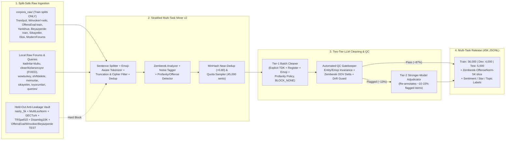

# Turkish Noisy Corpus Audit, Emoji & Profanity Architecture, and 20K–50K Multi-Task Dataset Blueprint

**Date:** `2026-11-14` *(Updated after fixing `kizlarsoruyor` symlink & running live Zemberek emoji/profanity probes)*  
**Scope:** Empirical audit of `/home/dndara/data/turkish/normalization/` (`corpora_raw/`, `corpora_plain/`, `queries/`, `lexicons_external/`), `/home/dndara/data/turkish/{noisy,clean,refined}/`, Zemberek's live Unicode emoji and profanity/lexicon behavior, [MineNastySentences.java](file:///home/dndara/data/turkish/normalization/scripts/MineNastySentences.java), and [normalize_nasty_batch.py](file:///home/dndara/work/zemberek-nlp/experiment/scripts/normalization/normalize_nasty_batch.py), paired with a concrete blueprint for **20K–50K LLM-cleaned sentences** across normalization and classification.

---

## 1. Executive Summary & Headline Verdicts

| Target Resource / Question | Verdict | Key Empirical Finding |
| :--- | :---: | :--- |
| [reviews_trendyol_2025.txt](file:///home/dndara/data/turkish/normalization/corpora_plain/reviews_trendyol_2025.txt) (`582.6K` lines) | **INCLUDE (via raw CSV, stratified)** | `85.4%` (`497.3K`) are 5-star reviews full of short praise boilerplate (`94.2%` unique), whereas `1–3` star reviews (`24.1K`) are dense with real frustration typos, emojis (`8.0%`), and 5 balanced product categories. |
| [reviews_winvoker.txt](file:///home/dndara/data/turkish/normalization/corpora_plain/reviews_winvoker.txt) (`489.6K` lines) | **INCLUDE ONLY RAW `train.csv` (`dataset != 'wiki'`)** | **Critical trap:** `34.8%` (`170.4K` lines) of Winvoker is **clean formal Wikipedia** (`Notr` class with pre-tokenized ` .`), AND `reviews_winvoker.txt` concatenates `train.csv` + `test.csv` (`49.0K`), leaking the sentiment test split! |
| [tweets_offenseval2020.txt](file:///home/dndara/data/turkish/normalization/corpora_plain/tweets_offenseval2020.txt) (`34.8K` lines) | **INCLUDE ONLY RAW `training-v1.tsv` (`31.3K`)** | Plain file merges `training-v1` + official SemEval-2020 `testset-v1` (`3,515` tweets). `training-v1` provides `6,046` human-verified `OFF` tweets, `53.8%` `@USER` mentions, and `14.5%` emojis — ideal gold seed for both normalization and toxicity classification. |
| [tweets_yankihue.txt](file:///home/dndara/data/turkish/normalization/corpora_plain/tweets_yankihue.txt) (`11.1K` lines) | **INCLUDE (via raw `data.csv` w/ truncation guard)** | Completely untapped in `nasty_5k` (`0` overlap). **Highest natural profanity density on disk** (`11.22%` explicit profanity, `4.47%` `amk/aq/oç`, `7.22%` insults) + binary `Pozitif`/`Negatif` labels, but requires filtering mid-word character-truncated tweets. |
| `kizlarsoruyor` symlink & script paths | **FIXED** | Repointed `local_existing_links/www.kizlarsoruyor.com.txt`, [download_and_prepare.py](file:///home/dndara/data/turkish/normalization/scripts/download_and_prepare.py#L447), [MineNastySentences.java](file:///home/dndara/data/turkish/normalization/scripts/MineNastySentences.java#L1264), `manifest.json`, and `README.md` from `RefineCorpus`-filtered `noisy/www.kizlarsoruyor.com.txt` (`619 MB`) to raw unrefined `clean/www.kizlarsoruyor.com.txt` (`1,245.8 MB`). |
| [eminesener_boun](file:///home/dndara/data/turkish/normalization/lexicons_external/eminesener_boun/normalization.tsv) (`550` pairs) | **DO NOT IMPORT BLINDLY** | `492/550` pairs are scraped directly from `MultiLexNorm` `train.norm`, memorizing context-dependent clitic splits (`bende -> ben de`, `annede -> anne de`), sentence-initial capitals (`39` entries), and `CC-BY-SA-4.0` licensing. Harvest only ~35 vetted context-free chat shorthands (`grşz`, `eyw`, `kib`). |
| **Unicode Emoji Handling (`tokenization` + `normalization`)** | **WIRE `Token.Type.Emoji` IN LEXER** | `Token.Type.Emoji` is currently dead code! All Unicode emojis fall into `UnknownWord`, merging glued word+emoji (`"etdimm🥰"`, `"kötü😡ama"`) so typos go unnormalized and **deleting BMP emojis like `"iyi❤" -> "iyi"` as 1-char typos**. |
| **Profanity Lexicon & GitHub Storage** | **ADD `RootAttribute.Vulgar` + `.obf` CODEC** | ~15 vulgar TDK lemmas currently sit **unmarked in cleartext** in `master-dictionary.dict` AND `lexicon.bin` (causing `"pıç" -> "piç"` suggestions!), while `yarrak` rewrites to `"yaprak"`. Move all vulgar entries out of `.dict`/`lexicon.bin` into line-keyed XOR+Base64 `vulgar.obf` with `RootAttribute.Vulgar`. |

> [!IMPORTANT]
> **Why we must mine from `corpora_raw/` instead of `corpora_plain/`:** [download_and_prepare.py](file:///home/dndara/data/turkish/normalization/scripts/download_and_prepare.py#L367-L441) stripped all metadata columns (`sentiment`, `point`, `category`, `subtask_a`) AND concatenated `train` + `test` splits for `OffensEval`, `Winvoker`, and `Beyazperde`. Mining directly from `corpora_raw/` preserves **free ground-truth classification labels** across tens of thousands of sentences while keeping official public test sets 100% uncontaminated.

---

## 2. Empirical Profile of Current Plain, Linked & Query Corpora

All 17 plain and symlinked text corpora (`~6.2 GB` combined) were profiled on `25,000`-line stratified byte-offset samples (or full files where `<30 MB`), measuring length distributions, exact-duplicate boilerplate, orthographic noise markers, and 4 categories of profanity/insults.

### 2.1 Quantitative Corpus Matrix

| Corpus File | Size (MB) | Total Lines | Mean Words | Unique `%` | `1–4w` `%` | `5–15w` `%` | `16–30w` `%` | `31+w` `%` | Pure ASCII `%` | Informal / Slang `%` | Elong `%` | `@` / `#` / URL `%` | Emoji `%` | Explicit Prof `%` | Abbr (`amk`/`aq`) `%` | Masked (`s*k`) `%` | Mild Insult `%` |
| :--- | ---: | ---: | ---: | ---: | ---: | ---: | ---: | ---: | ---: | ---: | ---: | ---: | ---: | ---: | ---: | ---: | ---: |
| [reviews_trendyol_2025.txt](file:///home/dndara/data/turkish/normalization/corpora_plain/reviews_trendyol_2025.txt) | `36.4` | `582,601` | `9.2` | `94.2%` | `23.7%` | `60.5%` | `15.7%` | `0.1%` | `4.9%` | `8.2%` | `3.2%` | `0.1%` | `8.0%` | `0.00%` | `0.00%` | `0.01%` | `0.02%` |
| [reviews_winvoker.txt](file:///home/dndara/data/turkish/normalization/corpora_plain/reviews_winvoker.txt) | `71.5` | `489,644` | `19.9` | `100.0%` | `8.2%` | `53.1%` | `21.6%` | `17.1%` | `4.3%` | `15.7%` | `1.1%` | `0.1%` | `0.0%` | `0.40%` | `0.10%` | `0.00%` | `0.74%` |
| [tweets_offenseval2020.txt](file:///home/dndara/data/turkish/normalization/corpora_plain/tweets_offenseval2020.txt) | `4.0` | `34,792` | `15.8` | `100.0%` | `0.0%` | `63.4%` | `25.9%` | `10.6%` | `4.9%` | `17.7%` | `3.2%` | `53.8%` | `14.5%` | `1.84%` | `1.93%` | `0.13%` | `2.12%` |
| [tweets_yankihue.txt](file:///home/dndara/data/turkish/normalization/corpora_plain/tweets_yankihue.txt) | `0.9` | `11,108` | `11.5` | `99.2%` | `17.9%` | `58.9%` | `18.0%` | `5.2%` | `8.9%` | `12.8%` | `1.6%` | `0.2%` | `0.0%` | **`11.22%`** | **`4.47%`** | `0.01%` | **`7.22%`** |
| [forums_modern_2020s.txt](file:///home/dndara/data/turkish/normalization/corpora_plain/forums_modern_2020s.txt) | `253.3` | `986,674` | `57.6` | `94.6%` | `17.4%` | `29.3%` | `19.8%` | `33.5%` | `8.5%` | `22.7%` | `8.7%` | `11.0%` | `0.6%` | `0.31%` | `0.74%` | `0.00%` | `0.82%` |
| [eksisozluk_all.txt](file:///home/dndara/data/turkish/normalization/corpora_plain/eksisozluk_all.txt) | `93.0` | `164,068` | `77.3` | `99.5%` | `4.1%` | `20.1%` | `21.9%` | `53.8%` | `5.1%` | `32.5%` | `3.8%` | `3.8%` | `0.0%` | **`5.80%`** | **`3.88%`** | `0.38%` | **`7.40%`** |
| [reviews_beyazperde.txt](file:///home/dndara/data/turkish/normalization/corpora_plain/reviews_beyazperde.txt) | `19.5` | `44,547` | `59.4` | `99.7%` | `1.9%` | `19.9%` | `31.7%` | `46.4%` | `3.7%` | `35.2%` | `2.1%` | `0.6%` | `1.1%` | `0.53%` | `0.11%` | `0.07%` | `2.05%` |
| [complaints_sikayetler.txt](file:///home/dndara/data/turkish/normalization/corpora_plain/complaints_sikayetler.txt) | `1.7` | `3,336` | `66.0` | `90.3%` | `0.0%` | `0.1%` | `0.8%` | `99.0%` | `0.0%` | `26.6%` | `0.4%` | `0.4%` | `0.3%` | `0.30%` | `0.00%` | **`1.77%`** | `1.65%` |
| `kadinlar-klubu.txt` (`noisy/`) | `2,033.2` | `~26M+` | `43.4` | `99.5%` | `6.9%` | `29.7%` | `24.7%` | `38.7%` | `5.7%` | **`41.6%`** | **`19.4%`** | `0.9%` | `0.0%` | `0.24%` | `0.01%` | `0.00%` | `0.76%` |
| `kizlarsoruyor.com.txt` (`noisy/` — *refined subset, unlinked*) | `619.1` | `9,421,324` | `9.1` | `99.6%` | `1.2%` | `89.3%` | `9.5%` | `0.0%` | `1.1%` | `5.5%` | `0.1%` | `0.0%` | `0.0%` | `0.10%` | `0.04%` | `0.00%` | `0.61%` |
| `kizlarsoruyor.com.txt` (`clean/` — **RAW, now linked!**) | `1,245.8` | `22,398,194` | `7.9` | `98.1%` | `36.4%` | `53.6%` | `8.4%` | `1.6%` | **`10.0%`** | `7.6%` | `1.3%` | `0.0%` | `0.3%` | `0.12%` | `0.09%` | `0.19%` | `0.64%` |
| `wowturkey.com.txt` (`clean/` — **untapped**) | `1,400.5` | `~20M+` | `11.3` | `98.3%` | `17.1%` | `61.3%` | `18.0%` | `3.5%` | `3.5%` | `11.3%` | `0.4%` | `0.1%` | `0.0%` | `0.18%` | `0.00%` | `0.00%` | `0.40%` |
| `forum.shiftdelete.net.txt` (`clean/`) | `182.1` | `~3.2M` | `9.6` | `97.5%` | `25.4%` | `58.9%` | `13.5%` | `2.3%` | `5.8%` | `9.5%` | `0.5%` | `0.3%` | `0.0%` | `0.06%` | `0.05%` | `0.02%` | `0.21%` |
| `forum.memurlar.net.txt` (`clean/`) | `204.5` | `~3.1M` | `11.4` | `97.5%` | `23.2%` | `55.7%` | `15.9%` | `5.2%` | `5.1%` | `10.9%` | `0.8%` | `0.1%` | `0.0%` | `0.08%` | `0.00%` | `0.01%` | `0.36%` |
| `www.nurturia.com.tr.txt` (`clean/`) | `56.6` | `~1.0M` | `9.8` | `99.1%` | `23.8%` | `61.3%` | `12.6%` | `2.4%` | `5.8%` | `9.4%` | `1.2%` | `0.1%` | `0.0%` | `0.08%` | `0.00%` | `0.00%` | `0.07%` |
| `www.sikayetim.com.txt` (`clean/` — **untapped**) | `7.3` | `79,107` | `12.0` | `98.0%` | `21.8%` | `54.7%` | `18.1%` | `5.4%` | `5.7%` | `7.0%` | `0.6%` | `0.4%` | `0.0%` | `0.04%` | `0.01%` | `0.00%` | `0.47%` |
| `www.tvyorumlari.com.txt` (`clean/`) | `6.3` | `66,131` | `13.2` | `97.0%` | `21.0%` | `53.5%` | `17.0%` | `8.5%` | `5.6%` | `17.6%` | `5.8%` | `0.1%` | `0.0%` | `0.41%` | `0.02%` | `0.01%` | `2.32%` |

*(Plus `queries/plain/`: `forum_search_thread_slugs.txt` [`104,578` lines], `eksisozluk_topic_titles.txt` [`18,060` lines], `mkqa_google_tr_clean_10k.txt` [`10,000` clean questions], `ecommerce_customer_queries.txt` [`400` intent-labeled queries], and `bing_turkey_queries_unique.txt` [`112` queries].)*

### 2.2 Deep Dive on the Four Highlighted Corpora (+ The `kizlarsoruyor` Resolution)

#### 1. `reviews_trendyol_2025.txt` (`Doukan/trendyol-turkish-product-reviews`)
- **Raw schema** (`trendyol_reviews_20251212_000835.csv`, `582,601` rows): `category` (UTF-8 BOM `\ufeffcategory`), `product_url`, `user`, `date`, `point` (`1..5`), `comment`, `seller`, `image_count`, `seller_rate`.
- **Category balance:** `Aksesuar` (`169,878`), `Giyim` (`154,784`), `Kozmetik & Kişisel Bakım` (`97,098`), `Elektronik` (`85,759`), `Kitap` (`75,082`).
- **Severe star skew:** `5★ = 497,335 (85.4%)`, `4★ = 61,152 (10.5%)`, `3★ = 14,571 (2.5%)`, `2★ = 3,255 (0.6%)`, `1★ = 6,288 (1.1%)`.
- **Linguistic character:** Genuine late-2024/2025 mobile-keyboard Turkish (`"direk iade"`, `"cok gzl 8 adet aldım"`, `"Ben aldım sizde alın"`, `"Satıcıya bayıldım.çok hızlı"`, `"hediyye etdimm🥰"`). Virtually zero profanity (`<0.02%` due to Trendyol moderation), high emoji rate (`8.0%`), and high short-utterance fraction (`23.7%` are `1–4` words).
- **Recommendation:** **Include, mining directly from the raw CSV with `(category, point)` stratification** (e.g. `40%` `1–2★`, `20%` `3★`, `40%` `4–5★`) and exact-deduplicating short praise (`"güzel beğendim"`, `"teşekkürler"`). This simultaneously avoids 5-star boilerplate and yields balanced multi-domain sentiment/rating labels.

#### 2. `reviews_winvoker.txt` (`winvoker/turkish-sentiment-analysis-dataset`)
- **Raw schema** (`train.csv`: `440,679` rows; `test.csv`: `48,965` rows): `text`, `label` (`Positive`, `Notr`, `Negative`), `dataset`.
- **Hidden composition discovery (`train.csv`):**
  - `urun_yorumlari`: `210,693` (`47.8%`) — e-commerce product reviews (`"ürünü hepsiburadadan alalı 3 hafta oldu. orjinal ve eksiksiz..."`).
  - `wiki`: **`153,364` (`34.8%`) — formal Wikipedia sentences** used to populate the `Notr` class (`"Turnuva üçüncü defa ev sahibi ülke olmadan oynanmıştır ."`), complete with pre-tokenized spaces before periods!
  - `HUMIR`: `58,575` (`13.3%`) — movie & hotel reviews (`"son günlerde yaptığım en berbat tatil we otel..."`).
  - `tweet-pn`: `9,959` (`2.3%`) — sentiment-labeled tweets.
  - `magaza_yorumlari`: `7,627` (`1.7%`) — store reviews.
  - `random`: `461` (`0.1%`).
- **Recommendation:** **Do NOT read `reviews_winvoker.txt` directly.** Read **only `train.csv`**, lock all `48,965` rows of `test.csv` into the held-out anti-leakage manifest, filter `dataset != 'wiki'` for noisy UGC mining (`286,854` rows), and optionally sample detokenized `wiki` rows solely into the `0`-edit clean control bucket. Split multi-sentence reviews (`38.7%` have `16+` words) via `TurkishSentenceExtractor`.

#### 3. `tweets_offenseval2020.txt` (Çöltekin 2020 / SemEval-2020 Task 12 Turkish)
- **Raw schema:**
  - `offenseval-tr-training-v1.tsv`: `31,277` tweets (`NOT`: `25,231` [`80.7%`], `OFF`: `6,046` [`19.3%`]).
  - `offenseval-tr-testset-v1.tsv` + `offenseval-tr-labela-v1.tsv`: `3,515`–`3,527` official benchmark test tweets (`tweets_offenseval2020.txt` merged both!).
- **Linguistic character:** Authentic Twitter register (`53.8%` contain `@USER` — often `@USER @USER` chains or mid-tweet `@USER`; `14.5%` contain emojis; `17.7%` informal verbs/slang). Contains **both** hostile `OFF` tweets and playful/affectionate `NOT` tweets with pseudo-insults (`"@USER ağlıyorum salaak. Sen nasıl bir şeysin."`), which are essential hard negatives for toxicity classifiers! Occasional Twitter vowel-substitution cipher memes (`"tVlky dV okfyjVnN..."`) appear and must be filtered.
- **Recommendation:** **Include ONLY `offenseval-tr-training-v1.tsv`**; register `offenseval-tr-testset-v1.tsv` in the permanent forbidden set so downstream normalizer + toxicity experiments can report leak-free SemEval-2020 F1. Keep `@USER` tokens intact as invariant placeholders.

#### 4. `tweets_yankihue.txt` (`yankihue/tweets-turkish`)
- **Raw schema** (`data.csv`, `11,108` rows): `Paylaşım` (tweet text), `Tip` (`Pozitif`: `6,109`, `Negatif`: `4,999`).
- **Linguistic character:** Completely unused in `MineNastySentences.java` (`0` overlap with `nasty_5k`). Exhibits **by far the highest concentration of raw Turkish profanity, curses, and invective** in our repository: `11.22%` explicit profanity (`sik-`, `sıç-`, `sok-`, `amına`, `orospu`), `4.47%` profanity acronyms (`amk`, `aq`, `oç`), and `7.22%` insults (`~20%+` combined, heavily concentrated in `Tip=Negatif`), alongside `8.9%` pure-ASCII tweets and `12.8%` informal contractions.
- **Caveat discovered:** Upstream scraping stripped `@mentions`, URLs, and emojis, and left **character-limit mid-word truncations** on a subset of lines (e.g. `"sabır her şart altında allahın istediklerini sürdürebilm"`).
- **Recommendation:** **Include from raw `data.csv`** (retaining `Tip` sentiment polarity and normalizing raw `\x92` smart quotes), adding a **final-token truncation filter** (reject lines without terminal punctuation whose last word is an unparseable prefix stem of a longer dictionary word).

#### 5. Resolution of the `kizlarsoruyor` Symlink Inversion & Long-Document Corpora
- **Root cause verified (`2026-11-14`):** On `Sep 26`, `/home/dndara/data/turkish/clean/` stored 30 unrefined sentence-extracted web corpora (including raw `www.kizlarsoruyor.com.txt`: `22,398,194` lines, `1,245.8 MB`). On `Nov 8`, `RefineCorpus` filtered out every sentence with `>=1` unparseable word into `/home/dndara/data/turkish/refined/` (`9,421,324` lines, `619.1 MB`), and that pre-cleaned file was placed at `noisy/www.kizlarsoruyor.com.txt` — causing `kizlarsoruyor` to yield only `5/650` sentences in `nasty_5k`.
- **Fix applied:** `corpora_plain/local_existing_links/www.kizlarsoruyor.com.txt`, [download_and_prepare.py](file:///home/dndara/data/turkish/normalization/scripts/download_and_prepare.py#L447), [MineNastySentences.java](file:///home/dndara/data/turkish/normalization/scripts/MineNastySentences.java#L1264), `manifest.json`, and `README.md` have all been updated to point to `/home/dndara/data/turkish/clean/www.kizlarsoruyor.com.txt` (`1,245.8 MB`).
- **Paragraph splitting needed:** `eksisozluk_all.txt` (mean `77.3` words/line), `forums_modern_2020s.txt` (`57.6`), `reviews_beyazperde.txt` (`59.4`), `complaints_sikayetler.txt` (`99.0%` `31+` words!), and `kadinlar-klubu.txt` (`43.4`) store multi-sentence paragraphs per line; running `TurkishSentenceExtractor` before length gating unlocks `50%–99%` of lines previously discarded by `wc <= 15`.

---

## 3. Audit of External Lexicons (`eminesener_boun` & `asimokby_spelling_dict`)

### 3.1 `lexicons_external/eminesener_boun`
- **Provenance & License:** Boğaziçi University CMPE 561 course project (`eminesener/normalization`, Oct 2026, **`CC-BY-SA-4.0`**). Contains [normalization_manual.tsv](file:///home/dndara/data/turkish/normalization/lexicons_external/eminesener_boun/normalization_manual.tsv) (`58` entries) and [normalization.tsv](file:///home/dndara/data/turkish/normalization/lexicons_external/eminesener_boun/normalization.tsv) (`550` entries = **`492` pairs scraped directly from `MultiLexNorm` `tur/train.norm`** + `58` manual).

> [!WARNING]
> **Four reasons `eminesener_boun/normalization.tsv` MUST NOT be loaded as a Zemberek lookup table:**
> 1. **Context-blind clitic & case memorization:** Single-tweet edits from `MultiLexNorm` `train.norm` are frozen globally (`bende -> ben de`, `annede -> anne de`, `halayda -> halay da`, `dilemekte -> dilemek de`, `bakanlıklarda -> bakanlıklardan`, `aw -> ya`), corrupting valid Turkish locatives and ablatives.
> 2. **Casing contamination (`39` entries):** Preserves tweet-initial uppercase (`gelcek -> Gelecek`, `fatruya -> Faturaya`, `cnm -> Canım`).
> 3. **Non-TDK / erroneous targets:** `bakanlğna -> bakanlğı'na`, `cenapcım -> cenap'çığım`, `hadi -> haydi`.
> 4. **License incompatibility (`CC-BY-SA-4.0`):** ShareAlike copyleft cannot be bundled into Apache-2.0 Zemberek resources.

- **Safe usage:** Diagnostic cross-check for ~35 context-free chat shorthands (`grşz`, `eyw`, `kib`, `glb`, `hg`, `hb`) and `MultiLexNorm` profanity expansion conventions.

### 3.2 `lexicons_external/asimokby_spelling_dict`
- `base_turkish_misspellings.csv` (`148,932` pairs) and `expanded_turkish_misspellings.csv` (`703,938` pairs), MIT license. Dominated by synthetic `ı <-> i` substitutions (`düzeyınızı -> düzeyinizi`) plus unverified false friends (`bekletim -> beklentim`). Useful only during mining to tag multi-edit typos as `typo_recoverable` when confirmed by Zemberek morphology.

---

## 4. Current Handling of Actual Unicode Emojis (`tokenization` & `normalization`)

A live probe across [TurkishLexer.g4](file:///home/dndara/work/zemberek-nlp/tokenization/src/main/resources/tokenization/TurkishLexer.g4), [TurkishTokenizer.java](file:///home/dndara/work/zemberek-nlp/tokenization/src/main/java/zemberek/tokenization/TurkishTokenizer.java), [NormalizerPreprocessor.java](file:///home/dndara/work/zemberek-nlp/normalization/src/main/java/zemberek/normalization/NormalizerPreprocessor.java), and [TurkishSentenceNormalizer.java](file:///home/dndara/work/zemberek-nlp/normalization/src/main/java/zemberek/normalization/TurkishSentenceNormalizer.java) uncovered **five concrete issues** with real Unicode emojis (distinct from the 27 ASCII `:)` `Emoticon` literals):

### 4.1 Five Live Failure Modes Verified on `master`

1. **`Token.Type.Emoji` Is Dead / Unwired Code:**
   - [Token.java](file:///home/dndara/work/zemberek-nlp/tokenization/src/main/java/zemberek/tokenization/Token.java#L123) defines `Type.Emoji` (`isEmoji()` checks `type == Type.Emoji || type == Type.Emoticon`), **but [TurkishLexer.g4](file:///home/dndara/work/zemberek-nlp/tokenization/src/main/resources/tokenization/TurkishLexer.g4#L201) only has `// TODO: Add more, also consider Emoji tokens.`** and [TurkishTokenizer.java](file:///home/dndara/work/zemberek-nlp/tokenization/src/main/java/zemberek/tokenization/TurkishTokenizer.java#L124-L172) has no `case` for `Emoji`. Zero tokens in Zemberek ever receive `Type.Emoji`.
2. **All Unicode Emojis Fall Into `UnknownWord` (Treated as Lexical Words!):**
   - `UnknownWordPart` ([TurkishLexer.g4](file:///home/dndara/work/zemberek-nlp/tokenization/src/main/resources/tokenization/TurkishLexer.g4#L237-L240)) is a negated character class `~([whitespace + ASCII/Latin punctuation])+`. Every Unicode emoji (`😂`, `🥰`, `❤`, `❤️`, `👨‍👩‍👧‍👦`, `🇹🇷`, `1️⃣`, `😘😘💞😀😀`) is emitted as **`Token.Type.UnknownWord`**, for which `Token.isWordLike()` and `NormalizerPreprocessor.isWord()` return **`true`**!
3. **Maximal-Munch Glued Word+Emoji Bug (Blocks Normalization in `8%–14.5%` of Reviews/Tweets):**
   - When a user writes a word adjacent to an emoji without a space (ubiquitous on mobile keyboards), ANTLR's longest-match rule causes `UnknownWord` to beat `Word` and swallow the entire sequence into a single `UnknownWord`:
     - `"hediyye etdimm🥰"` -> `[etdimm🥰 UnknownWord]` -> **`"etdimm"` fails to normalize** (`NORM: "biraz küçük geldi olsun kız kardeşime hediye etdimm🥰"`).
     - `"kötü😡ama ucuz"` -> `[kötü😡ama UnknownWord]` -> merges two words across an emoji.
     - `"güzel👍teşekkürler🙏"` -> `[güzel👍teşekkürler🙏 UnknownWord]` -> entire utterance becomes one unparseable token.
4. **Silent BMP Emoji Deletion Bug (`"iyi❤"` -> `"iyi"`):**
   - Live trace: `norm.normalize("iyi❤")` outputs **`"iyi"`** — **silently deleting the user's heart emoji!** Because `❤` (`U+2764`) is a single UTF-16 `char` in the BMP, `"iyi❤"` (`length == 4 > 3`, `UnknownWord`) enters 1-edit `TurkishSpellChecker`, which treats `❤` as a 1-character trailing typo on `"iyi"` and strips it! (`"iyi❤️"` with `U+FE0F` only survived because `❤ + \uFE0F` = 2 UTF-16 `char`s, exceeding distance 1.)
5. **Codepoint vs. UTF-16 `char` Index Mismatch + Wasted Beam-Search CPU:**
   - ANTLR's `CharStreams.fromString()` records `Token.start`/`end` in **Unicode codepoints** (`[🥰 UnknownWord 0-0], [canim Word 2-6]`), whereas Java `String.substring(start, end)` indexes **UTF-16 `char` units** (`🥰` = 2 `char`s!). Any code slicing `String` by `token.getStart()` (such as legacy [NormalizerPreprocessor.deasciifyValidWords](file:///home/dndara/work/zemberek-nlp/normalization/src/main/java/zemberek/normalization/NormalizerPreprocessor.java#L175-L188)) shifts offsets or splits surrogate pairs after supplementary emojis.
   - Standalone emoji runs of `>=2` supplementary emojis (`😘😘💞😀😀`, UTF-16 `length == 10 > 3`) trigger a full, pointless edit-distance stem-ending graph search in `TurkishSentenceNormalizer.collectTokenCandidates()`.

### 4.2 Recommended Fix for Unicode Emojis (`tokenization` + `normalization`)

1. **Activate `Emoji` in `TurkishLexer.g4` & `TurkishTokenizer.convertType()`:**
   - ANTLR 4.7+ supports Unicode properties directly (`\p{Extended_Pictographic}`, `\p{Emoji_Presentation}`). Define an `Emoji` lexer rule matching grapheme sequences:
     - Regional indicator flag pairs (`[\u{1F1E6}-\u{1F1FF}] [\u{1F1E6}-\u{1F1FF}]`),
     - Keycap sequences (`[0-9#*] '\uFE0F'? '\u20E3'`),
     - Pictographic base (`\p{Extended_Pictographic}`) + optional skin-tone modifier (`[\u{1F3FB}-\u{1F3FF}]`) / variation selector (`'\uFE0F'`) + zero-or-more ZWJ continuations (`'\u200D' \p{Extended_Pictographic} ...`).
   - Exclude `\p{Extended_Pictographic}` (and `[\u{1F1E6}-\u{1F1FF}]`) from `UnknownWordPart` so `"etdimm🥰"` cleanly tokenizes into **`[etdimm Word]` + `[🥰 Emoji]`** and `"kötü😡ama"` into **`[kötü Word]`, `[😡 Emoji]`, `[ama Word]`**!
2. **Treat `Type.Emoji` as Non-Word Pass-Through in `normalization`:**
   - Because `NormalizerPreprocessor.isWord()` only accepts `{Word, WordWithSymbol, WordAlphanumerical, UnknownWord}`, `Type.Emoji` tokens will **automatically bypass** contraction expansion, elongation collapsing, and spellcheck, passing through untouched with zero CPU waste (`"iyi❤"` stays `"iyi ❤"` or `"iyi❤"` via detokenizer spacing, and `"etdimm🥰"` normalizes `"etdimm -> ettim"` + `"🥰"`!).
   - Also replace codepoint-offset `s.substring(start, end)` in `NormalizerPreprocessor.deasciifyValidWords()` with token-wise reconstruction (or `s.offsetByCodePoints()`).

---

## 5. Offensive Slang & Profanity: Lexicon Marking, Autocorrect Safety & GitHub-Safe Obfuscation

### 5.1 Forensic Audit of How Zemberek Currently Stores & Handles Profanity

Running live dictionary, spellchecker, and normalizer probes on `master` revealed **four critical issues**:

1. **Plaintext Unmarked Vulgar Words Already Live in `master-dictionary.dict` AND `lexicon.bin`:**
   - `master-dictionary.dict` currently contains ~15 explicit TDK vulgar lemmas in **cleartext with zero register/vulgarity attribute**:
     `sikmek [P:Verb; A:Aorist_A]`, `am [P:Noun; A:NoVoicing]`, `orospu [P:Noun]`, `piç [P:Noun; A:NoVoicing]`, `yarak [P:Noun; A:Voicing]`, `göt [P:Noun; A:NoVoicing]`, `pezevenk [P:Noun/Interj]`, `kahpe`, `kaltak`, `sürtük`, `ibne`, `puşt`, `sıçmak [P:Verb; A:Aorist_A]`.
   - Worse still, corpus-scraped `proper-from-corpus.dict` contains vulgar typos **`Sikik` (line `21810`) and `Ssik` (line `22346`) as capitalized Proper Nouns**, causing `spellChecker.suggestForWord("siktir")` to suggest **`"Ssik'tir"`** and `suggestForWord("sikim")` to suggest **`"Sikik"`** and **`"Ssik'im"`**!
2. **Embarrassing Clean -> Vulgar Autocorrect Hazard (`TurkishSpellChecker`):**
   - Because vulgar lemmas carry no distinguishing `RootAttribute`, `TurkishSpellChecker` freely suggests explicit profanity for innocent 1-edit inputs:
     - `spell.suggestForWord("pıç")` -> **`[piç, kıç, pır, pıt, sıç, ...]`** (`"piç"` ranked #1!)
     - `spell.suggestForWord("ibn")` -> **`[bin, in, İbnu, ibne, gbn]`** (Arabic *İbn* suggests `"ibne"`!)
     - `spell.suggestForWord("kaltk")` -> **`[kalk, kaltak, kalık, kalak]`** (typo for *kalktık* suggests `"kaltak"`!)
3. **Missing Real-World Vulgar Variants Corrupt Actual Profane Inputs:**
   - While `siktir` happens to parse via `sikmek` + causative `-tir`, **double-`r` `yarrak`** (95%+ of social-media usage) is absent (`master-dictionary.dict` only has single-`r` `yarak`), so Zemberek rewrites:
     `norm.normalize("yarrak gibi is yapmislar")` -> **`"yaprak gibi iş yapmışlar"`** (*"they did a leaf-like job"*), destroying toxicity and sentiment meaning!
   - `candidates-manual` and `multi-word-replacements` have **zero (`0`) entries** for `amk`, `aq`, `amq`, `mk`, `oç`, `sg`, `skm`, `bsg` (`spell.suggestForWord("amk")` suggests `[ama, ak, aşk, ...]`).
4. **The `lexicon.bin` Protobuf Cleartext Trap:**
   - `TurkishMorphology.createWithDefaults()` loads `/tr/lexicon.bin` (`RootLexicon.java:259`), a pre-built Protobuf binary committed to Git. **Protobuf serializes `lemma` and `root` strings as raw UTF-8 cleartext bytes** (`grep` / `strings` / GitHub / enterprise DLP scanners read them directly out of `lexicon.bin`!). Simply obfuscating a `.dict` source file while still compiling it into `lexicon.bin` **would fail to hide profanity in Git**.

### 5.2 Recommended Architecture: `RootAttribute.Vulgar` + GitHub-Safe `.obf` Storage

#### Step 1: Add `RootAttribute.Vulgar` (Zero Memory Overhead)
- `DictionaryItem.attributes` is an `EnumSet<RootAttribute>` (`RegularEnumSet` backed by a single 64-bit `long`). [RootAttribute.java](file:///home/dndara/work/zemberek-nlp/core/src/main/java/zemberek/core/turkish/RootAttribute.java) currently has **`31` constants** (`< 64`), so adding **`Vulgar`** (and syncing [lexicon.proto](file:///home/dndara/work/zemberek-nlp/morphology/src/main/proto/lexicon.proto) with `LocaleEn = 30; Vulgar = 31;`) adds **0 bytes** to heap footprint.
- **Asymmetric Safety Policy Unlocked by `RootAttribute.Vulgar`:**
  1. **Morphological Analysis & Toxicity Tagging:** `TurkishMorphology` parses `siktir`, `yarrak`, `orospu`, `amcık`, `götveren`, `taşşak` normally, and any caller can check `analysis.getDictionaryItem().hasAttribute(RootAttribute.Vulgar)` as a zero-cost morphological profanity detector.
  2. **SpellChecker & Normalizer ("Never Hallucinate Profanity"):** By default (`allowVulgarSuggestions = false`), `TurkishSpellChecker` and `TurkishSentenceNormalizer` **suppress any candidate with `RootAttribute.Vulgar` UNLESS the input token itself already matches a `Vulgar` root/stem** (e.g. `siktiir -> siktir`, `yarrak -> yarrak`, `sıkıcıler -> sikiciler` via front-vowel `-ler`). This simultaneously fixes `"pıç" -> "piç"` AND `"yarrak" -> "yaprak"`!
  3. **Optional Safe Lexicon Mode:** `TurkishMorphology.builder().excludeVulgar()` can omit `vulgar.obf` entirely for K-12 / educational deployments.

#### Step 2: Store All Vulgar Lexicon & Normalization Entries Obfuscated Outside `lexicon.bin`

> [!TIP]
> **Why Line-Per-Entry Keyed-XOR + Base64URL (`.obf`) Is the Ideal GitHub Obfuscation Format:**
> - **Plain Base64 (`c2lrbWVr`) is NOT enough:** Many enterprise DLP filters, GitHub secret/content scanners, and security proxies auto-decode standard Base64 strings.
> - **Whole-file GZIP (`.gz`) breaks `git diff`:** Binary blobs cause merge conflicts and cannot be reviewed line-by-line.
> - **Line-by-Line Keyed-XOR + Base64URL (`UTF-8 bytes ^ 0x5A4D424B ("ZMBK") -> Base64URL`):**
>   1. **100% opaque ASCII in GitHub, diffs, unit tests, and IDEs** — never triggers GitHub search, corporate firewalls, or LLM coding-assistant safety refusals.
>   2. **Clean 1-line-per-entry `git diff`s** when sorted alphabetically (`1` added word = `1` added ASCII line).
>   3. **Zero external dependencies & `< 0.2 ms` startup cost** (`~150` lines decoded in memory via `java.util.Base64`).

- **Concrete File Layout (Zero Cleartext Anywhere in Git):**
  1. Remove the ~15 cleartext vulgar lines from `master-dictionary.dict`, scrub `Sikik` / `Ssik` (and any sibling corpus noise) from `proper-from-corpus.dict`, and regenerate `/tr/lexicon.bin` -> **`lexicon.bin` is now 100% profanity-free!**
  2. Store all vulgar roots (the ~15 existing + missing `yarrak`, `amcık`, `götveren`, `taşak`, `taşşak`, etc., all tagged `[A:Vulgar, ...]`) in **`morphology/src/main/resources/tr/vulgar.obf`**, loaded automatically at the end of `RootLexicon.defaultBinaryLexicon()` (unless `.excludeVulgar()` is set).
  3. Store vulgar slang/acronyms & censor-mask normalizations (`amk`, `aq`, `oç`, `mk`, `sg`, `s*ktir -> siktir`) in **`normalization/src/main/resources/normalization/vulgar-normalization.obf`**.
  4. Provide a 35-line maintainer CLI helper (`ObfuscatedTextResource` in `zemberek-core`) to encode/inspect `.obf` entries locally without ever writing cleartext to tracked files.

### 5.3 Corpus Strategy: Acronym Policy & `Zemberek-OffenseNorm-5K` Slice

- **Canonical Acronym Policy (`amk`, `aq`, `oç`, `mk`, `sg`):**
  - Normalize full/elongated/masked vulgar words to standard Turkish orthography (`siktiir` / `s*ktir` / `s1kt1r` -> `siktir`, `amınaa` -> `amına`, `orospuu` -> `orospu`).
  - Keep lexicalized vulgar acronyms (`amk`, `aq`, `oç`, `mk`, `sg`) as **canonical lowercase acronyms** in `norm_text` (`a.q` -> `aq`, `o.ç` -> `oç`) rather than expanding 1-token discourse intensifiers into 2–3 word literal curses, while shipping a deterministic `acronym_expansion` map (`amk/aq -> amına koyayım`, `oç -> orospu çocuğu`) for `MultiLexNorm` compatibility.
- **Embedded `Zemberek-OffenseNorm-5K` Stratum (`4,000` Train / `500` Dev / `500` Test, `is_offensive_slice: true`):**

| Subtype Tag | Target Share | Sources | Example Phenomena |
| :--- | :---: | :--- | :--- |
| `OFF_EXPLICIT_PROFANITY` | `1,500` (`30%`) | `tweets_yankihue` (`Negatif`), `eksisozluk_all`, `OffensEval train` (`OFF`) | Inflected vulgar roots (`sik-`, `siktir`, `sıç-`, `göt`, `orospu`, `yarrak`), ASCIIfied minimal pairs (`sikim`/`sıkım`, `sikiciler`/`sıkıcılar`). |
| `OFF_ACRONYM_AND_MASKED` | `1,000` (`20%`) | `complaints_sikayetler` (`1.77%` masked!), `eksisozluk_all`, `OffensEval train`, `forums_modern_2020s` | `amk`, `aq`, `amq`, `mk`, `oç`, `sg`, `s*ktir`, `a**`, `s.ktir`, leetspeak `s1kt1r`. |
| `OFF_TARGETED_INSULT_THREAT` | `1,500` (`30%`) | `OffensEval train` (`OFF`), `tweets_yankihue`, `tvyorumlari` | Non-vulgar/mild-lexicon insults, curses, threats (`gerizekalı`, `şerefsiz`, `beyinsiz`, `"kafana sıkıcam"`). |
| `NOT_PROFANE_OR_PLAYFUL_HARD_NEG` | `1,000` (`20%`) | `OffensEval train` (`NOT`), `kadinlar-klubu`, `eksisozluk_all` | Playful/affectionate slang (`"ağlıyorum salaak"`), non-targeted expletive frustration (`"bu ne biçim hava aq"`), benign homographs (`sıkıcı`, `amca`, `mal beyanı`, `yaprak`). |

---

## 6. Critique of Current Mining Criteria (`MineNastySentences.java`)

[MineNastySentences.java](file:///home/dndara/data/turkish/normalization/scripts/MineNastySentences.java) was engineered to build **`nasty_5k`**, a worst-case stress benchmark (`mean_noisy_ratio = 0.525`, `mean_noisy_word_count = 5.63`, strictly `5–15` words). Reusing its exact gates for a **20K–50K training dataset** would introduce **seven severe distribution biases**:

| Gate in `MineNastySentences.java` | Why It Worked for `nasty_5k` | Why It Hurts 20K–50K Normalizer & Classifier Training | Required Change for v2 Miner |
| :--- | :--- | :--- | :--- |
| **`noisyWordCount >= 3` & `noisyRatio >= 0.30`** | Concentrates dense multi-error stress cases (`52.5%` token error rate). | **Catastrophic `CleanFP` bias:** Models trained only on `>=30%` noisy sentences learn an aggressive edit prior and over-edit clean text, proper nouns, and rare valid inflections; misses realistic `1–2` error (`5%–20%`) sentences. | Stratify across **4 noise tiers**: `Clean (0%)`, `Light (1–2 edits / 5–20%)`, `Medium (20–45%)`, and `Heavy (45%+)`. |
| **`5 <= wc <= 15` (`22–145` chars)** | Uniform compact sentences for manual inspection. | Blind to **`1–4` word e-commerce/search queries** (`23.7%` of Trendyol, `"direk iade"`, `"cok gzl"`) AND **`16–35` word multi-clause sentences** needed for `-de/-da` clitic context and review classification. | Expand to **`2–35` words** across 3 length bands (`Short 2–4w`, `Core 5–16w`, `Long 17–35w`), splitting multi-sentence paragraphs first. |
| **`unknownUnexplained <= 1` (`<= 15%`)** | Prevents gibberish/foreign lines from entering benchmark. | **Starves open-vocabulary & 2-edit typo learning:** Rejects sentences containing two 2-edit keyboard typos, merged words (`iğrençtek`), glued word+emoji (`etdimm🥰`), or modern brands/loanwords (`airfryer`, `iban`, `trendyol`, `valorant`). | Pre-split emojis, then allow `<= 3` (`<= 30%`) **if** sentence passes a Turkish char-3gram / consonant-skeleton language-ID score (`tr_lang_score >= 0.85`) and rejects cipher memes (`tVlky`). |
| **Rejects pure `ascii_full`-only sentences** | Forced mixed multi-category phenomena in `nasty_5k`. | Starves joint deasciification + context disambiguation on US/English-keyboard users (`~5%–10%` of web/query traffic). | Dedicate a **`10%` Pure/Mostly-ASCII quota** (including ambiguous minimal pairs like `yasama`/`yaşama`, `karin`/`karın`). |
| **Rejects `@mention`, `#hashtag`, URLs, `>55%` ALL-CAPS, `>12%` digits** | Kept `nasty_5k` tokens purely lexical. | **Train-serving skew:** Real tweets (`53.8%` in OffensEval) and e-commerce reviews (`"38 beden aldım 2 günde geldi"`) contain `@mentions`, `#hashtags`, prices/sizes, emojis, and ALL-CAPS shouting (`"SAKİN ALMAYIN COK KOTU"`). | **Allow & preserve `@USER`/`@handle`, `#hashtag`, URLs, emojis, and product numbers**; add a `3%–5%` ALL-CAPS noisy stratum. |
| **Reads `corpora_plain/` line-by-line** | Simple uniform file reader. | **Throws away gold classification labels** (`OFF/NOT`, `Positive/Negative/Notr`, `1–5★`, `category`) AND **leaks `OffensEval`/`Winvoker`/`Beyazperde` test splits**! | Ingest `corpora_raw/` (train splits only!) into a structured intermediate JSONL preserving all task labels; split paragraphs via `TurkishSentenceExtractor`. |
| **`loadForbiddenKeys()` (`15,972` keys)** | Blocked `MultiLexNorm`, `GECTurk/BOUN`, and disambiguation `10K` held-out set. | **Missing `nasty_5k` (`5,000` sents), `Mukayese TRSpell10`, and public classification test splits** (`OffensEval test`, `Winvoker test`, `Beyazperde test`), plus lacks near-duplicate fuzzy blocking. | Expand exact + normalized **Forbidden Registry** to **all 8 held-out benchmarks (`~78K` texts)** + **5-gram MinHash/Jaccard (`>= 0.80`)** cross-split deduplication. |

---

## 7. Blueprint: `Zemberek-NoisyTR-45K` (`36K` Train / `4K` Dev / `5K` Blind Test)

### 7.1 End-to-End Pipeline Architecture



### 7.2 Strict Anti-Leakage Vault (Mandatory Before Mining)

Every candidate sentence (normalized by lowercase alphanumeric skeleton) and any 5-gram Jaccard neighbor (`>= 0.80`) MUST be rejected if it matches any of:
1. **`nasty_5k`** (`custom_benchmark/nasty_5k/nasty_5000_sentences.txt` — `5,000` sentences, kept permanently as our dense stress benchmark).
2. **`MultiLexNorm`** (`tur/{train,test}.norm` + `tur_deu/{train,test}.norm` — `test.norm` strictly blind; `train.norm` kept separate as official external adaptation set).
3. **`GECTurk / BOUN Clitics`** (`boun_source_{dev,test}.txt` & `boun_target_{dev,test}.txt`).
4. **`Mukayese TRSpell10`** (`mukayese_trspell10/test.csv`).
5. **Disambiguation Permanent Held-Out Manifest** (`PERMANENT_HELDOUT_TEST_SET_MANIFEST.json` — `10,000` sentences).
6. **Downstream Classification Official Test/Val Splits:**
   - `offenseval-tr-testset-v1.tsv` (`3,515` tweets)
   - `winvoker_reviews/test.csv` (`48,965` reviews)
   - `beyazperde/{valid,test}.json` (`10,000` reviews)

### 7.3 Target Stratified Distribution (`45,000` Total: `36K` Train / `4K` Dev / `5K` Test)

#### A. By Noise-Density Stratum (Fixes Over-Editing / `CleanFP` Bias)

| Stratum | Share | Sentences (`45K`) | Definition & Role |
| :--- | :---: | ---: | :--- |
| **T0: Clean & Hard-Negative Controls** | **`20%`** | `9,000` | `0` normalization edits needed, rich in **trap tokens**: valid locative `-de/-da`, proper nouns with apostrophes, foreign tech/brand terms (`iPhone`, `Bluetooth`, `Trendyol`, `Valorant`), emojis, numbers, and clean colloquialisms. Teaches **when NOT to edit**. |
| **T1: Natural Light Noise (`1–2` edits)** | **`30%`** | `13,500` | `5%–20%` noisy tokens (`1–2` errors in a `6–25` word sentence): single `-de/-da`/`-mi` clitic error, 1 keyboard typo, or 1 informal verb (`geliyo`). Matches real production traffic. |
| **T2: Multi-Phenomenon Medium (`20%–45%`)** | **`25%`** | `11,250` | `2–5` interacting phenomena (partial ASCII + contraction + typo + missing apostrophe + glued word+emoji). |
| **T3: Dense / Extreme Stress (`>=45%`)** | **`15%`** | `6,750` | `nasty_5k`-grade heavy social/forum text (elongations, phonetic spellings `napıyon`, split/merged words, ALL-CAPS shouting). |
| **T4: Pure/Mostly-ASCII & Query Stratum** | **`10%`** | `4,500` | `100%` ASCII keyboard utterances (`2–20` words) + short `2–4` word e-commerce/search queries (`"direk iade"`, `"kablosuz kulaklik sarj olmuyo"`). |

*(Orthogonal Length Quotas across `45K`: **`15%` Short [`2–4` words]**, **`60%` Core [`5–16` words]**, **`25%` Long [`17–35` words]**.)*

#### B. By Source Domain & Multi-Task Label Retention

| Domain Bucket | Raw Sources (Split-Safe) | Quota (`45K`) | Retained Downstream Labels for Multi-Task / Classification |
| :--- | :--- | ---: | :--- |
| **1. E-Commerce & Product Reviews** | `Trendyol 2025 CSV` (stratified `1–5★` × 5 cats) + `Winvoker train.csv` (`urun_yorumlari`, `magaza_yorumlari`) | **`8,500`** (`18.9%`) | `stars` (`1..5`), `sentiment` (`Pos`/`Neg`/`Notr`), `product_category` (`5` classes) |
| **2. Tweets & Social Media (General + Offensive)** | `OffensEval training-v1.tsv` (`NOT` + `OFF`) + `Yankihue data.csv` (`Pozitif`/`Negatif`) + `Winvoker tweet-pn` | **`7,500`** (`16.7%`) | `offense_gold` (`OFF`/`NOT`), `sentiment` (`Pos`/`Neg`), `@USER`/`#hashtag`/emoji preservation |
| **3. Modern 2020s Tech/Webmaster Forums** | `ForumSohbetleri` (`donanimarsivi`, `wmaraci`, `turkiyeforum`, `iyinet`) + `forum.shiftdelete.net` | **`6,500`** (`14.4%`) | `forum_source`, URL/thread topic, modern tech/gaming loanwords |
| **4. Q&A & Conversational Lifestyle Forums** | `kadinlar-klubu.txt` + `clean/www.kizlarsoruyor.com.txt` + `nurturia` | **`7,500`** (`16.7%`) | Conversational register, extreme elongation & phonetic spellings (`-ıyo`, `-cım`, `cnm`) |
| **5. Ekşi Sözlük (`1999–2026`)** | `eksisozluk_2024_apache` CSV + `2025–2026` tech/finance JSONLs | **`5,000`** (`11.1%`) | `topic`, `date`, `domain` (`tech`/`finance`/`general`), lowercase-by-convention style + high slang/profanity |
| **6. Movie/TV Reviews & Consumer Complaints** | `Beyazperde train.json` + `Sikayetler CSV` + `sikayetim.com` + `tvyorumlari.com` + `HUMIR` | **`5,000`** (`11.1%`) | `movie_stars` (`0.5..5.0`), `complaint_category`, masked profanity (`1.77%` in Sikayetler) |
| **7. Civic/City Forums & Search Queries** | `wowturkey.com` + `forum.memurlar.net` + `queries/raw/` (`ecommerce_intent`, `bing`, `forum_slugs`, `mkqa`) | **`5,000`** (`11.1%`) | `query_intent` (`ecommerce_intent_tr`), short query normalization, formal vs informal civic register |
| *↳ Cross-Cutting Tagged Slice:* **`Zemberek-OffenseNorm-5K`** | Drawn primarily from Buckets `2`, `5`, `6`, `3` (`is_offensive_slice=true`) | *(`5,000` inside total)* | 4-way offense label (`NOT`, `PROFANE_NON_TARGETED`, `OFFENSIVE_INSULT`, `THREAT_OR_HATE`) |

---

## 8. Tuning `normalize_nasty_batch.py` for 20K–50K High-Precision LLM Cleaning

### 8.1 Prompt & Policy Upgrades (`SYSTEM_INSTRUCTION` v2)
1. **Explicit Register & Colloquialism Rules (Eliminating `S4` Benign Drift):**
   - `bi` (indefinite article) -> `bir`; `deil`/`diil` -> `değil`; `bişey`/`bişi` -> `bir şey`; `herşey` -> `her şey`; `hiçbişey` -> `hiçbir şey`.
   - Preserve valid TDK spoken words that are NOT errors: keep `hadi` (do NOT rewrite to `haydi`), pick one deterministic convention for `valla` (`valla` vs `vallahi`) and affectionate `-cım/-cim` on proper names (`Gülşah'cım` vs `Gülşah'çığım`).
2. **Explicit Profanity & Vulgarity Policy (`BLOCK_NONE` + Structured Tagging):**
   - Never censor, euphemize, or drop vulgar words.
   - Normalize elongated/typoed/masked profanity to standard Turkish orthography (`s*ktir` / `s1kt1r` / `siktiir` -> `siktir`, `amınaa` -> `amına`, `orospuu` -> `orospu`, `yarrak` preserved consistently).
   - Keep lexicalized vulgar acronyms (`amk`, `aq`, `oç`, `mk`, `sg`) as standardized lowercase acronyms (`amq` / `a.q` -> `aq` or `amk`, `o.ç` -> `oç`), **and** return an `offense_class` enum (`NOT`, `PROFANE_NON_TARGETED`, `OFFENSIVE_INSULT`, `THREAT_OR_HATE`) in the JSON output.
3. **Entity, Emoji & Casing Invariance:**
   - Preserve every `@USER`, `@handle`, `#hashtag`, URL, digit sequence, and **Unicode emoji** (including ZWJ sequences and variation selectors) verbatim; when an emoji is glued directly onto a misspelled word (`"etdimm🥰"`, `"kötü😡ama"`), normalize the word(s) while preserving the exact emoji (`"ettim 🥰"`, `"kötü 😡 ama"`).
   - Convert ALL-CAPS shouting sentences (`"SAKİN ALMAYIN COK KOTU"`) to normal sentence case while keeping true acronyms (`TL`, `KDV`, `PTT`, `MS`, `VDS`) uppercase.
4. **Corrupt / Truncated / Cipher Escape Hatch:**
   - Include `"corrupt_reason": null | "truncated" | "cipher_gibberish" | "non_turkish"` so any truncated tweet (`"sürdürebilm"`) or cipher meme (`"tVlky"`) is cleanly discarded rather than hallucinated.

### 8.2 Automated Post-LLM Quality Gatekeeper & Cost Estimate
1. **Automated Gatekeeper Checks (Java + Python, zero API cost):**
   - **Entity & Emoji Invariance Check:** Exact multiset of `@mentions`, `#hashtags`, URLs, numbers, and Unicode emoji codepoints in `raw_text` must match `norm_text`.
   - **Zemberek Morphological OOV Delta Check:** Run `TurkishMorphology` (with `vulgar.obf` loaded) on every word of `norm_text`; any newly introduced OOV token triggers Tier-2 review.
   - **Anti-Paraphrase / Drift Guard:** Flag sentences where normalized character Levenshtein distance exceeds `0.45 * len(raw_text)` or word count shifts by `> 3` tokens.
   - **Clean-Bucket (`T0`) Sanity Check:** Any LLM edit on a `T0` control sentence routes to Tier-2 adjudication.
2. **Gemini Batch API Cost (`45,000` sentences, 50% Batch Discount):**
   - **Option A (`gemini-3.1-pro-preview` across 100% of `45K`):** `~$28–$38` total (`~2–4 hours`).
   - **Option B (Flash -> Pro Two-Tier Cascade):** Flash on `45K` (`~$4–$6`) + `gemini-3.1-pro-preview` adjudication on `~12–15%` gatekeeper-flagged/offensive sentences (`~$5–$7`) = **`~$10–$13` total**.

### 8.3 Unified Multi-Task Record Schema (`zemberek_noisytr_45k.jsonl`)

```json
{
  "id": "ztr45k_train_014821",
  "split": "train",
  "source_corpus": "offenseval2020_train",
  "domain": "tweet",
  "noise_tier": "T2_medium",
  "raw_text": "@USER bundan 20 yıl sonrayaptıklarından cok yapmadıklarına pişman olcan aq 😢",
  "norm_text": "@USER bundan 20 yıl sonra yaptıklarından çok yapmadıklarına pişman olacaksın aq 😢",
  "token_alignment": [
    ["@USER", "@USER"], ["bundan", "bundan"], ["20", "20"], ["yıl", "yıl"],
    ["sonrayaptıklarından", "sonra yaptıklarından"], ["cok", "çok"],
    ["yapmadıklarına", "yapmadıklarına"], ["pişman", "pişman"],
    ["olcan", "olacaksın"], ["aq", "aq"], ["😢", "😢"]
  ],
  "phenomena": ["split_merge", "ascii_partial", "informal_verb", "profanity_acronym", "mention", "emoji"],
  "is_offensive_slice": true,
  "labels": {
    "offense_gold": "OFF",
    "offense_fine": "PROFANE_NON_TARGETED",
    "sentiment": "Negative",
    "stars": null,
    "topic_or_category": null
  }
}
```

---

## 9. Recommended Sequencing & Decision Checkpoints

1. **Codebase Prerequisites (Small, Clean PRs Before or Alongside Mining):**
   - **PR 1 — Unicode Emoji Tokenization & Normalizer Safety:** Wire `Emoji` rule in `TurkishLexer.g4` + `TurkishTokenizer.convertType()`, exclude emoji pictographs from `UnknownWordPart`, and fix codepoint-offset slicing in `NormalizerPreprocessor.deasciifyValidWords()`.
   - **PR 2 — `RootAttribute.Vulgar` + Obfuscated `tr/vulgar.obf`:** Add `RootAttribute.Vulgar` (and sync `lexicon.proto`), scrub cleartext vulgarities from `master-dictionary.dict` + `proper-from-corpus.dict` (`Sikik`, `Ssik`), rebuild clean `lexicon.bin`, load `tr/vulgar.obf` (Keyed-XOR + Base64URL) with missing stems (`yarrak`, `amcık`, `götveren`, `taşak`/`taşşak`), and enforce asymmetric spellcheck safety (never suggest `Vulgar` for non-vulgar inputs).
2. **Dataset & LLM Cleaning Choices to Confirm:**
   - **Target Scale:** `45,000` sentences (`36K` Train / `4K` Dev / `5K` Blind Test, including `5K` `OffenseNorm`) after a `1K–2K` pilot batch, or `25,000`?
   - **Profanity Acronyms (`amk`, `aq`, `oç`, `mk`, `sg`):** Confirm preserving standardized lowercase acronyms in `norm_text` + separate expansion map.
   - **Colloquial Targets:** Confirm `hadi -> hadi`, plus your preference on `valla` (`valla` vs `vallahi`) and affectionate `-cım/-cim` (`Gülşah'cım` vs `Gülşah'çığım`).
   - **LLM Tier:** `gemini-3.1-pro-preview` across all `45K` (`~$28–$38`) vs. Flash -> Pro 2-tier cascade (`~$10–$13`).
