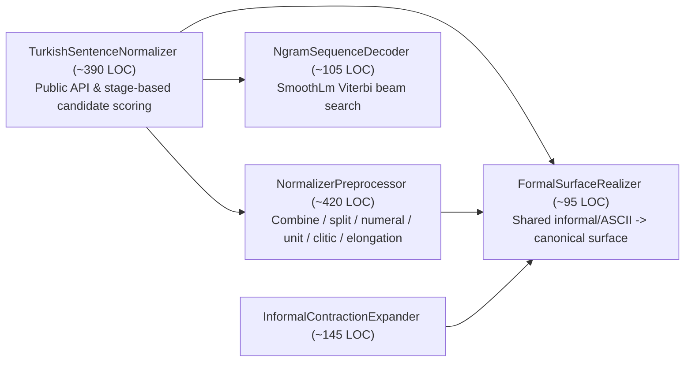

# Normalization Module Simplification & Readability Audit (Post-PRs `#371`–`#376`)

**Baseline**: `ahmetaa/zemberek-nlp:master` at `81c41cc4` (with PRs `#371`–`#376` merged).  
**Scope**: All `25` Java source files in `zemberek-normalization` (`~10,050` LOC; `TurkishSentenceNormalizer.java` is now `1,413` LOC and `InformalContractionExpander.java` is `254` LOC) and their boundaries with `zemberek-core`, `zemberek-morphology`, `zemberek-tokenization`, and `zemberek-lm`.  
**Goal**: Maximize readability, cohesion, and reuse of Zemberek core/linguistic abstractions and Java 21 features without sacrificing normalization accuracy.

---

## Executive Summary

Reviewing `master` (`81c41cc4`) after merging `#372`–`#376` surfaced several additional cross-feature duplications on top of the structural debt in legacy classes. Across the module, **~1,250+ lines of boilerplate, dead code, and duplicated logic** can be eliminated or simplified:

| Area | Primary Targets | Est. Net LOC Saved | Readability Gain |
| :--- | :--- | :---: | :--- |
| **A. Decomposition & Deduplication in `normalization`** | Split `1,413`-LOC `TurkishSentenceNormalizer` into 4 cohesive classes; delegate `SingleWordSpellChecker` (`535` LOC) to `CharacterGraphDecoder`; flatten `CharacterGraphDecoder.expand()`; unify `InformalContractionExpander` rule tables & `FormalSurfaceRealizer` | **~850 LOC** | Very High |
| **B. Reuse Existing `zemberek-core` Classes** | `KeyValueReader`, `TurkishAlphabet.isVoicelessConsonant`, `TurkishAlphabet.getLastVowel`, `TurkishAlphabet.containsDigit`, `ScoredItem`, `TextIO`, `Turkish.LOCALE` | **~140 LOC** | High |
| **C. Promote Shared Linguistic Helpers to `core` / `morphology` / `tokenization` / `lm`** | `SingleAnalysis.isRegularWord()` / `hasEnding()`, `DictionaryItem` POS helpers, `Turkish.toLower(char)`, `TurkishAlphabet` apostrophe/diacritic helpers, `Token.isWordLike()`, `LmVocabulary.indexOfTurkishWord` | **~160 LOC** | Very High |
| **D. Java 21 Idioms & JDK 21 Standard Library** | `record`s, pattern-matching `switch`, `StringBuilder.repeat`, `Set.of`/`Map.ofEntries`, `Map.merge`, `SequencedCollection.getLast()`, `Math.clamp`, `Locale.of("tr")` | **~180 LOC** | High |

---

## Part A — Method & Class Extraction Inside `normalization`

### A1. Post-Merge Duplications Inside `TurkishSentenceNormalizer` (`1,413` LOC) & `InformalContractionExpander` (`254` LOC)

After merging `#372`–`#376`, inspecting [TurkishSentenceNormalizer.java](file:///home/dndara/work/zemberek-nlp/normalization/src/main/java/zemberek/normalization/TurkishSentenceNormalizer.java) and [InformalContractionExpander.java](file:///home/dndara/work/zemberek-nlp/normalization/src/main/java/zemberek/normalization/InformalContractionExpander.java) revealed immediate intra-module duplications:

1. **Two identical static methods in the same file**:
   - `isRegularAnalysis(SingleAnalysis)` (`#L909-L914`) and `isRegularNonProperAnalysis(SingleAnalysis)` (`#L1031-L1036`) have **100% identical bodies**.
2. **Four copies of "informal / diacritic-tolerant `SingleAnalysis` → formal surface"**:
   - `TurkishSentenceNormalizer.normalize()` (`#L321-L366`)
   - `TurkishSentenceNormalizer.resolveCompoundSurface()` / `toFormalSurface()` (`#L837-L865`)
   - `TurkishSentenceNormalizer.realizeRegularHeadSurface()` (`#L1120-L1143`) — literally identical to `resolveCompoundSurface` with identity fallback
   - `InformalContractionExpander.realizeSingleWord()` (`#L195-L240`)
3. **Four duplicated token-stream rewrite loops + dead brute-force splitter**:
   - `normalizeElongations` (`#L1197-L1204`), `splitNecessaryWords` (`#L1314-L1325`), `splitBruteForce` (`#L1327-L1338`), and `replaceCommon` (`#L1340-L1354`) all repeat the same `ArrayList` + `String.join(" ", result)` loop.
   - `separateBrute` (`#L1155-L1166`) and `splitBruteForce` (`#L1327-L1338`) have **zero callers** anywhere in `main` or `test`.
4. **Expanded ASCII rule explosion & separate `ne + verb` method in `InformalContractionExpander`**:
   - `OPEN_COMPOUND_RULES` (`#L68-L87`) lists 18 entries (`hiçbirşey`, `hiçbirsey`, `hicbirsey`, `hiçbişey`, `hiçbisey`, `hicbisey`, etc.) because ASCII matching wasn't shared; using one-way `matchesCanonicalOrAscii` cuts the rule table to **10 canonical rows**.
   - `expandNeVerbContraction` (`#L150-L171`) (`nap*`, `n'ap*`, `nol*`, `n'ol*` with `minSuffixLen = 2`) is the **exact same operation** as `expandOpenCompound` (`firstWord = "ne"`, `secondStem = "yap"/"ol"`, `expectedLemma = "yapmak"/"olmak"`, `minSuffixLen = 2`, excluding `"nolu"`).

### A2. Decompose `TurkishSentenceNormalizer` (`1,413` LOC → `~390` LOC Orchestrator + 3 Collaborators)

- **`NgramSequenceDecoder`**: Extracts `Hypothesis`, `Candidate`, `Candidates`, `START`/`END`, `decode()`, and `lmIndex()`. Zero dependency on morphology or spell-checking.
- **`FormalSurfaceRealizer`**: Centralizes regular-analysis predicates, one-way ASCII matching (`matchesCanonicalOrAscii`, `stripsExplicitTurkishDiacritic`), and surface realization from `SingleAnalysis`.
- **`NormalizerPreprocessor`**: Owns `preProcess()` and all token-level split/combine/numeral/unit/clitic/deasciifier rewrite passes while preserving package-private delegate methods on `TurkishSentenceNormalizer` (`preProcess`, `combineCommon`, `separateCommon`, `combineNecessaryWords`, `splitNecessaryWords`, `deasciifyValidWords`) if tests call them directly.
- **Stage-based `normalize()`**: Splits the 145-line token loop (`#L267-L411`) into `collectTokenCandidates` → `addLookupCandidates`, `addMorphologicalCandidates`, `addSpellCandidates`, and `addIdentityCandidate`.

### A3. Deduplicate `SingleWordSpellChecker` (`535` LOC) vs `CharacterGraphDecoder` (`599` LOC)

- [SingleWordSpellChecker.java](file:///home/dndara/work/zemberek-nlp/normalization/src/main/java/zemberek/normalization/SingleWordSpellChecker.java) duplicates 68 lines of Turkish F/Q keyboard adjacency tables and ~380 lines of trie/Damerau-Levenshtein beam decoding already implemented in [CharacterGraphDecoder.java](file:///home/dndara/work/zemberek-nlp/normalization/src/main/java/zemberek/normalization/CharacterGraphDecoder.java).
- Delegating `SingleWordSpellChecker` internally to `CharacterGraphDecoder` (preserving original surface forms for words with apostrophes/capitals via a lightweight map) cuts `SingleWordSpellChecker` from **`535` LOC → `~95` LOC** while keeping 100% API & test compatibility.

### A4. Flatten `CharacterGraphDecoder.Decoder.expand()` (`160` LOC, 5-Level Nesting)

- Adding `Node.forEachMatchingChild(char c, CharMatcher matcher, Consumer<Node> consumer)` eliminates the 4-way `hasEpsilonConnection × (cc == null)` branching in [CharacterGraphDecoder.java](file:///home/dndara/work/zemberek-nlp/normalization/src/main/java/zemberek/normalization/CharacterGraphDecoder.java#L444-L487), and extracting `expandExactMatches`, `expandSubstitutions`, `expandTranspositions`, and `recordOrQueue` cuts `expand()` in half with max nesting depth `2`.

---

## Part B — Utilizing Existing `zemberek-core` Classes

| Hand-Rolled Code in `normalization` (`81c41cc4`) | Existing `zemberek-core` API | File & Line |
| :--- | :--- | :--- |
| `endsWithVoicelessConsonant(String)` (`f,s,t,k,ç,ş,h,p` char chain) | `TurkishAlphabet.INSTANCE.isVoicelessConsonant(char)` + `lastChar(s)` | [TurkishAlphabet.java](file:///home/dndara/work/zemberek-nlp/core/src/main/java/zemberek/core/turkish/TurkishAlphabet.java#L408-L410) |
| `lastTurkishVowel(String)` (manual reverse loop) | `TurkishAlphabet.INSTANCE.getLastVowel(CharSequence)` | [TurkishAlphabet.java](file:///home/dndara/work/zemberek-nlp/core/src/main/java/zemberek/core/turkish/TurkishAlphabet.java#L416-L427) |
| `containsDigit(String)` (`TurkishSentenceNormalizer#L456`) | `TurkishAlphabet.INSTANCE.containsDigit(String)` | [TurkishAlphabet.java](file:///home/dndara/work/zemberek-nlp/core/src/main/java/zemberek/core/turkish/TurkishAlphabet.java#L548-L559) |
| Manual `line.split("=")` loops (`split` & `multi-word-replacements`) | `new KeyValueReader("=").loadFromFile(...)` / `loadFromStream(...)` | [KeyValueReader.java](file:///home/dndara/work/zemberek-nlp/core/src/main/java/zemberek/core/io/KeyValueReader.java#L32-L68) |
| `private static final Locale tr = new Locale("tr")` | `Turkish.LOCALE` | [Turkish.java](file:///home/dndara/work/zemberek-nlp/core/src/main/java/zemberek/core/turkish/Turkish.java#L10) |
| Guava `Charsets.UTF_8` | `TextIO.loadLines(Path)` / JDK UTF-8 `Files.readAllLines(Path)` | [TextIO.java](file:///home/dndara/work/zemberek-nlp/core/src/main/java/zemberek/core/text/TextIO.java#L28-L33) |

---

## Part C — Shared Linguistic & Domain Methods to Extract Into `core`, `morphology`, `tokenization`, and `lm`

1. **`zemberek.core.turkish.Turkish`**:
   - Upgrade `LOCALE` from deprecated `new Locale("tr")` to `Locale.of("tr")`.
   - Add `Turkish.toLower(char c)` and `Turkish.toUpper(char c)` (`'I' <-> 'ı'`, `'İ' <-> 'i'`) so callers don't reinvent char-level Turkish case folding.
2. **`zemberek.core.turkish.TurkishAlphabet`**:
   - Add `isApostrophe(char c)` and `stripApostrophes(String s)` backed by `apostropheLookup`.
   - Add one-way ASCII matching helpers `matchesCanonicalOrAscii(String input, String canonical, boolean prefixMatch)` and `stripsExplicitTurkishDiacritic(String source, String candidate)`.
3. **`zemberek.core.io.KeyValueReader`**:
   - Add `loadFromPath(Path path)` and `loadFromResource(String resource)` convenience methods.
4. **`zemberek.morphology.lexicon.DictionaryItem` & `zemberek.morphology.analysis.SingleAnalysis`**:
   - `DictionaryItem`: `isProperNoun()`, `isAbbreviation()`, `isExtended()`.
   - `SingleAnalysis`: `isKnownLexical()`, `isRegularWord()`, and zero-allocation `hasEnding()`.
5. **`zemberek.tokenization.Token`**:
   - Promote `isWord()`, `isNumeral()`, `isWhiteSpace()`, `isWebRelated()`, `isEmoji()`, `isUnidentified()` to `public`, and add `public boolean isWordLike()`.
6. **`zemberek.lm.LmVocabulary`**:
   - Add `indexOfTurkishWord(String word)` handling curly-apostrophe normalization and capitalized proper-noun fallback (`"ankara'da"` → `"Ankara'da"`).

---

## Part D — Java 21 Idioms & Standard Library Modernization

- **Records (`record`)**: `CharRun` (`ElongationNormalizer`), `PrefixRule` & `OpenCompoundRule` (`InformalContractionExpander`), `Candidate` & `Candidates` (`NgramSequenceDecoder`), `Vocabulary` (`NormalizationVocabularyGenerator`).
- **JDK 21 APIs**: `StringBuilder.repeat(char, int)` (replaces `ElongationNormalizer.appendRepeated`), `SequencedCollection.getLast()`, `Math.clamp(...)`, `Locale.of("tr")`, `Stream.toList()`.
- **Pattern-matching `switch` expressions**: `TurkishSpellChecker.lmLogScale(NgramLanguageModel)` and `TurkishSpellChecker.tokenizeForSpelling(String)`.
- **Immutable collections & `Map.merge`**: `Set.of(...)` for suffix/unit/anchor sets, `Map.ofEntries(...)` for keyboard adjacency maps, and `scores.merge(surface, score, Float::max)`.

---

## Non-Overlapping 3-PR Implementation Plan (Merged into `master` at `93857d38`)

All three PRs branched directly off `master` (`81c41cc4`) with **zero overlapping files**, passed unit tests and zero-diff benchmark verification (`nasty_5k`, `Mukayese TRSpell10`, `MultiLexNorm`, `BOUN`, `GECTurk`), and were squash-merged into `ahmetaa/zemberek-nlp:master`:

1. **[PR #377](https://github.com/ahmetaa/zemberek-nlp/pull/377) (`216df549`) — Simplify `SingleWordSpellChecker`, `CharacterGraphDecoder`, and `ElongationNormalizer`**
   - *Files*: `CharacterGraph.java`, `Node.java`, `CharacterGraphDecoder.java`, `SingleWordSpellChecker.java`, `ElongationNormalizer.java`, `SingleWordSpellCheckerTest.java` (`+229 / -747` LOC).
   - *Impact*: Deduplicated `SingleWordSpellChecker` (`535` → `111` LOC) onto `CharacterGraphDecoder`, replaced 72 lines of mutable static keyboard maps with `Map.ofEntries`, flattened 5-level `Decoder.expand()`, and adopted Java 21 `record`, `StringBuilder.repeat`, and `List.getLast()`.
2. **[PR #378](https://github.com/ahmetaa/zemberek-nlp/pull/378) (`4ef5628d`) — Extract shared Turkish/morphology helpers and modernize `TurkishSpellChecker`**
   - *Files*: `Turkish.java`, `TurkishAlphabet.java`, `KeyValueReader.java`, `DictionaryItem.java`, `SingleAnalysis.java`, `Token.java`, `LmVocabulary.java`, `TurkishSpellChecker.java`, `StemEndingGraph.java`, `NormalizationVocabularyGenerator.java`, `ProcessNormalizationCorpus.java` (+ unit tests) (`+342 / -226` LOC).
   - *Impact*: Established reusable linguistic/domain APIs across `core`, `morphology`, `tokenization`, and `lm`, and simplified `TurkishSpellChecker`, `StemEndingGraph`, and corpus generators with Java 21 pattern-matching `switch`, `Map.merge`, and `Math.clamp`.
3. **[PR #379](https://github.com/ahmetaa/zemberek-nlp/pull/379) (`93857d38`) — Decompose `TurkishSentenceNormalizer` into focused pipeline components**
   - *Files*: `TurkishSentenceNormalizer.java`, `NormalizerPreprocessor.java`, `NgramSequenceDecoder.java`, `FormalSurfaceRealizer.java`, `InformalContractionExpander.java` (`+1184 / -1301` LOC).
   - *Impact*: Split `TurkishSentenceNormalizer` (`1,413` → `542` LOC) into `FormalSurfaceRealizer`, `NormalizerPreprocessor`, and `NgramSequenceDecoder`, removed dead brute-force splitters and duplicate predicates, adopted `KeyValueReader` & `TurkishAlphabet` helpers, and simplified `InformalContractionExpander` (`254` → `125` LOC).
