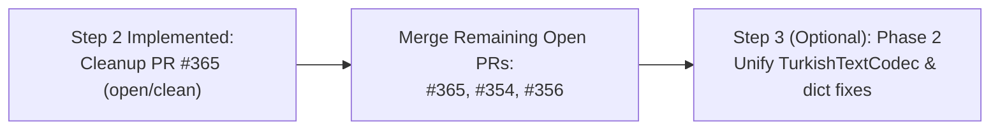

# Forensic Audit of Recent PRs (`#345`–`#364`) & Path Forward

> [!IMPORTANT]
> **Your suspicion about coordinator-dispatched weaker subagents is confirmed by the code.**
> While the top-line benchmark improvements are real, sharding work across isolated workers produced two clear artifacts:
> 1. **Siloed "bolt-on" pipeline bloat**: Each worker solved its assigned ticket by adding a standalone class and bolting another full `TurkishTokenizer.DEFAULT.tokenize(...)` + `String.join(" ", ...)` pass onto `TurkishSentenceNormalizer.preProcess()`. A single `normalize()` call now tokenizes the sentence **9–11 times**, and `#345` placed offline training classes (`LatticeDeasciifierTrainer.java` + `AveragedPerceptronWeights.java`, `461` LOC) inside `normalization/src/main/java` alongside `1,184` LOC of benchmark/sampling CLIs in `experiment/`.
> 2. **Classic weaker-LLM implementation bugs**: Re-implementing utilities already in `TurkishAlphabet`, misunderstanding Zemberek APIs (`LmVocabulary.indexOf` returning `unknownWordIndex >= 0`, not `-1`), writing `^[ivxlcdm]+$` as a "Roman numeral" regex (which silently skips Turkish words like `"miiii"`, `"diiiiil"`, `"ciddiiii"`), calling `morphology.analyze(word)` on every word *before* checking a 3-char `"nap"/"nol"` prefix, and double-penalizing diacritic edits in `TurkishSpellChecker`.

---

## 1. PR `#354` Simplification & Bugfixes (Completed)

PR [#354](https://github.com/ahmetaa/zemberek-nlp/pull/354) (`55b47c5b`, `mergeable: true`, `clean`) was rebased onto `upstream/master` (`e4f56239`) and simplified:

- **Fixed two scoring bugs in `TurkishSpellChecker`**:
  1. Replaced the 54-line DP `countDiacriticDifferences` (which allocated `int[]` arrays and `String.valueOf(char)` inside nested loops, and falsely counted *all* equal-length substitutions like `'a' != 'o'` in `"aldım"` vs `"oldum"` as diacritic differences) with a zero-allocation prefix/suffix character scan using `TurkishAlphabet.INSTANCE.getAsciiEqual(char)`.
  2. Stopped double-charging diacritic typos under the exact matcher (`charMatcher == null`), where `raw.score` already includes diacritic edits (`"dostlari" -> "dostları"` was previously charged `2.40 + 0.65 = 3.05` nats vs `2.40` nats for deleting `'i'` -> `"dostlar"`).
  3. Removed dead `getUnrankedSuggestions`, converted `ScoredSuggestion` to a `record`, and resolved apostrophized tokens (`'` and `’`) against both TitleCase (`lm-unigram.slm`) and lowercase (`lm.2gram.slm`) LM vocabularies.
- **Simplified `TurkishSentenceNormalizer`**:
  - Dropped `lookupFromAscii` (`#363`) and dropped `possibleNoisyWords` (`normalization/possible-noisy`), deriving override eligibility directly from `lookupManual` (`!manualForcedOverride`) — which also fixed a bug where `protectCleanForm` fought manual overrides like `öle=öyle` and `fiat=fiyat`.
  - Collapsed 11 scattered magic floats into 7 named constants and added curly-apostrophe (`’`) handling in `isFormallyValidWord` and `decode()`.

### Benchmark Impact of Simplifying `#354`

| Benchmark | `upstream/master` (`#363`) | Original `#354` | Simplified `#354` (`55b47c5b`) |
| :--- | :---: | :---: | :---: |
| **TRSpell10 Exact Top-1 / Top-5** | `35.50%` / `46.56%` | `36.34%` / `47.31%` | **`38.60%` / `47.24%`** |
| **TRSpell10 DiacIgn Top-1 / Top-5** | `28.94%`\* / `45.94%` | `41.61%` / `52.13%` | **`44.80%` / `56.15%`** |
| **BOUN Clean Corrupted / Preserved** | `236` / `75.29%` | `182` / `82.94%` | **`150` / `86.67%`** |
| **MultiLexNorm TR W-ERR (`SysDist`)** | `54.55%` (`230`) | `50.00%` (`253`, pre-`#345`) | **`54.94%` (`228`)** |
| **nasty_5k W-ERR (`SysDist`)** | `75.47%` (`8,578` w/o `#356`) | `69.41%` (`10,696`, pre-`#345`) | **`75.47%` (`8,578`)** |

*\*Note: Merging `#347` onto `master` without `#354` widened `DiacriticsIgnoringMatcher` candidate recall (`â/î/û`, `ı/i`) without edit/diacritic cost priors, dropping unweighted `TRSpell10 DiacIgn` Top-1 to `28.94%`. Merging `#354` restores and lifts it to **`44.80%`**.*

---

## 2. PR-by-PR Audit (`#345` through `#364`)

### A. Deasciifier (`#345`, `#346`)

| PR | Status | Diff | Grade | Assessment |
| :--- | :---: | :---: | :---: | :--- |
| **[#345](https://github.com/ahmetaa/zemberek-nlp/pull/345)** | Merged (`935658cc`) | `+6,973 / -1` | **B-** | High accuracy, thread-safe, well-bounded cache after `#363`, **but bloated packaging & duplicated utilities** (details below). |
| **[#346](https://github.com/ahmetaa/zemberek-nlp/pull/346)** | Merged (`f2068529`) | `+154 / -40` | **A-** | Clean, well-scoped `CircumflexMode` (`DISAMBIGUATION_ONLY` default) that prevents pedantic circumflex over-insertion. |

**Concrete issues found in `#345`**:
1. **Offline trainer code shipped in `normalization/src/main/java`**: While `CorpusMixSampler.java` (`663` LOC) and `LatticeDeasciifierBenchmark.java` (`521` LOC) are in `experiment/`, `LatticeDeasciifierTrainer.java` (`316` LOC) and `AveragedPerceptronWeights.java` (`145` LOC) live in `normalization/src/main/java` because `LatticeDeasciifierBenchmark` in `experiment/` calls `LatticeDeasciifierTrainer` and `LatticeDeasciifierTrainer` accesses package-private `TokenLattice` / `sealed interface WeightTable` internals.
2. **Accidental double-execution in `TurkishSentenceNormalizer.preProcess()`**:
   In `preProcess()`, pass 1 runs `sentence = latticeDeasciifier.deasciifyKnownWords(sentence)` before `toLowerCase(Turkish.LOCALE)`. Later, after `replaceCommon` / `combine` / `split`, line 639 checks `else if (!s.equals(sentence)) { s = latticeDeasciifier.deasciifyKnownWords(s); }`. Because `String.join(" ", ...)` inserts spaces before punctuation (`"ışık açık."` -> `"ışık açık ."`), **`!s.equals(sentence)` is `true` for virtually every punctuated ASCII sentence**, running the full 3-stage `LatticeDeasciifier` beam search **twice** per sentence even when zero tokens changed!
3. **Re-implemented Turkish text primitives**: `TurkishTextCodec.java` (`921` LOC) re-implements Turkish lower/upper-casing, ASCII folding, apostrophe detection, and tokenization from scratch instead of delegating to `TurkishAlphabet.INSTANCE`.

---

### B. Core Normalization, Lexicon & Morphotactics (`#347`–`#356`)

| PR | Status | Diff | Grade | Assessment |
| :--- | :---: | :---: | :---: | :--- |
| **[#347](https://github.com/ahmetaa/zemberek-nlp/pull/347)** | Merged (`8076515e`) | `+93 / -15` | **A** | Clean fix for `DiacriticsIgnoringMatcher` map overwrites and literal `.replace("['.]", "")` bug. Needs `#354` merged to rank the expanded homograph set properly. |
| **[#348](https://github.com/ahmetaa/zemberek-nlp/pull/348)** | Merged (`26b5ee25`) | `+155 / -11` | **A+** | Textbook bugfix (`+26/-11` prod LOC) in `NoisyWordsLexiconGenerator`: fixed `new IntIntMap(1)` wiping context counts, inverted hitting-time formula, and `nextInt(totalCounts + 1)` off-by-one. |
| **[#349](https://github.com/ahmetaa/zemberek-nlp/pull/349)** | Merged (`92667289`) | `+124 / -16` | **A-** | Good cleanup of destructive `candidates-manual` entries and `stripsExplicitTurkishDiacritic` guard. *(Note: the `x=x` identity lines in `candidates-manual` are intentional — `lookupManual.keySet()` masks noisy `lookup-from-graph` entries).* |
| **[#351](https://github.com/ahmetaa/zemberek-nlp/pull/351)** | Merged (`8ae462bf`) | `+167 / -6` | **A** | Idiomatic addition of `-Io/-Ior` (`yazıom`, `dio`) and `FutPart_Informal` (`kalkcağını`, `yapmıycağını`) to `InformalTurkishMorphotactics`. |
| **[#352](https://github.com/ahmetaa/zemberek-nlp/pull/352)** | Merged (`90bb54db`) | `+442 / -7` | **C+** | Useful features, **but contains a real regex bug (`^[ivxlcdm]+$`) and misses attached `"4'ncü"` ordinals** (details below). |
| **[#354](https://github.com/ahmetaa/zemberek-nlp/pull/354)** | **Open** (`55b47c5b`) | `+465 / -83` | **A** *(after today's fix)* | Essential noisy-channel scoring for `TurkishSpellChecker` and `TurkishSentenceNormalizer`. Rebased, simplified, and bug-fixed. |
| **[#355](https://github.com/ahmetaa/zemberek-nlp/pull/355)** | Merged (`570d50b6`) | `+398 / -8` | **C+** | `probablyRequiresDeasciifier` letter-ratio fix is great, **but `InformalContractionExpander` calls `morphology.analyze(word)` on every 4+ char word before checking prefixes** (details below). |
| **[#356](https://github.com/ahmetaa/zemberek-nlp/pull/356)** | **Open** (`d2b01a51`) | `+510 / -20` | **A-** *(after today's fix)* | Biggest `GECTurk` gain (`W-ERR +36.21%`). Simplified today (`-30%` LOC), fixed dead `mergedIdx < 0` check and `"Manisa'dada"` apostrophe bug. |

**Concrete bugs/wastes found in `#352` and `#355` (currently on `upstream/master`)**:
1. **`#352` — Broken Roman numeral guard in `ElongationNormalizer.java` (line 17)**:
   ```java
   private static final Pattern ROMAN_NUMERAL_PATTERN = Pattern.compile("^[ivxlcdm]+$");
   ```
   Because `i, v, x, l, c, d, m` are ordinary letters, **any elongated Turkish word composed of `{c, d, i, l, m, v}` matches `ROMAN_NUMERAL_PATTERN` and is completely skipped** — including `"miiii"`, `"diiiiil"`, `"ciddiiii"`, `"milliiii"`, and `"ciciiii"`! Replace with a strict Roman numeral validator (or check valid Roman syntax up to `mmmcmxcix`, where `iiii` is rarely even elongated except `ii`/`iii`).
2. **`#352` — Attached ordinal typo gap (`4'ncü`)**:
   `combineNumeralSuffix` handles detached `"4 üncü" -> "4'üncü"`, but leaves single-token `"4'ncü"` (`BOUN` failure: `"4'ncü golüne" -> "öncü golüne"`) untouched.
3. **`#355` — Inverted guard in `InformalContractionExpander.java` (lines 68–73)**:
   ```java
   if (!hasNonExtRegularAnalysisExcept(word, null)) { // <-- calls morphology.analyze(word)!
     String verbExpansion = expandNeVerbContraction(word); // <-- checks startsWith("nap"/"nol")!
   ```
   For **every** word of length `>= 4` in every sentence, `expandWord` executes `morphology.analyze(word)` *before* checking whether the word starts with `"nap"`, `"n'ap"`, `"nol"`, or `"n'ol"`! Checking the prefix first eliminates an unnecessary `morphology.analyze` call on ~99.9% of tokens. Also, `InformalContractionExpander.diacriticMismatchCount` duplicates `countDiacriticDifferences`.

---

### C. Memory & Cache Optimization PRs (`#359`, `#360`, `#361`, `#363`)

| PR | Status | Diff | Grade | Assessment |
| :--- | :---: | :---: | :---: | :--- |
| **[#359](https://github.com/ahmetaa/zemberek-nlp/pull/359)** | Merged (`61642238`) | `+68 / -25` | **A** | Clean lazy `DefaultModelHolder` + `volatile` double-checked locking for `AmbiguityResolver`; avoids G1GC humongous allocation. |
| **[#360](https://github.com/ahmetaa/zemberek-nlp/pull/360)** | Merged (`2da38e21`) | `+110 / -38` | **A** | Clean sorted `Node[]` + binary search replacing per-node `UIntMap` in `CharacterGraph` (~50–60% `StemEndingGraph` RAM reduction). |
| **[#361](https://github.com/ahmetaa/zemberek-nlp/pull/361)** | Merged (`2056a679`) | `+29 / -17` | **A** | Clean switch to `ImmutableListMultimap` and bounded caches. |
| **[#363](https://github.com/ahmetaa/zemberek-nlp/pull/363)** | Merged (`e4f56239`) | `+4 / -10` | **A** | Tuned `AnalysisCache` defaults (`1024 / 32K`), bounded `LatticeDeasciifier` cache, dropped redundant `lookupFromAscii`. *(Tiny leftover in `#345`: `MorphologicalCandidateGenerator.java:89` still calls deprecated no-op `.disableStaticCache()`).* |

---

### D. Closed / Dropped PRs (`#350`, `#353`, `#357`, `#358`, `#362`, `#364`)

Dropping these 6 PRs kept **`~9,300+` LOC** of redundant or parallel coordinator-worker code out of `master`:
- **`#350`** (`+282/-25`): Hardcoded short-word/question guards largely superseded by `#354` noisy-channel priors.
- **`#353`** (`+1,341/-10`): Parallel `FlatTrie` CSR graph duplicating `CharacterGraph`; `#360` achieved most of the RAM win in `+110/-38` lines.
- **`#357`** (`+671/-149`) & **`#358`** (`+814/-0`): Parallel `SpanToken` / `normalizePreservingFormat` pipelines bolted alongside the existing `preProcess` + `decode` code instead of refactoring it cleanly.
- **`#362`** (`+8/-68`): Misdirected move of `LatticeDeasciifier`.
- **`#364`** (`+6,222/-0`): Standalone `NimbleDeasciifier` kept locally in `experiment/` unsubmitted.

---

## 3. Recommended Path Forward



### Step 1 — Remaining Open Feature PRs (`#360` Merged)
1. ~~**[#360](https://github.com/ahmetaa/zemberek-nlp/pull/360)**~~ — Merged (`2da38e21`), cutting `TurkishSpellChecker` heap from `109.1 MB` to `81.0 MB` (`-28.1 MB` / `-25.8%`).
2. **[#354](https://github.com/ahmetaa/zemberek-nlp/pull/354)** (simplified noisy-channel spellchecker & normalizer scoring) — **merges cleanly with `#365` (`0` conflicts)**.
3. **[#356](https://github.com/ahmetaa/zemberek-nlp/pull/356)** (simplified clitic `de/da` split & merge) — has a trivial 2-line adjacency at the final `return` line of `preProcess()` if merged after `#365`.

### Step 2 — Post-Audit Cleanup & Bugfix PR: [#365](https://github.com/ahmetaa/zemberek-nlp/pull/365) (Submitted on `master` without `#356`/`#354`)
Submitted directly against `master` (`2da38e21`, `+139 / -74` lines across 6 files, `mergeable: true`, `clean`):
1. **Fixed `ElongationNormalizer.ROMAN_NUMERAL_PATTERN` & added char-run fast-path**: Replaced `^[ivxlcdm]+$` with a strict Roman numeral regex (`"ciddiiii" -> "ciddi"`, `"diiiiil" -> "dil"`, `"miiii" -> "mi"`) and added `hasReducibleLetterRun(word)` before `isValidWord.test(word)` (`morphology.analyze`).
2. **Fixed `InformalContractionExpander` guard order**: Checks `"nap"`, `"n'ap"`, `"nol"`, `"n'ol"` prefixes *before* calling `morphology.analyze(word)` (eliminating an unnecessary morphological analysis on ~99.9% of 4+ char tokens) and uses `TurkishAlphabet.INSTANCE.isAsciiEqual`.
3. **Fixed `preProcess()` double-deasciification, token-join churn & numeral suffixes**:
   - Compares `!s.equals(initial)` (token-joined text) instead of `!s.equals(sentence)` so `latticeDeasciifier.deasciifyKnownWords` does not run twice on punctuated ASCII sentences.
   - Skips redundant `TurkishTokenizer.DEFAULT.tokenize(...)` and second-pass `combineNecessaryWords` calls when text hasn't changed, and repairs attached numeral suffixes (`"4'ncü" -> "4'üncü"`, `"2'inci" -> "2'nci"`, `"4'de" -> "4'te"`).
   - Removed deprecated `.disableStaticCache()` in `MorphologicalCandidateGenerator` and leftover `ascii-map` dummy test writes.

### Step 3 — Optional Longer-Term Consolidation
- Trim `TurkishTextCodec.java` (`921` LOC) in `latticedeasciifier` by delegating casing, apostrophe, and Turkish alphabet tables to `TurkishAlphabet.INSTANCE`.
- Fix high-frequency `master-dictionary.dict` inflection gaps surfaced by `BOUN Clean` (such as `blok` voicing to `bloğa`).
