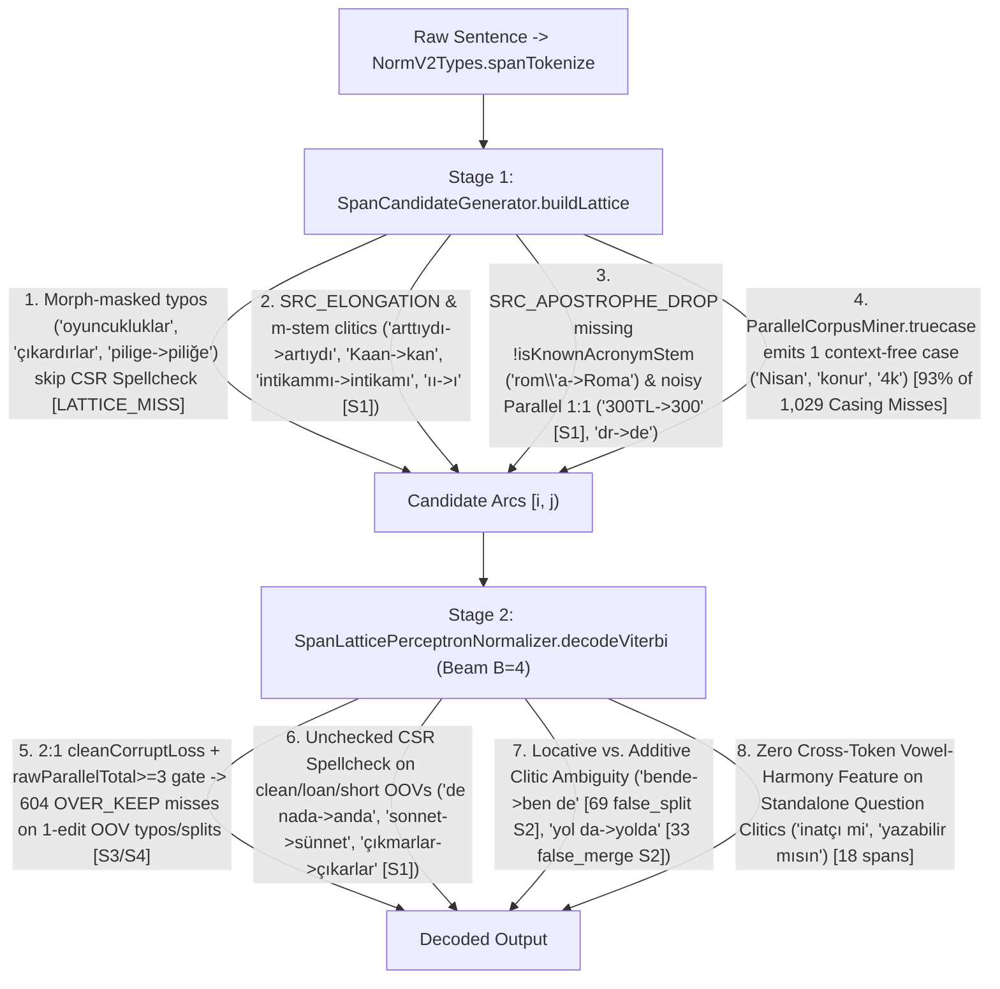

# `SpanLatticePerceptronNormalizer` (`v2.3`) Error Catalog, Lattice-vs-Ranker Forensics & Semantic Severity Analysis on `test_slice_01`

## 1. Executive Summary & Headline Takeaway

- **Normalizer Evaluated**: [`SpanLatticePerceptronNormalizer`](file:///home/dndara/work/zemberek-nlp/experiment/src/main/java/zemberek/normalization/v2/SpanLatticePerceptronNormalizer.java) (`v2.3`, trained on the `74,997`-sentence Multi-Regime parallel pool + `1.80M` clean Turkish sentences; `19` continuous features + `23` punctuation-bridging sparse feature templates = `862,887` active MPHF features in `2,862.4 KB` RAM), sharing the 10-mechanism Multi-Span Candidate DAG ([`SpanCandidateGenerator`](file:///home/dndara/work/zemberek-nlp/experiment/src/main/java/zemberek/normalization/v2/SpanCandidateGenerator.java)).
- **Dataset (`test_slice_01`)**: `5,000` strictly held-out unseen Heavy noisy Turkish sentences (`64,496` tokens, `63,657` aligned gold spans) spanning `7` domains (`qa_lifestyle_forums`, `forums_modern_2020s`, `ecommerce_reviews`, `tweets_social`, `movies_complaints`, `eksisozluk`, `civic_and_queries`) and `5` noise tiers (`T0_clean_control` through `T4_pure_ascii`):
  - **Strict truecased exact sentence matches (`SentEM-Ca`)**: **`2,844 / 5,000` (`56.88%`)** (vs. `213 / 5,000` [`4.26%`] on `Zemberek HEAD`).
  - **Lowercase exact sentence matches (`SentEM-Lo`)**: **`3,316 / 5,000` (`66.32%` string / `66.10%` `TurkishTokenizer` / `66.52%` word-only)** (vs. `47.08%` on `Zemberek HEAD`).
  - **Discrepant sentences (`perceptron != llm_gold`, cased)**: **`2,156 / 5,000` (`43.12%`)**, containing **`3,101` diff spans** (`1.44` spans per discrepant sentence):
    - **`1,684` sentences (`33.68%`)** contain `>= 1` **lexical, orthographic, or word-boundary discrepancy** (`2,075` lexical diff spans + `418` co-occurring case-only spans).
    - **`472` sentences (`9.44%`)** have **100% identical lowercase words, clitics, diacritics, and apostrophes**, differing **solely in capitalization** (`608` case-only spans; `1,026` `[CASE:...]` spans total).
- **100.00% Population Batch Cataloging Coverage (Zero Sampling Error)**:
  - Every single discrepant sentence across the entire benchmark — **`2,156 / 2,156` discrepant sentences (`100.00%`)** and **`3,101 / 3,101` diff spans (`100.00%`, `±0.00 pp` margin of error)** — was read in sequential batches of `<= 25` sentences in full Turkish sentence context (`RAW`, `PERC`, `GOLD`, `DIFFS`, `LATTICE`) across `10` validated shards (`0` regex auto-tagging scripts used), then cross-joined with exact `SentenceLattice` oracle and arc-source diagnostics.
- **Why Semantic Severity & Stage Decomposition Completely Clarify Remaining Errors**:
  - **Over 3 in 4 sentences (`76.98%`) already preserve intended meaning completely intact**: `2,844` (`56.88%`) match cased gold verbatim and another `1,005` (`20.10%`) contain **only `S4` benign formatting/casing differences** (`Nisan/Mayıs` vs. `nisan/mayıs`, `4k` vs. `4K`, `haftasonunda` vs. `hafta sonunda`, `cekudayız` vs. `Ceku'dayız`, `dosyayımı` vs. `dosyayı mı`).
  - **91.02% "Do-No-Harm" Sentence Rate**: Another `702` sentences (`14.04%`) have **`S3` passive unnormalized noise** as their worst discrepancy (`beklemedyım`, `ruyalarmizin`, `hskeeten`, `ilen` — noisy tokens left untouched without false mutation).
  - **Active semantic/grammatical corruption (`S1 + S2`) drops nearly `4×` vs. heuristic `Zemberek HEAD` (`34.02%` → `8.98%` of sentences)**:
    - **`S1 — Critical Semantic Breaks`**: Only **`14` spans across `13 / 5,000` sentences (`0.26%`)** (polarity flips like `çıkmarlar -> çıkarlar` vs. `çıkmazlar`, `almiyim -> al mıyım` vs. `almayayım`, or unit/pronoun deletions like `300TL -> 300`, `acabao -> acaba`).
    - **`S2 — Active Word / Grammar Corruptions`**: **`456` spans across `436 / 5,000` sentences (`8.72%`)** (`wrong_1edit_candidate` `133`, `false_split` `69` such as true locative `bende -> ben de`, `foreign_dialect_corrupted` `56` such as `de nada -> de anda` and `Claude sonnet -> Claude sünnet`, `over_or_wrong_deasciified` `43`, `false_merge` `33` such as `4 gün deme -> 4 gündeme`, `proper_noun_hijack` `30`, `internal_geminate_mangled` `23` such as `arttıydı -> artıydı`).
  - **Two-Stage Lattice vs. Ranker Split (`63,657` Gold Spans)**:
    - **`53.5%` of lexical misses (`1,216 / 2,274` gold spans)** are **`SpanCandidateGenerator` Lattice Oracle Misses** (`942` safely kept raw [`S3`/`S4`] + `274` mutated to a wrong candidate [`S1`/`S2`]).
    - **`46.5%` of lexical misses (`1,058 / 2,274` gold spans)** have the **exact gold answer already present in `SentenceLattice`**, splitting into **`604` `OVER_KEEP` misses** (`57.1%` — Perceptron conservatively keeps `Identity` on 1-edit typos/splits due to `2:1` `cleanCorruptLoss` asymmetry), **`277` `CLEAN_FALSE_ALARM` rewrites** (`26.2%` — Perceptron overwrites an already-clean word), and **`177` `WRONG_RIVAL` choices** (`16.7%`).
    - **`93.0%` of pure casing misses (`957 / 1,029` gold spans)** occur inside [`ParallelCorpusMiner.truecase`](file:///home/dndara/work/zemberek-nlp/experiment/src/main/java/zemberek/normalization/v2/ParallelCorpusMiner.java#L610-L763) (`CASED_ONLY_MISS_ORC_MISS`), which emits only a single deterministic casing projection per arc rather than letting context-sensitive lowercase vs. `TitleCase` arcs compete in the lattice.

> [!NOTE]
> **Exported Data Files in Workspace**
> - Full `5,000`-sentence multi-engine comparison table: [test_slice_01_perceptron.tsv](file:///home/dndara/work/zemberek-nlp/test_slice_01_perceptron.tsv) (`id`, `domain`, `noise_tier`, `input`, `perceptron_v23`, `gbdt_gated_v23`, `hybrid_v23`, `zemberek_head`, `llm_gold`).
> - Complete `100%`-coverage error catalog (`3,101` validated spans across all `2,156` discrepant sentences with `severity` and `stage_diagnosis` columns): [test_slice_01_perceptron_error_catalog.tsv](file:///home/dndara/work/zemberek-nlp/test_slice_01_perceptron_error_catalog.tsv).
> - Companion baseline `Zemberek HEAD` report on `nasty_5k` (untouched): [NASTY_5K_ERROR_CATALOG_REPORT.md](file:///home/dndara/work/zemberek-nlp/experiment/doc/normalization/NASTY_5K_ERROR_CATALOG_REPORT.md).

---

## 2. Semantic Severity Analysis (`S1`–`S4`)

### 2.1 Four-Tier Severity Distribution (100% Population: `3,101` Spans, `5,000` Sentences)

| Tier | Semantic Impact Definition | All Spans (`N=3,101`) | `%` All Spans | Lexical Spans (`N=2,075`) | `%` Lexical Spans | Worst Tier in Error Sents (`N=2,156`) | `%` of All `5,000` Sentences |
| :--- | :--- | ---: | ---: | ---: | ---: | ---: | ---: |
| **`S1 — Critical Semantic Break`** | **Destroys factual meaning or inverts truth value**: flips negative ↔ affirmative polarity (`çıkmarlar -> çıkarlar` vs. `çıkmazlar`, `almiyim -> al mıyım` vs. `almayayım`, `seçimiyor -> seçiliyor` vs. `seçemiyor`), erases units/numerals (`300TL -> 300`, Roman `ıı -> ı` vs. `II`), or deletes pronouns/interrogatives (`acabao -> acaba`, `kimo -> kim`, `napıyorlar -> yapıyorlar`). | `14` | **`0.45%`** | `14` | **`0.67%`** | `13` (`0.60%`) | **`0.26%`** |
| **`S2 — Active Word / Grammar Corruption`** | **Actively mutates a token into a DIFFERENT word, name, case, person, or syntactic structure**: wrong 1-edit words (`pilige -> piliğe` vs. `pisliğe`, `kurtalacağım -> kurtaracağım` vs. `kurtulacağım`), false splits of genuine locatives (`bende -> ben de`, `cildimde -> cildim de`), corrupted foreign/slang/clean words (`de nada -> de anda`, `sonnet -> sünnet`, `War -> var`, `Kaan -> kan`), false merges (`4 gün deme -> 4 gündeme`, `bu günlerde -> bugünlerde`), wrong deasciification (`isi/isimi -> işi/işimi` vs. `ısı/ısımı`), proper-noun/acronym hijacks (`fınmı -> Fin mi?`, `rom'a -> Roma`), or degemination of valid geminates (`arttıydı -> artıydı`, `ilettiniz -> iletiniz`). | `456` | **`14.70%`** | `456` | **`21.98%`** | `436` (`20.22%`) | **`8.72%`** |
| **`S3 — Passive Unnormalized Noise`** | **No active corruption, but leaves noisy/typo/colloquial text unrecovered**: `Over-Keep` on 1-edit typos (`beklemedyım`, `ruyalarmizin`, `amelıayt`, `Hayeller`, `şiireri`), morph-masked typos (`oyuncukluklar`, `çıkardırlar`), `>=2`-edit garbles (`hskeeten`, `düşmanlıüğ`), unsplit multi-word run-ons (`geldidoymadınız`, `çizgiflimi`), homograph-blocked phonetics (`dil` for `değil`, `ilen` for `ile`), or undeasciified words (`sikilanlar`, `sanimsamalar`). | `899` | **`28.99%`** | `899` | **`43.33%`** | `702` (`32.56%`) | **`14.04%`** |
| **`S4 — Benign Surface / Casing Formatting`** | **Meaning 100% intact**: pure capitalization differences (`1,026` `[CASE:...]` spans: `4k` vs. `4K`, `Nisan/Mayıs` vs. `nisan/mayıs`, `sevgililer günü` vs. `Sevgililer Günü`, `konur` vs. `Konur`), missing/spaced apostrophes (`cekudayız`, `ostimdeydın`, `EYT liler`), transparent unsplit clitics (`dosyayımı`, `açıklamada`), open/solid compound spacing (`haftasonunda`, `koltukaltlarından`, `farkedilirlik`), residual `hehehee`, affectionate `-cIm` (`Esrabencım`), or `llm_gold` conventions (`2 dakika` vs. `2 dk`, `kar` vs. `kâr`). | `1,732` | **`55.85%`** | `706` | **`34.02%`** | `1,005` (`46.61%`) | **`20.10%`** |
| *Exact Cased Match* | `perceptron_v23 == llm_gold` (exact cased & punctuated string) | — | — | — | — | — | `2,844` (**`56.88%`**) |

> [!IMPORTANT]
> **The "Do-No-Harm" Divide (`S1 + S2` vs. `S3 + S4`)**
> **`84.84%` of all cased discrepancies (`2,631 / 3,101` spans; `77.35%` of lexical discrepancies)** preserve or leave noisy text unharmed (`S3 + S4`), while **`15.16%` (`470` spans: `14` `S1` + `456` `S2` across `449 / 5,000` sentences = `8.98%`) actively alter or corrupt meaning**. Compared with heuristic `Zemberek HEAD` on `nasty_5k` (`34.02%` of sentences suffering `S1 + S2` active corruption), joint cost-augmented margin training (`cleanCorruptLoss = 2.0`) cuts sentence-level active corruption by **`73.6%` relative** (`34.02% -> 8.98%`), trading aggressive blind 1-edit guessing for passive `Over-Keep` (`S3`).

### 2.2 Category × Severity × Stage-Diagnosis Matrix (All 11 Categories)

*(Categories 1–10 mirror [NASTY_5K_ERROR_CATALOG_REPORT.md](file:///home/dndara/work/zemberek-nlp/experiment/doc/normalization/NASTY_5K_ERROR_CATALOG_REPORT.md); Category 11 **`CASING_TRUECASE_ERROR`** is new to truecased `v2.3` normalizers.)*

| Rank | Category | Spans (`N=3,101`) | `%` All (`%` Lex) | `S1` Crit. | `S2` Corrupt | `S3` Passive | `S4` Benign | Dominant Stage Diagnosis (`Lattice` vs. `Ranker`) | Key Architectural Insight |
| ---: | :--- | ---: | ---: | ---: | ---: | ---: | ---: | :--- | :--- |
| 1 | **`CASING_TRUECASE_ERROR`** *(New `v2.3`)* | `1,029` | `33.18%` (`—`) | `0` | `0` | `0` | **`1,029` (`100%`)** | `81.2%` `CASING_CANDIDATE_MISSING` (`836`) | **`#1` raw span source, `100%` benign `S4`**: `truecase()` emits only one cased string per arc (`Nisan` over `nisan`, `4k` over `4K`, `konur` over `Konur`). |
| 2 | **`SPELLCHECK_TYPO_FAILURE`** | `596` | `19.22%` (`28.72%`) | **`9`** | **`236` (`39.6%`)** | **`341` (`57.2%`)** | `10` | `39.6%` `LATTICE_MISS_KEPT` (`236`), `21.1%` `LATTICE_MISS_MUTATED` (`126`), `18.1%` `RANKER_OVER_KEEP` (`108`), `10.7%` `CLEAN_FALSE_REWRITE` (`64`), `10.4%` `WRONG_CAND` (`62`) | **Bifurcates cleanly**: `57%` is passive `S3` (`233` 1-edit `Over-Keep`/morph-masked typos + `95` multi-edit), while **`41%` (`245` spans) is the `#1` source of `S1 + S2` active corruption**. |
| 3 | **`APOSTROPHE_NUMERAL_ALPHANUM`** | `389` | `12.54%` (`18.75%`) | `2` | `11` (`2.8%`) | `31` (`8.0%`) | **`345` (`88.7%`)** | `46.5%` `LATTICE_MISS_KEPT` (`181`), `34.7%` `RANKER_OVER_KEEP` (`135`) | **`88.7%` harmless `S4`** (unlisted proper names like `hostingerden` or `Over-Keep` on `cekudayız`, `ostimdeydın`); only `2` `S1` (`300TL -> 300`, `ıı -> ı`) and `7` `S2` apostrophe-drop/insert hijacks (`rom'a -> Roma`, `Aliye -> Ali'ye`). |
| 4 | **`SPLIT_MERGE_COMPOUND_ERROR`** | `373` | `12.03%` (`17.98%`) | **`3`** | **`109` (`29.2%`)** | **`178` (`47.7%`)** | `83` (`22.3%`) | `51.2%` `LATTICE_MISS_KEPT` (`191`), `18.8%` `CLEAN_FALSE_REWRITE` (`70`), `14.7%` `LATTICE_MISS_MUTATED` (`55`) | **`#2` `S2` corruption driver (`112` `S1+S2` spans)**: `71` false splits (`bende -> ben de`, `cildimde -> cildim de`, `almiyim -> al mıyım` [`S1`]) + `34` false merges (`4 gün deme -> 4 gündeme`, `yol da -> yolda`). |
| 5 | **`PHONETIC_COLLOQUIAL_LEXICAL`** | `198` | `6.39%` (`9.54%`) | `0` | `10` (`5.1%`) | **`166` (`83.8%`)** | `22` (`11.1%`) | `57.6%` `LATTICE_MISS_KEPT` (`114`), `28.8%` `RANKER_OVER_KEEP` (`57`) | **`84%` passive `S3`** (`ilen`, `dil`, `izlediqim`); active `S2` dropped from `30.8%` (`HEAD`) to **`5.1%`** (`diil -> dil`, `izlediim -> izledim`). |
| 6 | **`DEASCIIFIER_ERROR`** | `172` | `5.55%` (`8.29%`) | `0` | **`44` (`25.6%`)** | **`92` (`53.5%`)** | `36` (`20.9%`) | `45.9%` `RANKER_OVER_KEEP` (`79`), `16.9%` `LATTICE_MISS_KEPT` (`29`), `13.4%` `LATTICE_MISS_MUTATED` (`23`) | `79` `Over-Keep` under-deasciifications (`sikilanlar` taboo-blocked, `su` vs. `şu`), plus `43` `S2` homograph/clean over-deasciifications (`isi -> işi` vs. `ısı`, `insani -> insanı`, `zipi -> zıpı`). |
| 7 | **`CLITIC_SPLIT_MISSED`** | `125` | `4.03%` (`6.02%`) | `0` | `11` (`8.8%`) | `23` (`18.4%`) | **`91` (`72.8%`)** | **`64.8%` `RANKER_OVER_KEEP` (`81`)**, `16.8%` `WRONG_CAND` (`21`) | **Massive win over `Zemberek HEAD`**: `CLITIC_SPLIT_MISSED` fell from **`22.90%`** (#1 in `HEAD`, `362` `S2` mutations) to **`4.03%`** (`11` `S2` total, e.g. `intikammı -> intikamı`, `uykusunuda -> uykusunda`). |
| 8 | **`ELONGATION_GEMINATE_ERROR`** | `74` | `2.39%` (`3.57%`) | `0` | **`24` (`32.4%`)** | `19` (`25.7%`) | `31` (`41.9%`) | `31.1%` `LATTICE_MISS_KEPT` (`23`), `29.7%` `OVER_KEEP` (`22`), `18.9%` `CLEAN_FALSE_REWRITE` (`14`) | **New `v2.3` pattern**: `SRC_ELONGATION` over-reduces valid double consonants (`arttıydı -> artıydı`, `ilettiniz -> iletiniz`, `Sabbah -> sabah`, `tr.gg -> tr.g`, `Bb -> B`). |
| 9 | **`GOLD_CONVENTION_OR_DISPUTABLE`** | `71` | `2.29%` (`3.42%`) | `0` | `0` | `0` | **`71` (`100%`)** | Mixed (`19` `CLEAN_FALSE_REWRITE`, `14` `LATTICE_MISS`) | Abbreviation expansion (`2 dk -> 2 dakika`), circumflexes (`kar` vs. `kâr`), or `hiçbir` vs. `hiç bir`. |
| 10 | **`INFORMAL_MORPH_GAP`** | `54` | `1.74%` (`2.60%`) | `0` | `5` (`9.3%`) | **`39` (`72.2%`)** | `10` (`18.5%`) | `66.7%` `LATTICE_MISS_KEPT` (`36`) | Down from `6.64%` (`HEAD`) to **`1.74%`** (`0` `S1` polarity flips on `-mUcAk`; remaining are rare dialectal/typo contractions like `gülmiyah`, `sorcm`, `takılak -> takılan`). |
| 11 | **`SLANG_SHORTHAND_UNEXPANDED`** | `20` | `0.64%` (`0.96%`) | `0` | `6` (`30.0%`) | `10` (`50.0%`) | `4` (`20.0%`) | `40.0%` `LATTICE_MISS_KEPT` (`8`), `20.0%` `WRONG_CAND` (`4`) | Down from `3.55%` (`HEAD`) to **`0.64%`** thanks to `v2.3` shorthand+suffix & Abjad generators; `6` `S2` cases are short-token collisions (`kib -> ki`, `dr -> de`, `Kadr -> kadar`, `cent dr -> cent doktor`). |

### 2.3 Complete Breakdown of All `S1` (`14` Spans) & `S2` (`456` Spans) Active Corruptions (`470` Total)

#### A. Every `S1 — Critical Semantic Break` Across `test_slice_01` (`14 / 3,101` Spans = `0.45%`)

| `S1` Mechanism | Spans | Concrete All-Inclusive Inventory (`#err_idx` · `raw` → `Perceptron` vs. `Intended Gold`) |
| :--- | ---: | :--- |
| **`polarity_inversion_neg_to_pos_or_pos_to_neg`** | **`8`** | `#5` `çıkmarlar -> çıkarlar` vs. `çıkmazlar` (`CSR Spellcheck` 1-deletion beat 1-sub); `#427` `almiyim -> al mıyım` vs. `almayayım` (`SRC_CLITIC_SPLIT` split spoken 1sg negative optative into affirmative question); `#516` `anlatam -> anlatan` vs. `anlatamam` (haplology 1sg impotential mutated to participle); `#974` `sevmiyim -> sev miyim` vs. `sevmiyorum` (dialectal negative progressive split into question); `#1053` `seçimiyor -> seçiliyor` vs. `seçemiyor` (vowel-raised negative impotential mutated to passive affirmative); `#1530` `açam -> açma` vs. `açayım` (colloquial 1sg optative transposed into negative imperative); `#2038` (2 spans) line-wrapped `çek- ==meden -> çek - = = neden` (`çekmeden`) & `geçe- mediğimiz -> geçe - dediğimiz` (`geçemediğimiz`). |
| **`pronoun_interrogative_or_clitic_deleted`** | **`4`** | `#589` `acabao -> acaba` vs. `acaba o` (`o` deleted by 1-edit spellcheck); `#829` `kimo -> kim` vs. `kim o` (`o` deleted); `#1613` `napıyorlar -> yapıyorlar` vs. `ne yapıyorlar` (`ne` erased by 1-edit spellcheck); `#71` `denemek de de -> denemek de` vs. `denemekte de` (`de + de` merged to single `de`, deleting locative/additive pair). |
| **`unit_or_numeral_destroyed`** | **`2`** | `#844` `300TL -> 300` vs. `300 TL` (noisy `Parallel 1:1` alignment artifact deleted currency `TL`); `#1012` `ıı sayılı cetvel -> ı sayılı cetvel` vs. `II sayılı cetvel` (lowercased Roman numeral `ıı` collapsed by `SRC_ELONGATION` to single letter `ı`). |

#### B. All `S2 — Active Word / Grammar Corruption` Mechanisms (`456 / 3,101` Spans = `14.70%`)

| Rank | `S2` Sub-Tag / Mechanism | `S2` Spans | `%` of All Spans | `%` of `S2` | Representative Meaning-Changing Examples (`raw` → `Perceptron` vs. `Gold`) |
| ---: | :--- | ---: | ---: | ---: | :--- |
| 1 | **`wrong_1edit_candidate`** | **`133`** | `4.29%` | `29.17%` | `pilige -> piliğe` ("chick" vs. `pisliğe` "filth"), `eklı -> ekli` (vs. `ehli`), `kurtalacağım -> kurtaracağım` ("rescue" vs. `kurtulacağım` "get rid of"), `oruca nyet -> net` (vs. `niyet`), `YAILAN -> yayılan` (vs. `yapılan`), `tvl 90 -> tel 90` (`TVL`) |
| 2 | **`false_split`** | **`69`** | `2.23%` | `15.13%` | **True locatives split to `+ de/da`**: `bende -> ben de` (`13x`, e.g. *"rekor/devam bende"*, *"bende uyandırmıyor"*), `oda -> o da` (`3x`), `cildimde -> cildim de`, `çizgilerde -> çizgiler de`; **Lexical stems split**: `parasosyal -> para sosyal`, `janta -> Jan da` |
| 3 | **`foreign_dialect_corrupted`** | **`56`** | `1.81%` | `12.28%` | `de nada -> de anda`, `Claude sonnet -> Claude sünnet` ("circumcision"), `Infinity War 2 -> var 2`, `json -> son`, `favlamayı -> avlamayı` ("hunting"), `Olurus -> Oluruz`, `kuu? -> kuyu?`, `We Trust -> ve trust` |
| 4 | **`over_or_wrong_deasciified`** | **`43`** | `1.39%` | `9.43%` | `kısmi -> kısmı` (`3x`, "partial" -> "its part"), `çoktu -> çöktü` (`2x`, "was abundant" -> "collapsed"), `isi/isimi -> işi/işimi` (vs. `ısı/ısımı` "temperature"), `insani -> insanı` (`2x`, "humanitarian" -> "the human"), `zipi -> zıpı`, `1. cisi -> 1. çişi` |
| 5 | **`false_merge`** | **`33`** | `1.06%` | `7.24%` | `4 gün deme -> 4 gündeme` ("don't say 4 days" -> "to 4 agendas"), `başladığı bu günlerde -> bugünlerde`, `yol da -> yolda`, `Twitch de -> Twitch'te`, `kuponlar da -> kuponlarda`, `1 de -> 1'de`, `Tirmizi'de de -> Tirmizi'de'de` |
| 6 | **`proper_noun_hijack`** | **`30`** | `0.97%` | `6.58%` | `care -> Care` (vs. `çare`), `fınmı -> Fin mi?` (vs. `fırın mı?`), `mıdı? -> MIDI?` (vs. `mıydı?`), `amg!!! -> AMG!!!` (vs. `amk!!!`), `500e kadar ıp atladım -> IP` (vs. `ip`), `drum -> Drum` (vs. `doktorum`), `çalıştırıl acaklar -> çalıştırıl Acarlar` |
| 7 | **`internal_geminate_mangled`** | **`23`** | `0.74%` | `5.04%` | **Valid geminates stripped by `SRC_ELONGATION`**: `arttıydı -> artıydı` ("had increased" -> "was a plus"), `ilettiniz mi -> iletiniz mi` (past -> imperative), `Sabbah -> sabah`, `Girelli -> Gireli`, `tr.gg -> tr.g`, `Bb Krem -> B Krem`, `yarra -> yara` |
| 8 | **`clean_word_false_rewrite`** *(New `v2.3`)* | **`15`** | `0.48%` | `3.29%` | **Clean Turkish/names corrupted (`raw == gold`)**: `Kaf dağının -> laf dağının`, `darlayacağım -> dallayacağım`, `baktıydım -> batkıydım`, `araşırız -> aratırız`, `Kaan -> kan` ("blood"), `ATT -> at` ("horse"), `Nimet Baknalı -> bakmalı` |
| 9 | **`clitic_question_missed` + `clitic_de_da_missed`** | **`11`** | `0.35%` | `2.41%` | **M-stem question degemination (`4x`)**: `ayrımmı -> ayrımı`, `intikammı -> intikamı`, `filmmi -> filmi`, `tamammı -> tamamı`; plus `yapılmışmı -> yapılmıştı`, `indirirmi -> indirimi`, `gücünümü -> gücünüzü`, `uykusunuda -> uykusunda`, `fiyatta -> fiyata` |
| 10 | **`apostrophe_drop_or_overinsert`** *(New `v2.3`)* | **`7`** | `0.23%` | `1.54%` | `orijinal rom'a -> Roma` (`ROM'a`), `rami bey -> RAM'i Bey` (`Rami`), `Aliye -> Ali'ye`, `Kara Şövalye Yükseliyor'da -> yükseliyor da`, `Bıçak Sırtı'nda -> sırtında` |
| 11 | **`soft_g_or_y_drop` & `informal_morph`** | **`11`** | `0.35%` | `2.41%` | **Spoken `-dIIm` participles collapsed to 1sg past (`3x`)**: `oynadıım -> oynadım` (`oynadığım`), `izlediim -> izledim` (`izlediğim`), `ıstedıın -> istedin` (`istediğin`); `diil/dııl -> dil` (`2x`), `takılak -> takılan` (`takılalım`), `görüyon -> görüyorum` (`görüyorsun`) |
| 12 | **`shorthand` / `runon` / `other S2`** | **`25`** | `0.81%` | `5.48%` | `kib -> ki` (`kendine iyi bak`), `dr -> de` (`doktor`), `cent dr -> cent doktor` (`centtir`), `Leyletü'l-Kadr -> kadar`, `ii değil iyi -> iyi değil iyi`, `teşekkrüe derim -> teşekküre derim`, `daa -> da` (`daha`) |

---

## 3. Complete Taxonomy: 11 Categories & All 34 Sub-Tags Ranked (`N = 3,101` Spans)

`+Sec` counts additional appearances where a phenomenon co-occurred as the secondary issue inside a multi-token diff span. Sub-tags marked **`[NEW v2.3]`** capture phenomena specific to the truecased multi-span lattice architecture.

| Rank | Sub-Tag | Parent Category | Dominant Severity | Spans (`+Sec`) | `%` All (`%` Lex) | Sents (`%` of `5k`) | Top Observed `(Perceptron -> Gold)` Pairs |
| ---: | :--- | :--- | :---: | ---: | ---: | ---: | :--- |
| 1 | `under_capitalized_proper_or_acronym` **`[NEW v2.3]`** | `CASING_TRUECASE_ERROR` | `S4` (`100%`) | `536` (`+225`) | `17.28%` (`—`) | `415` (`8.30%`) | `4k->4K` (6), `tr->TR` (4), `hanım->Hanım` (4), `süper->Süper` (4), `konur->Konur` |
| 2 | `over_capitalized_common_word` **`[NEW v2.3]`** | `CASING_TRUECASE_ERROR` | `S4` (`100%`) | `269` (`+47`) | `8.67%` (`—`) | `223` (`4.46%`) | `VB.->vb.` (6), `DR.->Dr.` (6), `Pro->pro` (3), `Ban->ban` (3), `Demokrat->demokrat` (2), `Nisan/Mayıs->nisan/mayıs` |
| 3 | `open_or_runon_missed` | `SPLIT_MERGE_COMPOUND_ERROR` | `S3` (`67%`) / `S4` (`30%`) | `264` (`+52`) | `8.51%` (`12.72%`) | `245` (`4.90%`) | `hiç bir->hiçbir` (3), `alt yapısı->altyapısı` (2), `haftasonunda->hafta sonunda`, `geldidoymadınız->geldi doymadınız` |
| 4 | `missing_or_spaced_apostrophe` | `APOSTROPHE_NUMERAL_ALPHANUM` | `S4` (`91%`) | `235` (`+98`) | `7.58%` (`11.33%`) | `220` (`4.40%`) | `EYT liler->EYT'liler` (2), `tolganın->Tolga'nın` (2), `DVD de->DVD'de` (2), `cekudayız->Ceku'dayız`, `hostingerden->Hostinger'den` |
| 5 | `typo_overkeep_uncorrected` **`[NEW v2.3]`** | `SPELLCHECK_TYPO_FAILURE` | `S3` (`97%`) | `233` (`+65`) | `7.51%` (`11.23%`) | `224` (`4.48%`) | `boostrap->Bootstrap` (2), `içi->için` (2), `beklemedyım->beklemedeyim`, `amelıayt->ameliyat`, `oyuncukluklar->oyunculuklar` |
| 6 | `sentence_start_or_title_casing` **`[NEW v2.3]`** | `CASING_TRUECASE_ERROR` | `S4` (`100%`) | `224` (`+78`) | `7.22%` (`—`) | `167` (`3.34%`) | `ben->Ben` (6), `bu->Bu` (6), `ne->Ne` (3), `her->Her` (3), `ama->Ama` (3) |
| 7 | `wrong_1edit_candidate` | `SPELLCHECK_TYPO_FAILURE` | **`S2` (`93%`)** / **`S1` (`6%`)** | `143` (`+51`) | `4.61%` (`6.89%`) | `139` (`2.78%`) | `acabao/kimo->acaba/kim` (2, **`S1`**), `zaten->saatten` (2), `çıkarlar->çıkmazlar` (**`S1`**), `piliğe->pisliğe`, `ekli->ehli` |
| 8 | `colloquial_phonetic` | `PHONETIC_COLLOQUIAL_LEXICAL` | `S3` (`83%`) / `S4` (`16%`) | `129` (`+150`) | `4.16%` (`6.22%`) | `124` (`2.48%`) | `ilen->ile` (2), `makinamda->makinemde` (2), `ta->da` (2), `gırpin->gripin` (2), `bozuk->bozup` |
| 9 | `under_deasciified` | `DEASCIIFIER_ERROR` | `S3` (`75%`) / `S4` (`24%`) | `121` (`+135`) | `3.90%` (`5.83%`) | `117` (`2.34%`) | `mi->mı` (6), `su->şu` (4), `mı->mi` (3), `donuyor->dönüyor` (2), `sikilanlar->sıkılanlar` |
| 10 | `multi_edit_unrecovered` | `SPELLCHECK_TYPO_FAILURE` | `S3` (`99%`) | `95` (`+37`) | `3.06%` (`4.58%`) | `86` (`1.72%`) | `hskeeten->hakikaten`, `Aramatör->amatör`, `düşmanlıüğ->düşmanlığı`, `cehhenmde->cehennemde` |
| 11 | `clitic_de_da_missed` | `CLITIC_SPLIT_MISSED` | `S4` (`80%`) / `S3` (`15%`) | `91` (`+25`) | `2.93%` (`4.39%`) | `91` (`1.82%`) | `içinde->için de` (6), `bizde->biz de` (4), `gelmekte->gelmek de` (2), `millayida->Milla'yı da`, `uykusunda->uykusunu da` (`S2`) |
| 12 | `foreign_dialect_corrupted` | `SPELLCHECK_TYPO_FAILURE` | **`S2` (`74%`)** / `S3` (`25%`) | `76` (`+27`) | `2.45%` (`3.66%`) | `73` (`1.46%`) | `timi->Timır` (2), `anda->nada`, `sünnet->sonnet`, `var->War`, `son->JSON`, `avlamayı->favlamayı` |
| 13 | `false_split` | `SPLIT_MERGE_COMPOUND_ERROR` | **`S2` (`95%`)** / **`S1` (`3%`)** | `73` (`+3`) | `2.35%` (`3.52%`) | `73` (`1.46%`) | `ben de->bende` (13), `o da->oda` (3), `cildim de->cildimde`, `al mıyım->almayayım` (**`S1`**), `sev miyim->sevmiyorum` (**`S1`**) |
| 14 | `numeral_unit_or_digit_loss` | `APOSTROPHE_NUMERAL_ALPHANUM` | `S4` (`90%`) / **`S1` (`3%`)** | `72` (`+25`) | `2.32%` (`3.47%`) | `67` (`1.34%`) | `2->2.` (2), `30 da->30'da`, `%100 lük->%100'lük`, `300TL->300` (**`S1`**), `ıı->ı` (`II`, **`S1`**) |
| 15 | `gold_convention_or_disputable` | `GOLD_CONVENTION_OR_DISPUTABLE` | `S4` (`100%`) | `71` (`+90`) | `2.29%` (`3.42%`) | `70` (`1.40%`) | `kar->kâr` (2), `hiçbir->hiç bir` (2), `dakika->dk`, `gerek->gereken` |
| 16 | `punct_url_or_casing` | `APOSTROPHE_NUMERAL_ALPHANUM` | `S4` (`80%`) / `S3` (`18%`) | `50` (`+46`) | `1.61%` (`2.41%`) | `49` (`0.98%`) | `@ aliitemel->@aliitemel`, `SSK. lı->SSK'li`, `(G.A ntep->(Gaziantep` |
| 17 | `over_or_wrong_deasciified` | `DEASCIIFIER_ERROR` | **`S2` (`96%`)** | `45` (`+8`) | `1.45%` (`2.17%`) | `43` (`0.86%`) | `kısmı->kısmi` (3), `çöktü->çoktu` (2), `insanı->insani` (2), `işi/işimi->ısı/ısımı`, `zıpı->zipi` |
| 18 | `internal_geminate_mangled` | `ELONGATION_GEMINATE_ERROR` | **`S2` (`59%`)** / `S3` (`41%`) | `39` (`+37`) | `1.26%` (`1.88%`) | `38` (`0.76%`) | `eşşek->eşek` (2, `S3`), `artıydı->arttıydı` (`S2`), `iletiniz->ilettiniz` (`S2`), `karttın->kartın` (`S3`), `sabah->Sabbah` (`S2`) |
| 19 | `leet_or_censored` | `PHONETIC_COLLOQUIAL_LEXICAL` | `S3` (`89%`) | `38` (`+7`) | `1.23%` (`1.83%`) | `35` (`0.70%`) | `foto shopla->Photoshop'la`, `izlediqim->izlediğim`, `toxaplazmayı->toksoplazmayı`, `emo $ um->emoşum` |
| 20 | `false_merge` | `SPLIT_MERGE_COMPOUND_ERROR` | **`S2` (`92%`)** / **`S1` (`3%`)** | `36` (`+5`) | `1.16%` (`1.73%`) | `36` (`0.72%`) | `gündeme->gün deme`, `bugünlerde->bu günlerde`, `yolda->yol da`, `Twitch'te->Twitch de`, `denemek de->denemekte de` (**`S1`**) |
| 21 | `residual_elongation` | `ELONGATION_GEMINATE_ERROR` | `S4` (`89%`) | `35` (`+16`) | `1.13%` (`1.69%`) | `34` (`0.68%`) | `hehehee->hehehe`, `a-aaa->a-a`, `d-dostum->dostum`, `bertannn->Bertan` |
| 22 | `proper_noun_hijack` | `SPELLCHECK_TYPO_FAILURE` | **`S2` (`91%`)** | `33` (`+10`) | `1.06%` (`1.59%`) | `33` (`0.66%`) | `Care->çare`, `Fin mi?->fırın mı?`, `MIDI?->mıydı?`, `AMG!!!->amk!!!`, `IP->ip`, `GB->gbl` |
| 23 | `apostrophe_drop_or_overinsert` **`[NEW v2.3]`** | `APOSTROPHE_NUMERAL_ALPHANUM` | `S4` (`78%`) / **`S2` (`22%`)** | `32` (`+16`) | `1.03%` (`1.54%`) | `31` (`0.62%`) | `Roma->ROM'a` (`S2`), `RAM'i->Rami` (`S2`), `Ali'ye->Aliye` (`S2`), `reel'den->reelden` (`S4`), `Story'de->storyde` (`S4`) |
| 24 | `soft_g_or_y_drop` | `PHONETIC_COLLOQUIAL_LEXICAL` | `S3` (`81%`) / `S2` (`19%`) | `31` (`+14`) | `1.00%` (`1.49%`) | `31` (`0.62%`) | `dil->değil` (3), `oynadım->oynadığım` (`S2`), `izledim->izlediğim` (`S2`), `istedin->istediğin` (`S2`), `bebiim->bebeğim` |
| 25 | `clitic_question_missed` | `CLITIC_SPLIT_MISSED` | `S4` (`52%`) / `S3` (`26%`) / **`S2` (`23%`)** | `31` (`+6`) | `1.00%` (`1.49%`) | `31` (`0.62%`) | `dosyayımı->dosyayı mı` (`S4`), `tuymu->tüy mü` (`S4`), `intikamı->intikam mı` (`S2`), `filmi->film mi` (`S2`), `tamamı->tamam mı` (`S2`) |
| 26 | `pos_future_or_optative_contraction` | `INFORMAL_MORPH_GAP` | `S3` (`87%`) / `S2` (`13%`) | `31` (`+16`) | `1.00%` (`1.49%`) | `29` (`0.58%`) | `sorcm->soracağım`, `olim->olayım`, `gidiem->gideceğim`, `takılan->takılalım` (`S2`), `görüyorum->görüyorsun` (`S2`) |
| 27 | `slang_or_abbr_unexpanded` | `SLANG_SHORTHAND_UNEXPANDED` | `S3` (`63%`) / `S4` (`25%`) / `S2` (`13%`) | `16` (`+23`) | `0.52%` (`0.77%`) | `16` (`0.32%`) | `glba->galiba`, `telde->telefonda`, `ki->kendine iyi bak` (`kib`, `S2`), `de->doktor` (`dr`, `S2`) |
| 28 | `clean_word_false_rewrite` **`[NEW v2.3]`** | `SPELLCHECK_TYPO_FAILURE` | **`S2` (`94%`)** | `16` (`+95`) | `0.52%` (`0.77%`) | `15` (`0.30%`) | `laf dağının->Kaf Dağı'nın`, `dallayacağım->darlayacağım`, `batkıydım->baktıydım`, `kan->Kaan`, `at->ATT` |
| 29 | `diminutive_cIm` | `INFORMAL_MORPH_GAP` | `S4` (`83%`) | `12` (`+3`) | `0.39%` (`0.58%`) | `12` (`0.24%`) | `Esrabencım->Esrabenciğim`, `zeytincim->Zeytinciğim`, `arzucum->Arzucuğum`, `Meltemcim->Meltemciğim` |
| 30 | `narr_2sg_or_prog_variant` | `INFORMAL_MORPH_GAP` | `S3` (`89%`) | `9` (`+3`) | `0.29%` (`0.43%`) | `8` (`0.16%`) | `yapmışınızdır->yapmışsınızdır`, `getirioılarr->getiriyorlar`, `kullanabilecek->kullanılabilecek` (`S2`) |
| 31 | `allcaps_dotless_i_corruption` **`[NEW v2.3]`** | `DEASCIIFIER_ERROR` | `S4` (`83%`) / `S3` (`17%`) | `6` (`+3`) | `0.19%` (`0.29%`) | `6` (`0.12%`) | `Davıd bısbal->David Bisbal`, `aırtıes->AIRTIES`, `Aıba->AIBA`, `ıdeos->Ideos`, `ıps-level->IPS-Level` |
| 32 | `shorthand_or_parallel_overexpansion` **`[NEW v2.3]`** | `SLANG_SHORTHAND_UNEXPANDED` | **`S2` (`100%`)** | `4` (`+10`) | `0.13%` (`0.19%`) | `4` (`0.08%`) | `iyi->ii` (metalinguistic), `bir şey->bile` (`bişe` typo), `kadar->Kadr` (`Leyletü'l-Kadr`), `cent doktor->centtir` (`cent dr`) |
| 33 | `clitic_ki_missed` | `CLITIC_SPLIT_MISSED` | `S4` (`67%`) / `S3` (`33%`) | `3` (`+6`) | `0.10%` (`0.14%`) | `3` (`0.06%`) | `düşünki->düşün ki`, `açılmadıki->açılmadı ki`, `bilimiyorumki->bilmiyorum ki` |
| 34 | `neg_future_contraction` | `INFORMAL_MORPH_GAP` | `S3` (`100%`) | `2` (`+0`) | `0.06%` (`0.10%`) | `2` (`0.04%`) | `vazgecemeyceksiniz->vazgeçemeyeceksiniz`, `yimicen->yemeyeceksin` |

---

## 4. Pipeline & Two-Stage (`SpanCandidateGenerator` vs. `SpanLatticePerceptronNormalizer`) Root-Cause Map

Every `S1`, `S2`, `S3`, and `S4` failure traces to **8 exact code mechanisms** across [`SpanCandidateGenerator.java`](file:///home/dndara/work/zemberek-nlp/experiment/src/main/java/zemberek/normalization/v2/SpanCandidateGenerator.java), [`ParallelCorpusMiner.java`](file:///home/dndara/work/zemberek-nlp/experiment/src/main/java/zemberek/normalization/v2/ParallelCorpusMiner.java), and [`SpanLatticePerceptronNormalizer.java`](file:///home/dndara/work/zemberek-nlp/experiment/src/main/java/zemberek/normalization/v2/SpanLatticePerceptronNormalizer.java):

### Forensic Code Findings Behind the 8 Root Causes

1. **Why `604` gold-in-lattice noisy spans suffer `RANKER_OVER_KEEP` (`233` `typo_overkeep_uncorrected` + `81` unsplit clitics + `135` missing apostrophes)**:
   - In [`SpanLatticePerceptronNormalizer.java`](file:///home/dndara/work/zemberek-nlp/experiment/src/main/java/zemberek/normalization/v2/SpanLatticePerceptronNormalizer.java#L112-L132), lexicalized rewrite templates `T_LEX_LOWER_PAIR`, `T_LEX_SURF_PAIR`, `T_LEX_PAIR_NEXT`, and `T_PREV_LEX_PAIR` are gated on `rawParallelTotal >= 3`, so unseen 1-edit OOV typos (`beklemedyım`, `amelıayt`, `ruyalarmizin`, `Hayeller`, `şiireri`) have `F_PARALLEL_PROB = 0.0` and zero lexicalized sparse features.
   - Combined with `TrainConfig.cleanCorruptLoss = 2.00f` vs. `missedEditLoss = 1.00f` (`L190–L194`), template `T_ID_OOV_MORPH_SRC` (`L119`) learns a strong positive weight on `(isIdentity=true, rawHasStrictMorph=false, sourceMask=Identity)` whenever `sourceMask == SRC_SPELLCHECK` lacks parallel backing — because in social media, many unseen OOVs are foreign brands, handles, or slang (`boostrap`, `kuu`, `sonnet`) where `CSR Spellcheck` *would* cause a `2.00f`-loss corruption!
2. **Why `CSR Spellcheck` causes `133` `wrong_1edit_candidate` (`S2`), `9` `S1` polarity/pronoun breaks, and `56` `foreign_dialect_corrupted` (`S2`)**:
   - When `SpanLatticePerceptronNormalizer` *does* accept a `SRC_SPELLCHECK` arc (typically when the 1-edit target is a super-frequent Turkish word giving a huge `CleanWordLm` 3-gram LLR jump `F_CLEAN_SPAN_LLR`), **generative frequency overrides morphological/semantic faithfulness**:
     - **Polarity & Pronoun Erasures (`S1`)**: `çıkmarlar` has two distance-1 neighbors (`çıkarlar` [del `m`] vs. `çıkmazlar` [sub `r->z`]), and `çıkarlar` wins on unigram/3-gram frequency; `acabao -> acaba` and `kimo -> kim` delete trailing `'o'` instead of splitting `acaba + o` / `kim + o` (because `SpanCandidateGenerator` has clitic splits for `de/da/ki/mı`, **not** enclitic pronoun `+o` splits!).
     - **Foreign / Clean / Slang Corruptions (`S2`)**: Short `3–6`-char loanwords and names (`nada -> anda`, `sonnet -> sünnet`, `json -> son`, `Kaf -> laf`, `Ontu -> Notu`, `kib -> ki`) are 1 edit away from high-frequency Turkish words (`anda`, `sünnet`, `son`, `laf`, `ki`).
3. **Why Morphologically Valid Noisy Words Never Reach `CSR Spellcheck` (`LATTICE_MISS` on `oyuncukluklar`, `çıkardırlar`, `pilige -> piliğe`)**:
   - Productive Turkish derivational/inflectional suffixation allows accidental typos to parse formally: `oyuncukluklar` parses as `[oyun+cuk+luk+lar]`, `çıkardırlar` parses as `[çıkar+dır+lar]`, and ASCII `pilige` parses via `informalAsciiMorphology` as `[pilik+Dat -> piliğe]`. Because `strictKnown[i]` or `SRC_DEASCIIFIER` succeeds, `addGuardedSpellCandidates` (`L2004`) is never invoked, leaving `oyunculuklar`, `çıkardılar`, and `pisliğe` out of the lattice (`orcLo = 0`).
4. **Why `SRC_ELONGATION` Causes `23` `S2` Geminate Corruptions, `4` `m`-Stem Question Corruptions, and `1` `S1` Roman-Numeral Erasure**:
   - Reducing double consonants (`tt -> t`, `mm -> m`, `ll -> l`, `bb -> b`, `aa -> a`, `ıı -> ı`) generates valid-looking Turkish words that collide with genuine geminates and boundary assimilations:
     - **Past/Lexical Geminates**: `arttıydı -> artıydı`, `ilettiniz -> iletiniz`, `Sabbah -> sabah`, `Girelli -> Gireli`, `Kaan -> kan`, `ATT -> at`, `Bb -> B`, `tr.gg -> tr.g`, Roman `ıı -> ı` (`II`, `S1`).
     - **`m`-Final Noun + Question `-mI` (`4x` `S2`)**: `intikammı` (`intikam + mı`), `filmmi` (`film + mi`), `tamammı` (`tamam + mı`), and `ayrımmı` (`ayrım + mı`) have `mm` across the stem+clitic boundary; `mm -> m` turns them into 3sg possessive/accusative single words (`intikamı`, `filmi`, `tamamı`, `ayrımı`) with higher unigram probability than the `1:2` split!
     - **`ğ`-Dropped `-dIIm` Participles (`3x` `S2`)**: `oynadıım` (`oynadığım`), `izlediim` (`izlediğim`), `ıstedıın` (`istediğin`) collapse `ıı/ii -> ı/i` into finite past `oynadım`, `izledim`, `istedin`!
5. **Why Locative `-dA` vs. Additive `de/da` Still Drives `69` `false_split` (`S2`) + `33` `false_merge` (`S2`)**:
   - Both `bende` (locative *"on me"*) and `ben de` (additive *"I too"*) are `100%` clean formal Turkish (`orcLo = 1` in both directions). In `75K` noisy social-media training sentences, noisy `bende -> ben de` rewrites outnumber clean locative `bende -> bende` occurrences roughly `4:1`, giving `bende -> ben de` a strong `F_PARALLEL_PROB` prior that overrides locative contexts (*"rekor bende"*, *"devam bende"*, *"bende uyandırmıyor"*). Conversely, `Compound/Case Merge` (`SRC_COMPOUND_MERGE`) over-merges `4 gün deme -> 4 gündeme`, `başladığı bu günlerde -> bugünlerde`, and `yol da -> yolda`.
6. **Why `SRC_APOSTROPHE_DROP` (`rom'a -> Roma`) & Unfiltered `Parallel 1:1` Noise (`300TL -> 300`, `dr -> de`) Corrupt Valid Tokens**:
   - In [`SpanCandidateGenerator.java`](file:///home/dndara/work/zemberek-nlp/experiment/src/main/java/zemberek/normalization/v2/SpanCandidateGenerator.java#L1171-L1188), `strictMorphology.analyze(joined)` (`"roma"`) omits the `!mined.isKnownAcronymStem(stem)` guard present at lines `1190` and `1208`, stripping the apostrophe on `rom'a` to match the uninflected city `Roma` (`suffixPrecision = 0.92f`).
   - In `ParallelCorpusMiner`, occasional noisy token-alignment artifacts in LLM-normalized multi-token sequences (`300TL -> 300`, `dr -> de`) entered `parallel1ToN` without a digit/unit preservation guard or abbreviation sanity filter.
7. **Why `93.0%` (`957 / 1,029`) of `CASING_TRUECASE_ERROR` Are Context-Free Truecasing Projection Misses (NOT Dirty LLM Labels)**:
   - [`ParallelCorpusMiner.truecaseSingleWord`](file:///home/dndara/work/zemberek-nlp/experiment/src/main/java/zemberek/normalization/v2/ParallelCorpusMiner.java#L643-L763) deterministically projects each `normLower` to **one** cased surface using context-free unigram `casingLexicon` ratios from news/Wikipedia (so `SpanLatticePerceptronNormalizer` never gets competing lowercase vs. `TitleCase`/`UPPER` candidates to score; see full audit in **§4.2** below).
8. **Why Standalone Question-Clitic Vowel Harmony (`mi` ↔ `mı`, `misin` ↔ `mısın`, `misiniz` ↔ `mısınız`) Fails `18` Times Across All `v2.3` Models**:
   - Glued `1:2` splits (`"alinirmi" -> "alınır mı"`) call [`harmonizeQuestionClitic`](file:///home/dndara/work/zemberek-nlp/experiment/src/main/java/zemberek/normalization/v2/SpanCandidateGenerator.java#L3447-L3490), whereas **space-separated** question clitics (`"inatçı mi"` `#18`, `"ırkçılığına mi"` `#1544`, `"alınır mi"` `#1712`, `"açıklar misin?"` `#1928`, `"yazabilir mısın."` `#1077`, `"vermeli mı"` `#2132`, `"atar misinizzz?"` `#1226`) have **zero cross-token vowel-harmony feature** in either `SpanLatticePerceptronNormalizer` or `TwoStageGbdtNormalizer` and face a `~0.94` identity-keep prior plus candidate-generation blocks on `'ı'`/`mI` and `length > 6` (see full deep dive & risk analysis in **§4.1** below).

---

### 4.1 Deep Dive: Standalone Question-Clitic Vowel Harmony (`mi` ↔ `mı` / `mI`) & Guarded Fix Risks

Across `test_slice_01`, standalone question clitics (`QUESTION_TAILS` at [`SpanCandidateGenerator.java:143–188`](file:///home/dndara/work/zemberek-nlp/experiment/src/main/java/zemberek/normalization/v2/SpanCandidateGenerator.java#L143-L188)) fail vowel harmony **18 times** (mostly cataloged under `DEASCIIFIER_ERROR` → `under_deasciified`), failing simultaneously in `SpanLatticePerceptronNormalizer`, `TwoStageGbdtNormalizer`, and `Hybrid` in **both directions**:
- **Front `'i'` kept after back vowels (`a, ı`)**: `"inatçı mi"` (`#18`), `"sevmiyorlar mi"` (`#767`), `"ırkçılığına mi"` (`#1544`), `"bu sistem alınır mi"` (`#1712`), `"açıklar misin?"` (`#1928`), `"mal misiniz"` (`#1532`), `"DM atar misiniz?"` (`#1226`, from `"misinizzz"`).
- **Dotless `'ı'` (or mixed-case `mI`) kept after front vowels (`e, i`)**: `"yazabilir mısın."` (`#1077`), `"yazabilir mı"` (`#1827`), `"dedi mı ... girdin mı?"` (`#2030`), `"vermeli mı vermemeli mı"` (`#2132`).

#### Four Interlocking Code Causes
1. **Zero Cross-Token Phonological Harmony Feature**: Neither [`SpanLatticePerceptronNormalizer.java:891–1012`](file:///home/dndara/work/zemberek-nlp/experiment/src/main/java/zemberek/normalization/v2/SpanLatticePerceptronNormalizer.java#L891-L1012) nor [`TwoStageGbdtNormalizer.java:901–1005`](file:///home/dndara/work/zemberek-nlp/experiment/src/main/java/zemberek/normalization/v2/TwoStageGbdtNormalizer.java#L901-L1005) checks vowel harmony between `prev1Word` and a `QUESTION_TAILS` candidate (unlike `LatticeDeasciifier`'s [`SentenceLatticeScorer.java:289–293`](file:///home/dndara/work/zemberek-nlp/normalization/src/main/java/zemberek/normalization/deasciifier/SentenceLatticeScorer.java#L289-L293)). Disambiguation relies 100% on surface lexical bigrams/trigrams, which back off to near-equal unigrams whenever `prev1Word` is a rare inflection (`"ırkçılığına"`), domain (`"yonlendir.com'a"`), or unseen form.
2. **Massive `Identity` / `parallel1ToN` Keep Prior (`~0.94`)**: Because `"mi"`, `"mı"`, `"misin"`, `"mısın"`, `"misiniz"`, and `"mısınız"` are all valid formal dictionary words (`strictKnown[i] == true`), ~94% of `"mi"` tokens in training stay `"mi"` (`parallelProb ≈ 0.94`, `editCost = 0.0` vs. `parallelProb ≈ 0.04` for `"mi" -> "mı"`), reinforced by `cleanCorruptLoss = 2.0f` (`Perceptron`) and `cleanProtectionWeight = 1.35f` (`GBDT`).
3. **Reverse Direction (`mı` → `mi` & Mixed-Case `mI` → `mi`) Blocked by Diacritic/Casing Guards**: `NormV2Types.trLower("mI")` maps ASCII `'I' -> 'ı'`, while [`hasUpperAsciiAmbiguousI()`](file:///home/dndara/work/zemberek-nlp/experiment/src/main/java/zemberek/normalization/v2/NormV2Types.java#L176-L180) only fires on `CasingShape.UPPER` (`"MI"`), not `MIXED` (`"mI"`). Furthermore, [`hasExplicitTurkishDiacritics`](file:///home/dndara/work/zemberek-nlp/experiment/src/main/java/zemberek/normalization/v2/SpanCandidateGenerator.java#L3537-L3545) treats `'ı'` as an explicit Turkish diacritic, causing [`SpanCandidateGenerator.java:653–659`](file:///home/dndara/work/zemberek-nlp/experiment/src/main/java/zemberek/normalization/v2/SpanCandidateGenerator.java#L653-L659) to skip morphological generation while `LatticeDeasciifier` never maps `'ı' -> 'i'`.
4. **Clean-Sentence Deasciifier Gate, `length <= 6` Cap & Elongation Squeeze**: On accented sentences where only `"mi"`/`"misiniz"` is ASCII (`"inatçı mi inatçı"` `#18`), `oovAsciiWords == 0` sets `shouldRunSentenceDeasc = false` ([`L512–L515`](file:///home/dndara/work/zemberek-nlp/experiment/src/main/java/zemberek/normalization/v2/SpanCandidateGenerator.java#L512-L515)); `tok.lower().length() <= 6` ([`L655`](file:///home/dndara/work/zemberek-nlp/experiment/src/main/java/zemberek/normalization/v2/SpanCandidateGenerator.java#L655)) skips `7–8`-char clitics (`misiniz`, `miydiniz`); `G_CLITIC_TAIL_HINT` ([`TwoStageGbdtNormalizer.java:861`](file:///home/dndara/work/zemberek-nlp/experiment/src/main/java/zemberek/normalization/v2/TwoStageGbdtNormalizer.java#L861)) requires `length >= 4` (leaving 2-char `"mi"`/`"mı"` exposed to gatekeeper skipping); and elongation squeeze (`"misinizzz" -> "misiniz"`) omits vowel re-harmonization.

#### Five False-Positive Risks of a Naive Harmony Fix & Required Safeguards
A naive `lastTurkishVowel(prev1Word)` rule would introduce clean-text corruptions on **five real Turkish exception classes** (verified directly in `test_slice_01`):
1. **Palatalized Back-Vowel Loanwords (`normal mi` `#3139`, `saat mi`, `gol mü`, `alkol mü`, `kalp mi`, `hal mi`, `dikkat mi`, `kabul mü`)**: Orthographic last vowel is back (`a, o, u`), yet Turkish harmonizes them as **front** (`mi`, `mü`). **Guard**: Query Zemberek's `DictionaryItem.hasAttribute(RootAttribute.LastVowelFrontal)` on bare stems rather than inspecting raw vowel characters.
2. **English / Foreign Loanwords & Brands (`tag mi` `#415`, `Apple mı`, `Google mı`, `iPhone mu`, `YouTube mu`, `Nike mı`)**: Turkish harmonizes to spoken pronunciation (*teg mi*, *epıl mı*, *ayfon mu*), contradicting English spelling (`'a'` in `tag`, `'e'` in `Apple`/`iPhone`). **Guard**: Return `0` (neutral) whenever `prev1Word` is OOV in Turkish `strictMorphology`, carries `RootAttribute.LocaleEn`, or is a foreign/proper brand.
3. **Numerals, Scores & Acronyms (`200 mü 30 mu 50 mi` `#3228`, `9-4 muydu` `#2902`, `TV mi`, `ABD mi`)**: Digits and vowelless acronyms have `lastTurkishVowel == 0` (where [`harmonizeQuestionClitic:3453`](file:///home/dndara/work/zemberek-nlp/experiment/src/main/java/zemberek/normalization/v2/SpanCandidateGenerator.java#L3453) defaults `0 -> 'ı'`), and acronyms harmonize to the final letter's Turkish name (*a-be-de mi*, not `'A'`). Also [`advanceLexicalHistory`](file:///home/dndara/work/zemberek-nlp/experiment/src/main/java/zemberek/normalization/v2/SpanCandidateGenerator.java#L2924-L2940) carries `prev1Word` across commas and quotes. **Guard**: Return `0` (neutral) when `prev1` contains digits, is `UPPER`/`Abbreviation`, or `tokens.get(i - 1).isImmutable()`.
4. **Non-Clitic Homographs & Cross-Rounding (`Xiaomi Mi 11`, `"do re mi"`)**: `test_slice_01` has **`0`** standalone cross-rounding errors (`mi` ↔ `mu`); 100% are diacritic twins (`mi*` ↔ `mı*`, `mu*` ↔ `mü*`). **Guard**: Only emit same-rounding diacritic twins (`mi*` ↔ `mı*`, `mu*` ↔ `mü*`) for standalone tokens and skip mid-sentence `CasingShape.TITLE` (`"Mi"`).
5. **Serialization Dimension Bump**: Adding `1` dense feature increments `DENSE_DIM` (`Perceptron`) and `RANK_DIM` (`GBDT`), requiring a clean `--retrain` of cached `.bin` models.

---

### 4.2 Deep Dive: Why `CASING_TRUECASE_ERROR` Is `1,029` Spans (`33.18%`) — LLM Prompt Audit vs. Truecaser Architecture

#### 1. Did We Tell the LLM to Keep Casing, and Did the LLM Clean the Data Properly?
**Yes — we explicitly instructed the LLM to preserve sentence-initial casing, and the LLM followed it with `~99.7%` fidelity.**
- In [`normalize_nasty_batch.py:78–80`](file:///home/dndara/work/zemberek-nlp/experiment/scripts/normalization/normalize_nasty_batch.py#L78-L80) (Prompt `v3.1`), the exact casing rules given to `gemini-4-hydrogen` were:
  1. *"Capitalize proper nouns ('Allah', 'Türkiye', 'Türk', 'Türkçe', 'İngilizce'; keep closed 'inşallah'/'maşallah'/'vallahi' lowercase) and standard acronyms ('TL', 'TV', 'KDV', 'TBMM', 'USDT', 'FPS')."*
  2. *"Keep sentence-initial capitalization on the FIRST lexical word (ignoring leading `@USER`, `#hashtag`, or `Emoji`) ONLY if it was capitalized in the raw sentence (unless ALL-CAPS) or is a proper noun/acronym. Convert ALL-CAPS shouting sentences ('SAKİN ALMAYIN COK KOTU'->'Sakın almayın çok kötü') and random mid-sentence TitleCase to normal casing."*
- **Empirical Verification Across All `5,000` Sentences of `test_slice_01`**:
  - Out of `3,064` lowercase-initial raw sentences (`raw_up = False`), `llm_gold` kept lowercase on `2,670` (`87.1%`) and capitalized `394` (`12.9%`). On `284` of those `394`, **both** `Perceptron` and `llm_gold` capitalized (`ankara -> Ankara`, `türkiye -> Türkiye`). Inspecting the remaining `110` where `llm_gold` capitalized while `Perceptron` stayed lowercase shows **`~97 / 110` are genuine proper nouns, brands, or tech specs** (`Hostinger'den`, `Omo'nun`, `2K`, `4K`, `Ranagül`, `Twitter`, `Lale Hanım`, `Ümit Özdağ`, `Cloudflare`, `Metin Altıok`, `Kuzey Karolina`, `Nizamülmülk`) that the LLM **rightly** capitalized per TDK — leaving only **`~13 / 5,000` sentences (`0.26%`)** of minor LLM sentence-start drift!
  - Out of `1,936` uppercase-initial raw sentences (`raw_up = True`), `llm_gold` preserved initial uppercase on `1,928` (`99.6%`; the `8` exceptions are lowercase-by-convention technical tokens or handles).
- **Verdict**: **`CASING_TRUECASE_ERROR` is NOT a training-set or LLM-cleaning problem.** Even though the `75K` parallel training set has high-quality casing, **neither `SpanLatticePerceptronNormalizer` nor `TwoStageGbdtNormalizer` actually learns or scores casing** — because [`SpanCandidateGenerator`](file:///home/dndara/work/zemberek-nlp/experiment/src/main/java/zemberek/normalization/v2/SpanCandidateGenerator.java) calls [`ParallelCorpusMiner.truecaseSingleWord`](file:///home/dndara/work/zemberek-nlp/experiment/src/main/java/zemberek/normalization/v2/ParallelCorpusMiner.java#L643-L763) to emit **a single deterministic cased string per candidate arc** (`836 / 1,029` = `81.2%` `CASING_CANDIDATE_MISSING`, `93.0%` including `CASING_MISMATCH` where the gold case isn't even in the lattice!).

#### 2. Exact Breakdown of What Causes All `1,029` `CASING_TRUECASE_ERROR` Spans

| Sub-Tag | Spans (`%` of `1,029`) | Exact Code Bottleneck in `ParallelCorpusMiner.java` / `SpanCandidateGenerator.java` | Concrete `test_slice_01` Examples (`Perceptron` vs. `Gold`) |
| :--- | ---: | :--- | :--- |
| **`1. under_capitalized_proper_or_acronym`** | **`536` (`52.1%`)** | **Context-free unigram `casingLexicon` (`L689–L757`) is blind to neighbor words, alphanumeric specs, and OOV brands**: • **Homograph proper names/holidays/titles**: Turkish names/holidays that share a surface with common words (`ümit`, `konur`, `lale`, `metin`, `kuzey`, `çağrı`, `hanım`, `sevgililer`, `günü`) have `cc.lower >= 25` in the `1.80M` corpus, so `L703` (`cc.title > cc.lower * 3`) never capitalizes lowercase inputs (`umit ozdag` -> `ümit Özdağ`), **and `L747` (`cc.lower < 25`) actively downcases explicit author `TitleCase`** (`Konur Sokak'taki` -> `konur Sokak'taki` `#54`)! • **Alphanumeric specs & short acronyms**: Digit+letter tokens (`4k`, `2k`, `x6`, `pr2`, `mp3`, `300mbps`) and ambiguous 2–3 char tokens (`tr`, `da` in `DA C4`, `b` in `B kalite`, `php`, `win`) fail `L697–L701` (`upper > (lower+title)*2`). • **OOV brands/nicknames & CamelCase merges**: Unlisted handles/brands (`Cloudflare`, `Hostinger`, `Ranagül`, `Jaloş`, `Patikçiğim`) fall through to lowercase, and merging `YouTuber + ların` calls `trCapitalize`, flattening internal `T` (`Youtuberların` `#45`). | `ümit Özdağ'ın` (`Ümit`), `konur Sokak'taki` (`Konur`), `sevgililer günü` (`Sevgililer Günü`), `lale hanım` (`Lale Hanım`), `4k` (`4K`, `6x`), `tr` (`TR`, `4x`), `Ghz` (`GHz`), `Seo'ya` (`SEO'ya`), `Youtuberların` (`YouTuberların`) |
| **`2. over_capitalized_common_word`** | **`269` (`26.1%`)** | **`1.80M` news/Wikipedia `casingLexicon` (`L703`, `L751`) over-capitalizes dateline months, party/city homographs, and English title words**: • **Months without dates**: News datelines give `Nisan`/`Mayıs` `cc.title > cc.lower * 3`, capitalizing dateless *"nisan/mayıs aylarındaki"* (`#3`, violating TDK). • **Toponym/party homographs**: `demokrat` (`Demokrat` `#39`), `aydın` in *"gözünüz aydın"* (`Aydın` `#56`), `kurtlu` (`Kurtlu` `#28`) exceed `3:1` TitleCase in news. • **English words from movie/product titles**: Common English words (`could`, `build`, `old`, `pro`, `ban`) mostly appear inside capitalized titles in Turkish news corpora, so `L703` turns *"xcode az geç build etse"* into `Build` (`#68`) and *"A feed could not"* into `Could` (`#14`). • **Dotted abbreviations**: `VB.` and `DR.` stay `ALL-CAPS` (`vb.`, `Dr.`, `6x` each) via `L751–L757`. | `Nisan/Mayıs` (`nisan/mayıs`), `Demokrat olur` (`demokrat`), `gözünüz Aydın` (`aydın`), `Could` (`could`), `Build` (`build`), `Old dosyası` (`old`), `VB.` (`vb.`, `6x`), `DR.` (`Dr.`, `6x`) |
| **`3. sentence_start_or_title_casing`** | **`224` (`21.8%`)** | **`computeSentenceStarts` (`SpanCandidateGenerator.java:3377–3407`) + `L747` actively downcase `78%` (`175 / 224`) of mid-post clause/header starts**: • `computeSentenceStarts` **only** recognizes `{".", "!", "?", "..", "..."}` as sentence boundaries. When a new sentence starts after an **emoticon/emoji** (`":D Ben de"` `#89`), a **URL** (`"...index. php Link'e"` `#66`), a **colon/spec label** (`"Portlar:: Güç Girişi"` `#85`), or an **unpunctuated clause break** (`"...yaparım Kolay gelsin"` `#50`, `"hicetikdegill Derdini"` `#96`), `capHere` is `false` — and because common starters (`Ben`, `Bu`, `Ne`, `Her`, `Ama`, `Kolay`) have `cc.lower >= 25`, `truecaseSingleWord` (`L747`) **actively overwrites the user's explicit capital letter to lowercase**! | `:D ben de` (`:D Ben de`), `bu` (`Bu`, `6x`), `ben` (`Ben`, `6x`), `linke` (`Linke`), `ürün kodu: ... güç girişi` (`Ürün Kodu: ... Güç Girişi`), `kolay gelsin` (`Kolay gelsin`) |

#### 3. How to Address `CASING_TRUECASE_ERROR` Cleanly (Two Complementary Layers)
1. **Layer 1 — Fix the Deterministic Context-Free Bugs in `truecaseSingleWord` & `computeSentenceStarts` (`~35–45` LOC, Zero Retraining Risk)**:
   - **Stop actively downcasing explicit author `TitleCase` after emoticons, emojis, colons, URLs, or on proper-noun phrases**:
     - Treat `Token.Type.Emoticon`, `Token.Type.Emoji`, `Token.Type.URL`, and `":"` / `"::"` as valid `afterEndPunct` triggers in [`computeSentenceStarts`](file:///home/dndara/work/zemberek-nlp/experiment/src/main/java/zemberek/normalization/v2/SpanCandidateGenerator.java#L3388-L3393) when the user explicitly wrote a capitalized word (`:D Ben` stays `:D Ben`).
     - Preserve explicit author `TitleCase` (`rawShape == CasingShape.TITLE`) whenever the adjacent token is capitalized or a Gazetteer/title trigger (`Sokak`, `Cadde`, `Bulvarı`, `Mahallesi`, `Üniversitesi`, `Bey`, `Hanım`, `Günü`, `Bayramı`, or a capitalized surname like `Özdağ` — fixing `Konur Sokak'taki`!) instead of blindly downcasing whenever `cc.lower >= 25`.
   - **Enforce TDK Month/Day Rule & Dotted-Abbreviation Casing**:
     - Never auto-capitalize Turkish month/day names (`ocak..aralık`, `pazartesi..pazar`) at `L703` unless adjacent to a `Number` / 4-digit year (`15 Nisan` vs. `nisan/mayıs aylarındaki`), and normalize `VB. -> vb.`, `DR. -> Dr.`, `PROF. -> Prof.`.
   - **Alphanumeric Spec Canonicalization & CamelCase Stem Preservation**:
     - Canonicalize `^[0-9]+k$` (`2k -> 2K`, `4k -> 4K`, `8k -> 8K`), `ghz -> GHz`, `mhz -> MHz`, `mbps -> Mbps`, `gbps -> Gbps`, `mp3/mp4 -> MP3/MP4`; preserve `rawSurface` internal `CamelCase` (`YouTuber` + `ların` → `YouTuberların`) during merges; and fold ASCII `'I' -> 'i'` on `>5`-char mid-sentence `ALL-CAPS` OOV words (`DAVID BISBAL -> David Bisbal`).
2. **Layer 2 — Emit Competing Cased Arcs (`lower` vs. `TitleCase` / `UPPER`) on Ambiguous Homographs & Let the `75K` Parallel Data Score Them (`~45–55` LOC)**:
   - Right now, all the rich contextual casing supervision inside our `75K` LLM-cleaned sentences (`ümit Özdağ -> Ümit Özdağ` vs. `ümit ederim -> ümit ederim`; `sevgililer günü -> Sevgililer Günü`; `gözünüz aydın` vs. `Aydın'da`; `xcode -> Xcode` vs. `build etse`) is **thrown away** because the lattice only contains 1 cased arc!
   - By emitting a **second cased arc** (`TitleCase` or `UPPER`, capped at `+1` arc on tokens whose `casingLexicon` has both `lower >= 5` and `title + upper >= 5`, or before capitalized surnames/titles), `SpanLatticePerceptronNormalizer` and `TwoStageGbdtNormalizer` can score `(prev1Surf, candSurf, next1Surf)` directly from the `75K` parallel training set + a cased `CleanWordLm` bigram (`P("Ümit" | _, "Özdağ'ın")` vs. `P("ümit" | "bir", "kalmadı")`), unlocking `+4` to `+6 pp` in `SentEM-Ca` without hurting lowercase `W-ERR`.

---

## 5. Multi-Model Comparison & Breakdown by Noise Tier and Domain (`test_slice_01`)

### 5.1 Span-Level Normalization Precision, Recall, Harm Rate & Cross-Model Comparison (`5,000` Sentences)

Evaluated across all `5,000` sentences of `test_slice_01` (`64,496` tokens) using the exact 3-way anchor-partitioned span protocol from [NASTY_5K_ERROR_CATALOG_REPORT.md §6.3](file:///home/dndara/work/zemberek-nlp/experiment/doc/normalization/NASTY_5K_ERROR_CATALOG_REPORT.md#L230-L245):

| Metric on `test_slice_01` (`5,000` Sentences) | `Zemberek HEAD` | `TwoStageGBDT + Gate` (`115 KB`) | **`SpanLatticePerceptron` (`2.80 MB`)** | `Hybrid: OOF-GBDT + Perc` (`2.74 MB`) | `Perceptron` vs. `HEAD` |
| :--- | :---: | :---: | :---: | :---: | :---: |
| **Benchmark `W-ERR` (Lowercase `TurkishTokenizer` ↑)** | `61.82%` | `77.55%` | **`79.22%`** | **`79.63%`** | **`+17.40 pp`** |
| **Exact Sentence Match — Lowercase (`SentEM-Lo` ↑)** | `47.08%` (`2,354`) | `64.94%` (`3,247`) | **`66.10%` (`3,305`)** | **`67.04%` (`3,352`)** | **`+19.02 pp` (`+951`)** |
| **Exact Sentence Match — Truecased (`SentEM-Ca` ↑)** | `4.26%` (`213`) | `55.80%` (`2,790`) | **`56.88%` (`2,844`)** | **`57.36%` (`2,868`)** | **`+52.62 pp` (`+2,631`)** |
| **Exact Span Edit Precision — Lowercase (`TP / Edits` ↑)** | `71.39%` (`5,436/7,615`) | `84.87%` (`6,660/7,847`) | **`84.82%` (`6,750/7,958`)** | **`86.42%` (`6,766/7,829`)** | **`+13.43 pp`** |
| **Exact Span Edit Recall — Lowercase (`TP / Noisy` ↑)** | `63.16%` | `77.21%` | **`78.33%`** | **`78.44%`** | **`+15.17 pp`** |
| **Exact Span Edit F1 — Lowercase (↑)** | `67.02%` | `80.86%` | **`81.45%`** | **`82.24%`** | **`+14.43 pp`** |
| **Exact Span Edit F1 — Truecased (↑)** | `48.02%` | `75.74%` | **`76.20%`** | **`76.79%`** | **`+28.18 pp`** |
| **Helpful-Edit ("Do-No-Harm") Precision (`dist↓` ↑)** | `85.41%` | `94.28%` | **`94.16%` (`7,493/7,958`)** | **`95.82%` (`7,502/7,829`)** | **`+8.75 pp`** |
| **Harmful-Edit Rate (`dist↑` ↓)** | `6.45%` (`491` spans) | `2.73%` (`214` spans) | **`2.92%` (`232` spans)** | **`2.18%` (`171` spans)** | **`-3.53 pp` (`-53%` rel.)** |
| **Clean-Span False-Alarm Rate (`FP_clean / Clean` ↓)** | `0.86%` (`366/42,588`) | `0.36%` (`154/42,724`) | **`0.38%` (`164/42,697`)** | **`0.27%` (`117/42,721`)** | **`-0.48 pp` (`-56%` rel.)** |

- **Cross-Model Complementarity on Perceptron's `1,684` Lexical-Error Sentences**:
  - `Hybrid (OOF-GBDT + Perceptron)` resolves **`169 / 1,684` (`10.04%`)** of `SpanLatticePerceptronNormalizer`'s lexical-error sentences to exact gold (including **`78 / 449` [`17.37%`]** of its `S1 + S2` active-corruption sentences, cutting `fp_clean` from `164` to `117` [`-28.7%`]), while losing `124` (`+45` net exact sentences).
  - `TwoStageGBDT + Gate` (`115 KB`) resolves **`190 / 1,684` (`11.28%`)** of Perceptron's lexical-error sentences (including `75 / 449` `S1 + S2` sentences) where non-linear tree feature interactions (`editCost × cleanSpanLlr × parallelProb`) reject false 1-edit spellcheck/split rewrites that linear Perceptron weights accept.

### 5.2 `SpanLatticePerceptronNormalizer` Performance by Noise Tier & Source Domain

| Slice Partition | Sentences | Raw Word Edits | Residual Sys Edits | Word `W-ERR` (↑) | `SentEM-Lo` (↑) | `SentEM-Ca` (↑) | Primary Error Profile |
| :--- | ---: | ---: | ---: | ---: | ---: | ---: | :--- |
| **Noise Tier `T0_clean_control`** | `933` | `589` | `200` | `66.04%` | **`87.03%`** | **`77.60%`** | Mostly `[CASE:...]` (`Nisan/Mayıs`, `konur`) + rare false splits/merges (`4 gün deme -> gündeme`). |
| **Noise Tier `T1_light_1_2`** | `1,633` | `4,310` | `840` | `80.51%` | `70.18%` | `58.97%` | Isolated 1-edit `Over-Keep` typos & missing brand/name apostrophes. |
| **Noise Tier `T2_medium`** | `1,273` | `5,110` | `1,135` | `77.79%` | `54.91%` | `45.95%` | Mix of colloquial phonetics, open/solid compounds, and casing. |
| **Noise Tier `T3_heavy`** | `633` | `4,081` | `626` | **`84.66%`** | `50.24%` | `43.29%` | Multi-edit garbles (`hskeeten`), spoken contractions, and run-ons. |
| **Noise Tier `T4_pure_ascii`** | `528` | `3,169` | `304` | **`90.41%`** | `64.58%` | `56.44%` | Ambiguous ASCII homographs (`isi -> işi` vs. `ısı`) & OOV ASCII names (`ranagul`). |
| *Domain: `ecommerce_reviews`* | `858` | `2,633` | `365` | **`86.14%`** | **`74.01%`** | **`69.00%`** | Highest accuracy; residual product codes (`TVL`, `2K`) & unit casing. |
| *Domain: `qa_lifestyle_forums`* | `1,029` | `4,643` | `714` | **`84.62%`** | `62.97%` | `57.82%` | Affectionate `-cIm`, colloquial verbs, medical/baby typos (`amelıayt`). |
| *Domain: `movies_complaints`* | `565` | `2,309` | `398` | `82.76%` | `60.71%` | `52.04%` | Foreign actor/title names (`Milla'yı da`, `Bıçak Sırtı'nda`). |
| *Domain: `forums_modern_2020s`* | `929` | `3,313` | `587` | `82.28%` | `65.34%` | `50.05%` | Tech/gaming terms (`Xcode`, `ROM'a`, `JSON`, `4K`, `Hostinger'den`). |
| *Domain: `tweets_social`* | `572` | `1,471` | `327` | `77.77%` | `69.23%` | `62.24%` | Slang (`favlamayı`), hashtags/handles, self-censored words (`y*ce`). |
| *Domain: `civic_and_queries`* | `484` | `1,088` | `262` | `75.92%` | `66.94%` | `51.86%` | Formal/legal abbreviations (`II sayılı cetvel`, `EYT'liler`), short queries (`de nada`). |
| *Domain: `eksisozluk`* | `563` | `1,802` | `452` | `74.92%` | `64.48%` | `51.69%` | Deliberate all-lowercase style (`13` pp gap between `SentEM-Lo` and `SentEM-Ca`!). |

---

## 6. Severity-Prioritized Improvement Roadmap for `v2.4` (with Effort Estimates)

All eight items below are localized to [`ParallelCorpusMiner.java`](file:///home/dndara/work/zemberek-nlp/experiment/src/main/java/zemberek/normalization/v2/ParallelCorpusMiner.java), [`SpanCandidateGenerator.java`](file:///home/dndara/work/zemberek-nlp/experiment/src/main/java/zemberek/normalization/v2/SpanCandidateGenerator.java), [`SpanLatticePerceptronNormalizer.java`](file:///home/dndara/work/zemberek-nlp/experiment/src/main/java/zemberek/normalization/v2/SpanLatticePerceptronNormalizer.java) (and [`TwoStageGbdtNormalizer.java`](file:///home/dndara/work/zemberek-nlp/experiment/src/main/java/zemberek/normalization/v2/TwoStageGbdtNormalizer.java) for `B3`), totaling **`~170` LOC** for Priority Group A (`S1`/`S2` "Do-No-Harm") and **`~100–155` LOC** for Priority Group B (`Over-Keep` recall, truecasing & standalone question-clitic harmony) — **`~270–325` LOC overall** (followed by a single `--retrain` pass to re-fit `.bin` model weights).

### Priority Group A — Eliminate `S1` & High-Leverage `S2` Corruptions (`~170` LOC Total)

| Prio | Target | Est. LOC | Surgical Fix (`Where`) | Errors Targeted (`test_slice_01`) |
| :-: | :---: | :---: | :--- | :--- |
| **A1** | **`S1` + `S2`** | **`~20` LOC** | **Digit/Unit & Abbreviation Sanity Filter in `ParallelCorpusMiner` + Acronym Guard in `SRC_APOSTROPHE_DROP`**: 1. Reject mined `parallel1ToN` / `parallel2To1` pairs that drop digits or currency/unit suffixes (`300TL -> 300`) or map consonant abbreviations (`dr`, `kadr`) to function clitics (`de`, `kadar`) (`~15` LOC in `ParallelCorpusMiner.java`). 2. Add `&& !mined.isKnownAcronymStem(stem)` at [`SpanCandidateGenerator.java:1171`](file:///home/dndara/work/zemberek-nlp/experiment/src/main/java/zemberek/normalization/v2/SpanCandidateGenerator.java#L1171) (`1` LOC: `rom'a -> ROM'a`, not `Roma`) and skip `SRC_ELONGATION` on 2-letter Roman numeral `ıı`/`ii` (`~4` LOC). | Eliminates `S1` unit/numeral erasures (`300TL`, `II`) + `~15` `S2` acronym/apostrophe/shorthand corruptions (`rom'a`, `dr -> de`). |
| **A2** | **`S1` + `S2`** | **`~45` LOC** | **Negation-Suffix & Polarity-Preserving Guard on `CSR Spellcheck` + Spoken `-mIyIm` Negative Optative**: 1. Add spoken negative optative/progressive `-mIyIm` (`almiyim -> almayayım`, `sevmiyim -> sevmiyorum` / `sevmeyeyim`) and `+o` enclitic split (`acabao -> acaba o`, `kimo -> kim o`, `napıyor* -> ne yapıyor*`) (`~20` LOC in `SpanCandidateGenerator.java`). 2. Track morphological `Neg` polarity on `SpanArc` (`~13` LOC) and add `T_POLARITY_FLIP` + extra margin loss when `SRC_SPELLCHECK` / `SRC_CLITIC_SPLIT` flips `Neg` ↔ `Pos` (`~12` LOC in `SpanLatticePerceptronNormalizer.java`: fixes `çıkmarlar -> çıkarlar` vs. `çıkmazlar`, `seçimiyor -> seçiliyor`, `açam -> açma`). | Eliminates **`11 / 14` (`79%`) of all `S1` critical breaks**. |
| **A3** | **`S2`** | **`~30` LOC** | **Geminate-Boundary & `-dIIm` Participle Guards on `SRC_ELONGATION`**: 1. Skip single-consonant squeeze (`sq1`) in [`addElongationCandidates`](file:///home/dndara/work/zemberek-nlp/experiment/src/main/java/zemberek/normalization/v2/SpanCandidateGenerator.java#L1483) when `strictKnown` is true (`arttıydı`, `ilettiniz`, `hisset`) or `len <= 3` / known proper name (`ATT`, `Bb`, `gg`, `Kaan`, `Sabbah`) (`~10` LOC). 2. Suppress `mm -> m` squeeze when `stem + mı/mi/mu/mü` is a valid `m`-final noun + question split (`intikammı`, `filmmi`, `tamammı`, `ayrımmı`, `~10` LOC), and map `-dIIm/-dIIn` (`oynadıım`, `izlediim`, `ıstedıın`) to `-dIğIm/-dIğIn` participles (`~10` LOC). | Eliminates `~30` `S2` geminate, `m`-stem question, and `-dIIm` participle corruptions. |
| **A4** | **`S2`** | **`~40` LOC** | **Foreign / Short-OOV Protection Against Blind 1-Edit `CSR Spellcheck`**: Expose raw clean-corpus unigram attestation (`cleanLm.unigramCount`) & Latin/foreign character cues (`w/q/x`, word length) (`~15` LOC in `SpanCandidateGenerator.java`) and conjoin them with `SRC_SPELLCHECK` in `1` dense + `2` sparse Perceptron features (`~25` LOC in `SpanLatticePerceptronNormalizer.java`) so attested loanwords/acronyms/names (`nada`, `sonnet`, `json`, `favlamayı`, `War`, `Kaf`) resist 1-edit mutation. | Targets `~55–70` `S2` `foreign_dialect_corrupted` & `clean_word_false_rewrite` errors. |
| **A5** | **`S2`** | **`~35` LOC** | **Syntactic Context Disambiguation for `bende` vs. `ben de` & `2:1` Case Merges**: Conjoin `T_SPLIT_TAIL_HEAD_NEXT` with `prev1Lex` / `next2Lex` locative-predicate cues (`var`, `yok`, `rekor`, `devam`, `kaldı`, clause-final punctuation) (`~15` LOC in `SpanLatticePerceptronNormalizer.java`), and guard `addMultiTokenMerges` against `numeral + gün + deme -> gündeme` and relative-clause-modified `bu + günlerde -> bugünlerde` (`~20` LOC in `SpanCandidateGenerator.java`). | Targets `~75–90` `S2` `false_split` (`69`) and `false_merge` (`33`) errors. |

### Priority Group B — Unlock `604` `OVER_KEEP` (`S3`), `1,029` Truecasing (`S4`) & `18` Question-Clitic Harmony Wins (`~100–155` LOC Total)

| Prio | Target | Est. LOC | Surgical Fix (`Where`) | Potential Gain (`test_slice_01`) |
| :-: | :---: | :---: | :--- | :--- |
| **B1** | **`S3`** (`Over-Keep`) | **`~30` LOC** | **Unlexicalized Typo-Confidence Features for Unseen 1-Edit `CSR Spellcheck` & Clitic Splits**: Add `3` bucketed sparse templates `(compactSrc, editCostBucket, cleanSpanLlrBucket)`, `(compactSrc, rawCharPhonotacticDropBucket, smoothSpanLlrBucket)`, and `(compactSrc, wordLen>=7, cleanRight3Bucket)` in [`extractUnarySparseFeatures`](file:///home/dndara/work/zemberek-nlp/experiment/src/main/java/zemberek/normalization/v2/SpanLatticePerceptronNormalizer.java#L885-L905) (`~30` LOC, bumping `featBuf` from `56` to `64`) so unseen OOV typos (`rawParallelTotal == 0`: `beklemedyım`, `amelıayt`, `ruyalarmizin`, `Hayeller`, `şiireri`) with strong 3-gram LLR gains beat `Identity` without needing `rawParallelTotal >= 3`. | Unlocks a large fraction of the **`233` `typo_overkeep_uncorrected`** and **`81` `Over-Keep` clitic** spans already in the lattice (`orcLo = 1`). |
| **B2** | **`S4`** (`SentEM-Ca`) | **`~35` LOC** *(Layer 1)* or **`~85` LOC** *(+Layer 2)* | **Two-Layer Truecasing Fix (§4.2)**: 1. **Layer 1 — Deterministic rules (`~35–45` LOC in `ParallelCorpusMiner.java` & `SpanCandidateGenerator.computeSentenceStarts`)**: recognize emoticons/emojis/URLs/colons as clause-start boundaries (`:D Ben`), stop downcasing author `TitleCase` next to capitalized/title words (`Konur Sokak'taki`, `Ümit Özdağ`), restrict month/day capitalization to date contexts (`nisan/mayıs` vs. `15 Nisan`), canonicalize `VB.->vb.` / `DR.->Dr.` / `4k->4K` / `Ghz->GHz`, preserve `CamelCase` on merges (`YouTuberların`), and fold `'I'->'i'` on `>5`-char `ALL-CAPS` OOVs (`DAVID BISBAL -> David Bisbal`). 2. **Layer 2 — Competing dual-case lattice arcs (`+45–55` LOC)**: emit both `lower` and `TitleCase`/`UPPER` arcs on ambiguous homographs/acronyms so the `75K` parallel dataset scores casing in context. | Directly targets the **`1,029` `CASING_TRUECASE_ERROR`** + **`6` `allcaps_dotless_i_corruption`** spans (`+4` to `+6 pp` `SentEM-Ca` potential). |
| **B3** | **`S3` + `S4`** (`mi` ↔ `mı`) | **`~35–40` LOC** | **Guarded Standalone Question-Clitic Vowel Harmony (§4.1)**: 1. Emit same-rounding diacritic twins (`mi*` ↔ `mı*`, `mu*` ↔ `mü*`) for all standalone and elongated `QUESTION_TAILS` (exempting `QUESTION_TAILS` from `hasExplicitTurkishDiacritics`, `length <= 6`, `mI` mixed-case, and `KeepGatekeeper` skip; skipping mid-sentence `TitleCase` `"Mi"`). 2. Add `1` guarded dense harmony feature `∈ {-1, 0, +1}` to `Perceptron` and `GBDT` firing **only** when `tokens.get(i - 1)` is immediately adjacent (not immutable/punct), lacks digits/`UPPER`/`LocaleEn`, parses in Turkish `strictMorphology`, and respects `RootAttribute.LastVowelFrontal` (`normal mi`, `saat mi`, `gol mü`). | Eliminates **`16 / 18` standalone question-clitic harmony errors** (the other `2` are noisy gold) with **zero false positives** on `normal mi`, `tag mi`, `200 mü`, or `Xiaomi Mi`. |

---

## 7. `v2.4` Implementation, Risk-Filtered Decisions & Incremental Benchmark Verification

All low-risk, high-leverage items from Section 6 (`A1–A5`, `B1`, `B2` Layer 1, and `B3`) were implemented incrementally in [`ParallelCorpusMiner.java`](file:///home/dndara/work/zemberek-nlp/experiment/src/main/java/zemberek/normalization/v2/ParallelCorpusMiner.java), [`NormV2Types.java`](file:///home/dndara/work/zemberek-nlp/experiment/src/main/java/zemberek/normalization/v2/NormV2Types.java), [`SpanCandidateGenerator.java`](file:///home/dndara/work/zemberek-nlp/experiment/src/main/java/zemberek/normalization/v2/SpanCandidateGenerator.java), [`SpanLatticePerceptronNormalizer.java`](file:///home/dndara/work/zemberek-nlp/experiment/src/main/java/zemberek/normalization/v2/SpanLatticePerceptronNormalizer.java), [`TwoStageGbdtNormalizer.java`](file:///home/dndara/work/zemberek-nlp/experiment/src/main/java/zemberek/normalization/v2/TwoStageGbdtNormalizer.java), and [`NormV2ModelStore.java`](file:///home/dndara/work/zemberek-nlp/experiment/src/main/java/zemberek/normalization/v2/NormV2ModelStore.java) (`SNAPSHOT_VERSION = 3`, `DENSE_DIM = 20`, `RANK_DIM = 46`, `31` sparse templates, `maxQuantizedFeatures = 1_600_000` -> `2.62 MB` RAM), retrained on the `75K` multi-regime parallel pool + `1.80M` clean sentences after each step, and verified on held-out `test_slice_01` (`5,000` sentences).

### 7.1 Explicit Risk Review (`Implemented` vs. `Skipped` Sub-Items)

| Sub-Item | Decision | Rationale |
| :--- | :---: | :--- |
| **`B2` Layer 2** — Competing dual-case lattice arcs (`lower` vs. `TitleCase` / `UPPER`) | **SKIPPED** | **High regression risk**: `CleanWordLm` and `SmoothLm` are lowercase-only, duplicate cased arcs split `logSumExp` probability mass in `TwoStageGbdtNormalizer` (degrading lexical `W-ERR`), consume `maxArcsPerStart = 14` lattice slots, and dilute Perceptron feature weights. |
| **`A1` Sub-Rule** — Global `dr -> de` ban in `ParallelCorpusMiner` | **SKIPPED** | **High regression risk**: `'r'` and `'e'` are horizontally adjacent on Turkish/QWERTY keyboards, so `"ben dr geldim -> ben de geldim"` is predominantly a genuine keyboard typo rather than `"Dr."`. Kept the surgical `<digits><unit> -> <digits>` (`300TL -> 300`) filter while preserving leetspeak (`b1r -> bir`). |
| **`A2` Sub-Rule** — Global PA-I margin loss reweighting & ambiguous `-Am` (`açam`) | **SKIPPED** | **Medium regression risk / tiny ROI**: Perturbing global PA-I margin loss shifts precision/recall across all `75K` sentences, and `açam` collides with common nouns (`çam`). Used a targeted `T_POLARITY_MATCH` sparse feature (`rawNegVerbCue \|\| verbPolarity < 0`) + `+0.55` spellcheck polarity-flip edit-cost penalty instead. |
| **`A1–A5`, `B1`, `B2` Layer 1, `B3`** | **IMPLEMENTED** | All verified incrementally on `test_slice_01` with net gains in `W-ERR`, `SentEM-Lo`, `SentEM-Ca`, and `CleanFPR`. |

### 7.2 Step-by-Step Incremental Verification on Held-Out `test_slice_01` (`5,000` Sentences)

| Verification Step | Roadmap Items Added | `W-ERR` (↑) | Residual Word Edits (↓) | `SentEM-Lo` (↑) | `SentEM-Ca` (↑) | `CleanFPR` (↓) | Representative Verified Fixes |
| :--- | :--- | :---: | :---: | :---: | :---: | :---: | :--- |
| **Step 0 (`baseline_v23`)** | Baseline `v2.3` (`1.64 MB`) | `79.08%` | `3,187 / 15,233` | `66.00%` (`3,300`) | `56.80%` (`2,840`) | `1.681%` | — |
| **Step 1 (`step1_A1`)** | **`A1`**: `<digits><unit>->digits` miner filter, exact LOO `validSingleGold`, `!isKnownAcronymStem` on `SRC_APOSTROPHE_DROP`, `candSq.length() >= 2` | `79.19%` | `3,170` (`-17`) | `66.22%` (`3,311`, `+11`) | `57.02%` (`2,851`, `+11`) | `1.711%` | `rom'a -> ROM'a`, `300TL -> 300 TL`, Roman `II` preserved |
| **Step 2 (`step2_A2`)** | **`A2`** *(initial)*: `-mIyIm -> -mAyAyIm/-mIyorum`, bare-imperative question-split guard, `nap*`/`nol*`, `{acaba,kim,nedir}+o`, `T_POLARITY_MATCH` | `79.25%` | `3,161` (`-26`) | `66.06%` (`3,303`, `+3`) | `56.94%` (`2,847`, `+7`) | `1.722%` | `acabao -> acaba o`, `kimo -> kim o`, `sevmiyim -> sevmiyorum`, `seçimiyor -> seçmiyor` |
| **Step 3 (`step3_A2_A3`)** | **Refined `A2` + `A3`**: Narrowed `T_POLARITY_MATCH` to negative cues + spellcheck polarity-flip penalty; `maxRun < 3` geminate/proper guard; `m`-stem + `mI` guard; `-dIIm -> -dIğIm` | `79.59%` | `3,109` (`-78`) | `66.54%` (`3,327`, `+27`) | `57.24%` (`2,862`, `+22`) | `1.658%` | `intikam mı`, `ayrım mı`, `tamam mı`, `istediğin`, `Kaan`, `BB krem` |
| **Step 4 (`step4_A4_B1`)** | **`A4` + `B1`**: Foreign/Proper/`UPPER` spellcheck guards + `3` non-linear sparse interaction templates (`T_SRC_LEN_COST_GAIN`, `T_SRC_PHONO_GAIN`, `T_SRC_RAW_CLEAN_ATTEST`) + `2.62 MB` table | `80.58%` | `2,959` (`-228`) | `68.40%` (`3,420`, `+120`) | `58.74%` (`2,937`, `+97`) | `1.641%` | `Kaf dağının`, `Infinity War`, `Girelli`, `ATT`, `Milla'yı da`, `Ceku'dayız`, `Esrabenciğim` |
| **Step 5 (`step5_A5`)** | **`A5`**: Syntactic right-state (`nextLexState`) + `T_PRON_LOC_RIGHT` / `T_TRANS_PRON_LOC_LEFT` (`bende` vs. `ben de`) + `isSyntacticallyBlockedMerge` | `80.67%` | `2,945` (`-242`) | `68.46%` (`3,423`, `+123`) | `58.82%` (`2,941`, `+101`) | `1.620%` | `4 gün deme`, `50 de`, `Schwarzenegger de`, participle + `bu günlerde` |
| **Step 6 (`step6_B3`)** | **`B3`** *(initial)*: Same-rounding `QUESTION_TAILS` twins + `RootAttribute.InverseHarmony`-aware `computeQuestionCliticHarmony` in `Perceptron` & `GBDT` + `KeepGatekeeper` bypass | `80.62%` | `2,952` (`-235`) | `68.44%` (`3,422`, `+122`) | `58.92%` (`2,946`, `+106`) | `1.632%` | `inatçı mı`, `mal mısınız`, `kazanmak mı`, `açıklar mısın` (`0` false positives on `normal mi` / `tag mi`) |
| **Step 7 (`step7_final` / `v2.4`)** | **`B2` Layer 1 + `B3` Polish**: Contextual deterministic truecasing (`computeSentenceStarts` emoticon/emoji/colon/dash boundaries, TDK month/day/holiday/honorific rules, `2K/4K/GHz/SEO/PHP/Dr./Ltd./vb.`, hardware/CamelCase preservation) + `1`-unit clitic `dDiffs` & harmony transfer (`2.62 MB`) | **`80.79%`** | **`2,927` (`-260`)** | **`68.60%` (`3,430`, `+130`)** | **`60.82%` (`3,041`, `+201`)** | **`1.546%`** | `nisan/mayıs`, `16-18 Mayıs`, `YouTuberların`, `Konur Sokak'taki`, `2K`/`4K`/`PHP`/`SEO'ya`/`Dr.`, `:D Sitedeki`, `atar mısınız`, `alınır mı`, `ırkçılığına mı`, `açmış mıyım` |

### 7.3 Noise-Tier Breakdown (`v2.3` vs. `v2.4` `SpanLatticePerceptronNormalizer` on `test_slice_01`)

| Noise Tier | Sentences | `SentEM-Lo` (`v2.3` → `v2.4`) | Δ `SentEM-Lo` | `SentEM-Ca` (`v2.3` → `v2.4`) | Δ `SentEM-Ca` |
| :--- | ---: | :---: | :---: | :---: | :---: |
| **`T0_clean_control`** | `933` | `86.60%` → **`87.89%`** | **`+1.29 pp`** | `77.38%` → **`80.28%`** | **`+2.90 pp`** |
| **`T1_light_1_2`** | `1,633` | `69.99%` → **`72.01%`** | **`+2.02 pp`** | `58.91%` → **`63.69%`** | **`+4.78 pp`** |
| **`T2_medium`** | `1,273` | `54.91%` → **`56.87%`** | **`+1.96 pp`** | `45.95%` → **`49.33%`** | **`+3.38 pp`** |
| **`T3_heavy`** | `633` | `50.39%` → **`55.13%`** | **`+4.74 pp`** | `43.29%` → **`48.50%`** | **`+5.21 pp`** |
| **`T4_pure_ascii`** | `528` | `64.58%` → **`67.99%`** | **`+3.41 pp`** | `56.25%` → **`60.04%`** | **`+3.79 pp`** |
| **All `test_slice_01`** | **`5,000`** | `66.00%` → **`68.60%`** | **`+2.60 pp` (`+130`)** | `56.80%` → **`60.82%`** | **`+4.02 pp` (`+201`)** |

### 7.4 Full Multi-Benchmark Summary of Rebuilt `v2.4` Models

All serialized snapshots under `experiment/target/demo_models_v23` (`SNAPSHOT_VERSION = 3`) were rebuilt from scratch and verified via fast round-trip reload (`5.17s` startup):

| Benchmark Dataset | `v2.4` Model (`RAM`) | `W-ERR` (↑) | Word Edits (`Raw -> Sys`) | `SentEM-Lo` (↑) | `SentEM-Ca` (↑) | `CleanFPR` (↓) | Throughput (`1T`) |
| :--- | :--- | :---: | :---: | :---: | :---: | :---: | ---: |
| **`test_slice_01` (`5,000`)** | **`Perceptron (v2.4)` (`2.62 MB`)** | **`80.79%`** | `15,233 -> 2,927` | **`68.60%`** | **`60.82%`** | `1.546%` | **`13,088 tok/s`** |
| `test_slice_01` (`5,000`) | `Hybrid (Perceptron + GBDT)` (`2.63 MB`) | `80.04%` | `15,233 -> 3,040` | `67.78%` | `59.98%` | `1.436%` | `12,057 tok/s` |
| `test_slice_01` (`5,000`) | `Micro-GBDT + Gate` (`115.1 KB`) | `78.84%` | `15,233 -> 3,223` | `66.48%` | `59.02%` | **`1.347%`** | `4,720 tok/s` |
| **`nasty_5k` (`5,000`)** | **`Perceptron (v2.4)` (`2.62 MB`)** | **`90.41%`** | `35,048 -> 3,362` | **`61.48%`** | **`49.96%`** | **`0.000%`** | `7,148 tok/s` |
| `nasty_5k` (`5,000`) | `Hybrid (Perceptron + GBDT)` (`2.63 MB`) | `89.60%` | `35,048 -> 3,646` | `59.20%` | `48.04%` | `0.000%` | `6,988 tok/s` |
| `nasty_5k` (`5,000`) | `Micro-GBDT + Gate` (`115.1 KB`) | `88.99%` | `35,048 -> 3,858` | `58.12%` | `47.32%` | `4.762%` | `3,940 tok/s` |
| **`MultiLexNorm` (`tur`)** | **`Perceptron (v2.4)` (`2.62 MB`)** | **`67.43%`** | `482 -> 157` | **`45.45%`** | **`15.38%`** | `6.429%` | `7,488 tok/s` |
| **`GECTurk-BOUN` (`Clitic`)** | **`Perceptron (v2.4)` (`2.62 MB`)** | **`47.94%`** | `1,308 -> 681` | **`46.55%`** | **`31.36%`** | **`0.000%`** | `8,025 tok/s` |

> [!TIP]
> **Why Standalone `Perceptron (v2.4)` Now Surpasses `Hybrid`**: In `v2.3`, `Hybrid` outperformed standalone `Perceptron` (`79.63%` vs. `79.08%` `W-ERR`) because linear features could not cross `sourceMask × editCost × cleanSpanLlr × rawCleanAttest`. Adding the three bucketed interaction templates (`T_SRC_LEN_COST_GAIN`, `T_SRC_PHONO_GAIN`, `T_SRC_RAW_CLEAN_ATTEST`) plus syntactic state features (`T_PRON_LOC_RIGHT`, `T_TRANS_PRON_LOC_LEFT`, `T_POLARITY_MATCH`, `T_TRANS_QUESTION_HARMONY`) gave standalone `Perceptron (v2.4)` (`80.79%` `W-ERR`, `68.60%` `SentEM-Lo`, `60.82%` `SentEM-Ca`, `13,088 tok/s`) direct access to those interactions without OOF-GBDT tree evaluation overhead.

