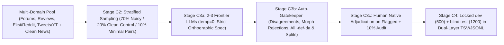

# Turkish Noisy Text Corpus & Normalization Benchmark Roadmap

This document complements [TURKISH_NORMALIZATION_INVESTIGATION_AND_ROADMAP.md](file:///home/dndara/.gemini/antigravity/brain/e13f6e6b-cb12-4920-b467-a54e05357b91/TURKISH_NORMALIZATION_INVESTIGATION_AND_ROADMAP.md) following the integration of [`LatticeDeasciifier`](file:///home/dndara/work/zemberek-nlp/normalization/src/main/java/zemberek/normalization/deasciifier/latticedeasciifier/LatticeDeasciifier.java) (PR `#345`). Before executing Phases 1–3 of the normalization and spell-checker improvements, Zemberek requires reproducible, realistic noisy Turkish corpora and standardized evaluation suites.

---

## 1. Why Two Distinct Data Assets Are Required

Improving `zemberek-normalization` without over-normalizing clean prose requires separating **unlabeled corpus mining** from **gold parallel benchmarking**:

1. **Unlabeled Realistic Noisy Corpus (`50M–200M` tokens)**
   - Regenerating `lookup-from-graph` and `split` with [`NoisyWordsLexiconGenerator.java`](file:///home/dndara/work/zemberek-nlp/normalization/src/main/java/zemberek/normalization/NoisyWordsLexiconGenerator.java) after fixing Bug `B4` (chunk context-count wipeout and inverted Hassan & Menezes hitting-time similarity).
   - Estimating noisy-channel edit/source priors (`A1`), clitic `-de/-da` PMI statistics (`A5`), real-world OOV frequency distributions, and large-scale throughput / `p95` tail latency.
2. **Gold Parallel Normalization Benchmark (`dev` + blind `test`)**
   - Measuring **W-NUT 2021 Error Reduction Rate (`ERR`)**:
     $$\text{ERR} = \frac{\text{Acc}_{\text{system}} - \text{Acc}_{\text{LAI}}}{1 - \text{Acc}_{\text{LAI}}}$$
     Because ~80–85% of tokens in social text are already canonical, false positives on clean tokens (`CleanFP` from `probablyRequiresDeasciifier`, destructive `candidates-manual` entries, or unweighted Viterbi) penalize `ERR` just as heavily as missed corrections.
   - Measuring per-category recall across all **8 Turkish normalization error categories** identified in the audit:
     1. Informal verbal suffixes (`-Iyo`, `-Io` `y`-drop like `çalışıom`/`gelio`, `-ycAk`, `-Abil+cAk`, `FutPart` `kalkcağını`)
     2. Full & mixed/partial ASCII diacritics (`sikinti`, `guldum`, `Istanbul`)
     3. Expressive elongations (`çoooook`, `teşşşekkür`, `eveeet` vs. valid geminates `anne`, `hakkı`, `hisse`)
     4. Split/merge & clitics (`-de/-da` clitic vs. locative, `-ki`, attached `-mı/-mi` `sevdimi`, solid compounds `hiçbir`/`birkaç`, detached numeral suffixes `12 de` → `12'de`)
     5. Colloquial contractions, slang & haplology (`tmm`, `slm`, `cnm`, `deil`, `bişi`, `burda`, `nerde`, `şarz`, `orjinal`)
     6. Keyboard/motor typos & transpositions (`bilgisyaar`, `bekliyrum`)
     7. Morphological false friends (lowercase un-apostrophized `Abbreviation`/`ProperNoun` parses: `goyduk`, `komsu`, `tusa`, `tuslarla`)
     8. Case & punctuation preservation (`Ankara'ya`, `Google`, sentence-initial casing, natural spacing) + Clean-Control minimal pairs (`on/ön`, `oldu/öldü`, `kar/kâr`).

---

## 2. Part (b): Available Standard Noisy Turkish Benchmarks (Verified Inventory)

Live inspection of public repositories and dataset schemas reveals **very few** true end-to-end human-annotated Turkish lexical normalization benchmarks—and several widely cited datasets carry schema traps that make them unsuitable as primary normalization benchmarks.

### 2.1 Summary Comparison Matrix

| Dataset / Benchmark | Source & Access | Size (Verified) | Task & Annotation Schema | Suitable as Primary Norm Test? | Best Role for Zemberek |
| :--- | :--- | :--- | :--- | :---: | :--- |
| **W-NUT 2021 `MultiLexNorm` (`tur`)** | Bitbucket `robvanderg/multilexnorm` (`data/tur/`) — **open & unmasked** | `train`: `570` tweets (`6,443` tok) `test`: `143` tweets (`1,639` tok) Total: `713` tweets (`8,082` tok) | Human token-aligned TSV (`1:1`, `1:N`, `N:1`), truecased + apostrophes (`keske`→`Keşke`, `twitterda`→`Twitter'da`) | **Partial** (`test` too small at `143` tweets) | **External blind anchor** (`ERR` in `--lowercase` and cased modes) |
| **W-NUT 2021 `MultiLexNorm` (`tur_deu`)** | Bitbucket `robvanderg/multilexnorm` (`data/tur_deu/`) — **open & unmasked** | `train`: `800` tweets (`12,773` tok) `test`: `229` tweets (`3,735` tok) | Code-switched Turkish–German token-aligned TSV | **No** (bilingual) | **Foreign-word preservation** stress test & monolingual clause mining |
| **Mukayese `TRSPELL-10`** | GitHub `alisafaya/mukayese` / `mukayese-datasets` v1.0 | `10,000` isolated words (`65%` synthetic edits, `35%` clean) | Context-free `(noisy_word, gold_word)` pairs from TS Corpus | **No** (no sentence context, splits, or slang) | **Isolated `TurkishSpellChecker` regression** (published Zemberek baseline: `62.12%` corr acc, `96.56%` det F1) |
| **`GECTurk` (`datasets/boun` clitic split)** | GitHub `GGLAB-KU/gecturk` (`datasets/boun/`) | `boun_source_test.txt` (`~206 KB`) / `target_test.txt` | M2-formatted parallel sentences for `-de/-da` clitic orthographic errors (Arıkan et al., 2019) | **Sub-task only** | **Dedicated `-de/-da` clitic sub-benchmark** (`A5`) |
| **`GECTurk` (`train/dev/test` & `movie_reviews`)** | GitHub `GGLAB-KU/gecturk` & HF `GGLab/GECTurk` | `96,919` / `20,769` / `20,769` synthetic; `300` `movie_reviews` | Synthetic 25-rule formal GEC; HF `movie_reviews` has **GED tag IDs (`0..25`) only, no target strings** | **No** (schema mismatch & non-lexical grammar rules) | Skip for lexical normalization |
| **`turkish-chat-normalization-mini`** | HF `yagmurtuncer/turkish-chat-normalization-mini` | `16,000` train / `4,000` test | Synthetic degradation of Wikipedia/Wikibooks (`message_polishing` deletes/inserts words) | **No** (artificial prose & generative polishing) | At most use `diacritics_restoration` slice as auxiliary sanity check |
| **`eminesener/normalization`** | HF `eminesener/normalization` | Lexicon & frequency TSVs (`normalization.tsv`, `wiki_vocab.tsv`) | Lookup dictionaries & context counts, not parallel test sentences | **No** | Lexicon cross-check only |
| **`UD_Turkish_German-SAGT` / `UD_Turkish-BOUN`/`IMST`** | GitHub Universal Dependencies / local `data/` | Local UD files have `0` `CorrectForm=`/`Typo=Yes` tokens | `SAGT` stores already-normalized surfaces | **No** | Clean syntax reference only |
| **İTÜ `IWT` & `BTS`** | `tools.nlp.itu.edu.tr` (Torunoğlu-Selamet & Eryiğit) | `IWT`: `~5K` sents (`39,152` tok) `BTS`: `26K+` tweets (`385,568` tok) | Manually normalized Turkish Web 2.0 & tweets | **License-gated** (signed EULA required) | Cannot bundle in open repo; optional private academic validation |
| **Existing Zemberek Test Resources** | [`mini-noisy-corpus.txt`](file:///home/dndara/work/zemberek-nlp/normalization/src/test/resources/normalization/mini-noisy-corpus.txt), [`spell-checker-test.txt`](file:///home/dndara/work/zemberek-nlp/normalization/src/test/resources/spell-checker-test.txt), [`NormalizationBenchmarkSuite.java`](file:///home/dndara/work/zemberek-nlp/experiment/src/main/java/zemberek/normalization/experiment/NormalizationBenchmarkSuite.java) | `13` noisy lines, `205` clean lines, `130` curated experimental sentences | Smoke & prototype ablation tests | **Too small** (`80` noisy + `50` clean in experiment) | Keep as fast unit smoke tests alongside full benchmark |

### 2.2 Key Empirical Takeaways from Tier 1–3 Verification

- **`MultiLexNorm` (`tur`) is directly usable without Twitter API rehydration**: Contrary to older Twitter-ID datasets, `data/tur/train.norm` (`570` tweets, `6,443` tokens, `2,385` case-sensitive / `1,973` case-insensitive edits, `193` `1→N` splits, `109` `N→1` merge continuations) and `data/tur/test.norm` (`143` tweets, `1,639` tokens, `592` case-sensitive / `474` case-insensitive edits, `46` `1→N` splits, `22` `N→1` merge continuations) contain unmasked raw and gold tokens directly in git. However, `143` test tweets are far too small for reliable per-phenomenon diagnostics, and gold targets enforce proper capitalization and apostrophes—meaning Zemberek should be scored in both `--lowercase` mode and truecased (`A6`) mode.
- **Avoid synthetic/mismatched HF traps**: Live row inspection confirmed `GGLab/GECTurk`'s `movie_reviews` split exposes only token error-type integer labels (`0..25`) without target strings (and leaves `orjinalinde` untagged as `0`), while `yagmurtuncer/turkish-chat-normalization-mini` mutates Turkish Wikipedia/Wikibooks sentences with generative `"message_polishing"` edits (e.g., dropping `"ve"` from input). Neither measures real-world noisy Turkish normalization faithfully.

---

## 3. Part (a): Roadmap to Collect Realistic Unlabeled Noisy Turkish Corpora

Target: **`50M–200M` deduplicated, language-verified tokens** stratified by noise density, built in **~3–4 days**.

### Phase A1 — Harvest & Re-Classify Local Corpora (Day 1, Zero Scraping)

Audit of `/home/dndara/data/turkish/` shows substantial real noisy text already on disk, including several forum/comment files currently placed under `clean/`:

1. **Primary noisy corpora already categorized**:
   - `/home/dndara/data/turkish/noisy/kadinlar-klubu.txt` (`2.0 GB`) — rich informal verbs (`çalışmıom`, `buluşabilceğimiz`), elongations (`eveeet`), colloquialisms, emoticons.
   - `/home/dndara/data/turkish/noisy/www.kizlarsoruyor.com.txt` (`620 MB`) — conversational Q&A, clitics, mixed diacritics.
2. **Misclassified conversational/noisy files inside `/home/dndara/data/turkish/clean/`** (sampling confirmed noisy comments like `"versene bigisayarı"`, `"bence haksizlik var"`, `"hamdi abi naber nasılsın"`):
   - `www.tvyorumlari.com.txt` (`6.4 MB`), `www.sikayetim.com.txt` (`7.3 MB`), `www.nurturia.com.tr.txt` (`57 MB`), `forum.shiftdelete.net.txt` (`183 MB`), `forum.memurlar.net.txt` (`205 MB`), `wowturkey.com.txt` (`1.4 GB`).
3. **Existing OOV frequency telemetry**:
   - `/home/dndara/data/turkish/unparsed_words.tsv` (`11,243,462` lines) already ranks the highest-impact OOV phenomena (`bi`: `1,784,584`, `cok`: `819,245`, `bişey`: `459,256`, `cnm`: `348,311`, `icin`: `197,278`, `hemde`: `178,390`, `degil`: `154,364`), enabling immediate data-driven prioritization of lexicon & morphotactic coverage.

### Phase A2 — Bridge the Modern Mobile & Domain Gap (Days 2–3)

Local forums skew toward ~2012 desktop web prose. Supplement them with open/public modern Turkish user-generated text across 5 domains:

1. **E-Commerce & Complaint Reviews**: Hugging Face `fthbrmnby/turkish_product_reviews` / `boun-tabilab/Turkish-Product-Reviews` (`235K+` Hepsiburada reviews) — captures modern mobile autocorrect/keyboard typos, brand/model proper nouns, prices, and numeric suffixes (`12 de`).
2. **Ekşi Sözlük & Turkish Reddit**: Hugging Face `turkish-nlp-datasets/eksisozluk-*` + public Turkish subreddit archives (`r/turkey`, `r/KGBTR`) — captures deliberate all-lowercase writing, modern internet slang, and English loanword suffixation.
3. **Public Turkish Tweets & Social Moderation Datasets**: `coltekin/offenseval2020_tr`, `BounTi`, `ctoraman/large-scale-hate-speech-turkish-v2`, `Overfit-GM/turkish-toxic-language` — short mobile utterances, heavy elongations, ASCII-only typing, and masked/slang tokens.
4. **YouTube Comments & Spoken Subtitles**: Turkish subset of `PleIAs/YouTube-Commons` combined with `/home/dndara/data/turkish/clean/open-subtitles-tr-2018.txt` (`5.0 GB`).
5. **Unfiltered Turkish Web Slices**: Medium-OOV slices from `CulturaX` / `FineWeb-2` before perplexity filtering discards informal user-comment sections.

### Phase A2.5 — Turkish Search Query Corpus & Short-Context Stress Data

Raw commercial search logs (Google, Yandex, Trendyol/Hepsiburada) are proprietary, so we assemble a dedicated `queries/` stratum combining open web/e-commerce queries with organic query-like text:
- **Real Web Search Queries**: Microsoft `BingCoronavirusQuerySet` (`Country == "Turkey"`, 2020–2021) — authentic `2–4` word telegraphic search strings, mixed ASCII/diacritics, and navigational queries.
- **Clean-Query Control**: Apple `MKQA` (`tr`, `10,000` human-translated Google Search queries) — clean short noun-phrase/question queries to guard against over-normalizing telegraphic syntax or named entities.
- **Organic Noisy Query-Style Text**: `kdrhnn/turkce-eticaret-niyet-analizi` customer queries, Ekşi Sözlük topic titles (`title`/`topic`), and modern forum thread slugs (ASCII-degraded troubleshooting/product queries such as `"i7 4790k nasil bir islemcidir"`).
- **Auxiliary Word-Level Pairs**: `asimokby/Turkish-Spelling-Dictionary` (`base` + `expanded` wrong→correct pairs, including numeral/apostrophe tokens like `1deki` → `1'deki`).

Reserve a dedicated **`200–300` search-query evaluation slice** inside `Zemberek-NormBench` (`custom_benchmark/`) to verify short-context `SmoothLm` ranking and brand/model/alphanumeric preservation.

### Phase A3 — Deterministic Zemberek Cleaning & Noise-Stratum Bucketing (Days 3–4)

Run a deterministic preprocessing pass before feeding corpora into [`NoisyWordsLexiconGenerator`](file:///home/dndara/work/zemberek-nlp/normalization/src/main/java/zemberek/normalization/NoisyWordsLexiconGenerator.java) or benchmark sampling:

1. **Language ID Gate**: Require Zemberek `LanguageIdentifier` (`tr` score > `0.85`) to prevent English, German, or Azerbaijani text from polluting random-walk contexts.
2. **Deduplication & PII Scrubbing**: Exact line hash + MinHash near-dedup (removes spam/forum signatures); mask `@mentions`, URLs, emails, and phone numbers.
3. **Morphological Noise-Density Bucketing**: Compute per-sentence OOV/informal ratio $r_{\text{noisy}} = \frac{\text{OOV} + \text{Informal} + \text{AsciiOOV}}{\text{WordTokens}}$:
   - **Clean Anchor ($r = 0$, accented)** → `SmoothLm` training and Clean-Control test sampling.
   - **Natural Noisy ($0 < r \le 0.45$)** → `NoisyWordsLexiconGenerator` bipartite random walks (needs clean surrounding context words as graph anchors!) and `Zemberek-NormBench` noisy sampling pool.
   - **Extreme / Spam ($r > 0.60$)** → quarantine keyboard smashes (`asdfgh`), ASCII art, and non-Turkish spam.

---

## 4. Part (c): Roadmap to Create Our Own Gold Test Set (`Zemberek-NormBench v1`)

Because `MultiLexNorm` `tur/test.norm` has only `143` tweets (`1,639` tokens) and no standard open benchmark covers all 8 Turkish normalization categories plus clean over-normalization traps, Zemberek should build a curated, Apache-2.0-compatible benchmark: **`1,700` sentences (`500 dev` + `1,200 blind test`, `~22,000` tokens)**.

### Stage C1 — Lock a Strict 1-Page Orthographic Normalization Guideline

Keep the task strictly **lexical/orthographic normalization**, *not* stylistic rewriting or GEC paraphrasing:
- **In-scope**: Diacritics (`cok`→`çok`), typos (`bilgisyaar`→`bilgisayar`), expressive elongations (`çoooook`→`çok`), informal morphophonology (`gelicem`→`geleceğim`, `çalışıom`→`çalışıyorum`), clitics/splits (`annemde fark etti`→`annem de fark etti`, `sevdimi`→`sevdi mi`), numeral apostrophes (`12 de`→`12'de`), standard colloquial contractions (`tmm`→`tamam`, `bişi`→`bir şey`, `deil`→`değil`).
- **Out-of-scope (Leave-As-Is)**: Valid slang/discourse markers (`kanka`, `aynen`, `valla`, `yaw`), laughter tokens (`ahahaha`, `sjsjsj`), emojis, URLs, and grammatical/word-order choices.
- **Dual-Layer Gold Format** (MultiLexNorm-compatible `1:1`, `1:N`, `N:1` token alignment in JSONL + TSV):
  - `gold_cased`: truecased + proper-noun apostrophes + natural punctuation (`"Tamam, yarın Ankara'ya gideceğim!"`).
  - `gold_lower`: lowercased + tokenized form for apples-to-apples comparison with legacy `TurkishSentenceNormalizer.normalize()`.
  - `alt_gold` (optional): accepted TDK/orthographic variants (`abi`/`ağabey`, `hadi`/`haydi`, `bir şey`/`bişi` where ambiguous).

### Stage C2 — Stratified Multi-Domain Sampling + Clean-Control & Minimal-Pair Splits

Avoid selection bias by **never** sampling based on whether current Zemberek modifies a sentence; instead, stratify with surface & morphological triggers:

| Split Tier | Share | `dev` / `test` Size | Sampling Strategy & Purpose |
| :--- | :---: | :---: | :--- |
| **1. Real Noisy Stratified** | `70%` | `350` / `850` sents | Equal domain mix (`Forums`, `E-commerce Reviews`, `Ekşi/Reddit`, `Tweets/YouTube`) stratified across all **8 noise categories** (min. `100` test examples per category). |
| **2. Clean-Control Traps** | `20%` | `100` / `250` sents | 100% valid edited Turkish packed with diacritic minimal pairs (`on/ön`, `kar/kâr`, `oldu/öldü`, `hala/hâlâ`), geminates (`anne`, `elli`, `hakkı`, `hisse`), valid locatives (`Evde kaldım`), solid compounds (`hiçbir`, `uluslararası`), and proper nouns (`Google`, `Paris`). Directly bounds `CleanFP`. |
| **3. Minimal-Pair Challenges** | `10%` | `50` / `100` sents | Paired sentences testing contextual disambiguation (`"Annemde kaldı"` vs. `"Annemde fark etti"`, `"On kişi geldi"` vs. `"Ön kapı açık"`). |

### Stage C3 — Multi-LLM Consensus Pre-Annotation + Morphological Gatekeeper + Human Adjudication

Reuse the high-leverage semi-automated annotation pattern already proven in Zemberek's ambiguity adjudication pipeline:

1. **Multi-LLM Pre-Annotation**: Run 2–3 distinct LLMs (`temperature = 0`) with the Stage C1 spec and strict token-alignment output (forbidding word insertion/deletion/reordering).
2. **Automated Gatekeeper**: Automatically route sentences to human review if:
   - Any token differs between LLM annotators;
   - Any normalized token fails `TurkishMorphology.analyze()` (unless tagged `PROPER`, `FOREIGN`, `LAUGH`, or `EMOJI`);
   - Any edit alters consonant skeletons beyond threshold (catches silent LLM paraphrasing);
   - **100% of `-de/-da`, `-ki`, `-mı/-mi`, and `1:N` / `N:1` split-merge edits** (highest ambiguity class).
3. **Human Native Adjudication**: Adjudicate all flagged items plus a 10% random audit of unanimous items (`~8x` faster than manual annotation from scratch while enforcing consistent TDK rules).

### Stage C4 — Unified Multi-Suite Evaluation Protocol & Anti-Leakage Rules

Evaluate every normalization PR across four complementary lenses:

1. **External Blind Anchor**: `MultiLexNorm` `tur/test.norm` (`143` tweets) — report `ERR` (`--lowercase` and cased). **Never inspect `test.norm` while tuning rules or lexicons.**
2. **Primary Diagnostic Suite**: `Zemberek-NormBench` `test` (`1,200` sentences) — report overall `ERR`, noisy-token F1, `CleanFP` (target `0%`), 8-category breakdown, and case/punctuation exact match.
3. **Targeted Sub-Benchmarks**:
   - `GECTurk/datasets/boun` test split → `-de/-da` clitic F1 (`A5`).
   - `MultiLexNorm` `tur_deu/test.norm` → foreign/non-Turkish token preservation rate.
   - `Mukayese` `TRSPELL-10` → isolated `TurkishSpellChecker` detection F1 & Top-1 correction accuracy.
4. **Systems Budget Gate**: `4,000`-sentence benchmark (`2,000` forum + `2,000` clean news) reporting throughput (`tokens/s`), `p95` latency (`ms`), and JVM heap delta (`MB`).

---

## 5. Execution Timeline (~5–7 Days Pre-Implementation)

| Day | Deliverable | Concrete Output |
| :---: | :--- | :--- |
| **Day 1** | **Phase A1 + Tier 1/2 Pull** | Audit/bucket local `/home/dndara/data/turkish/` noisy+forum files; download `MultiLexNorm` (`tur`, `tur_deu`), `GECTurk/datasets/boun`, and `TRSPELL-10`. |
| **Day 2** | **Phase A2 + A3 Pipeline** | Fetch HF reviews/Ekşi/social corpora; run Zemberek `LanguageIdentifier` + dedup + noise-density bucketing (`50M–200M` tokens). |
| **Days 3–4** | **Stage C1–C2 Sampling** | Lock 1-page normalization spec; extract stratified `500 dev` + `1,200 test` candidates across 4 domains, 8 noise categories, Clean-Control, and minimal pairs. |
| **Days 5–6** | **Stage C3 Adjudication** | Run multi-LLM consensus + `TurkishMorphology` gatekeeper + human adjudication on flagged spans & 10% audit. |
| **Day 7** | **Stage C4 Baseline Freeze** | Run `LatticeDeasciifier` branch + `upstream/master` + `experiment/` prototypes on `MultiLexNorm` + `Zemberek-NormBench` + `BOUN` + `TRSPELL-10` to lock baseline numbers before Phase 1 PRs. |
