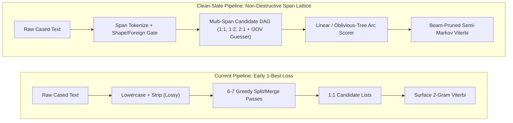

# Rethinking Turkish Text Normalization From First Principles

**A Grounded Engineering Analysis of Multi-Span Lattices, Classical ML, and Practical Neural Reranking for Zemberek**

Across the recent normalization and memory campaign (see [ZEMBEREK_NORMALIZATION_IMPROVEMENTS_REPORT.md](file:///home/dndara/.gemini/antigravity/brain/e881e065-186e-4459-9937-8488961d947e/ZEMBEREK_NORMALIZATION_IMPROVEMENTS_REPORT.md)), Zemberek's classical normalizer (`LatticeDeasciifier`, `ElongationNormalizer`, `InformalContractionExpander`, bug fixes in `#345`–`#355`, plus pending `#354`/`#356` and memory PRs `#359`–`#363`) improved `nasty_5k` word-error reduction from `70.03%` (`0.18.0`) up to `~77.4%` on the full patch stack while bringing warm JVM heap from `~270 MB` down to `~112–115 MB` (`#359 + #360 + #361 + #363`).

However, inspecting the **actual residual errors** on `nasty_5k` (`~7,900` word edits across `5,000` noisy forum/social sentences), `GECTurk` (`~690` edits), and `BOUN Clean` (`~150` diffs across `10,102` tokens) shows two very different truths:
1. **Many remaining errors are lexicon/OOV coverage gaps or benchmark artifacts**—not mystical deep-learning problems.
2. **The remaining structural errors come from sequential 1-best string rewriting in `preProcess()`** and fighting generative 2-gram `SmoothLm` frequencies with hand-tuned float thresholds.

If we designed `zemberek-normalization` from scratch today—reusing `TurkishMorphology`, `InformalTurkishMorphotactics`, `WordGenerator`, `SmoothLm`, `LatticeDeasciifier`, and `CharacterGraphDecoder`, while staying **100% Pure Java (JDK 21, zero CLI incubator flags, zero JNI)**—what actually makes engineering sense, and what is ML hype?

---

## 1. Grounded Diagnosis: What Actually Fails Today (and Why)

Auditing actual error pairs from [bench_post345_all_v2data.json](file:///home/dndara/.gemini/antigravity/brain/e881e065-186e-4459-9937-8488961d947e/scratch/bench_post345_all_v2data.json) and [nasty_5000_pairs.tsv](file:///home/dndara/data/turkish/normalization/custom_benchmark/nasty_5k/llm_gold/exports/nasty_5000_pairs.tsv) separates real architectural limits from misdiagnosed dictionary bugs:

### 1.1 Lexicon & Productive OOV Stem Gaps (Often Misattributed to the LM)
Before blaming the language model, inspect what candidate generation actually produces:
- **Lexicon attribute bugs (`"bloğa"` → `"bloga"` on `BOUN`)**: Previously misdiagnosed as generative LM bias. In reality, `master-dictionary.dict` marks `blok [A:NoVoicing]` (so Zemberek rejects TDK-standard `"bloğa"` as OOV!), while `non-tdk.dict` has `blog [A:Ext, NoVoicing]`. `informalAsciiTolerantMorphology` maps `"bloğa"` to `[blog:Noun]+a:Dat` (`"bloga"`), leaving `"bloğa"` absent from the candidate set altogether. No scorer or LM can pick a candidate that morphology refuses to generate.
- **Inflected OOV usernames, brands & loanwords (`nasty_5k`)**: Real social text is full of productive Turkish suffixes glued onto unknown stems: `"bıttercım"` → `"bitterciğim"`, `"zerencım"` → `"zerenciğim"`, `"skypenizi"` → `"skype'ınızı"`. Because Zemberek only runs `InformalTurkishMorphotactics` and spellchecking over **known `RootLexicon` stems**, any unknown root with an informal or ASCII suffix fails completely.
- **Chat abbreviations & phonetic multi-word slang (`nasty_5k`)**: `"dımı"` → `"değil mi"`, `"inş."` → `"inşallah"`, `"war"` → `"var"`, `"ii"` → `"iyi"`, `"baya"` → `"bayağı"`, `"filimler"` → `"filmler"`.
- **Benchmark noise in `BOUN Clean`**: Out of `151` diffs on `BOUN Clean`, a sizable fraction are **actual typos/artifacts inside `BOUN` itself** (`"fondoten"` fixed to `"fondöten"`, `"t6ahmin"` fixed to `"tahmin"`, `"birşey"` split to `"bir şey"`, soft-hyphens `sektörün\u00adde`, and double-encoded UTF-8 mojibake `ayaäÿän`). Thus the *true* clean-text false-corruption rate is already closer to **`~0.8–1.0%`**, not `1.5%`.

### 1.2 Irreversible Greedy `preProcess()` Cascades (Segmentation Lock-In)
In [TurkishSentenceNormalizer.java](file:///home/dndara/work/zemberek-nlp/normalization/src/main/java/zemberek/normalization/TurkishSentenceNormalizer.java), `preProcess()` runs **6–7 consecutive 1-best string rewrites** (`deasciifyKnownWords` → lowercasing → `replaceCommon` → `normalizeElongations` → `combineNecessaryWords` → `splitNecessaryWords(false)` → `deasciifyValidWords` → `combineNecessaryWords` → `splitNecessaryWords(true)`) before `decode()` ever runs.
- Downstream Viterbi only sees a rigid `1:1` `List<Candidates>`. Once `preProcess()` commits to splitting or merging (or refuses to split `"sonrada"` in `"golden sonrada ataklarını"`), the sentence decoder cannot compare the split path against the unsplit path using surrounding context.

### 1.3 Upfront Orthographic Destruction (`toLowerCase` & Apostrophe Loss)
Lowercasing the entire string and regenerating surfaces through `WordGenerator` destroys high-precision orthographic signals:
- **`ALL_CAPS` Acronyms (`BOUN`)**: `"Münih Teknik Üniversitesi( TUM )"` and `"SERDA teknik danışmanı"` have `TUM` and `SERDA` lowercased to `"tum"` and `"serda"`, which ASCII/spellcheck candidates overwrite with `"tüm"` and `"serdar"`.
- **Apostrophes & Numerals**: Curly/straight apostrophes on proper nouns and months (`"Haziran’da"` → `"haziranda"`, `"Manisa'dada"` → `"manisada da"`) get stripped by `WordGenerator`, while malformed ordinals/numerals (`"4'ncü"` → `"öncü"`, `"3 de 2sini"` → `"3'te 2'sini"`, Roman numeral `"II."` → `"ıı"`) lose their token-shape structure.
- **Foreign Spans**: Untranslated phrases (`"revue canadienne de sante publique"`) get pulled toward Turkish lookalikes (`"revü ... sahte"`).

### 1.4 Generative 2-Gram `SmoothLm` vs. Conditional Edit Faithfulness
`SmoothLm` estimates $\log P_{\text{LM}}(w_t \mid w_{t-1})$—it rewards **common words**, not faithfulness to what the user typed:
- Without learned conditional edit costs, high-frequency 1-edit neighbors (`"oldum"` vs `"aldım"`) outscore rare clean words whenever bigram counts are sparse.
- Compensating with 10+ hand-tuned magic floats (as seen in PR `#354` and `#356`'s LLR cutoffs) creates fragile interactions whenever an upstream stage like `LatticeDeasciifier` changes token distributions.
- Furthermore, surface 2-grams are blind to morpho-syntactic patterns like `[Noun+Abl:golden] + [Postp:sonra] + [Conj:da]` vs. `[Noun+Loc:sonrada]`.

---

## 2. Hard Engineering Constraints: Speed, Heap & JVM Reality Check

Any serious redesign must respect **measured Zemberek profiling facts**, not wishful back-of-the-envelope numbers:

1. **Where CPU time actually goes (Amdahl's Law)**:
   - Profiling `TurkishSentenceNormalizer` (which led to closing PR `#357`) proved that tokenization and 2-gram Viterbi decoding consume **`<5%` of total CPU time**.
   - Over **`90%` of runtime** is spent in **candidate generation**: `RuleBasedAnalyzer` (`morphology` + `informalAsciiTolerantMorphology`), `WordGenerator`, `LatticeDeasciifier`, and `CharacterGraphDecoder` (edit-distance spellchecking).
   - **Implication**: Making Viterbi faster will *not* make noisy-text normalization `3x` faster. On noisy social media (`nasty_5k`), throughput will realistically stay in the **`5,000–10,000 tok/s`** range because ~60% of tokens require morphological/edit expansion. Fast-path skipping only accelerates *clean* prose (`15,000–30,000 tok/s` when valid formal words bypass edit generation).

2. **Where JVM heap actually goes**:
   - After PRs `#359`, `#360`, `#361`, and `#363`, a warm normalizer + morphology JVM retains **`~112–115 MB`** (`RootLexicon` + `StemTransitionsMapBased` + `asciiKeys` + caches `~55–65 MB`, `SmoothLm` + vocabulary `~18–25 MB`, `StemEndingGraph` `17.1 MB`, `LatticeDeasciifier` `~8 MB`).
   - Even with deeper primitive-array packing (`CSR` spellcheck trie + flat `RootLexicon` / `LmVocabulary`), a realistic total JVM footprint with morphology + dual LMs is **`~65–85 MB`**, **not** `30–40 MB`.

3. **Java 21 Deployment Constraint (`jdk.incubator.vector` is NOT free)**:
   - Zemberek's `pom.xml` already targets **JDK 21**, *however* `jdk.incubator.vector` remains an **incubating module** in JDK 21: any library touching `FloatVector` / `ByteVector` forces every downstream user to pass `--add-modules jdk.incubator.vector` on the `java` command line or fail at classload time.
   - Core `zemberek-normalization` **must use standard JDK 21 bytecode (`short[]` / `float[]` scalar loops)** with zero JVM CLI flags.

---

## 3. Clean-Slate Classical Design: Multi-Span Lattice + Discriminative Scorer

Following the exact recipe already proven in Zemberek's `FastPerceptronAmbiguityResolver` and [LatticeDeasciifier.java](file:///home/dndara/work/zemberek-nlp/normalization/src/main/java/zemberek/normalization/deasciifier/latticedeasciifier/LatticeDeasciifier.java), the cleanest from-scratch architecture unifies normalization into **5 concrete stages**:

### Stage 1: Non-Destructive Span Tokenization & Orthographic Features
- Preserve exact character offsets $[c_0, c_1)$, original casing shape (`ALL_CAPS`, `TitleCase`, `lower`, `Mixed`, `Digits+Suffix`), and punctuation/apostrophe attachment.
- Compute lightweight span priors:
  - **`ALL_CAPS` protection**: `TUM`, `SERDA`, `TBMM` keep a strong identity prior instead of silently collapsing into `"tüm"` or `"serdar"`.
  - **Character 3–4-gram Turkishness / foreign-span score** (`<100 KB`, reusing `zemberek-lang-id` primitives): suppresses spellcheck replacements inside foreign spans (`"revue canadienne de sante"`).
  - **Deterministic numeral/ordinal normalizer**: handles `"4'ncü"` → `"4'üncü"`, `"3 de 2sini"` → `"3'te 2'sini"`, and Roman numerals (`"II."`) structurally instead of sending them to edit-distance search.

### Stage 2: Unified Multi-Span Candidate DAG + Productive OOV Stem Guesser
Every rewriter becomes a **stateless arc proposer** over token boundaries $(i \to j)$ rather than mutating a string in place:
- **$1:1$ Identity & Orthographic Arcs ($i \to i+1$)**: verbatim token, case-normalized token, proper-noun apostrophe variants (`Haziran'da`, `Manisa'da`).
- **$2:1$ Merge Arcs ($i \to i+2$)**: detached locatives (`birlik + te` → `birlikte`), detached suffixes (`3 + de` → `3'te`), solid compounds (`bir + çok` → `birçok`, guarded against merging adjacent `ProperNoun`s like `Ahmet + Davutoğlu`).
- **$1:2$ Split Arcs ($i \to i+1$ emitting 2 tokens)**: attached clitics (`başlasada` → `[başlasa, da]`, `Manisa'dada` → `[Manisa'da, da]`, `sonrada` emitting **both** `[sonrada]` and `[sonra, da]`), question particles (`gelecekmisin` → `[gelecek, misin]`), and phonetic contractions (`napıyon` → `[ne, yapıyorsun]`, `dımı` → `[değil, mi]`).
- **Lexical & Morphological $1:1$ Rewrite Arcs**:
  - `ElongationNormalizer` (`çooook` → `çok`) + top-$k$ `LatticeDeasciifier` candidates.
  - `InformalTurkishMorphotactics` + `WordGenerator` (`geliyom` → `geliyorum`).
  - **Productive OOV / Loanword Suffix Guesser (critical for social media)**: when an unknown word ends in a recognizable Turkish informal/ASCII suffix chain (`skypenizi`, `bıttercım`, `tweetin`), strip the suffix via `endingGraph`, hypothesize a noun/proper-noun dynamic stem (`skype`, `bitter`), harmonize/regenerate the suffix (`skype'ınızı`, `bitterciğim`), and emit it with an OOV-stem penalty.
  - Curated & random-walk noisy lexicon (`msjı` → `mesajı`, `inş.` → `inşallah`, `war` → `var`) + weighted Damerau-Levenshtein / Q-keyboard distance-1 spellcheck candidates.

### Stage 3: Dual Compact `SmoothLm`s (Surface 2-Gram + Coarse Morpho-Tag 3-Gram)
- **Surface 2-gram `SmoothLm` (`~16 MB`)**: scores lexical collocations (`"ya da"`, `"sağ ol"`, `"değil mi"`).
- **Coarse `(POS + Case/Tense)` 3-gram `SmoothLm` (`~2–3 MB`)**: instead of exploding the lattice with every full `SingleAnalysis` per candidate, attach each candidate's **primary morpho-syntactic tag signature** (e.g. `Noun+Abl`, `Postp`, `Conj`, `Verb+Opt+A3sg`) and score 3-gram tag transitions. That directly resolves `[Noun+Abl:golden] -> [Postp:sonra] -> [Conj:da]` vs. `[Noun+Loc:sonrada]` with zero vocabulary sparsity.

### Stage 4: Beam-Pruned Semi-Markov Scorer (`Linear` + `50 KB` Oblivious Trees)
> [!WARNING]
> **Avoiding the State-Explosion Trap**: A single Turkish surface word averages `2.5–5` morphological parses. Expanding all `(surface, SingleAnalysis)` pairs in exact 3-gram Semi-Markov DP would evaluate $O(A^3) \approx 10^4\text{–}6\times 10^4$ transitions per token (milliseconds, not microseconds). Keep **one canonical tag mask per surface arc** (or top-2 when `POS` genuinely splits, as in `ya/sonra`) and decode with **beam width `B = 8–12`** (`<0.2 ms/sentence`).

Score candidate paths using ~25 interpretable features:
- **Channel / Faithfulness features**: exact identity flag, character edit ops (substitution, deletion, insertion, transposition, Q-keyboard adjacency), diacritic-only diff count, elongation count, casing change (`ALL_CAPS → lower`), apostrophe loss/gain, OOV-guesser flag, foreignness prior, sentence ASCII ratio.
- **Contextual features**: surface `SmoothLm` log-prob, morpho-tag 3-gram log-prob, unigram frequency ratio $\log P(y) - \log P(x)$, left/right punctuation & clitic compatibility.

**Best non-linear upgrade — Branchless Oblivious Decision Trees (`CatBoost`-style GBDT)**:
- Linear models struggle with sharp conjunctive rules (*e.g., "never apply a consonant edit to an `ALL_CAPS` or high-foreignness token unless it came from the manual slang table"*).
- `150–200` depth-6 oblivious trees take **`~50 KB` of `float[]` arrays** and ~60 lines of dependency-free scalar Java (`6` threshold comparisons → 6-bit leaf index `0..63`), scoring a candidate arc in `<1 µs` with zero external libraries.

### Stage 5: Cost-Augmented Training on Clean + LLM-Distilled Pairs
Replace all hand-tuned magic floats (`-1.35f`, `LLR > 5.8f`) with weights learned via **MIRA / Averaged Structured Perceptron** (plus GBDT reranking) under an asymmetric loss:

$$\Delta(\hat{y}, y^*) = 1.0 \cdot \text{MissedError}(\hat{y}, y^*) + 3.0 \cdot \text{FalseCorruption}(\hat{y}, y^*)$$

Using the exact batch recipe verified on `nasty_5k` (`5,000` sentences for **\$4.10**), annotating **`100k–200k` real noisy Turkish sentences** with a frontier LLM Teacher costs **~\$80–\$160** (after automated token-alignment sanity filtering to drop LLM paraphrases), combined with **`500k+` synthetically corrupted clean sentences** and **`25%` verified clean text** (after scrubbing treebank typos/mojibake).

---

## 4. Critical Evaluation of Neural & Frontier Ideas (Separating Signal from Hype)

Would a deep neural architecture beat the classical lattice, and is it viable in Pure Java on CPU? Here is a sober assessment:

### 4.1 What Does NOT Make Sense for Zemberek (Drop These)
1. **Autoregressive Seq2Seq (`ByT5` / Decoder LLMs, `60M–300M` params) at Runtime**:
   - `200–1,000 ms/sentence` on CPU, `60–300 MB` weights, and prone to silent hallucinations (rewriting numbers, dropping clauses, inventing names). Use **only offline as a data-labeling Teacher**.
2. **`64-bit` Binary Semantic Lemma Sketches (`SimHash` / `Long.bitCount`)**:
   - **Verdict: Hype — do not build.** Compressing 768-d embeddings to 64 bits has a $\pm 6.25\%$ random Hamming noise floor on orthogonal vectors—far too coarse to disambiguate word choices inside noisy 8-word social posts. Worse, real confusions either share the same lemma, stem from dictionary bugs (`blok`), or involve ~30 circumflex pairs (`kar`/`kâr`) already solved by `LatticeDeasciifier` in a few kilobytes.
3. **Character-Level `MinGRU`/`Mamba` Hard-Masked by `StemEndingGraph`**:
   - **Verdict: Linguistically broken.** Zemberek's `StemEndingGraph` is an *over-generating* surface concatenation trie that connects all stems to all endings without enforcing vowel harmony, consonant voicing (`kitapda`), or POS compatibility (which `TurkishSpellChecker` only filters *after* decoding via `TurkishMorphology`). Hard-masking a character RNN with it neither guarantees grammatical Turkish nor handles multi-word splits, apostrophes, or OOV loanwords (`Skype'ınızı`).

### 4.2 What Actually Works if You Want Neural Context: Scalar `1D Dilated Conv` Lattice Reranker (`~850 KB`)
Why do standard neural normalizers need `50M+` parameters? Because most of their capacity memorizes vocabulary, spelling, and inflection tables that Zemberek **already computes symbolically**.

If a neural module is ever added to resolve long-range contextual homographs (`"aldım"` vs `"oldum"`, `"bir"` vs `"bu"`, subtle `de/da` and `ki` syntax beyond 2-grams), the right design is a **feed-forward `Char-CNN + Dilated 1D ConvNet` scoring only Zemberek's lattice candidates**:
- **Why `1D Dilated Conv` instead of `BiGRU` or `Transformer`?**
  - Unlike a `BiGRU` (sequential gate steps per token) or `Transformer` ($O(N^2)$ attention + subword fragility on typos), a 3-layer depthwise-separable dilated conv (`d = 128`, kernel `3`, dilations `1, 2, 4` → 15-token receptive field) has **`~800K` `INT8`/`FP16` weights (`~850 KB`)** and **`~6–8M` MACs per 15-word sentence**.
  - At `~7M` MACs, even **plain scalar JDK 21 `float[]` code** (zero `jdk.incubator.vector` flags, zero JNI!) runs a sentence forward pass in **`~2.5–4 ms`**—and with confidence gating (invoking the neural scorer **only** when the classical lattice's top-2 paths are within a narrow margin, roughly `15–25%` of sentences), average overhead drops below **`0.6 ms/sentence`**.
- **Zero hallucination**: The network never generates characters; it only adds a contextual log-potential $\mathbf{h}_i^\top W \mathbf{e}_{\text{cand}}$ to candidates already proposed by Zemberek's lattice.

---

## 5. Realistic Architecture Comparison

*(Note: Unlike optimistic whitepaper projections, `nasty_5k` W-ERR has an inherent single-reference agreement ceiling around `~86–90%` due to subjective colloquialisms and LLM reference variance, and throughput on noisy text is bounded by morphological/spellcheck candidate generation.)*

| Architecture | Expected `nasty_5k` Gain Over `~77%` Stack | True Clean-Text Error Rate | CPU Speed on Noisy / Clean (1 Core, JDK 21) | Warm JVM Heap Footprint | Implementation & Maintenance Cost |
| :--- | :---: | :---: | :---: | :---: | :--- |
| **Current Sequential (`master` + `#360`/`#363` + `#354`/`#356`)** | Baseline (`~77%` W-ERR) | `~0.9–1.1%` *(excl. BOUN typos)* | `~6,500–8,400` / `~8,500 tok/s` | **`~112–115 MB`** | Low (incremental PRs, brittle float tuning) |
| **Clean-Slate Span-DAG + OOV Guesser + Dual `SmoothLm` + Linear/Oblivious-Tree Scorer** | **`+4` to `+7 pp` (`~81–84%`)** | **`<0.4%`** | `~6,000–9,000` / **`~18,000+ tok/s`** *(fast-path)* | **`~75–95 MB`** *(w/ Tier-2 compact structures)* | **Moderate & Clean** (pure JDK 21, `<100 KB` model, zero flags) |
| **Above + Confidence-Gated Scalar `1D Dilated Conv` Reranker (`~850 KB`)** | **`+6` to `+9 pp` (`~83–86%`)** | **`<0.25%`** | `~4,500–7,500` / **`~16,000+ tok/s`** | **`+1–2 MB`** | Medium-High (requires PyTorch training + export pipeline) |
| **Standalone `4-Layer` Micro-Transformer (`Seq2Edits`)** | Mixed (weak on wild typos & inflection without morphology) | `~0.4%` | `~1,500–3,000 tok/s` *(scalar)* / `~4,500` *(Vector flag)* | `+5–10 MB` | High + `--add-modules` CLI friction |
| **Autoregressive `ByT5` / Small LLM (`100M+`)** | **`~86–90%` (Offline Teacher)** | `~0.2%` *(can hallucinate)* | `~15–50 tok/s` *(unusable live)* | `150–400+ MB` | Offline annotation tool only |

---

## 6. Pragmatic Roadmap: What Is Actually Worth Building

Rather than chasing exotic neural tricks, **90% of the real-world gain** comes from four grounded engineering steps, ordered strictly by ROI:

1. **Fix Lexicon & Productive OOV/Loanword Guessing First**:
   - Audit high-frequency false-negative dictionary attributes (like `blok [A:NoVoicing]`) and add a lightweight **OOV + Apostrophized Loanword Suffix Guesser** (`skypenizi` → `skype'ınızı`, `bıttercım` → `bitterciğim`) plus deterministic numeral/ordinal handling (`4'ncü` → `4'üncü`, `3 de` → `3'te`) and `ALL_CAPS` acronym protection (`TUM`, `SERDA`).
2. **Replace `preProcess()` String Rewriting with a Multi-Span Candidate DAG**:
   - Keep raw token casing/spans intact; let `LatticeDeasciifier` (top-$k$), `ElongationNormalizer`, `InformalContractionExpander`, `CliticDeDaNormalizer` (`1:2` & `2:1`), and `TurkishSpellChecker` emit competing lattice arcs into a single **beam-pruned (`B=8`) Semi-Markov decoder**.
3. **Train a `50 KB` Oblivious-Tree (`CatBoost`) + Morpho-Tag `SmoothLm` Scorer on LLM-Distilled Data**:
   - Add a `~2–3 MB` coarse `(POS + Case/Tense)` 3-gram `SmoothLm` alongside the surface 2-gram `SmoothLm`.
   - Train `~150` branchless depth-6 oblivious trees on `100k–200k` LLM-annotated noisy Turkish sentences + clean controls with `3x` false-corruption weighting—eliminating every hand-tuned magic float in `TurkishSentenceNormalizer` in `<100` lines of pure, flag-free Java.
4. **Only If Needed Later — Gated `~850 KB` `1D Dilated Conv` Contextual Reranker**:
   - Triggered only on low-margin lattice spans (`~20%` of sentences) in plain scalar JDK 21 `float[]` arrays, keeping zero JNI and zero `--add-modules` deployment friction.
