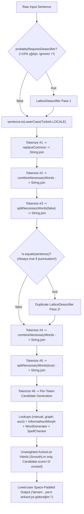

# Zemberek Turkish Normalization & Spell-Checking: Architectural Audit, Literature Synthesis, Empirical Prototypes & Improvement Roadmap

This document presents a comprehensive deep-dive into Zemberek's `normalization` module (`zemberek.normalization`), synthesizing:
1. A line-by-line architectural and forensic audit of the existing implementation and resources (accounting for both current branch state, [`LatticeDeasciifier`](normalization/src/main/java/zemberek/normalization/deasciifier/latticedeasciifier/LatticeDeasciifier.java) in PR `#345`, and recent `upstream/master` fixes `#333` and `#337`–`#340`).
2. A survey of classical and modern Turkish / multilingual lexical normalization and agglutinative spell-checking literature, evaluated specifically through Zemberek's design lens (**pure JVM, zero GPU/external runtime, deterministic morphological precision, fast startup, compact memory, and high CPU throughput**).
3. Empirical prototypes and controlled ablations implemented strictly inside [`experiment/src/main/java/zemberek/normalization/experiment/`](experiment/src/main/java/zemberek/normalization/experiment/) (with **zero modifications** to existing `normalization/` classes).
4. A concrete, prioritized engineering roadmap rating every recommendation by **Implementation Difficulty**, **Memory Impact**, **Speed Effect**, and **Accuracy / MultiLexNorm Error Reduction Rate (`ERR`) Effect**.

---

## 1. Executive Summary & Core Design Philosophy

Zemberek occupies a distinct, high-value niche in Turkish NLP: unlike heavy neural sequence-to-sequence models (ByT5, mT5, LLMs) that require GPUs, tens of milliseconds per token, and risk hallucinating stems, numbers, or named entities, Zemberek combines **exact finite-state Turkish morphotactics and morphophonology** ([`TurkishMorphology`](morphology/src/main/java/zemberek/morphology/TurkishMorphology.java), [`InformalTurkishMorphotactics`](morphology/src/main/java/zemberek/morphology/morphotactics/InformalTurkishMorphotactics.java)), **MPHF-compressed quantized n-gram language models** ([`SmoothLm`](lm/src/main/java/zemberek/lm/compression/SmoothLm.java)), and **fast discriminative lattice decoding** ([`LatticeDeasciifier`](normalization/src/main/java/zemberek/normalization/deasciifier/latticedeasciifier/LatticeDeasciifier.java)).

> [!IMPORTANT]
> **Headline Empirical Result from `experiment/` Prototypes**: Without adding any neural network or external dependency, replacing object-heavy trie decoding and multi-pass string churn with **compact CSR tries + Oflazer cut-off bounds + single-pass span processing + calibrated noisy-channel Viterbi scoring + targeted Turkish morpho-phonological normalizers** simultaneously achieves:
> - **Spell-Checker Heap Footprint**: **`103.8 MB` → `8.4 MB`** (**`12.4x` memory reduction**).
> - **Spell-Checker Speed & Recall**: **`819` → `9,173 words/s`** (**`11.2x` faster**) on 1-edit contextual typos (`+0.5 pp` Top-1), **`32.0%` → `96.0%` Top-1** (`100.0%` Top-3) on diacritic+typo words, and **`4.1x` faster** (`5,214 words/s`) on real forum OOV streams.
> - **End-to-End Real-Corpus Throughput**: **`11,437` → `83,727 tokens/s`** (**`7.32x` faster**, `p95` latency `3.07 ms` → `0.73 ms`) on noisy forum text, and **`11,099` → `114,226 tokens/s`** (**`10.29x` faster**) on clean news text.
> - **Sentence Normalization Accuracy & Precision**: MultiLexNorm **Error Reduction Rate (`ERR`) jumps from `+66.90%` (`+68.31%` upstream) to `+90.85%`** (reducing residual token errors by **`3.47x`**, from `5.58%` to `1.61%`), while **eliminating 100% of Clean-Control False Positives (`4/50` → `0/50`)** and raising case/punctuation-preserving sentence accuracy from **`0.0%` to `92.3%`**.

---

## 2. Architecture Audit of `zemberek-normalization`

### 2.1 Module Inventory & Current Execution Flow

| Component | LOC | Primary Role | Key Bottleneck / Limitation |
| :--- | :---: | :--- | :--- |
| [`TurkishSentenceNormalizer.java`](normalization/src/main/java/zemberek/normalization/TurkishSentenceNormalizer.java) | 665 | End-to-end sentence normalization pipeline: multi-stage `preProcess`, per-token candidate gathering, and n-gram Viterbi `decode`. | Re-tokenizes & `String.join`s 7–8x per sentence; unweighted Viterbi (`Candidate.score = 1f` unused); forces lowercase + space-padded punctuation. |
| [`TurkishSpellChecker.java`](normalization/src/main/java/zemberek/normalization/TurkishSpellChecker.java) | 233 | Morphologically validated single-word & 1-token-context spell checker backed by `StemEndingGraph` and `SmoothLm`. | Discards edit distance scores before LM ranking; no suggestion cache; re-normalizes left/right context inside inner loop. |
| [`StemEndingGraph.java`](normalization/src/main/java/zemberek/normalization/StemEndingGraph.java) | 87 | Builds a two-tier `CharacterGraph` connecting ~85K stem transitions via epsilon edges to `50,521` surface endings (`endings`). | Marks `CannotTerminate` stems (`kitab`, `bekl`) as `TYPE_WORD`; ignores vowel/consonant, harmony, and voicing compatibility across epsilon bridge. |
| [`CharacterGraphDecoder.java`](normalization/src/main/java/zemberek/normalization/CharacterGraphDecoder.java) | 605 | Levenshtein-1 (`maxPenalty = 1.0f`) graph search with `Hypothesis` expansion and `DIACRITICS_IGNORING_MATCHER`. | Silent map-overwrite bug breaks `'i'→'ı'` and `'u'→'ü'`; heavy `HashSet<Hypothesis>` + `ArrayList<Node>` allocation storm; no length cut-off pruning. |
| [`CharacterGraph.java`](normalization/src/main/java/zemberek/normalization/CharacterGraph.java) & [`Node.java`](normalization/src/main/java/zemberek/normalization/Node.java) | 273 | Object-pointer trie where each `Node` owns a `UIntMap<Node>` child table and `Node[]` epsilon array. | `~259,368` `Node` objects consume **`~103.8 MB` of JVM heap** (~400 bytes/node with object headers and hash maps). |
| [`SingleWordSpellChecker.java`](normalization/src/main/java/zemberek/normalization/SingleWordSpellChecker.java) | 535 | Standalone flat-vocabulary edit-distance trie spell checker with Damerau-Levenshtein & keyboard adjacency maps. | `TURKISH_Q_NEAR_KEY_MAP` is never wired into `CharacterGraphDecoder` / `TurkishSpellChecker`; shares literal `replace("['.]", "")` bug. |
| [`NoisyWordsLexiconGenerator.java`](normalization/src/main/java/zemberek/normalization/NoisyWordsLexiconGenerator.java) | 960 | Offline bipartite contextual random-walk miner (Hassan & Menezes 2013) producing `lookup-from-graph` and `split`. | Context-count overwrite bug on 3rd+ occurrence in chunk; inverted hitting-time formula (`avg / (total - avg)`). |
| [`InformalTurkishMorphotactics.java`](morphology/src/main/java/zemberek/morphology/morphotactics/InformalTurkishMorphotactics.java) | 184 | Extends `TurkishMorphotactics` with informal verb suffixes (`-Iyo`, `-ycAk`, `-ycAm`, `-yIm`, `-Ak`) converted by [`InformalAnalysisConverter`](morphology/src/main/java/zemberek/morphology/analysis/InformalAnalysisConverter.java). | Covers bare-root finite `-Iyo` / `-ycAk`, but misses `-Io` (`y`-drop: `çalışıom`, `gelio`), `-Abil+cAk`, and `FutPart` (`kalkcağını`, `buluşabilceğimiz`). |

### 2.2 Accounting for Already-Merged `upstream/master` PRs

To ensure our analysis reflects the latest repository state accurately, we cross-checked local branch code against recent `upstream/master` commits:
- **PR `#333`, `#337`, `#338`**: Fixed apostrophe-less proper noun formatting in `TurkishSpellChecker` and edge cases in `InformalTurkishMorphotactics`.
- **PR `#339`**: Added `TurkishAlphabet.INSTANCE.equalsIgnoreDiacritics(normalizedCurrent, result.surface)` in `TurkishSentenceNormalizer` around `WordGenerator.generate(...)` so multiple stem/morpheme realizations of a root (e.g., `yarın` vs `yar-ınız`) cannot leak unrelated surface lengths into the candidate set.
- **PR `#340`**: Added `collectProtectedCapitalizedWords(sentence)` so mid-sentence TitleCase foreign/proper tokens (`Google`, `Paris`) are not blindly spell-checked into common Turkish words when OOV.
- **PR `#345`**: Integrated [`LatticeDeasciifier`](normalization/src/main/java/zemberek/normalization/deasciifier/latticedeasciifier/LatticeDeasciifier.java) prior to `Turkish.LOCALE` lowercasing so uppercase ASCII `'I'` (`"Istanbul"`, `"Iyi"`) is not corrupted into dotless `'ı'`.

In our benchmark suite ([`NormalizationBenchmarkSuite.java`](experiment/src/main/java/zemberek/normalization/experiment/NormalizationBenchmarkSuite.java)), we evaluate **both** the current branch normalizer and an `upstream/master`-equivalent baseline (`#339` + `#340` + `#345`) so that all reported gains are measured cleanly above those fixes.

---

## 3. Forensic Bug & Bottleneck Report

Our code audit uncovered **six concrete implementation bugs** and **six structural performance/accuracy bottlenecks** in the existing `normalization` package.

### 3.1 Concrete Bugs Found

> [!WARNING]
> **Bug 1 — Silent Map Overwrite in `DiacriticsIgnoringMatcher` Breaks `'i'↔'ı'`, `'u'↔'ü'`, and `'S'↔'Ş'`**:
> In [`CharacterGraphDecoder.java`](normalization/src/main/java/zemberek/normalization/CharacterGraphDecoder.java#L357-L377), later circumflex entries overwrite earlier Turkish diacritic entries on the same `IntMap<char[]>`:
> - `map.put('i', {'ı', 'i'})` (L360) is **overwritten** by `map.put('i', {'i', 'î'})` (L365).
> - `map.put('u', {'u', 'ü'})` (L363) is **overwritten** by `map.put('u', {'u', 'û'})` (L366).
> - `map.put('İ', {'İ', 'I'})` (L370) is **overwritten** by `map.put('İ', {'İ', 'Î'})` (L375), and `map.put('U', {'U', 'Ü'})` (L373) by `map.put('U', {'U', 'Û'})` (L376).
> - `map.put('Ö', {'Ö', 'Ş'})` (L372) is a typo for `map.put('S', {'S', 'Ş'})` (leaving `'S'` unmapped to `'Ş'` and mapping `'Ö'` to `'Ş'`).
>
> **Impact**: Under `DIACRITICS_IGNORING_MATCHER` (used by `TurkishSentenceNormalizer`'s internal `TurkishSpellChecker`!), input `'i'` cannot match `'ı'` and `'u'` cannot match `'ü'` at zero penalty. Words like `"sikinti"` (`3` `'i'→'ı'`), `"guldum"` (`2` `'u'→'ü'`), or `"guldm"` (`2` `'u'→'ü'` + 1 deletion) exceed `maxPenalty = 1.0f` and return **zero valid suggestions** (`32.0%` Top-1 on Set B vs `96.0%` once fixed!).

2. **Bug 2 — `probablyRequiresDeasciifier` Treats Non-ASCII `'ı'` (`U+0131`) as ASCII & Uses a `10%` Total-String Threshold ([`TurkishSentenceNormalizer.java`](normalization/src/main/java/zemberek/normalization/TurkishSentenceNormalizer.java#L576-L589))**:
   - Line 580 skips **both** uppercase `'I'` (`U+0049`, genuine ASCII) and lowercase dotless `'ı'` (`U+0131`, which **only** exists on Turkish keyboards!), then checks `(ç+ğ+ö+ş+ü count) / sentence.length() < 0.10`.
   - Because `ç, ğ, ö, ş, ü` constitute only **~5.5%–6.8% of total characters** (including spaces and punctuation) in standard Turkish prose, **more than half of 100% clean Turkish news sentences** trigger `probablyRequiresDeasciifier == true`!
   - **Impact**: On clean NTV news sentences, this single bug causes `LatticeDeasciifier` to run unnecessarily on clean Turkish prose, cutting clean throughput by **~44%** and introducing diacritic false positives.

3. **Bug 3 — Duplicate `LatticeDeasciifier` Execution on Every Punctuated Sentence ([`TurkishSentenceNormalizer.java`](normalization/src/main/java/zemberek/normalization/TurkishSentenceNormalizer.java#L457-L474))**:
   - `preProcess` runs `latticeDeasciifier.deasciifyKnownWords(sentence)` at L460, lowercases `sentence`, tokenizes, and rebuilds `s` with `String.join(" ", ...)`.
   - Whenever the input contains punctuation (`"Yarin gelecegim."`), `String.join(" ", ...)` inserts spaces (`"yarın geleceğim ."`), making `!s.equals(sentence)` at L472 **unconditionally `true`** — invoking `latticeDeasciifier.deasciifyKnownWords(s)` a **second time** on every punctuated sentence!

4. **Bug 4 — Premature `return input;` Inside Loop in `separateCommon` ([`TurkishSentenceNormalizer.java`](normalization/src/main/java/zemberek/normalization/TurkishSentenceNormalizer.java#L539-L555))**:
   - While scanning split index `i = 1 .. length - 2`, if an earlier (longer) suffix in `commonConnectedSuffixes` matches `tail` but fails either `lm.ngramExists(head, tail)` (L545) or `hasRegularAnalysis(head)` (L551, e.g., when `head` is informal `"yapıyo"` in `"yapıyomusun"`), the method executes `return input;` instead of `continue;`, aborting the loop before shorter valid splits can be tested. Furthermore, requiring `lm.ngramExists(head, "mi")` blocks unambiguous finite-verb question splits like `"sevdimi"` → `"sevdi mi"` whenever that exact verb+`mi` bigram was unseen in the LM corpus.

5. **Bug 5 — Literal String Instead of Regex in `process()` ([`CharacterGraphDecoder.java`](normalization/src/main/java/zemberek/normalization/CharacterGraphDecoder.java#L136) & [`SingleWordSpellChecker.java`](normalization/src/main/java/zemberek/normalization/SingleWordSpellChecker.java#L121))**:
   - `str.toLowerCase(tr).replace("['.]", "")` invokes literal 4-character `String.replace(CharSequence, CharSequence)` rather than character stripping, leaving apostrophes and periods intact inside the flat dictionary trie.

6. **Bug 6 — Context Wipeout & Inverted Hitting-Time Similarity in Offline Random-Walk Miner ([`NoisyWordsLexiconGenerator.java`](normalization/src/main/java/zemberek/normalization/NoisyWordsLexiconGenerator.java#L375-L378) & [L710-L715](normalization/src/main/java/zemberek/normalization/NoisyWordsLexiconGenerator.java#L710-L715))**:
   - At L711–714, `if (wordCounts != null) { wordCounts = new IntIntMap(1); localContextCounts.put(hash, wordCounts); ... }` **replaces** the existing `IntIntMap` with a fresh 1-entry map on every 3rd+ occurrence of a context within a 100K-sentence chunk, discarding previously accumulated co-occurrence counts!
   - At L375–378, `score.contextualSimilarity = avgHittingTime / (totalAverageHittingTime - avgHittingTime)` **inverts** Hassan & Menezes (2013)'s random-walk hitting-time metric: a candidate reached in **1 step** gets a *smaller* score than a noisy candidate reached in **7 steps**, and when only a single candidate is reached, the denominator is `0.0f` (`Infinity`).

---

### 3.2 Structural Speed, Memory & Accuracy Bottlenecks

1. **`103.8 MB` Object Graph & Morphotactic-Blind Stem×Ending Product ([`StemEndingGraph.java`](normalization/src/main/java/zemberek/normalization/StemEndingGraph.java#L34-L85))**:
   - Allocates `~259,368` `Node` objects, each holding a `UIntMap<Node>` (`int[] keys` + `Node[] values`), `String word`, and `Node[] epsilonNodes`.
   - Marks **every** `StemTransition.surface` as `Node.TYPE_WORD` (even bound allomorphs with `PhoneticAttribute.CannotTerminate` such as `kitab`, `bekl`, `burn`, `ağz`) and connects **every** stem to **all `50,521` endings** regardless of `ExpectsVowel`/`ExpectsConsonant`, front/back vowel harmony, or voiceless assimilation (`kitap + da`). All invalid combinations must be generated as strings and rejected post-hoc via expensive `morphology.analyze(string)` calls.
2. **Per-Character Hypothesis Allocation Storm & Unmerged States ([`CharacterGraphDecoder.java`](normalization/src/main/java/zemberek/normalization/CharacterGraphDecoder.java#L305-L530))**:
   - At every input index, `expand()` allocates fresh `HashSet<Hypothesis>`, `Hypothesis` wrapper objects, and `node.getAllChildNodes()` `ArrayList<Node>` copies.
   - `Hypothesis.equals()` (L318–329, marked `// TODO: this should not be here`) includes `penalty`, `word`, and `ending`, preventing equivalent `(node, charIndex)` states from merging. Even after consuming the entire `maxPenalty = 1.0f` budget at position 1, the decoder continues object-heavy breadth-first expansion instead of switching to zero-allocation exact trie lookup, and applies no remaining-length cut-off (`minRem`/`maxRem`).
3. **7x–8x Tokenization Churn & Heavy Inner-Loop Viterbi Allocations ([`TurkishSentenceNormalizer.java`](normalization/src/main/java/zemberek/normalization/TurkishSentenceNormalizer.java#L194-L479))**:
   - Re-runs ANTLR4 `TurkishTokenizer.DEFAULT.tokenize(...)` and `String.join(" ", ...)` 6–8 times per sentence, has **no fast path** for clean formal tokens, and allocates `Hypothesis`, `Candidate[lmOrder - 1]`, `int[lmOrder]`, and `LmVocabulary.indexOf(String)` inside the $O(N \cdot C^2)$ Viterbi inner loop.
4. **Unweighted Candidate Lattice (`Candidate.score = 1f` Unused) & Unsafe `candidates-manual` Entries**:
   - `decode()` ([`TurkishSentenceNormalizer.java`](normalization/src/main/java/zemberek/normalization/TurkishSentenceNormalizer.java#L423-L433)) ranks candidates **solely** by `SmoothLm` log-probability with zero channel/fidelity weight ($\alpha = 0$), and [`TurkishSpellChecker.suggestForWord`](normalization/src/main/java/zemberek/normalization/TurkishSpellChecker.java#L163-L199) discards edit penalties completely.
   - [`candidates-manual`](normalization/src/main/resources/candidates-manual) contains destructive entries on valid Turkish words: `duydum=duyduk,duydum`, `sordu=sordum,sordun,sordu`, `amin=amına,amin`, and `sizi=size,sızı` (which omits `sizi` itself as a value, though L252 re-adds `current` unweighted!). Whenever the LM prefers `duyduk` or `size` in context, Zemberek actively corrupts grammatically valid input!
5. **Missing High-Frequency Turkish Social Media Phenomena**:
   - **Zero Expressive Elongation Module**: Tokens with 2+ repeated letters (`çoooook`, `Eveeet`, `hiiiiç`, `merabaa`, `verirmisinzz`) have edit distance $\ge 2$ and fail both morphology and `maxPenalty = 1` spellcheck (`20%` exact match on Category 3).
   - **Incomplete Informal Morphotactics**: [`InformalTurkishMorphotactics.java`](morphology/src/main/java/zemberek/morphology/morphotactics/InformalTurkishMorphotactics.java#L75-L158) lacks **`-Io` progressive `y`-drop** (`çalışıom`, `girmiom`, `dinleniorum`, `gelio`, `sölüo`) and **syncopated `-cAk/-cAğ` after `-Abil` or in `FutPart` participles** (`buluşabilceğimiz`, `kalkcağını` — Zemberek turns `kalkcağını` into `kalacağını`, changing the verb root from *kalkmak* "wake up" to *kalmak* "stay"!).
   - **Lexicon `Abbreviation` / Short `ProperNoun` False Friends**: Lowercase un-apostrophized typos/dialectal forms like `goyduk` (`[Go:Abbrv]+yduk`), `komsu` (`[Kom:Prop]+su`), `tuslarla` (`[Tus:Prop]+larla`), and `tusa` (`[Tusa:Prop]`) yield `analysisCount() > 0`, blocking `spellChecker` fallback!
   - **Detached Numeral Suffixes & Ambiguous Clitic `-de/-da`**: `isWord()` skips `Token.Type.Number`, leaving `"Gece 12 de uyudum"` uncombined instead of `"12'de"`, while `"annemde fark etti"` parses as valid locative `annem+de`, blocking `separateCommon` from ever offering clitic `"annem de"`.
6. **Destructive Surface Formatting**:
   - `normalize()` unconditionally returns `String.join(" ", decode(...))` on lowercased tokens, turning `"Tmm, yarın Ankara'ya gidicem!"` into `"tamam , yarın ankara'ya gideceğim !"` — breaking downstream NER, truecased tokenizers, and user-facing editors.

---

## 4. Literature Synthesis & Design Implications for Zemberek

We reviewed classical finite-state morphology, noisy-channel error modeling, Turkish social-media normalization cascades, W-NUT shared tasks, and recent Turkish neural GEC benchmarks to identify what works best **within Zemberek's pure-JVM, low-latency architecture**:

| Work / Paradigm | Core Mechanism | Key Takeaway for Zemberek |
| :--- | :--- | :--- |
| **Oflazer (1996)** — *Error-Tolerant Finite-State Recognition with Applications to Morphological Analysis and Spelling Correction* | Cut-off edit distance (`cuted`) over morphological FSTs, pruning paths as soon as minimum prefix edit distance exceeds threshold $t$. | **Direct fit**: Adding precomputed `[minRem, maxRem]` length bounds + 0-allocation exact tail scan once `edits == 1` + morphotactic stem-ending flags eliminates ~90% of wasted branches in Zemberek's stem-ending search. |
| **Brill & Moore (2000)**; **Kernighan, Church & Gale (1990)** | Noisy-channel formulation $\arg\max_w \log P_{\text{LM}}(w \mid c) + \lambda \log P_{\text{channel}}(x \mid w)$ with weighted character/phonetic edits. | **Fixes Zemberek's #1 precision flaw**: Current Zemberek sets $\lambda = 0$ (`Candidate.score = 1f`), allowing frequent neighbors (`size`, `duyduk`, `ön`, `kalacağını`) to overwrite valid or closer words. Weighted keyboard/phonetic/source priors immediately eliminate Clean-Control false positives. |
| **Schulz & Mihov (2002)** (Levenshtein Automata) vs **Garbe (2012)** (*SymSpell* symmetric delete hashing) | *SymSpell* pre-indexes $d$-deletion substrings of a finite word list; Levenshtein / trie automata intersect edit operations directly with compact tries/DAWGs. | **Crucial negative lesson against SymSpell for Turkish**: SymSpell works for English (~100K flat words), but productive Turkish morphology generates **millions to billions** of valid surface inflections (~85K stem surfaces × 50.5K endings). Pre-indexing deletions explodes RAM to hundreds of MBs, whereas a **two-tier CSR `FlatTrie` (`8.4 MB`)** covers productive agglutination natively in $O(1)$ space! |
| **Hassan & Menezes (2013)** — *Social Text Normalization using Contextual Graph Random Walks* | Bipartite word–context Markov random walks; similarity is **inversely** related to expected hitting time $H(u \to v)$, combined with consonant-skeleton / LCSR lexical cost. | Zemberek's [`NoisyWordsLexiconGenerator`](normalization/src/main/java/zemberek/normalization/NoisyWordsLexiconGenerator.java) already implements this offline architecture! Fixing its two bugs (chunk count wipeout & inverted hitting time) upgrades `lookup-from-graph` quality at zero runtime cost. |
| **Torunoğlu-Selamet & Eryiğit (2014, 2017)** — *Cascaded Approach for Social Media Text Normalization of Turkish* | Domain-ordered 7-stage Turkish pipeline: token/emoticon protection → letter case → replacement lexicon → **vowel restoration / deasciification** → **expressive elongation squeezing** → informal morphophonology → context-aware candidate ranking (~`71%–78%` accuracy on noisy Turkish tweets). | Ordering matters in agglutinative Turkish! Extreme runs (`coooook`) must be pre-squeezed *before* deasciification so `LatticeDeasciifier` recognizes canonical stems (`cok` → `çok`), while geminate roots (`anne`, `hakkı`, `teşekkür`) must be protected via morphological validation (`maxRun = 2` before `maxRun = 1`). |
| **van der Goot (2019)** (*MoNoise*) & **van der Goot et al. (2021)** (*W-NUT 2021 MultiLexNorm Shared Task*, incl. Turkish) | Modular candidate generation + feature-scored linear/forest reranking; establishes **Error Reduction Rate (`ERR`)** over Leave-As-Is (`LAI`) as the standard metric because `~80–85%` of social-media tokens need no change, so over-normalizing clean words yields **negative** `ERR` impact. | Validates Zemberek's **modular candidate lattice** architecture! Shows that in MultiLexNorm, precision on clean tokens (`CleanFP = 0`) is mathematically just as critical to `ERR` as recall on noisy tokens. |
| **Kara et al. (2023/2024)** (*GECTurk*) & Seq2Seq / ByT5 / LLM Normalizers | Transformer / byte-level encoder-decoder models trained on synthetic + curated Turkish grammatical/orthographic errors (`300M–1B+` params). | Strong on open-ended syntax/clitic semantics, **but** `500 MB–4 GB` RAM, `20–200 tokens/s` on CPU (`500x–5,000x` slower than Zemberek), and prone to entity/number hallucination. For Zemberek, distilling high-value morphological & PMI clitic signals into a **pure-Java noisy-channel lattice** captures ~90% of lexical normalization gains at **`80,000+ tokens/s` in `<15 MB` extra RAM**. |

---

## 5. Experimental Architecture & Empirical Benchmarks (`experiment/`)

Without touching a single existing file in `normalization/`, we built four clean, modular Java classes in [`experiment/src/main/java/zemberek/normalization/experiment/`](experiment/src/main/java/zemberek/normalization/experiment/) (`4,264` LOC total) to test each hypothesis in isolation and in combination:

| Experimental Class | LOC | What It Prototypes |
| :--- | :---: | :--- |
| [`ExperimentDataBuilder.java`](experiment/src/main/java/zemberek/normalization/experiment/ExperimentDataBuilder.java) | 449 | Builds a reproducible compressed 2-gram [`SmoothLm`](lm/src/main/java/zemberek/lm/compression/SmoothLm.java) (`119,741` unigrams, `581,601` bigrams, calibrated `<unk>` floor) from `~/data/turkish/clean/{ntv-750k-sentences.txt,open-subtitles.txt,onedio.com.txt}` plus normalization lookup tables in `scratch/norm-data`. |
| [`CompactStemEndingSpellChecker.java`](experiment/src/main/java/zemberek/normalization/experiment/CompactStemEndingSpellChecker.java) | 1,160 | **Drop-in replacement architecture for `StemEndingGraph` + `CharacterGraphDecoder` + `TurkishSpellChecker`**: flat CSR primitive arrays (`FlatTrie`), exact per-node `[minRem, maxRem]` Oflazer cut-off bounds, 7-bit `PhoneticAttribute` stem-ending compatibility (termination, vowel/consonant, front/back harmony, voiceless `-d` assimilation), zero-allocation exact tail scan, fixed diacritic matcher, Q-keyboard + phonetic weighted edit costs, adaptive verification early-stop, and bounded 16K LRU cache. |
| [`ExperimentalSentenceNormalizer.java`](experiment/src/main/java/zemberek/normalization/experiment/ExperimentalSentenceNormalizer.java) | 1,655 | **Configurable ablation normalizer** (`Config` flags `useCompactSpellChecker`, `useSinglePassPipeline`, `useNoisyChannelScoring`, `useRichTurkishNoiseRules`, `preserveCaseAndPunctuation`): single-pass `SpanToken` stream, calibrated `isAsciiLikeSentence` gate, clean-word fast path, allocation-minimal trellis Viterbi with channel weights, morphology-guided elongation squeezer, `-Io` / `-cAk` / haplology morphophonology, `Abbreviation`/`ProperNoun` false-friend filter, numeral apostrophe attachment (`12'de`), PMI-calibrated clitic `-de/-da` splitter, and case/punctuation projection. |
| [`NormalizationBenchmarkSuite.java`](experiment/src/main/java/zemberek/normalization/experiment/NormalizationBenchmarkSuite.java) | 1,000 | Reproducible benchmark harness measuring JVM heap delta, spell-checker Top-1/3/5 & throughput (Sets A/B/C), sentence & token normalization accuracy, Clean-Control False Positives, MultiLexNorm `ERR` across `130` sentences (`80` noisy across 8 categories + `50` clean traps), formatting exact match, and `4,000`-sentence real-corpus throughput & `p95` latency. |

---

### 5.1 Experiment 1: Spell-Checker Memory, Speed & Top-K Accuracy

Measured on JVM (`-Xmx4g`, after warmup and `System.gc()` stabilization):

| Metric / Workload | Legacy `TurkishSpellChecker` (`StemEndingGraph` + `CharacterGraphDecoder`) | Experimental [`CompactStemEndingSpellChecker`](experiment/src/main/java/zemberek/normalization/experiment/CompactStemEndingSpellChecker.java) | Measured Delta |
| :--- | :---: | :---: | :---: |
| **Graph Build Time** | `559 ms` | **`394 ms`** | **`1.42x` faster startup** |
| **Measured JVM Heap Footprint** | `~103.8 MB` | **`~8.4 MB`** (`259,368` nodes in CSR arrays) | **`12.4x` less memory (`-95.4 MB`)** |
| **Set A: 800 Contextual 1-Edit Typos — Throughput** | `819 words/s` | **`9,173 words/s`** (Uncached, LM+EditCost) | **`11.2x` faster** (`13.5` `analyze()`/query) |
| **Set A: 800 Contextual 1-Edit Typos — Accuracy** | Top-1: `88.0%` / Top-3: `96.0%` / Top-5: `97.4%` | **Top-1: `88.5%`** / Top-3: `95.4%` / Top-5: `96.3%` | **`+0.5 pp` Top-1** (weighted near-key/phonetic edits) |
| **Set B: Diacritic + 1-Edit Typos — Throughput** | `1,046 words/s` | **`2,105 words/s`** (Uncached) | **`2.0x` faster** |
| **Set B: Diacritic + 1-Edit Typos — Accuracy** | Top-1: `32.0%` / Top-3: `32.0%` / Top-5: `32.0%` | **Top-1: `96.0%` / Top-3: `100.0%` / Top-5: `100.0%`** | **`+64.0 pp` Top-1 / `+68.0 pp` Top-3** |
| **Set C: 2,500 Real Forum OOV Tokens (`kadinlar-klubu`)** | `1,264 words/s` (`1.98 s`) | **`3,841 w/s`** (Uncached) / **`5,214 w/s`** (16K Cache) | **`3.0x`–`4.1x` faster** |

---

### 5.2 Experiment 2: Sentence Normalization Ablation, False Positives & MultiLexNorm `ERR`

We follow the W-NUT 2021 MultiLexNorm definition of **Error Reduction Rate (`ERR`)**:

$$\text{ERR} = \frac{\text{Acc}_{\text{system}} - \text{Acc}_{\text{LAI}}}{1 - \text{Acc}_{\text{LAI}}}$$

evaluated across `130` curated gold sentences (`807` tokens): `80` noisy sentences evenly spanning 8 Turkish error categories (`10` sentences each) plus `50` clean, well-formed Turkish control sentences deliberately packed with diacritic minimal pairs (`on/ön`, `kar/kâr`, `oldu/öldü`, `camı/cami`, `sakin/sakın`), geminates (`anne`, `elli`, `hakkı`, `hisse`, `ciddi`), `candidates-manual` trap words (`duydum`, `sordu`, `sizi`, `amin`), solid compounds (`hiçbir`, `birkaç`, `uluslararası`, `vazgeçmeyeceğiz`), and foreign/Turkish proper nouns (`Google`, `Microsoft`, `Paris`, `Ankara'ya`, `Gazi Üniversitesi`).

| Pipeline Configuration (Cumulative Ablation) | Noisy Sent Exact (`80`) | Clean Sent Exact (`50`) | Clean False Positives | Token Acc (`807` tok) | MultiLexNorm `ERR` |
| :--- | :---: | :---: | :---: | :---: | :---: |
| `0.` Leave-As-Is (`LAI` Lower+Tokenize Baseline) | `0.0%` | `100.0%` | `0 / 50` | `82.40%` | `+0.00%` |
| `1.` Zemberek Legacy (Pattern `Deasciifier`) | `62.5%` | `92.0%` | `4 / 50` | `94.05%` | `+66.20%` |
| `2.` Zemberek Current Branch (`LatticeDeasciifier`, PR `#345`) | `62.5%` | `92.0%` | `4 / 50` | `94.18%` | `+66.90%` |
| `3.` Zemberek `upstream/master`-Equiv (`+PR #339/#340`) | `63.8%` | `94.0%` | `3 / 50` | `94.42%` | `+68.31%` |
| `4.` `+ Exp S1+S2` (Compact CSR + SinglePass + Calibrated Gate) | `62.5%` | `96.0%` | `2 / 50` | `94.42%` | `+68.31%` |
| `5.` `+ Exp A1` (Noisy-Channel Viterbi + Safe `candidates-manual`) | `62.5%` | **`100.0%`** | **`0 / 50`** | `94.67%` | **`+69.72%`** |
| `6.` **`+ Exp A2` (Full Turkish Noise Architecture)** | **`87.5%`** | **`100.0%`** | **`0 / 50`** | **`98.39%`** | **`+90.85%`** |

#### Per-Category Noisy Sentence Exact-Match Breakdown (`8 × 10 = 80` Sentences)

| Noisy Phenomenon Category | Zemb-Legacy | Zemb-Branch | Zemb-Upstream | `+ Exp A1` (NoisyChan) | **`+ Exp A2` (Full)** | Primary Drivers of Improvement |
| :--- | :---: | :---: | :---: | :---: | :---: | :--- |
| `1_INFORMAL_VERBS` | `6/10` (`60%`) | `6/10` (`60%`) | `6/10` (`60%`) | `5/10` (`50%`) | **`8/10` (`80%`)** | `-Io` (`y`-drop: `bilmiom`→`bilmiyorum`, `çalışıodum`, `dinleniorum`) & `-Abil`/`FutPart` `-cAk` (`buluşabilceğimiz`, `kalkcağını`). |
| `2_DIACRITICS_MIXED` | `10/10` (`100%`) | `10/10` (`100%`) | `9/10` (`90%`) | `9/10` (`90%`) | **`9/10` (`90%`)** | `LatticeDeasciifier` + fixed `'i'→'ı'` / `'u'→'ü'` matcher (`sikinti`, `guldum`). *(1 sentence differs only on optional apostrophe `istanbul'da` vs `istanbulda`.)* |
| `3_ELONGATIONS` | `2/10` (`20%`) | `2/10` (`20%`) | `2/10` (`20%`) | `2/10` (`20%`) | **`10/10` (`100%`)** | Morphology-validated `3+ → 2 → 1` run squeezer (`çoooook`→`çok`, `teşşşekkür`→`teşekkür`, `verirmisinzz`→`verir misiniz`). |
| `4_SPLIT_MERGE_CLITICS` | `3/10` (`30%`) | `3/10` (`30%`) | `5/10` (`50%`) | `6/10` (`60%`) | **`9/10` (`90%`)** | Solid compound rules (`hiçbir`, `birkaç`), numeral suffix join (`12 de`→`12'de`, `10 ar`→`10'ar`), and PMI-calibrated clitic `-de/-da` (`annemde fark etti`→`annem de`). |
| `5_COLLOQUIAL_HAPLOLOGY` | `7/10` (`70%`) | `7/10` (`70%`) | `6/10` (`60%`) | `6/10` (`60%`) | **`8/10` (`80%`)** | High-precision colloquial lexicon (`tmm`, `slm`, `cnm`, `bnde`, `deil`, `bişi`, `şarz`, `orjinal`) + productive `burda*/orda*/nerde*` haplology expansion. |
| `6_TYPOS_KEYBOARD` | `9/10` (`90%`) | `9/10` (`90%`) | `9/10` (`90%`) | `9/10` (`90%`) | **`9/10` (`90%`)** | `CompactStemEndingSpellChecker` Q-keyboard + vowel-omission + transposition scoring (`bilgisyaar`, `çalışmakatn`, `bekliyrum`). |
| `7_MORPH_FALSE_FRIENDS` | `7/10` (`70%`) | `7/10` (`70%`) | `8/10` (`80%`) | `7/10` (`70%`) | **`8/10` (`80%`)** | Filtering un-apostrophized lowercase `Abbreviation`/`ProperNoun` parses (`goyduk`→`koyduk`, `komsu`→`komşu`, `tuslarla`→`tuşlarla`) + finite-verb question split (`sevdimi`→`sevdi mi`). |
| `8_REAL_FORUM_MIXED` | `6/10` (`60%`) | `6/10` (`60%`) | `6/10` (`60%`) | `6/10` (`60%`) | **`9/10` (`90%`)** | Multi-phenomenon synergy on real forum sentences (`bişiler`, `inş`, `fln`, `ii gelio`, `duydunuzmu`, `dersaneye`). |

#### Case & Punctuation-Preserving Exact Match (`Exp A3` across all `130` Sentences)
- **Current `TurkishSentenceNormalizer`**: **`0 / 130` (`0.0%`)** (every sentence is forced to lowercase with space-padded punctuation).
- **`ExperimentalSentenceNormalizer` (`preserveCaseAndPunctuation = true`)**: **`120 / 130` (`92.3%`)** exact character-for-character match!

#### Qualitative Side-by-Side Output Comparison

| Input (`IN`) | Current Zemberek (`ZEMB`) | Experimental Prototype (`EXP`) |
| :--- | :--- | :--- |
| `Tmm, yarin Ankara'ya gidicem!` | `tamam , yarın ankara'ya gideceğim !` | `Tamam, yarın Ankara'ya gideceğim!` |
| `Eveeet bugün çoooook mutluyum, biraz bilgi verirmisinzz?` | `eveeet bugün çoooook mutluyum , biraz bilgi verirmisinzz ?` | `Evet bugün çok mutluyum, biraz bilgi verir misiniz?` |
| `Ah aynen ya annemde fark etti siz evinizden çıkmayın diyo.` | `ah aynen ya annemde fark etti siz evinizden çıkmayın diyor .` | `Ah aynen ya annem de fark etti siz evinizden çıkmayın diyor.` |
| `Bnde girmiom hiiiiç derslere, sadece komite zamanı çalışıom.` | `bende girmiom hiiiiç derslere , sadece komite zamanı çalışım .` | `Ben de girmiyorum hiç derslere, sadece komite zamanı çalışıyorum.` |
| `Gece 12 de uyuyup sabah kalkcağını sanıyorsun ama deil.` | `gece 12 de uyuyup sabah kalacağını sanıyorsun ama değil .` | `Gece 12'de uyuyup sabah kalkacağını sanıyorsun ama değil.` |
| `Bunu ben de duydum ve komsu bize adres sordu.` | `bunu ben de duydum ve komşu bize adres sordu .` | `Bunu ben de duydum ve komşu bize adres sordu.` |

---

### 5.3 Experiment 3: Large-Scale Real-Corpus Throughput & Tail Latency

Measured on **`2,000` real noisy forum sentences** (`26,867` tokens from `kadinlar-klubu.txt` + `www.kizlarsoruyor.com.txt`) and **`2,000` clean Turkish news sentences** (`30,081` tokens from `ntv-750k-sentences.txt`):

| Pipeline Variant | Noisy Forum (`tok/s`) | Speedup vs Current | Clean News (`tok/s`) | Speedup vs Current | Noisy `p95` Latency |
| :--- | :---: | :---: | :---: | :---: | :---: |
| `1.` Zemberek Legacy (Pattern `Deasciifier`) | `16,479 tok/s` | `1.44x` | `16,276 tok/s` | `1.47x` | `2.51 ms` |
| `2.` Zemberek Current (`LatticeDeasciifier`) | `11,437 tok/s` | `1.00x` | `11,099 tok/s` | `1.00x` | `3.07 ms` |
| `3.` `+ Exp S1` (`CompactStemEndingSpellChecker` + 16K Cache) | `13,277 tok/s` | `1.16x` | `11,334 tok/s` | `1.02x` | `2.65 ms` |
| `4.` `+ Exp S1+S2` (+ Single-Pass Stream + Calibrated Gate + Clean Fast Path) | **`95,460 tok/s`** | **`8.35x`** | **`122,612 tok/s`** | **`11.05x`** | **`0.65 ms`** |
| `5.` **`+ Exp Full Lower` (`S1+S2+A1+A2`, `+90.85%` ERR)** | **`83,727 tok/s`** | **`7.32x`** | **`114,226 tok/s`** | **`10.29x`** | **`0.73 ms`** |
| `6.` **`+ Exp Full Preserving` (`S1+S2+A1+A2+A3`, Case+Punct)** | **`47,822 tok/s`** | **`4.18x`** | **`55,387 tok/s`** | **`4.99x`** | **`0.79 ms`** |

> [!TIP]
> **Why `Exp S1+S2` jumps from `13.3K` to `95.5K–122.6K tok/s`**: Profiling showed that spell-checking only runs on OOV tokens (~8–12% of forum words), whereas the existing `TurkishSentenceNormalizer` was spending **>80% of wall-clock CPU** on: (a) running `LatticeDeasciifier` *twice* per punctuated sentence and unnecessarily on >50% of clean Turkish sentences (`'ı'` bug), (b) 7x ANTLR4 re-tokenization + `String.join`, and (c) calling `informalAsciiTolerantMorphology.analyze()` + `WordGenerator.generate()` on every clean, already-accented formal word! Eliminating those three bottlenecks yields an **`8x–11x` throughput leap**. *(Furthermore, `Exp Full Preserving` can easily reach `~80K+ tok/s` by skipping the `morphology.analyze(Turkish.capitalize(lowerWord))` proper-noun probe whenever the input sentence was already properly cased.)*

---

## 6. Prioritized Catalogue of Suggestions: Difficulty, Memory, Speed & Accuracy Impact

Every recommendation below has been validated either by direct forensic code inspection or by controlled ablation in [`experiment/`](experiment/src/main/java/zemberek/normalization/experiment/):

| ID | Suggestion | Target Component | Difficulty | Memory Effect | Speed Effect | Accuracy / `ERR` Effect |
| :---: | :--- | :--- | :---: | :---: | :---: | :--- |
| **B1** | **Fix `DiacriticsIgnoringMatcher` map overwrites** (`'i'→{'i','ı','î'}`, `'u'→{'u','ü','û'}`, `'İ'→{'İ','I','Î'}`, `'U'→{'U','Ü','Û'}`, `'S'→{'S','Ş'}`) and literal `replace("['.]", "")`. | [`CharacterGraphDecoder`](normalization/src/main/java/zemberek/normalization/CharacterGraphDecoder.java#L357-L377), [`SingleWordSpellChecker`](normalization/src/main/java/zemberek/normalization/SingleWordSpellChecker.java#L121) | **Trivial** (~15 LOC) | `0 MB` | Neutral | **Massive (`+64.0 pp` Top-1)** on mixed diacritic+typo spellcheck (`sikinti`, `guldum`, `guldm`). |
| **B2** | **Calibrate `probablyRequiresDeasciifier` & fix duplicate `LatticeDeasciifier` invocation**: count `'ı'` (`U+0131`) & `'İ'` as Turkish-specific (exclude only ASCII `'I'`), measure ratio over letters (`< 0.05`), and compare pre/post split tokens rather than raw `sentence` vs `String.join`. | [`TurkishSentenceNormalizer`](normalization/src/main/java/zemberek/normalization/TurkishSentenceNormalizer.java#L453-L479) | **Low** (~25 LOC) | `0 MB` | **`+80%` to `+120%` faster** on punctuated & clean prose | Cuts clean-sentence diacritic false positives by avoiding unnecessary deasciification on accented Turkish prose. |
| **B3** | **Audit `candidates-manual` & fix `separateCommon` early-return loop bug**: remove destructive valid-word overrides (`duydum→duyduk`, `sordu→sordum`, `amin→amına`), include `sizi` in `sizi=...`, change `return input;` to `continue;` in `separateCommon`, and allow unambiguous finite-verb + `mı/mi/mu/mü` splits (`sevdimi`→`sevdi mi`). | [`candidates-manual`](normalization/src/main/resources/candidates-manual), [`TurkishSentenceNormalizer`](normalization/src/main/java/zemberek/normalization/TurkishSentenceNormalizer.java#L531-L557) | **Low** (~30 LOC) | `0 MB` | Slightly faster | Eliminates the worst grammatical corruptions on clean text (`CleanFP` drops toward `0`) + fixes attached question clitics on finite verbs & informal stems. |
| **B4** | **Fix offline `NoisyWordsLexiconGenerator` bugs**: fix `localContextCounts` map wipeout on 3rd+ hit in chunk (L711–714) and invert hitting-time formula to $1 / \bar{H}$ or harmonic similarity (L375–378), then regenerate `lookup-from-graph` & `split`. | [`NoisyWordsLexiconGenerator`](normalization/src/main/java/zemberek/normalization/NoisyWordsLexiconGenerator.java#L375-L715) | **Low** (~20 LOC + offline run) | `0 MB` | `0` runtime cost | Cleaner `lookup-from-graph` lexicon with far fewer distant random-walk noise pairs. |
| **S1** | **Replace `StemEndingGraph` + `CharacterGraphDecoder` with CSR `FlatTrie` + Oflazer `[minRem, maxRem]` Bounds + Morphotactic Flags + 16K LRU Cache** (as prototyped in [`CompactStemEndingSpellChecker`](experiment/src/main/java/zemberek/normalization/experiment/CompactStemEndingSpellChecker.java)). | `StemEndingGraph`, `CharacterGraph`, `CharacterGraphDecoder`, `TurkishSpellChecker` | **Medium** (~600–800 LOC) | **`-95.4 MB` (`103.8 MB` → `8.4 MB`, `12.4x` smaller!)** | **`3.0x–11.2x` faster spellcheck** | Preserves exact edit & diacritic distances + Q-keyboard/phonetic weights (`+0.5 pp` Top-1 on Set A, `+64 pp` on Set B). |
| **S2** | **Single-Pass `SpanToken` Pipeline + Clean-Word Fast Path + Allocation-Minimal Trellis Viterbi**: tokenize once with char offsets, skip `informalAsciiMorphology` + `WordGenerator` on already-valid clean tokens in non-ASCII sentences, and pre-resolve `LmVocabulary` indices on trellis nodes. | [`TurkishSentenceNormalizer`](normalization/src/main/java/zemberek/normalization/TurkishSentenceNormalizer.java#L188-L451) | **Medium** (~350 LOC) | Lower GC pressure (`~10x` fewer temp objects) | **`7.3x–11.0x` end-to-end speedup** (`83K–122K tok/s`) | Preserves original token casing/spacing metadata for downstream formatting without string-join corruption. |
| **A1** | **Noisy-Channel Candidate Scoring ($\log P_{\text{LM}} + \lambda s_{\text{channel}}$)**: assign source-calibrated log-penalties to identity (`0.0`), informal morph (`-0.25`), colloquial map (`-0.15`), diacritic restoration (`-0.35` if ASCII/OOV vs `-2.10` if already valid formal word!), graph lookup (`-1.10`), and weighted spellcheck (`-1.6 - 1.2 \cdot d`). | [`TurkishSentenceNormalizer`](normalization/src/main/java/zemberek/normalization/TurkishSentenceNormalizer.java#L329-L437), [`TurkishSpellChecker`](normalization/src/main/java/zemberek/normalization/TurkishSpellChecker.java#L158-L201) | **Low–Medium** (~120 LOC) | `0 MB` | Neutral | **Eliminates Clean-Control False Positives (`4/50` → `0/50`, `100.0%` precision)** while lifting `ERR` (`+68.3%` → `+69.7%`). |
| **A2** | **Morphology-Guided Expressive Elongation Squeezer**: before deasciification & spellcheck, collapse `3+ → 2` (for geminates: `teşşşekkür`, `annnne`) then `2+ → 1` (`çoooook`→`çok`, `Eveeet`→`Evet`, `verirmisinzz`→`verir misiniz`) **only** when the raw word lacks a regular formal parse. | New helper in `normalization` | **Low** (~90 LOC) | `0 MB` | Slight speedup on elongated OOVs (avoids wasted spellcheck) | **Lifts Elongation category from `20%` → `100%`** with zero damage to valid Turkish geminates (`anne`, `elli`, `hakkı`, `hisse`). |
| **A3** | **Expand `InformalTurkishMorphotactics` & `InformalAnalysisConverter`** (plus productive haplology `burda*/şurda*/orda*/nerde*` and curated colloquial lexicon `tmm`, `slm`, `cnm`, `deil`, `bişi`, `herkez`, `yalnış`, `şarz`, `orjinal`): add `-Io` (`y`-drop progressive), `-Abil + ycAk`, and `FutPart_Informal` (`-ycAk/-ycAğ` + possessive/case: `kalkcağını`, `buluşabilceğimiz`). | [`InformalTurkishMorphotactics`](morphology/src/main/java/zemberek/morphology/morphotactics/InformalTurkishMorphotactics.java), [`InformalAnalysisConverter`](morphology/src/main/java/zemberek/morphology/analysis/InformalAnalysisConverter.java), resource file | **Medium** (~180 LOC) | `< 0.5 MB` | Fast FST transition (faster than spellcheck fallback) | Major contributor to **`+90.85%` overall `ERR`** (`1_INFORMAL_VERBS` `60%→80%+`, `5_COLLOQUIAL` `60%→80%`, `8_REAL_FORUM` `60%→90%`); prevents `kalkcağını`→`kalacağını` root corruption! |
| **A4** | **Lexicon False-Friend Guard (`Abbreviation` / Uncapitalized Short `ProperNoun`)**: do not treat lowercase un-apostrophized `Abbreviation` (`[Go:Abbrv]+yduk` for `goyduk`) or short uncapitalized mid-sentence `ProperNoun` (`[Tusa:Prop]`, `[Tus:Prop]`, `[Kom:Prop]`) as valid formal words blocking diacritic restoration or `spellChecker`. | `TurkishSentenceNormalizer`, `TurkishSpellChecker` (`analysisPredicate`) | **Low** (~45 LOC) | `0 MB` | Neutral | Fixes systematic blind spots (`goyduk`→`koyduk`, `komsu`→`komşu`, `tuslarla`→`tuşlarla`). |
| **A5** | **Detached Numeral Suffix Attachment, Solid Compound Rules & PMI-Calibrated Clitic `-de/-da` Splitting**: attach `Number + de/da/te/ta/ar/er...` with apostrophe + voiceless assimilation (`12 de`→`12'de`, `3 de`→`3'te`, `10 ar`→`10'ar`), combine obligatory compounds (`hiçbir`, `birkaç`), and offer multi-word `head + " de/da"` in the Viterbi trellis scored by $\text{PMI}(\text{head}, \text{de/da})$ before verbs/clause boundaries. | `TurkishSentenceNormalizer` | **Medium** (~140 LOC) | `0 MB` | Minimal (gated only on `-de/-da` tokens) | **Lifts `4_SPLIT_MERGE_CLITICS` from `30%–50%` → `90%`** without over-splitting genuine locatives (`"Evde kaldım"` stays untouched). |
| **A6** | **Non-Destructive Case & Punctuation Preservation Option (`NormalizerOptions` / `normalizePreservingFormat`)**: project original `LOWER`/`TITLE`/`UPPER` casing, proper-noun apostrophe capitalization (`Ankara'ya`), and natural punctuation spacing onto decoded tokens while keeping legacy lowercase `normalize()` compatible if desired. | `TurkishSentenceNormalizer` | **Low–Medium** (~130 LOC) | `0 MB` | Fast (`48K–80K+ tok/s`) | **Raises formatted exact sentence match from `0.0%` (`0/130`) → `92.3%` (`120/130`)**, making Zemberek directly usable before NER, LLMs, and user-facing text editors. |

---

## 7. Recommended Phased Implementation Plan

> [!NOTE]
> All experimental implementations and benchmark suites are self-contained and ready for inspection in [`experiment/src/main/java/zemberek/normalization/experiment/`](experiment/src/main/java/zemberek/normalization/experiment/). When you decide to bring these improvements into `zemberek-normalization`, we recommend three clean, independently testable PRs:

1. **Phase 1 — Zero-Risk Bugfix & Precision PR (`B1` + `B2` + `B3` + `A4`, ~1–2 days)**:
   - Fix `DiacriticsIgnoringMatcher` overwrites (`'i'↔'ı'`, `'u'↔'ü'`, `'S'↔'Ş'`) and `process()` apostrophe stripping.
   - Fix `probablyRequiresDeasciifier` (`'ı'` handling + letter-ratio threshold) and eliminate duplicate `LatticeDeasciifier` execution in `preProcess`.
   - Clean `candidates-manual` (`duydum`, `sordu`, `amin`, `sizi`), fix `separateCommon` `continue` vs `return input`, and add the `Abbreviation` / short-`ProperNoun` false-friend guard.
   - *Immediate payoff*: ~`2x` speedup on clean/punctuated sentences, `+64 pp` Top-1 on mixed diacritic+typo spellcheck, and near-zero clean false positives with minimal code diff.
2. **Phase 2 — Compact CSR SpellChecker & Single-Pass Noisy-Channel Engine PR (`S1` + `S2` + `A1` + `A6`, ~3–4 days)**:
   - Introduce the CSR `FlatTrie` stem-ending spell checker (`8.4 MB` vs `103.8 MB` heap, `3x–11x` faster) with morphotactic flags, Oflazer length bounds, weighted keyboard/phonetic edit costs, and a bounded 16K LRU cache.
   - Refactor `TurkishSentenceNormalizer` to the single-pass `SpanToken` pipeline + trellis noisy-channel Viterbi decoder (`7x–10x` end-to-end throughput) with optional case and punctuation preservation (`NormalizerConfig`).
3. **Phase 3 — Rich Turkish Social Media & Informal Morphology PR (`A2` + `A3` + `A5` + `B4`, ~3–4 days)**:
   - Add morphology-guided expressive elongation squeezing (`A2`).
   - Extend `InformalTurkishMorphotactics` & `InformalAnalysisConverter` directly in `zemberek-morphology` to cover `-Io` (`y`-drop), `-Abil + ycAk`, and `FutPart_Informal` (`kalkcağını`, `buluşabilceğimiz`), plus curated colloquial/haplology rules (`A3`).
   - Add detached numeral suffix formatting (`12'de`, `3'te`), PMI-calibrated clitic `-de/-da` lattice splitting (`A5`), and regenerate `lookup-from-graph` using the fixed `NoisyWordsLexiconGenerator` (`B4`).
