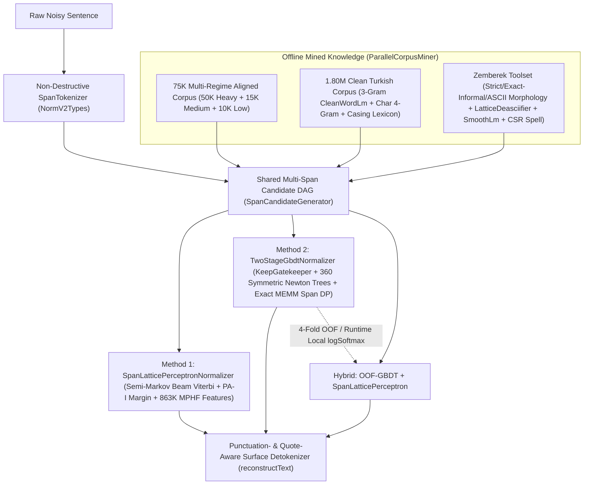
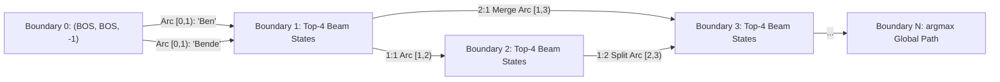
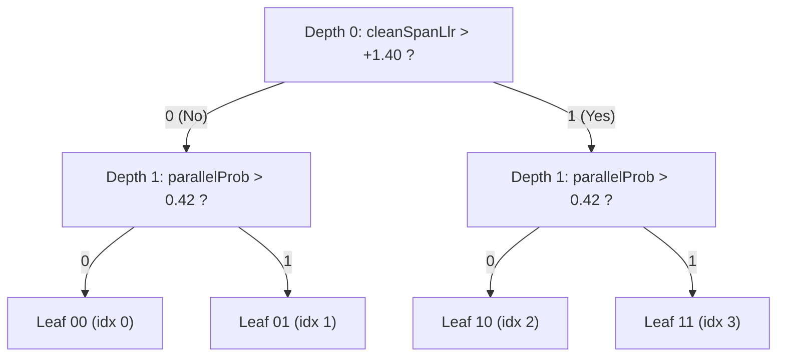

# Turkish Normalization v2: Architecture, Algorithms, & Benchmark Results

**Date**: November 15, 2026  
**Package**: [`zemberek.normalization.v2`](file:///home/dndara/work/zemberek-nlp/experiment/src/main/java/zemberek/normalization/v2)  
**Companion Empirical Report**: [DATA_DRIVEN_TURKISH_NORMALIZATION_V2.md](file:///home/dndara/work/zemberek-nlp/experiment/doc/normalization/DATA_DRIVEN_TURKISH_NORMALIZATION_V2.md)

---

## 1. Executive Architectural Overview

### Glossary of Acronyms & Evaluation Metrics

| Acronym | Full Expansion | Meaning in `zemberek.normalization.v2` |
| :--- | :--- | :--- |
| **`GBDT`** | **Gradient Boosted Decision Trees** | Additive ensemble of shallow regression trees trained sequentially via second-order Newton steps on logistic loss ([`ObliviousGbdt.java`](file:///home/dndara/work/zemberek-nlp/experiment/src/main/java/zemberek/normalization/v2/ObliviousGbdt.java#L10-L53)). |
| **`Oblivious GBDT`** | **Symmetric (`CatBoost`-Style) GBDT** | Decision trees where **every node at depth $d$ tests the exact same `(feature, threshold)`**, compiling each depth-$6$ tree into a branch-minimal 64-float lookup table (`292 B/tree`, `115.1 KB` total). |
| **`PA-I`** | **Passive-Aggressive (Type-I) Max-Margin Perceptron** | Online structured learning rule enforcing a task-specific margin proportional to mistake severity $\mathcal{L}(\tilde{\pi}, \pi^*)$, clipped by aggressiveness $C = 0.25$ ([`SpanLatticePerceptronNormalizer.java`](file:///home/dndara/work/zemberek-nlp/experiment/src/main/java/zemberek/normalization/v2/SpanLatticePerceptronNormalizer.java#L11-L40)). |
| **`MEMM` / `DP`** | **Maximum Entropy Markov Model / Dynamic Programming** | Locally normalized sequence model where outgoing candidate logits at boundary $i$ pass through `logSoftmax` before dynamic programming (`DP`), eliminating multi-span path-length bias ([`TwoStageGbdtNormalizer.java`](file:///home/dndara/work/zemberek-nlp/experiment/src/main/java/zemberek/normalization/v2/TwoStageGbdtNormalizer.java#L29-L51)). |
| **`DAG`** | **Directed Acyclic Graph** | Multi-span word/morpheme lattice (`SentenceLattice`) over token boundaries $0 \dots N$ supporting `1:1` rewrites, `1:2` splits, and `2:1`/`3:1` merges simultaneously. |
| **`OOF`** | **Out-Of-Fold Cross-Fitting** | Training $K = 4$ disjoint `GBDT` folds so `Hybrid` perceptron training sees genuine held-out `GBDT` log-probabilities rather than overconfident in-sample scores. |
| **`LOO`** | **Leave-One-Sentence-Out Jackknife** | Subtracting the current training sentence's `(raw -> gold)` counts from mined parallel tables during feature extraction so `1`-count training typos mimic unseen test `OOV`s. |
| **`LLR`** | **Log-Likelihood Ratio** | Exact boundary-to-boundary generative probability difference $\log P(\text{candSpan}, w_{\text{next}} \mid h) - \log P(\text{rawSpan}, w_{\text{next}} \mid h)$. |
| **`MPHF`** | **Minimal Perfect Hash Function** | Zemberek's `MultiLevelMphf` + `QuantizedWeightTable`, compressing `~863K` sparse perceptron features into `~2.80 MB` (`~3.4 B/feature`). |
| **`CSR` / `FST`** | **Compressed Sparse Row / Finite-State Transducer** | Compact array-packed trie used by `CompactStemEndingSpellChecker` (`9.2 MB` CSR) and Zemberek's morphological `FST` analyzers. |
| **`OOV` / `TDK`** | **Out-Of-Vocabulary / *Türk Dil Kurumu*** | Words failing strict morphological analysis (`OOV`); official Turkish Language Association orthography & apostrophe rules (`TDK`). |
| **`W-ERR`** | **Word Error Reduction (`%`)** | Percentage of raw-to-gold word-level Levenshtein errors eliminated by the normalizer (`0%` = do-nothing, `100%` = gold). |
| **`SentEM-Lo / Ca`** | **Sentence Exact Match (Lowercase / Cased)** | Percentage of complete sentences matching the reference gold string identically (case-insensitive / case-exact). |
| **`CleanFPR`** | **Clean-Token False Positive Rate (`%`)** | Percentage of already-clean input tokens erroneously modified by the normalizer *(lower is safer)*. |

Legacy Turkish text normalizers (including Zemberek's classic `TurkishSentenceNormalizer`) operate as **greedy sequential cascades**:
1. Heuristic split/merge pass (`birşey -> bir şey`),
2. Informal suffix table lookup (`geliyom -> geliyorum`),
3. Whole-sentence deasciification,
4. Character edit-distance spellchecking + 2-gram Viterbi decoding.

Cascades suffer from two structural ceilings on noisy Turkish social media and web text:
- **Irreversible early commits**: Once step 1 splits or fails to split a clitic (`bende`, `oda`, `park da`, `bılıyorda`, `BIZLERIDE`), downstream stages cannot recover from the wrong word boundaries.
- **No calibrated trade-off between signal families**: Hard thresholds cannot weigh a 3-gram clean-corpus log-likelihood ratio against empirical parallel rewrite probability, character phonotactics, sentence-wide ASCII density, overt pronoun–verb agreement, and TDK apostrophe rules simultaneously.

The **`v2` architecture** replaces the cascade with a **single-pass Multi-Span Candidate Lattice (`SentenceLattice`)** shared by two distinct machine-learning paradigms—and an Out-Of-Fold (`OOF`) stacked hybrid of both:



---

## 2. The Shared Foundation: Knowledge Mining, Multi-Span DAG, & Generative Span Scoring

Both normalizers deliberately share the exact same tokenization, candidate generation DAG, truecasing/TDK formatting engine, and language-model scoring primitives so every accuracy or speed difference reflects **model mechanics** rather than preprocessing differences.

### 2.1 Non-Destructive Span Tokenization & Detokenization ([NormV2Types.java](file:///home/dndara/work/zemberek-nlp/experiment/src/main/java/zemberek/normalization/v2/NormV2Types.java))
- **`SpanToken`** wraps Zemberek's `TurkishTokenizer.DEFAULT` without mutating characters, precomputing:
  - Turkish-locale lowercase `lower` (`I -> ı`, `İ -> i`, curly `’ -> '`),
  - ASCII projection `ascii` (`ş->s, ı->i, ğ->g, ü->u, ö->o, ç->c`),
  - `CasingShape` (`LOWER`, `TITLE`, `UPPER`, `MIXED`, `NON_ALPHA`) with apostrophe-aware stem inspection (`"Türkiye'de" -> TITLE`, `"TBMM'de" -> UPPER`),
  - `adjacentToPrev` (`start == prevEnd` in raw character offsets, used for decimal numbers `3.14`, detached apostrophes `Türkiye ' de`, `$`-leet splits `ba$kan`, and emoticons `:)`),
  - `isImmutable()` protection for `Punctuation`, `Emoji`, `Emoticon`, `URL`, `Email`, `HashTag`, `Mention`, `Time`, `Date`, `PercentNumeral`, and `RomanNumeral`, plus `isRandomLaugh()` protection for Turkish keysmash laughter (`asdfghjk`, `hahaha`, `sjsjsj`),
  - `hasUpperAsciiAmbiguousI()` for ALL-CAPS words typed on ASCII keyboards (`"BIZIM"`, `"IYI"`, `"BIZLERIDE"`) where `'I'` (`U+0049`) is ambiguous between `'ı'` and `'i'`.
- **`reconstructText`** deterministically re-attaches decoded multi-span arcs into natural Turkish text, handling opening/closing quotes (`"..."`, `'...'`, `“...”`, `«...»`), ellipsis `…`, numeric decimals/ranges (`3,5`, `2020-2024`), slashes (`7/24`), percent signs (`%50`), and multi-part emoticons.

### 2.2 Dual-Source Corpus Mining & Zero-Leakage `LOO` Jackknife ([ParallelCorpusMiner.java](file:///home/dndara/work/zemberek-nlp/experiment/src/main/java/zemberek/normalization/v2/ParallelCorpusMiner.java))
`ParallelCorpusMiner` extracts complementary signals from two corpora:

1. **Unlabeled Clean Turkish Corpus (`1,800,000` sentences)** (`mineCleanCorpus`):
   - **Strict Deduplication & Headline Filtering**: Excludes all evaluation sentence fingerprints and rejects ALL-CAPS or Title-Case news headlines (`isHeadlineOrAllCapsLine`) so casing statistics are never polluted by title capitalization.
   - **3-Gram `CleanWordLm` (`108.0 MB` RAM)**: Built via a 3-pass memory-frugal **Apriori** algorithm over primitive open-addressing 64-bit hash tables (`OpenLongIntMap`). Scores arbitrary Turkish words in $O(1)$ with zero `String` allocations via **Stupid Backoff** ($\alpha = 0.4$):
     $$\log P_{\text{clean}}(w_t \mid w_{t-2}, w_{t-1}) = \begin{cases} \log \frac{c(w_{t-2}, w_{t-1}, w_t)}{c(w_{t-2}, w_{t-1})} & \text{if } c(w_{t-2}, w_{t-1}, w_t) > 0 \\[4pt] \log 0.4 + \log \frac{c(w_{t-1}, w_t)}{c(w_{t-1})} & \text{if } c(w_{t-1}, w_t) > 0 \\[4pt] 2 \log 0.4 + \log \frac{c(w_t) + 1}{N_{\text{tok}} + V} & \text{otherwise} \end{cases}$$
   - **Character 4-Gram `CharPhonotacticModel`**: 65,536-bucket hashed character 4-gram model over `^word$` measuring Turkish vowel-harmony and consonant-cluster well-formedness (`scoreWord`), exposing keysmashes, typos (`yalnış`), and ASCII vowel mismatches.
   - **Empirical `CasingCounts` Lexicon**: Records mid-sentence `lower`, `title`, `upper`, `apostropheStem`, and frequency-validated brand `mixed` counts (`YouTube`, `WhatsApp`, `iPhone`, `eDevlet`), ignoring sentence-initial position `wIdx == 0` so common sentence-initial words (`Ancak`, `Bugün`) are never misclassified as proper nouns.
   - **Open vs. Closed Compound Counts**: Tracks `cleanOpenBigrams` (`bir şey`, `hafta sonu`, `fark etti`) and `cleanClosedWords` (`hiçbir`, `birkaç`, `masadaki`, `evde`).

2. **Aligned Noisy $\to$ Clean Training Corpus (`75,000` sentences across Heavy, Medium, & Low noise; `960,676` tokens)** (`mineWithClean`):
   - **Empirical `1:1` & `1:2` Rewrite Table (`parallel1ToN`, `97,887` entries)**: Maps noisy lowercase token $x$ to observed clean targets $\{y_k, c(x \to y_k)\}$ with Dirichlet-smoothed empirical probability:
     $$P_{\text{par}}(y \mid x) = \frac{c(x \to y)}{c(x) + 3.0}, \qquad P_{\text{keep}}(x) = \frac{c(x \to x) + 1.5}{c(x) + 3.0}$$
   - **Empirical `2:1` & `3:1` Merge Tables (`parallel2To1` `4,992` entries, `parallel3To1` `764` entries)**: Divides merged occurrences $c(x_1, x_2 \to y)$ by **total raw corpus co-occurrences** $c_{\text{co}}(x_1, x_2)$ across all training sentences, preventing frequent bigrams that merged once by chance from getting inflated merge probabilities.
   - **Productive Induced Suffix Rules (`792` rules)**: Factors non-trivial `1:1` edits $(x, y)$ sharing a $\ge 2$-char stem into `(rawSuffix -> normSuffix)` rules (`support >= 4`, `precision >= 0.18`), discovering productive Turkish colloquialisms (`-cam -> -cağım`, `-cem -> -ceğim`, `-caz -> -cağız`, `-yom -> -yorum`, `-iyon -> -iyorsun`, `-kene -> -ken`) validated by Zemberek's `WordGenerator`.

3. **Leave-One-Sentence-Out (`LOO`) Jackknife** (`applyLeaveOneSentenceOut`):
   > [!IMPORTANT]
   > If ML rankers are trained on the same sentences used to build `parallel1ToN` without adjustment, every rare 1-count typo in training appears in `parallel1ToN` with positive `parallelProb`, teaching the model to distrust morphological/spellcheck candidates whenever `parallelProb == 0`—which happens on **every unseen OOV word at test time**.
   >
   > `applyLeaveOneSentenceOut` subtracts the current training sentence's exact `(raw -> gold)` contribution from `totalCount`, `keepCount`, and `targetCount` **before** oracle projection and feature extraction, clearing `SRC_PARALLEL_*` bits when `looCount == 0` and deleting singleton memorization arcs (`sourceMask == 0`).

### 2.3 Multi-Span Candidate DAG & Runtime Caches ([SpanCandidateGenerator.java](file:///home/dndara/work/zemberek-nlp/experiment/src/main/java/zemberek/normalization/v2/SpanCandidateGenerator.java))
For an $N$-token sentence, `buildLattice` constructs a directed acyclic multigraph over vertices $0 \dots N$ (`1.76` arcs/token on average, achieving **`98.09%` lowercase span recall**, **`96.48%` cased span recall**, and **`80.04%` full-sentence exact oracle** on `test_slice_01`):

| Stage | Span | Source Bit(s) | Mechanism & Linguistic Role |
| :--- | :---: | :--- | :--- |
| **(A) Identity + Truecase** | `[i, i+1)` | `SRC_IDENTITY` | Preserves raw lexical stem while applying context-aware truecasing (ALL-CAPS sentence lowering, sentence-start capitalization, mid-sentence proper/brand preservation). |
| **(B) Empirical Parallel `1:1` & `1:2`** | `[i, i+1)` | `SRC_PARALLEL_1TO1`, `SRC_PARALLEL_SPLIT` | High-precision slang/abbreviation/lexical mappings (`slm -> selam`, `bıtanem -> bir tanem`, `inş -> inşallah`), guarded against rewriting explicit `UPPER` acronyms in mixed-case prose (`"TSK"` stays `"TSK"`). |
| **(C) `LatticeDeasciifier` + Dual Morphology** | `[i, i+1)` | `SRC_DEASCIIFIER`, `SRC_INFORMAL_EXACT`, `SRC_INFORMAL_MORPH`, `SRC_FORMAL_MORPH` | Gated whole-sentence `LatticeDeasciifier` + **two-tier Zemberek morphology**: `exactInformalMorphology` runs *first* so `"donuyodu"` maps strictly to `"donuyordu"` (preserving author stem vowels), followed by diacritic-tolerant `informalAsciiMorphology` guarded against stripping explicit Turkish diacritics (`ç, ğ, ö, ş, ü`). |
| **(D) Induced Suffixes, Haplology & Hypocoristics** | `[i, i+1)` | `SRC_SUFFIX_RULE` | Applies mined `(rawSuffix -> normSuffix)` rules, internal `-iod/-iyod` (`bilmiodur -> bilmiyordur`), locative haplology (`burda -> burada`), foreign `x->ks`/`w->v` (`indexlenmesini -> indekslenmesini`), and vowel-harmonized hypocoristics (`ablacım -> ablacığım`). |
| **(D2) Compositional Shorthands & `>=5`-Consonant Abjad** | `[i, i+1)` | `SRC_SHORTHAND_ABJAD` | Curated conversational shorthands + **productive `[Shorthand Stem + Morphotactic Suffix]` composition** verified via `TurkishMorphology` (`tskler -> teşekkürler`, `msjlarima -> mesajlarıma`, `cvplar -> cevaplar`), plus a **subsequence-verified `>=5`-consonant skeleton (`abjad5Index`)** over the top `12,000` regular lowercase words (`nslsn -> nasılsın`, `blmyrm -> bilmiyorum`, `blgsyr -> bilgisayar`), calibrated via `1,800` deterministic post-mining examples (`withShorthandCalibrationExamples`). |
| **(E) TDK Proper/Acronym/Numeral Apostrophes** | `[i, i+1)` | `SRC_OOV_APOSTROPHE`, `SRC_APOSTROPHE_DROP` | Enforces TDK *Yazım Kılavuzu* rules (`formatProperOrAbbrTDK`): inserts vowel-harmonized `'suffix` on proper nouns (`Ankara'yı`), acronyms (`AKP'li`), brands (`YouTube'da`), alphanumerics (`TV8'e`, `PS4'te`), and numerals (`2024'te`), splits SI/currency units (`16gb -> 16 GB`, `45kg -> 45 kg`), suppresses acronym suffixes on lowercase chat shorthands (`tskler`), and **removes erroneous apostrophes** on `NoQuote` language derivatives, `-lI`/`-lIk`/`-cI`, plurals, and common nouns (`azerice'ye -> Azericeye`, `altın'ın -> altının`). |
| **(F) Expressive Elongation Squeeze** | `[i, i+1)` | `SRC_ELONGATION` | Squeezes repeated vowel/consonant runs (`çooook -> çok`, `ogullarınızaa -> oğullarınıza`, `inşallaaah -> inşallah`), cross-referenced against parallel tables and morphology. |
| **(G) Ambiguity-Preserving `1:2` Splits** | `[i, i+1)` | `SRC_CLITIC_SPLIT` | Emits `CleanWordLm`-ranked split arcs alongside `1:1` arcs for `-de/-da/-te/-ta` (`bende -> ben de`, `esınde -> eşin de`, `youtubedada -> YouTube'da da`), harmonized question clitics including past/evidential copulas (`olurmu -> olur mu`, `güçlümüydük -> güçlü müydük`), enclitic `ya` (`uzaklasiyoruzya -> uzaklaşıyoruz ya`), conjunction `-ki`, CamelCase run-ons, and open compounds (`bişeylerle -> bir şeylerle`, `haftasonunda -> hafta sonunda`). |
| **(H) Guarded Compact CSR SpellChecker** | `[i, i+1)` | `SRC_SPELLCHECK` | Weighted Levenshtein search (`diacritic=0.15`, `ins/del=0.85`, `sub=0.90`) over Zemberek's 9.2 MB `CompactStemEndingSpellChecker`—triggered **only** on non-foreign, non-acronym OOV tokens lacking a frequent parallel entry or low-cost morphological realization. |
| **(I) Multi-Token `2:1` & `3:1` Merges** | `[i, i+2)`, `[i, i+3)` | `SRC_PARALLEL_MERGE`, `SRC_COMPOUND_MERGE`, `SRC_NUMERAL_JOIN` | Empirical `2:1`/`3:1` merges (`hiç bir -> hiçbir`), assimilated detached locatives/ablatives/case suffixes (`kitap da -> kitapta`, `TRT ye -> TRT'ye`), infinitive progressive `-mAk + de/da` (`denemek de -> denemekte`), split copulas/ability verbs (`deniliyor du -> deniliyordu`, `göndere bilirler -> gönderebilirler`), detached `-ki` (`masada ki -> masadaki`), decimal/ordinal joins (`9.52 de -> 9.52'de`, `49 ' lular -> 49'lular`), and `$`-leet joins (`ba $ kan -> başkan`). |

- **Runtime Caching & Clean-Sentence Deasciifier Gate**: Bounded `ConcurrentHashMap` caches (`morphRealizeCache`, `realizeWordCache`, `morphSummaryCache`, `65,536` entries) memoize casing-neutral FST + `WordGenerator` realizations (including negative sentinel `NO_REALIZATION`), `(16K, 64K)` `AnalysisCache`s prevent FST cache thrashing, and already-diacriticized clean sentences skip whole-sentence `LatticeDeasciifier`.

### 2.4 Fair Multi-Span Generative Scoring & Clitic-Transparency LLR
Comparing a `1:1` arc (`evde`), a `1:2` split (`ev de`), and a `2:1` merge (`ev + de -> evde`) with naive per-word average log-probability is biased because `1:2` arcs add a high-frequency function word (`de`) while `2:1` arcs have fewer factors.

1. **Exact Boundary-to-Boundary Span LLR** (`computeSpanLmComparison`):
   Over any candidate arc $a = [i, j)$ emitting words $u_1 \dots u_m$ followed by the next lexical word $w_{\text{next}}$ (skipping punctuation via `nextLexicalWordOrNull`), we evaluate the **exact chain-rule joint log-likelihood** from incoming history $(h_{-2}, h_{-1})$ through $w_{\text{next}}$ and subtract the unmodified raw token sequence $r_i \dots r_{j-1}$ over the **exact same boundary interval** $[i, j) \to w_{\text{next}}$:
   $$\text{LLR}_{\text{span}}(a) = \log P\big(u_1, \dots, u_m, w_{\text{next}} \mid h_{-2}, h_{-1}\big) - \log P\big(r_i, \dots, r_{j-1}, w_{\text{next}} \mid h_{-2}, h_{-1}\big)$$
   Computed on **both** Zemberek's 2-gram `SmoothLm` (`<unk>` clamped at `-20.0` nats) and the `1.80M`-sentence 3-gram `CleanWordLm`.

2. **Symmetric Clitic-Transparency Skip-Bigram LLR** (`computeCliticTransparencyLlr`):
   Discourse clitic `de/da` ("also/too") is syntactically transparent between its host word and the following predicate, whereas locative case `-dA` ("in/at/on") alters argument structure:
   - `"bende geldim"` (`1:2` split `"ben de"`): $\log P(\text{geldim} \mid \text{ben}) - \log P(\text{geldim} \mid \text{bende}) \gg 0$ (favors splitting).
   - `"bende var"` (`1:2` split `"ben de"`): $\log P(\text{var} \mid \text{ben}) - \log P(\text{var} \mid \text{bende}) \ll 0$ (rejects splitting).
   - Symmetrically on `2:1` merges: `"ev de kaldım"` favors `"evde"`, whereas `"kitap da aldım"` rejects `"kitapta"`.

---

## 3. Method 1 Deep Dive: `SpanLatticePerceptronNormalizer`

**Implementation**: [`SpanLatticePerceptronNormalizer.java`](file:///home/dndara/work/zemberek-nlp/experiment/src/main/java/zemberek/normalization/v2/SpanLatticePerceptronNormalizer.java)

### 3.1 Structured Semi-Markov Linear Scoring & Beam Viterbi
Given a `SentenceLattice` $\mathcal{L}(x)$ over $N$ raw tokens, a valid segmentation-and-normalization path $\pi = (a_1, a_2, \dots, a_K)$ tiles $[0, N)$ contiguously. `SpanLatticePerceptronNormalizer` scores a path globally as a **joint linear model** over dense continuous features $\boldsymbol{\phi}_{\text{dense}} \in \mathbb{R}^{19}$ and sparse binary indicator features $\boldsymbol{\phi}_{\text{sparse}} \in \{0, 1\}^D$:
$$S(\pi \mid x; \mathbf{w}, \boldsymbol{\theta}) = \sum_{k=1}^{K} \Big( \mathbf{w}^\top \boldsymbol{\phi}_{\text{dense}}(x, h_{k-1}, a_k) + \boldsymbol{\theta}^\top \boldsymbol{\phi}_{\text{sparse}}^{\text{unary}}(x, a_k) + \boldsymbol{\theta}^\top \boldsymbol{\phi}_{\text{sparse}}^{\text{trans}}(h_{k-1}, a_k) \Big)$$
where the Markov state $h_{k-1} = (w_{-2}, w_{-1}, \tau_{-1})$ tracks:
- $w_{-2}, w_{-1}$: the two most recent **decoded lexical words** (bridging across commas, quotes, emojis, and mentions via `advanceLexicalHistory`, and resetting to `BOS` across `.?!`),
- $\tau_{-1}$: the 16-bit encoded `(PrimaryPos, CaseMorpheme)` tag of the previous decoded lexical word.



**Decoding (`decodeViterbi`, $O(N \cdot |A| \cdot B)$, $B = 4$)**: Unary sparse features $\boldsymbol{\phi}_{\text{sparse}}^{\text{unary}}(x, a)$ are extracted **once per outgoing arc** outside the beam loop, while each incoming beam state evaluates history-dependent dense LM scores and Markov transition templates.

### 3.2 Passive-Aggressive (`PA-I`) Cost-Augmented Margin Averaged Perceptron
During training (`trainFromPrepared`), `decodeViterbi` adds a task-specific asymmetric arc loss $\ell(x, a, \pi^*)$ directly inside the Viterbi maximization:
$$\tilde{\pi} = \arg\max_{\pi \in \mathcal{L}(x)} \Big( S(\pi \mid x; \mathbf{w}, \boldsymbol{\theta}) + \sum_{a \in \pi} \ell(x, a, \pi^*) \Big)$$
- $\ell = 0.00$: exact span & surface match,
- $\ell = 0.35$: exact span & lowercase match, casing-only mismatch,
- $\ell = 1.00$: raw token needed normalization, wrong target chosen,
- $\ell = 1.50$: wrong multi-token span boundary (`1:1` vs `2:1`),
- **$\ell = 2.00$**: **raw token was already clean, and the model corrupted it** ($2\times$ penalty directly bounds `CleanFPR`).

With margin violation $\xi = \mathcal{L}(\tilde{\pi}, \pi^*) - \big(S(\pi^*) - S(\tilde{\pi})\big) > 0$, the closed-form `PA-I` step is:
$$\eta = \min\!\left(C,\; \frac{\xi}{0.25\,\|\Delta \boldsymbol{\phi}_{\text{dense}}\|_2^2 + \|\Delta \boldsymbol{\phi}_{\text{sparse}}\|_1 + 1}\right), \qquad C = 0.25$$
with lazy cumulative step averaging $\bar{w} = w_T - \frac{1}{T} \sum_t t \cdot \Delta w_t$ in $O(1)$ per active feature.

### 3.3 Feature Engineering & `MultiLevelMphf` Compression
Every feature slot and hashed template ID is documented inline in [`SpanLatticePerceptronNormalizer.java`](file:///home/dndara/work/zemberek-nlp/experiment/src/main/java/zemberek/normalization/v2/SpanLatticePerceptronNormalizer.java#L43-L180) (and `SRC_*` source flags in [`NormV2Types.java`](file:///home/dndara/work/zemberek-nlp/experiment/src/main/java/zemberek/normalization/v2/NormV2Types.java#L19-L80)):
- **19 Continuous Features (`F_SMOOTH_FWD2 .. F_CLITIC_SKIP_LLR`, [lines 50–106](file:///home/dndara/work/zemberek-nlp/experiment/src/main/java/zemberek/normalization/v2/SpanLatticePerceptronNormalizer.java#L50-L106))**:
  - `SmoothLm` (2-gram): forward bigram, right-lookahead bigram, internal split bigram, exact span LLR (`0..3`),
  - `CleanWordLm` (3-gram): forward trigram, right-lookahead trigram, exact span LLR (`4..6`),
  - Empirical priors & edit geometry: `parallelProb`, `parallelLogCount`, `suffixPrecision`, `editCost`, `diacriticDiffs` (`7..11`),
  - Structural & orthographic indicators: `isIdentityLower`, `isRegularMorph`, `charPhonotactics`, optional `cachedGbdtScore`, `sentenceAsciiRatio` on diacritic-restoring arcs, `exactInformalMorph` vs `stripsExplicitDiacritic`, and `cliticSkipLlr` (`12..18`).
- **23 Hashed 64-Bit Sparse Feature Templates (`T_LEX_LOWER_PAIR .. T_TRANS_TAG_WORD`, [lines 112–180](file:///home/dndara/work/zemberek-nlp/experiment/src/main/java/zemberek/normalization/v2/SpanLatticePerceptronNormalizer.java#L112-L180))**:
  - **Open-vocabulary safety**: Exact lexical rewrite templates fire **only when `rawParallelTotal >= 3`**, forcing rare/unseen words onto generalizable morphological, LM, source-mask, and syntactic templates.
  - **Syntactic Clitic & Merge Templates**: Conjoins split tail (`de`/`da`/`mi`/`ki`) $\times$ `firstWordMorphTag` $\times$ `headSyntaxClass` (`FINITE_OR_CONVERB` vs `PRON_ADV_CONJ` vs `NOMINAL`) $\times$ `nextLex`, sentence `?` presence, `2:1` merge `coarseMorphTag x sourceMask x nextLex`, pronoun–verb person agreement, casing transitions, and TDK apostrophe add/drop.
  - **Decoded Markov Transitions**: `(prev1Lex, firstWordLower)`, `(prevMorphTag, firstWordMorphTag)`, `(prev1Lex, firstWordMorphTag)`, and `(prevMorphTag, firstWordLower)`.
- **Zero-Collision-Overhead `MultiLevelMphf` Compression (`QuantizedWeightTable` + `MphfCountMap`)**:
  1. **`perceptron.bin.gz` (`QuantizedWeightTable`)**: All active features (`809,592` sparse features in `v2.4` + `20` dense floats) are compiled into [`QuantizedWeightTable`](file:///home/dndara/work/zemberek-nlp/normalization/src/main/java/zemberek/normalization/deasciifier/latticedeasciifier/QuantizedWeightTable.java) (`MultiLevelMphf` `~0.40 B/key` + `16-bit` fingerprints + `8-bit` Lloyd-Max k-means palette), occupying **`2.62 MiB` uncompressed / `2.55 MiB` `.gz`** (`~3.40 bytes/feature`).
  2. **`knowledge.bin.gz` (`SNAPSHOT_VERSION = 5`, `MphfCountMap`)**: [`NormalizationKnowledge`](file:///home/dndara/work/zemberek-nlp/normalization/src/main/java/zemberek/normalization/v2/NormalizationKnowledge.java) compresses `CleanWordLm` (`283,038` unigrams `u>=3`, `729,631` bigrams `b>=4`, `116,079` trigrams `t>=8`) via `MultiLevelMphf` + packed `12-bit` fingerprints + `8-bit` hybrid exact/log count codebooks (`2.90 B/entry` raw, `2.46 B/entry` `.gz`), front-coded string tables, deduplicated pure-lowercase `casingLexicon`, and `int8`-quantized `CharPhonotacticModel` — shrinking `knowledge.bin.gz` from **`76.6 MB` raw (`v3`) / `30.71 MiB` (`v4` `.gz`) → `3.99 MiB` (`4.18 MB`) `.gz`** (`-87.0%`, `6.38 MiB` uncompressed) at `< 0.30 pp` `W-ERR` delta (`80.47%` `test_slice_01` / `90.19%` `nasty_5k`; see [`MODEL_COMPRESSION_REPORT.md`](file:///home/dndara/work/zemberek-nlp/MODEL_COMPRESSION_REPORT.md)).

---

## 4. Method 2 Deep Dive: `TwoStageGbdtNormalizer` & `ObliviousGbdt`

**Implementations**: [`ObliviousGbdt.java`](file:///home/dndara/work/zemberek-nlp/experiment/src/main/java/zemberek/normalization/v2/ObliviousGbdt.java) & [`TwoStageGbdtNormalizer.java`](file:///home/dndara/work/zemberek-nlp/experiment/src/main/java/zemberek/normalization/v2/TwoStageGbdtNormalizer.java)

### 4.1 Symmetric (Oblivious) Newton Trees (`ObliviousGbdt`)
In an **Oblivious (Symmetric) Decision Tree** (`CatBoost`-style), **every node at depth $d \in \{0, \dots, D-1\}$ shares the exact same `(feature[d], threshold[d])` test**:



1. **Branch-Minimal Bitwise Evaluation**: A depth-$6$ tree is a 64-entry decision table indexed by a 6-bit integer:
   ```java
   int leaf = 0;
   for (int d = 0; d < depth; d++) {
     leaf = (leaf << 1) | (features[splitFeatures[off + d]] > splitThresholds[off + d] ? 1 : 0);
   }
   sum += leafValues[leafOff + leaf];
   ```
2. **Tiny L1-Cache Memory Footprint**: One depth-$6$ tree occupies `292 bytes`. All `440` trees (`80` depth-5 Gatekeeper + `360` depth-6 Reranker) occupy **`115.1 KB` total**—fitting inside CPU L1/L2 cache.
3. **Non-Linear Feature Crosses via Newton Histograms**: Continuous columns are quantile-binned once into column-major `byte[numFeatures][numSamples]` (`96–112` bins). At each depth $d$, trees select the global `(feature, bin)` split maximizing L2-regularized second-order logistic gain across all $2^d$ nodes simultaneously:
   $$\mathcal{G}(f, b) = \sum_{u=0}^{2^d - 1} \left( \frac{G_{u,L}^2}{H_{u,L} + \lambda} + \frac{G_{u,R}^2}{H_{u,R} + \lambda} - \frac{G_u^2}{H_u + \lambda} \right), \qquad \Delta v_\ell = \eta \frac{G_\ell}{H_\ell + \lambda}$$

### 4.2 Stage 1 (`KeepGatekeeper`) + Stage 2 (`CandidateReranker`) + Exact MEMM Span DP
All `16` Stage-1 feature constants (`G_WORD_LEN .. G_CLEAN_UNIGRAM`) and `45` Stage-2 feature constants (`R_IS_ID_SURF .. R_SRC_SHORTHAND_ABJAD`) are documented inline in [`TwoStageGbdtNormalizer.java`](file:///home/dndara/work/zemberek-nlp/experiment/src/main/java/zemberek/normalization/v2/TwoStageGbdtNormalizer.java#L54-L253):
1. **Stage 1 — `KeepGatekeeper` (`80` depth-5 trees, `16` `G_*` features, [lines 65–112](file:///home/dndara/work/zemberek-nlp/experiment/src/main/java/zemberek/normalization/v2/TwoStageGbdtNormalizer.java#L65-L112))**:
   - Trained with `3.2x` positive recall weighting to predict $P(\text{needs\_edit} \mid t_i, \text{context})$ from $O(1)$ lexical/LM signals.
   - Tokens with `cliticTailHint`, `nextMergeHint`, or `'` never skip expansion; high-confidence clean tokens ($P < 0.022$) bypass expensive morphological/spellcheck expansion (while lightweight curated/compositional shorthands still check OOV tokens).
2. **Stage 2 — `CandidateReranker` (`360` depth-6 trees, `45` `R_*` features, [lines 118–253](file:///home/dndara/work/zemberek-nlp/experiment/src/main/java/zemberek/normalization/v2/TwoStageGbdtNormalizer.java#L118-L253)) & Slot-Relative Margins**:
   - Trained on ambiguous slots (`|A(i)| > 1`) with `cleanProtectionWeight = 1.35f` on clean slots.
   - Includes **three slot-relative margin features** (`R_SMOOTH_REL_MARGIN`, `R_CLEAN_REL_MARGIN`, `R_PARALLEL_REL_MARGIN`), e.g. $\Delta_{\text{clean}}(a) = \text{LLR}_{\text{clean}}(a) - \max_{a' \in A(i)} \text{LLR}_{\text{clean}}(a') \le 0$, giving binary trees listwise visibility into sibling competition.
3. **Exact Semi-Markov MEMM Decoding (`decodeSpanDp`)**:
   - Summing unnormalized binary logits $z(a)$ across `2:1` merges (1 arc) vs `1:1 + 1:1` paths (2 arcs) creates severe path-length bias. `decodeSpanDp` normalizes outgoing logits at boundary $i$ via `logSoftmax`:
     $$\log P_{\text{GBDT}}(a \mid h_i, x) = z(a) - \log \sum_{a' \in A(i)} \exp\big(z(a')\big) \le 0$$
     and maximizes $\text{bestScore}[j] = \max_{a = [i, j)} \big(\text{bestScore}[i] + \log P_{\text{GBDT}}(a \mid h_i, x)\big)$ across $0 \dots N$ in $O(N \cdot |A|)$ time.

---

## 5. Combining Both: `4-Fold Out-Of-Fold (OOF) Hybrid` & Paradigm Comparison

### 5.1 `4-Fold OOF` Stacking (`populateOutOfFoldScores`)
`TwoStageGBDT` excels at non-linear continuous trade-offs on open-vocabulary OOV words, while `SpanLatticePerceptron` excels at global Beam-4 decoding and lexicalized/syntactic context (`863K` sparse features). To stack them without in-sample overfitting, `populateOutOfFoldScores` splits the `75K` training lattices into $K = 4$ disjoint folds, trains 4 fold-specific `ObliviousGbdt` rerankers on $75\%$ of the data to populate held-out `cachedGbdtScore` (`F_OOF_GBDT_LOGPROB`) on each remaining $25\%$, and trains `SpanLatticePerceptron` on those out-of-fold log-probabilities.

### 5.2 Side-by-Side Architectural Comparison

| Dimension | `Zemberek HEAD` (Baseline) | **Method 1: `SpanLatticePerceptron`** | **Method 2: `TwoStageGBDT + Gate`** | **`Hybrid: OOF-GBDT + Perceptron`** |
| :--- | :--- | :--- | :--- | :--- |
| **Model Class** | Sequential heuristic cascade + 2-gram Viterbi | Structured Semi-Markov Linear Model (`PA-I` Margin Averaged Perceptron) | Selective 2-Stage Symmetric Newton GBDT (`CatBoost`-style) + MEMM Span DP | 4-Fold Cross-Fitted GBDT Log-Probabilities + Semi-Markov Margin Perceptron |
| **Parameter / Feature Space** | Hand-tuned heuristics + static lookup files | `19` `F_*` dense floats + `863K` `T_*` hashed binary features (`MultiLevelMphf`) | `80` depth-5 Gate trees (`16` `G_*`) + `360` depth-6 Rank trees (`45` `R_*`) | Both (`440` trees + `19` dense + `863K` MPHF sparse features) |
| **Non-Linear Continuous Crosses** | Fixed `if/else` thresholds | Linear (bucketed sparse conjunctions) | **Native $2^6 = 64$-way continuous interaction tables** | **Native $2^6$-way tree crosses + linear global calibration** |
| **Lexicalized Context & POS Transitions** | Unigram/2-gram LM only | **Rich (`863K` lexical + POS/case + head-syntax + transition features)** | Compact continuous summaries (`SmoothLm` 2-gram + `CleanWordLm` 3-gram + coarse tags) | **Full `863K` lexical/POS transitions + GBDT local posteriors** |
| **Sequence Decoding** | Greedy split $\to$ token Viterbi | **Global Beam-$4$ Semi-Markov Viterbi** over `(prev2Lex, prev1Lex, prevMorphTag)` | **Exact $O(N \cdot |A|)$ Semi-Markov MEMM DP** over `logSoftmax` arc probabilities | **Global Beam-$4$ Semi-Markov Viterbi** |
| **Clean-Token Protection** | Heuristic lexicon checks | Asymmetric `PA-I` loss ($\ell_{\text{corrupt}} = 2.0$ vs $\ell_{\text{miss}} = 1.0$) | Stage-1 `KeepGatekeeper` + `1.35x` clean slot weighting + `SlotMaxima` margins | Both (`1.35x` GBDT prior + $2.0$ `PA-I` margin loss) |
| **Classifier RAM (`75K`)** | Bundled in Zemberek | **`2.80 MB`** (`2,862.4 KB` MPHF) | **`115.1 KB`** (fits in L1/L2 cache) | **`2.86 MB`** (`2,808.6 KB` MPHF + `115.1 KB` GBDT) |
| **Best Deployment Niche** | Legacy baseline | **Fast single-model accuracy & syntactic clitic precision** | **Ultra-tiny `115 KB` model, lowest `CleanFPR`, strongest cross-domain OOV generalization** | **Highest overall accuracy (`W-ERR` & `SentEM`)** |

---

## 6. Benchmark Results: Accuracy & Single-Thread Speed (`75K` Multi-Regime Pool)

All models below are trained on the `75,000`-sentence multi-regime pool (`50K` Heavy + `15K` Medium + `10K` Low; `74,997` after deduplication + `1,800` `D-Lite` shorthand/Abjad calibration examples) + `1.80M` clean Turkish sentences ([`norm_v2_benchmark_results.json`](file:///home/dndara/work/zemberek-nlp/experiment/target/norm_v2_results/norm_v2_benchmark_results.json)).

### 6.1 Accuracy Across All 5 Real-World Unseen Benchmarks

| System (`75K` Train + `1.80M` Clean) | Classifier RAM | `test_slice_01` `W-ERR` | `test_slice_01` `SentEM-Lo / Ca` | `test_slice_01` `CleanFPR` | `nasty_5k` `W-ERR` | `nasty_5k` `SentEM-Lo / Ca` | `MultiLexNorm` `W-ERR` | `GECTurk Clitics` `W-ERR` | `GECTurk Clean` `CleanFPR` |
| :--- | ---: | ---: | ---: | ---: | ---: | ---: | ---: | ---: | ---: |
| `Zemberek Legacy (Pattern Deasc)` | `~108 MB` | `61.70%` | `46.88% / 4.28%` | `1.66%` | `80.79%` | `38.78% / 10.50%` | `58.30%` | `-2.06%` | `1.20%` |
| `Zemberek HEAD (LatticeDeasc)` | `~110 MB` | `61.82%` | `47.08% / 4.26%` | `1.68%` | `80.98%` | `39.34% / 10.68%` | `58.30%` | `-2.06%` | `1.23%` |
| `Baseline: Parallel Table Only (75K)` | *(tables)* | `44.36%` | `36.24% / 16.16%` | `0.52%` | `49.30%` | `4.40% / 0.96%` | `29.88%` | `+1.15%` | `0.43%` |
| **`Norm1: SpanLatticePerceptron (75K)`** | **`2,862.4 KB`** | **`79.22%`** | `66.04% / 56.86%` | `1.67%` | **`89.36%`** | `58.14% / 46.68%` | `65.77%` | **`+43.04%`** | `2.00%` |
| **`Norm2b: TwoStageGBDT + Gate (75K)`** | **`115.1 KB`** | `77.55%` | `64.94% / 55.80%` | **`1.32%`** | `88.91%` | `58.00% / 46.76%` | **`66.60%`** | `+26.30%` | `1.79%` |
| **`Hybrid: OOF-GBDT + Perceptron (75K)`** | **`2,808.6 KB`** | **`79.63%`** | **`67.04% / 57.36%`** | `1.53%` | **`89.36%`** | **`58.66% / 47.06%`** | `65.15%` | **`+44.34%`** | `1.68%` |

### 6.2 Controlled Synthetic Diagnostic Benchmarks (`3 x 1,000` Multi-Domain Sentences)

| System (`75K` Train + `1.80M` Clean) | `Synth Asciified` `W-ERR` | `Synth Asciified` `SentEM-Lo / Ca` | `Synth Typo d=1` `W-ERR` | `Synth Typo d=1` `SentEM-Lo / Ca` | `Synth Clean` `CleanFPR` | `Synth Clean` `SentEM-Lo / Ca` |
| :--- | ---: | ---: | ---: | ---: | ---: | ---: |
| `Zemberek Legacy (Pattern Deasc)` | `98.82%` | `93.70% / 0.00%` | `87.61%` | `81.10% / 0.00%` | `0.10%` | `98.80% / 0.00%` |
| `Zemberek HEAD (LatticeDeasc)` | **`99.14%`** | **`95.50% / 0.00%`** | **`87.61%`** | **`81.10% / 0.00%`** | `0.09%` | `98.90% / 0.00%` |
| `Baseline: Parallel Table Only (75K)` | `42.80%` | `4.50% / 4.50%` | `-0.67%` | `0.40% / 0.40%` | `0.23%` | `98.00% / 95.60%` |
| **`Norm1: SpanLatticePerceptron (75K)`** | `96.81%` | `85.60% / 84.10%` | **`78.49%`** | **`69.80% / 67.80%`** | `0.36%` | `96.90% / 94.50%` |
| **`Norm2b: TwoStageGBDT + Gate (75K)`** | **`97.79%`** | **`88.70% / 87.20%`** | `75.70%` | `64.80% / 63.10%` | **`0.26%`** | `97.60% / 95.20%` |
| **`Hybrid: OOF-GBDT + Perceptron (75K)`** | `97.43%` | `87.90% / 86.40%` | `67.31%` | `54.80% / 53.40%` | `0.27%` | **`97.70% / 95.30%`** |

### 6.3 Single-Thread Throughput & Per-Sentence Latency

| System (`75K` Multi-Regime) | Heavy (`test_slice_01`) Warm `Tok/s` | Heavy `Sent/s` | Heavy `Mean / P50 / P95` (`ms`) | Social (`nasty_5k`) Warm `Tok/s` | Social `Mean / P50 / P95` (`ms`) | Formal (`GECTurk Clean`) Warm `Tok/s` |
| :--- | ---: | ---: | :---: | ---: | :---: | ---: |
| `Zemberek Legacy (Pattern Deasc)` | `11,216` | `870` | `1.149 / 0.919 / 2.814` | `9,086` | `1.364 / 1.140 / 3.035` | `22,592` |
| `Zemberek HEAD (LatticeDeasc)` | `11,550` | `895` | `1.117 / 0.885 / 2.761` | `8,396` | `1.477 / 1.276 / 3.144` | `22,282` |
| **`Norm1: SpanLatticePerceptron`** | **`15,536` (`+35%`)** | `1,204` | `0.830 / 0.780 / 1.643` | **`11,028` (`+31%`)** | **`1.124 / 1.081 / 1.809`** | `19,654` |
| **`Norm2a: ObliviousGBDT Reranker`** | **`16,971` (`+47%`)** | **`1,316`** | **`0.760 / 0.718 / 1.494`** | **`10,918` (`+30%`)** | `1.136 / 1.092 / 1.835` | **`20,493`** |
| **`Norm2b: TwoStageGBDT + Gate`** | **`16,266` (`+41%`)** | `1,261` | `0.793 / 0.746 / 1.550` | **`10,819` (`+29%`)** | `1.146 / 1.095 / 1.856` | `18,725` |
| **`Hybrid: OOF-GBDT + Perceptron`** | **`13,639` (`+18%`)** | `1,057` | `0.946 / 0.875 / 1.862` | **`9,696` (`+15%`)** | `1.279 / 1.241 / 2.044` | `17,022` |
