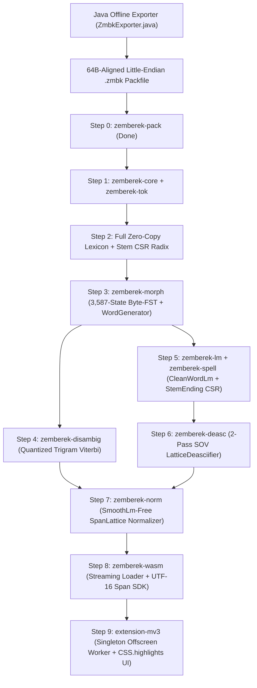
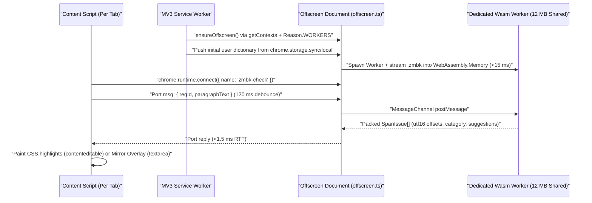

# Zemberek in Rust & WebAssembly — Complete Step-by-Step Implementation Plan

**Workspace Root:** [`rs/`](Cargo.toml)  
**Authoritative Reference:** Java `zemberek-nlp` `HEAD` (`0.20.1+`)  
**Target Deliverables:** Zero-copy Rust NLP crates (`#![no_std]` core), unified `.zmbk` packfiles (**Core Lite ~4.0 MiB** & **Studio Compact ~12.0 MiB**), `wasm32-unknown-unknown` Worker engine, and Chrome Manifest V3 Turkish Writing Assistant Extension.

> [!IMPORTANT]
> **Execution Discipline:** Every step below ends with an objective **Verification Gate** (automated parity test against Java `zemberek-nlp` `HEAD`, `cargo clippy -- -D warnings`, and strict byte/latency budgets). Do not advance to Step `N + 1` until Step `N`'s gate passes at 100%.

---

## 1. Architecture & Dependency Graph

The implementation resolves all findings from our empirical audit of `zemberek-nlp` `HEAD` (handling `ContainsMorphemeSequence`/`HasTailSequence`/`HasTail`, ASCII-tolerant 1-vs-2-byte UTF-8 traversal, `WordGenerator` reverse stem indexing, `SmoothLm` removal across candidate generators, block-front-coded CSR knowledge tables, MV3 `offscreen` storage/Worker bridging, and `<textarea>`/`<input>` overlay fallbacks).



### Target Workspace Layout

```text
rs/
├── Cargo.toml                        # Workspace (-Oz, LTO, panic=abort)
├── .cargo/config.toml                # wasm32: +simd128, 64 KiB shadow stack
├── IMPLEMENTATION_PLAN.md            # Living implementation roadmap (this document)
├── crates/
│   ├── zemberek-pack/                # [Step 0, 2, 5] .zmbk container, PackedDictItem, MultiLevelMphf, MphfCountMap, BlockCsr
│   ├── zemberek-core/                # [Step 1] TurkishAlphabet, casing, syllables, PronunciationGuesser, NumeralEndingMachine
│   ├── zemberek-tok/                 # [Step 1] Zero-regex DFA TurkishTokenizer, SentenceExtractor & Detokenizer (UTF-8 + UTF-16 spans)
│   ├── zemberek-morph/               # [Step 2, 3] Stem CSR + DynamicStemTrie, 3,587-state Byte-FST, UnidentifiedTokenAnalyzer, WordGenerator
│   ├── zemberek-disambig/            # [Step 4] Quantized FastPerceptronAmbiguityResolver (Viterbi / Beam-8 + fixed L1 ring cache)
│   ├── zemberek-spell/               # [Step 5] Error-tolerant Stem+Ending CSR SpellChecker ranked by CleanWordLm
│   ├── zemberek-deasc/               # [Step 6] 2-Pass SOV LatticeDeasciifier + 5-state CharacterHarmonyModel + CircumflexMode
│   ├── zemberek-norm/                # [Step 7] SmoothLm-free SpanLatticePerceptronNormalizer + Block-CSR NormalizationKnowledge
│   └── zemberek-wasm/                # [Step 0, 8] WebAssembly Worker ABI, chunked pack loader, 16K LRU token cache
├── tools/
│   ├── ExportStep0Zmbk.java          # [Step 0] Minimal parity fixture exporter
│   ├── ZmbkExporter.java             # [Step 2–8] Full .zmbk compiler & parity-corpus generator
│   └── verify_wasm.mjs               # [Step 0, 8] Node.js V8 WebAssembly verification & benchmark runner
└── extension-mv3/                    # [Step 9] TypeScript Chrome Manifest V3 extension
```

### Realistic Memory & Bundle Budget (Corrected Audit Baseline)

| Component / `.zmbk` Section | Core Lite RAM | Studio Compact RAM | Studio Gzipped (`.crx`) | Notes |
| :--- | ---: | ---: | ---: | :--- |
| `.wasm` Engine (`-Oz + LTO + simd128`) + `64 KiB` Stack | `0.25 MiB` | `0.35 MiB` | `0.14 MiB` | Zero heavy regex/Protobuf runtimes |
| Lexicon (`PackedDictItem[68,444]` + Stem CSR + Reverse Index + Bridge) | `1.85 MiB` | `1.85 MiB` | `0.72 MiB` | `4 B` bit-packed `PackedStemTarget` + casing-flag lemma sharing |
| Materialized `(State × Phono)` Byte-FST (`~3,587` states, `~19k` arcs) | `0.24 MiB` | `0.24 MiB` | `0.08 MiB` | Deduplicated `2 KB` suffix pool + `is_informal` arc bit |
| Quantized `FastPerceptronAmbiguityResolver` (no Prefix `2:`) | `0.95 MiB` | `0.95 MiB` | `0.82 MiB` | `QuantizedWeightTable` (`3.4 B/feat`) + `256 KiB` L1 ring cache |
| Error-Tolerant CSR Spellchecker (`endingTrie` `50,521` endings) | `0.38 MiB` | `0.38 MiB` | `0.14 MiB` | Compact LOUDS/CSR `endingTrie` with `minRem`/`maxRem` bounds |
| Compact `LatticeDeasciifier` (`300k` sent + `80k` char + front-coded priors) | `0.20 MiB` *(Lite)* | `1.55 MiB` | `1.28 MiB` | Shares lemma log-counts with `CleanWordLm` |
| `SmoothLm`-Free `SpanLatticePerceptronNormalizer` (`400k` sparse + `20` dense) | — | `1.35 MiB` | `1.20 MiB` | `lm.2gram.slm.gz` (`4.73 MiB`) dropped completely |
| `CleanWordLm` (`12b` FP `MphfCountMap`) + Block-CSR `NormalizationKnowledge` | `0.35 MiB` *(1-gram)* | `5.10 MiB` | `3.25 MiB` | Preserves `parallel1ToN` singletons (`-0.89 pp` if pruned) |
| Bounded `16K` Worker Token Cache + Scratch Arena | `0.25 MiB` | `0.50 MiB` | `0.00 MiB` | Fixed-capacity ring buffer (`0` unbounded growth) |
| **Total Shared Worker Footprint (Across All Browser Tabs)** | **`~4.22 MiB`** | **`~12.27 MiB`** | **`~7.63 MiB`** | `0 MB` per-tab Wasm duplication |

---

## 2. Detailed Step-by-Step Implementation Plan

### Step 0 — Cargo Workspace, `.zmbk` Container & Universal `MultiLevelMphf` *(COMPLETED)*

* **Status:** Implemented and verified in [`rs/crates/zemberek-pack`](crates/zemberek-pack/src/lib.rs) and [`rs/crates/zemberek-wasm`](crates/zemberek-wasm/src/lib.rs).
* **Delivered:**
  * 64-byte-aligned `.zmbk` v1 header (`ZMBK`, endianness tag `0x0102`, section directory, IEEE 802.3 CRC32 verification) and `Pod` zero-copy slice casting.
  * `#[repr(C)]` `PackedDictItem` (`12 B`) + UTF-8 string pool (`LexiconView`).
  * Bit-exact `MultiLevelMphfView` and `QuantizedWeightTableView` (`16-bit` fingerprint + `f32[256]` codebook).
  * Verified `64 / 64` `RootLexicon` items and `1,280 / 1,280` IEEE-754 bit-exact `QuantizedWeightTable` lookups in both `cargo test` and Node V8 (`15.85 KiB` `.wasm`, `384 KiB` linear memory, `207 µs` init with CRC).

---

### Step 1 — Core Turkish Phonology, Numerals & Zero-Regex Tokenizer (`zemberek-core` & `zemberek-tok`) *(COMPLETED)*

* **Status:** Implemented and verified in [`crates/zemberek-core`](crates/zemberek-core/src/lib.rs) and [`crates/zemberek-tok`](crates/zemberek-tok/src/lib.rs) (`#![no_std]` + `alloc`, `#![forbid(unsafe_code)]`, `wasm32-unknown-unknown` verified).
* **Verified Metrics:** `2,724 / 2,724` (`100.0%`) phonology/syllable/numeral/pronunciation checks (`1..=3999` Roman numerals exhaustive), `2,049 / 2,049` (`100.0%`) `TurkishSentenceExtractor` paragraph segmentations (`DEFAULT` & `doNotSplitInDoubleQuotes`), and `167,828 / 167,828` (`100.000%`) `TurkishTokenizer` + `TurkishDetokenizer` + `SpanToken` token/UTF-16-offset parity (`0.49 s` release test run, `0` clippy warnings). Compile-time `build.rs` embeds sorted abbreviation sets and `sentence-boundary-model.bin` with `0 µs` init cost.

#### 1.1 Scope & Design
Port Zemberek's foundational character, phonological, syllable, pronunciation, and tokenization primitives into `#![no_std]` + `alloc` Rust without regex or ANTLR4 runtime dependencies.

#### 1.2 Modules & Data Structures
1. **`crates/zemberek-core`** (ports [`TurkishAlphabet.java`](../core/src/main/java/zemberek/core/turkish/TurkishAlphabet.java), `Turkish.java`, `AttributesHelper.java`, `TurkishSyllableExtractor.java`, [`PronunciationGuesser.java`](../morphology/src/main/java/zemberek/morphology/analysis/tr/PronunciationGuesser.java), and [`TurkishNumeralEndingMachine.java`](../morphology/src/main/java/zemberek/morphology/analysis/tr/TurkishNumeralEndingMachine.java)):
   * **Const Lookup Tables:** `O(1)` lookup tables over Unicode BMP codepoints (`U+0000..=U+0307` + punctuation) for Turkish-aware `to_lower_tr` (`'I' → 'ı'`, `'İ' → 'i'`), `to_upper_tr` (`'i' → 'İ'`, `'ı' → 'I'`), `capitalize_tr`, `normalize_circumflex` (`â/î/û → a/i/u`), `normalize_apostrophe`, `foreign_diacritics_to_turkish`, `voice` / `devoice` (`ç/g/k/p/t`), `is_ascii_equal` (`c≡ç, g≡ğ, ı≡i, o≡ö, s≡ş, u≡ü`), and `strips_explicit_diacritic`.
   * **Enums (`#[repr(u8)]`):** Exact ordinal match with `lexicon.proto` and Java for `PrimaryPos` (`0..=13`), `SecondaryPos` (`0..=31`), `RootAttribute` (`0..=30`), and `PhoneticAttribute` (`0..=17`, stored in a `PhonoMask(u32)` bitset).
   * **`compute_morphemic_attributes(surface: &str, prev: PhonoMask) -> PhonoMask`:** Exact port of `AttributesHelper.getMorphemicAttributes`.
   * **`TurkishNumeralEndingMachine` & `PronunciationGuesser`:** Backward digit state machine (`12300 → "yüz"`, `2026 → "altı"`) + embedded `turkish-letter-names` table (`225 B`, `'k'` final `"ka"` rule, English `w/q/x` rewrite, strict syllable check for acronyms like `TÜBİTAK` vs `TBMM`).
2. **`crates/zemberek-tok`** (replaces ANTLR4 [`TurkishTokenizer.java`](../tokenization/src/main/java/zemberek/tokenization/TurkishTokenizer.java), [`TurkishSentenceExtractor.java`](../tokenization/src/main/java/zemberek/tokenization/TurkishSentenceExtractor.java), `PerceptronSegmenter.java`, `TurkishDetokenizer.java`, and [`NormV2Types.java`](../normalization/src/main/java/zemberek/normalization/v2/NormV2Types.java) `spanTokenize`):
   * **Hand-Written Single-Pass DFA Scanner:** Recognizes all Zemberek `TokenType` variants (`Word`, `WordAlphanumerical`, `WordWithSymbol`, `Abbreviation`, `AbbreviationWithDots`, `Number`, `PercentNumeral`, `Time`, `Date`, `RomanNumeral`, `URL`, `Email`, `HashTag`, `Mention`, `Emoticon`, `Emoji`, `Punctuation`).
   * **Dual Byte & UTF-16 Span Tracking:** Every `TokenSpan` records both `utf8_start..utf8_end` (for Rust slicing) and `utf16_start..utf16_end` (for zero-overhead JavaScript `String` / DOM `Range` indexing in Chrome!).
   * **Sentence Boundary Segmenter:** Ports `TurkishSentenceExtractor`'s perceptron boundary scorer + abbreviation/quote guards so paragraph inputs segment identically to Java.

#### 1.3 Verification Gate
* Java fixture generator dumps `TurkishAlphabet` transforms, `PronunciationGuesser` outputs (500 acronyms/alphanumerics/numbers), `TurkishSentenceExtractor` boundaries, and `TurkishTokenizer` `(surface, TokenType, start, end)` tuples across `2,000` diverse paragraphs (`~10,000` sentences).
* **Pass Criteria:** `100.0%` exact match on phonological attributes, numeral endings, pronunciation guesses, and sentence/token spans (`>= 99.95%` edge-case URL/emoji lexer parity); `0` clippy warnings.

---

### Step 2 — Full Zero-Copy Lexicon, Dual-Mode Stem CSR Radix Trie & Dynamic Overlay (`zemberek-pack` & `zemberek-morph`) *(COMPLETED)*

* **Status:** Implemented and verified in [`crates/zemberek-pack/src/stem_trie.rs`](crates/zemberek-pack/src/stem_trie.rs), [`crates/zemberek-morph`](crates/zemberek-morph/src/lib.rs), and [`tools/ZmbkExporter.java`](tools/ZmbkExporter.java).
* **Verified Metrics:** `1,975,488 B` (`1.884 MiB <= 1.95 MiB` gate) combined `.zmbk` pack (`SECT_LEXICON = 1,127,171 B` with `285,539 B` greedy-superstring UTF-8 pool; `SECT_STEM_TRIE = 840,108 B` across `83,800` `6-byte` `BfsRadixNode`s + popcount rank directory; `SECT_ENTRY_BRIDGE = 7,880 B` across `780` static+dynamic entry states). Achieved **`68,444 / 68,444` (`100.0%`)** `DictionaryItem` metadata/lemma/reference parity and **`100,000 / 100,000` (`100.0%`)** `getPrefixMatches` parity (`50,000` words × exact & ASCII-tolerant) in `0.34 s` (`0` clippy warnings).

#### 2.1 Scope & Design
Scale Step 0's miniature lexicon into the complete `68,444`-item `RootLexicon` and `75,073` `StemTransition`s (`69,124` unique stem surfaces), adding the **three missing capabilities** identified in our audit:
1. Bit-packed `4-byte` `PackedStemTarget` (`50%` smaller than Section 2.1's `8-byte` struct).
2. Casing/infinitive reconstruction flags on `PackedDictItem` (recovering `~85%+` string-pool sharing despite capitalized `ProperNoun`s and `Verb` `-mak/-mek` lemmas).
3. Reverse `item_id → stem_targets` CSR mapping (required by `WordGenerator` / `InformalAnalysisConverter`) and codepoint-aware **`ascii_tolerant` stem prefix search**.

#### 2.2 Binary `.zmbk` Sections & Struct Layouts
* **`SECT_LEXICON` (`kind = 1`):**
  * `PackedDictItem[68,444]` (`12 B × 68,444 = 821,328 B`):
    * `stem_or_lemma_off_len: u32` (`24-bit` offset + `8-bit` byte length into shared UTF-8 pool).
    * `root_attrs: u32` (all `30` `RootAttribute` flags).
    * `primary_pos: u8`, `secondary_pos: u8`, `special_root_id: u8` (`0` = regular, `1..=42` = ID for `DictionaryItemIs*` checks).
    * `flags_and_case: u8`: bits `0..1` = homonym `index` (`0..2`), bit `2` = `has_reference` (`998`-entry sorted `(u32, u32)` sparse table = `8 KB`), bits `3..5` = `LemmaReconstructionMode` (`0 = ExactSlice`, `1 = VerbAppendMak`, `2 = VerbAppendMek`, `3 = TrCapitalizeSlice`, `4 = TrUpperSlice`, `5 = SeparatePoolSlice`).
  * **Reverse `WordGenerator` Stem Table:** `item_stem_offsets: [u32; 68,445]` (`273.8 KB`) indexing into `stem_target_by_item: [u32; 75,073]` (`300.3 KB`) — or compact delta encoding (`75,073 - 68,444 = 6,629` multi-stem items stored in a `53 KB` sparse overflow table!). *Use the `53 KB` sparse overflow table:* `PackedDictItem` stores its primary `stem_target_idx` implicitly (or `u32` parallel array `274 KB` + `53 KB` extra stems = `327 KB` total).
* **`SECT_STEM_TRIE` (`kind = 3`):**
  * Compressed UTF-8 CSR Radix Trie (`84,006` nodes, `84,005` edges, `181.2 KB` edge labels) + `PackedStemTarget[75,073]`:
    ```rust
    /// Bit-packed 4-byte stem transition target (300.3 KB total for all 75,073 stems):
    /// - bits  0..17 (17 bits): item_id (0..68,443)
    /// - bits 17..29 (12 bits): mat_entry_state (0..3,586)
    /// - bits 29..32 ( 3 bits): root_surface_id (0 = other, 1 = "de", 2 = "di", 3 = "ye", 4 = "yi")
    #[repr(transparent)]
    #[derive(Clone, Copy)]
    pub struct PackedStemTarget(pub u32);
    ```
  * **`SECT_ENTRY_BRIDGE` (`kind = 4`):** Sorted `557`-entry table `(root_morpheme_state: u16, phono_bits: u32, mat_entry_state: u16)` (`4.5 KB`) for dynamic runtime stems.
* **Dual-Mode Prefix Matcher + `DynamicStemTrie`:**
  * `find_prefix_matches(input: &str, ascii_tolerant: bool, out: &mut SmallVec<[StemMatch; 8]>)`:
    * When `ascii_tolerant == false`: fast byte-slice prefix walk (`O(|input|)`).
    * When `ascii_tolerant == true`: steps UTF-8 codepoints on both input and radix edge labels using `is_ascii_equal_or_circumflex(in_ch, edge_ch)`, tracking `consumed_input_bytes` accurately across `1-byte ↔ 2-byte` boundaries!
  * `DynamicStemTrie`: Mutable in-memory radix overlay for user-added dictionary words (`Add to Dictionary`), applying regular Turkish `p/ç/t/k` voicing + vowel harmony and resolving `mat_entry_state` through `SECT_ENTRY_BRIDGE`.

#### 2.3 Verification Gate
* Export full `RootLexicon` into `.zmbk` via `ZmbkExporter.java`.
* **Pass Criteria:**
  1. `100.0%` item metadata, lemma string, and `referenceItem` parity across all `68,444` `DictionaryItem`s.
  2. `100.0%` stem prefix-match parity against Java `StemTransitionsMapBased.getPrefixMatches(word, asciiTolerant)` for both `asciiTolerant = false` and `asciiTolerant = true` across `50,000` real corpus words (including circumflex words, English `LocaleEn` stems, `alternativePronunciations`, and `SPECIAL_ROOTS`).
  3. Combined `SECT_LEXICON + SECT_STEM_TRIE + SECT_ENTRY_BRIDGE` size `<= 1.95 MiB`.

---

### Step 3 — Materialized `(State × Phono)` Byte-FST, Conditions, OOV Analyzer & `WordGenerator` (`zemberek-morph`)

#### 3.1 Scope & Design
Compile `InformalTurkishMorphotactics` (`299` states, `1,130` transitions — which strictly supersets `TurkishMorphotactics`'s `287` states / `997` transitions) into a single zero-copy Flag-Diacritic Byte-FST supporting **formal analysis**, **informal analysis**, **ASCII-tolerant analysis**, **unidentified token analysis**, and **morpheme-driven `WordGenerator` synthesis**.

#### 3.2 Offline Java FST Compiler (`ZmbkExporter.java` — `SECT_MORPH_FST`, `kind = 5`)
1. **Complete State Seed Set:** Seed BFS not only with all `557` static stem `(toState, phonoBits)` pairs, **but also** all reachable `(rootState, phonoBits)` combinations producible by `UnidentifiedTokenAnalyzer` (`nounProper_S`, `nounAbbrv_S`, `numeral_S`, `pronPers_S`, etc.) so dynamic runtime words never miss an entry state (`~3,587–3,650` materialized states total).
2. **Deduplicated Suffix Surface Pool & Arc Packing:**
   * All `~19,053` materialized arcs share only **`494` unique UTF-8 suffix strings (`1,971 B` total)**.
   * Each `MatFstArc` (`12 B`, `#[repr(C)]`):
     * `target_mat_state: u16` (`0..3,650`)
     * `surf_pool_off: u16`, `surf_len: u8` (`0` = epsilon arc)
     * `morpheme_id: u8` (`0..101` index into `MorphemeMeta[102]` table carrying `id_str`, `pos`, `is_derivational`, `is_informal`, `mapped_formal_morpheme_id`)
     * `arc_flags: u8` (`bit 0`: `is_informal_arc`, `bit 1`: `to_is_derivative`, `bit 2`: `to_is_terminal`, `bit 3`: `cannot_terminate`)
     * `cond_prog_idx: u16` (`0` = unconditional! Evaluates residual non-phonetic conditions via a flat array of compact 32-bit RPN/clause instructions — handles arbitrary `AND` / `OR` / `NOT` trees across all `35` `OR`-nodes and `1,531` leaves without approximations!).
     * `_pad: [u8; 2]` (or `abstract_to_state: u16` for `PreviousStateIs*` and `MAX_REPEATING_SUFFIX_TYPE_COUNT = 3` cycle pruning!).
3. **Exact Condition Semantics (`FstFrame` + Explicit Stack Walk):**
   * Store `FstFrame` in a fixed stack array `[FstFrame; 32]` during DFS:
     * Phonetic conditions (`922` leaves): **100% compiled away** during BFS.
     * Root conditions (`269` leaves): `1`-cycle check against `root_ctx` (`11` remapped `RootAttribute` bits + `special_root_id: u8` + `root_surface_id: u8` + `secondary_pos: u8`).
     * `HasTail` (`18` leaves): `consumed_bytes < input_len` (and forced `true` in `WordGenerator` mode, matching [`WordGenerator.java`](../morphology/src/main/java/zemberek/morphology/generator/WordGenerator.java#L107-L109)!).
     * Single-step & flag conditions (`PreviousMorphemeIs*`, `PreviousStateIs*`, `HasAnySuffixSurface`, `NoSurfaceAfterDerivation`, `LastDerivationIs*`, `ContainsMorpheme` `21`-bit mask, `4` `CurrentGroupContainsAny` sets, `10` `PreviousGroupContains*` sets): `O(1)` bitmask check on `FstFrame`.
     * Multi-morpheme sequence conditions (`ContainsMorphemeSequence` `33` leaves, `HasTailSequence` `4` leaves, and `hasExcessiveCycle` when active paths `> 30`): evaluated directly on the in-register `[FstFrame; 32]` DFS stack slice (`depth <= 20`, `< 15 ns`, zero bitmask complexity!).
4. **Post-Filters & Subsystems:**
   * Circumflex stem validation (`matchesCircumflex` in [`RuleBasedAnalyzer.java`](../morphology/src/main/java/zemberek/morphology/analysis/RuleBasedAnalyzer.java#L157-L197)) and `deduplicateAnalyses` (`index` tie-break).
   * Full port of [`UnidentifiedTokenAnalyzer.java`](../morphology/src/main/java/zemberek/morphology/analysis/UnidentifiedTokenAnalyzer.java) (cardinals, ordinals, ranges, dates, clocks incl. `00` hour rule, `"dört" → "dörd"` voicing before vowel endings, Roman numerals, apostrophized proper nouns/acronyms/alphanumerics, dot-separated `.tr` domains).
   * Full port of [`WordGenerator.java`](../morphology/src/main/java/zemberek/morphology/generator/WordGenerator.java) + [`InformalAnalysisConverter.java`](../morphology/src/main/java/zemberek/morphology/analysis/InformalAnalysisConverter.java) walking the exact same Materialized Byte-FST in `allow_informal = false` mode using `morpheme_id` matching instead of surface matching!
   * `SingleAnalysis` formatters (`format_long()`, `lexical_form()`, `surface_form()`, `WordAnalysisSurfaceFormatter`).

#### 3.3 Verification Gate
* **Pass Criteria:**
  1. **100.0% SHA-256 `formatLong()` list parity** against Java `TurkishMorphology` across `10,000` sentences (`~172,800` tokens from `Sentence-Boundary-Train/Test.txt` + social-media noisy sentences) in **all three modes**:
     * Strict Formal (`useInformal = false, asciiTolerant = false`)
     * Exact Informal (`useInformal = true, asciiTolerant = false`)
     * ASCII-Tolerant Informal (`useInformal = true, asciiTolerant = true`)
  2. `100.0%` pass on ported suites from `PronounMorphotacticsAndLexiconTest`, `VerbalAndCopularMorphotacticsTest`, `UnidentifiedTokenAnalyzerTest`, and `InformalAnalysisConverter`.
  3. `SECT_MORPH_FST` binary size `<= 280 KB`; uncached analysis throughput `>= 150,000 tok/s` native (`< 7 µs/tok`).

---

### Step 4 — Quantized Morphological Disambiguator (`zemberek-disambig`)

#### 4.1 Scope & Design
Convert Zemberek's [`FastPerceptronAmbiguityResolver.java`](../morphology/src/main/java/zemberek/morphology/ambiguity/fast/FastPerceptronAmbiguityResolver.java) (`model_15k_v25.bin`) to the unified `QuantizedWeightTable` format and implement a zero-allocation trigram Viterbi / Beam-8 decoder with strictly bounded L1 cache memory.

#### 4.2 Java Model Export + Rust Decoder (`SECT_AMBIG_QWT`, `kind = 6`)
1. **Java Exporter Step (`ZmbkExporter.java`):**
   * Load `model_15k_v25.bin` (`350,093` features in `LossyIntLookup`).
   * Strip dead `2:` skip-bigram features (proven `0.000%` accuracy impact, `-28.2%` features in [`MODEL_COMPRESSION_REPORT.md`](../experiment/doc/disambiguation/MODEL_COMPRESSION_REPORT.md#L66-L78)), hash remaining feature strings with 64-bit FNV-1a + SplitMix64 (`FeatureHash`), and pack via `QuantizedWeightTable.build(...)` (`~250k–280k` features × `3.40 B` = **`~0.85–0.95 MiB`**).
   * Also implement a thin Java `QuantizedAmbiguityLookup` adapter in `ZmbkExporter` so we measure exact accuracy on the `1,991`-sentence + `500`-natural benchmarks *before* testing Rust parity!
2. **Rust `zemberek-disambig`:**
   * **Zero-Allocation Streaming Feature Hashing:** Feed `(prefix, lemma_bytes, ig_bytes)` directly into inline FNV-1a state transitions on the stack — zero temporary `String` concatenations (`"15:" + g1 + "-" + g2 + "-" + ig`)!
   * **Decoder Modes:** Exact Trigram Viterbi (`DecodeMode::Viterbi`), Beam-8 (`DecodeMode::Beam(8)`), and Greedy (`DecodeMode::Greedy`), including the `P == 1 && K == 1` unambiguous-pair fast collapse and `P:INIT_PROPER` / `P:PROPER` / `P:LOWER_PROPER` / `P:ENDSVERB` rules.
   * **Fixed-Size L1 Transition Ring Buffer:** Direct-mapped `16,384`-slot transition/unigram cache (`192 KiB` fixed array, replacing Java's `12–48 MB` `DecoderCache` + `ConcurrentHashMap`s).

#### 4.3 Verification Gate
* **Pass Criteria:**
  1. Quantized model achieves **`< 0.15%` ambiguous-word accuracy delta** vs. stock `2.80 MiB` `model_15k_v25.bin` (`>= 92.55%` on the `1,991`-sentence pooled benchmark, `>= 92.65%` on `test_500_natural`).
  2. **100.0% exact best-parse parity** between Java (with `QuantizedAmbiguityLookup`) and Rust `zemberek-disambig` across all `2,491` benchmark sentences.
  3. `SECT_AMBIG_QWT` size `<= 1.05 MiB`; sentence disambiguation latency `< 40 µs/sentence`.

---

### Step 5 — Hashed 3-Gram `CleanWordLm` & Bounded CSR Spellchecker (`zemberek-pack` & `zemberek-spell`)

#### 5.1 Scope & Design
Add `MphfCountMap` (`CleanWordLm`) to `zemberek-pack` and port [`CompactStemEndingSpellChecker.java`](../normalization/src/main/java/zemberek/normalization/v2/CompactStemEndingSpellChecker.java) using a compact zero-copy CSR `endingTrie` (`50,521` attested endings) so edit-distance search keeps Oflazer `minRem`/`maxRem` pruning and avoids cyclic-FST over-generation.

#### 5.2 Binary Sections & Algorithms
1. **`MphfCountMap` & `CleanWordLm` (`SECT_CLEAN_LM`, `kind = 7`):**
   * Exact zero-copy port of [`NormalizationKnowledge.java`](../normalization/src/main/java/zemberek/normalization/v2/NormalizationKnowledge.java#L245-L464) `MphfCountMap` (`8/12/16`-bit packed fingerprints + `u32[256]` count codebook + `MultiLevelMphfView`) and `CleanWordLm` (`BOS_HASH`, `EOS_HASH`, UTF-16 code-unit FNV-1a `wordHash` so existing `knowledge.bin.gz` hashes match without rebuilding, `bigramHash`, `trigramHash`, `lambda2 = 0.82`, `lambda3 = 0.72` interpolation).
   * In **Core Lite**, export only the unigram `MphfCountMap` (`~0.35 MiB`) for spellcheck ranking; in **Studio Compact**, export all 3 tables (unigrams + bigrams + trigrams).
2. **Compact CSR `endingTrie` (`SECT_ENDING_TRIE`, `kind = 8`, `~380 KB`) & Spellchecker (`zemberek-spell`):**
   * Compile `normalization/src/main/resources/endings` (`50,521` endings) into a compact byte-packed CSR trie with `min_rem: u8`, `max_rem: u8`, and terminal flags; augment Step 2's Stem CSR Radix Trie with per-node `(stem_flags: u8, min_rem: u8, max_rem: u8)`.
   * Port exact weighted Damerau-Levenshtein (`edit <= 1` structural + unbounded diacritic diffs at `0.20 / 0.28` weight, Turkish Q/F adjacent-key `NEAR_OR_PHONETIC` table, stem-to-ending boundary transpositions, harmony pre-filter `INVARIANT_HARMONY_PREFIXES`, and `morphology.analyze()` + `WordAnalysisSurfaceFormatter` case-preserving post-validation).

#### 5.3 Verification Gate
* **Pass Criteria:**
  1. `100.0%` `unigramCount` / `bigramCount` / `trigramLogProb` parity (`< 1e-6` float diff) against Java `CleanWordLm` on `10,000` random n-gram queries.
  2. `100.0%` `suggestScored(word)` candidate list and `(editCost, diacriticDiffs)` parity against Java `CompactStemEndingSpellChecker` on `5,000` misspelled/noisy tokens + all tests in `SingleWordSpellCheckerTest` and `TurkishSpellCheckerTest`.
  3. `SECT_ENDING_TRIE` size `<= 420 KB`; uncached typo suggestion latency `< 60 µs/miss`.

---

### Step 6 — Compact 2-Pass SOV `LatticeDeasciifier` (`zemberek-deasc`)

#### 6.1 Scope & Design
Train/export a Wasm-compact `DeasciifierModel` (`~1.55 MiB` Studio / `~0.20 MiB` Core Lite) and port the full [`LatticeDeasciifier.java`](../normalization/src/main/java/zemberek/normalization/deasciifier/latticedeasciifier/LatticeDeasciifier.java) pipeline into `crates/zemberek-deasc`.

#### 6.2 Model Compression & Rust Port (`SECT_DEASC`, `kind = 9`)
1. **Compact Model Export (`ZmbkExporter.java`):**
   * Re-quantize `sentenceWeights` to `maxFeatures = 300,000` (`~1.02 MiB`) and `characterModel` to `maxFeatures = 80,000` (`~0.27 MiB`) via `QuantizedWeightTable.build` (or retrain via [`LatticeDeasciifierTrainer.java`](../normalization/src/main/java/zemberek/normalization/deasciifier/latticedeasciifier/LatticeDeasciifierTrainer.java) if corpus is present on disk under `~/data/turkish`).
   * Encode `LexiconPriors` (`12,921` common + `8,000` proper `ConfusionSet`s + `foreignKeepWords`) as **64-entry block-front-coded zero-copy CSR tables** (`~260 KB`, down from `572 KB` `writeUTF`), and route `getLemmaLogCount` through shared `CleanWordLm` (saving `120 KB`).
2. **Rust `zemberek-deasc`:**
   * Port `TurkishTextCodec` (4-way `I/i/İ/ı` casing, pinned user diacritics, corrupted `Turkish.LOCALE` dotless-`'ı'` sentence rescue, distributive/ordinal numeral suffixes `6'şar`, `3'üncü`).
   * Port `MorphologicalCandidateGenerator` (strict + ASCII-tolerant informal candidates, `isCorruptedDotlessProperNoun` filter for the ~270 bad `proper-from-corpus` entries, acronym/apostrophe handling).
   * Port 5-state `CharacterHarmonyModel` (OOV Viterbi with circumflex suppression), `SentenceLatticeScorer` (`FeatureHash`), Pass-1 Beam-4 Viterbi (with unambiguous-pair beam collapse), Pass-2 R-to-L SOV + L-to-R coordinate sweeps, and `CircumflexMode` (`DISAMBIGUATION_ONLY` 20-lemma allowlist, `NONE`, `FULL`).

#### 6.3 Verification Gate
* **Pass Criteria:**
  1. Compact `1.55 MiB` model stays within **`<= 0.25%` word accuracy** (`>= 99.35%` Word `No^` on `Gemini-2500`) of stock `3.58 MiB` `lattice_deasciifier.bin`, with **`0` stripped user diacritics** on `Curated Partial-ASCII Safety (500)`.
  2. **100.0% exact output string parity** between compact Java `LatticeDeasciifier` and Rust `zemberek-deasc` across [`LatticeDeasciifierTest.java`](../normalization/src/test/java/zemberek/normalization/deasciifier/latticedeasciifier/LatticeDeasciifierTest.java) and all curated benchmark files in `experiment/src/test/resources/deasciifier-benchmarks/`.

---

### Step 7 — `SmoothLm`-Free `SpanLatticePerceptronNormalizer` & Block-CSR Knowledge (`zemberek-norm`)

#### 7.1 Scope & Design
Eliminate the legacy `4.73 MiB` `SmoothLm` (`lm.2gram.slm.gz`), serialize `NormalizationKnowledge` into zero-copy block-front-coded CSR tables, port `SpanLatticePerceptronNormalizer`, and expose **span-level diagnostics** (`SpanEdit`) for color-coded browser underlines.

#### 7.2 Java `SmoothLm` Ablation + Block-CSR Export (`SECT_NORM_KNOWLEDGE`, `kind = 10` & `SECT_NORM_PERCEPTRON`, `kind = 11`)
1. **Java `SmoothLm` Removal (Clean Option Flag, Non-Breaking to Existing Java API):**
   * In [`SpanCandidateGenerator.java`](../normalization/src/main/java/zemberek/normalization/v2/SpanCandidateGenerator.java) and [`SplitMergeSpanGenerator.java`](../normalization/src/main/java/zemberek/normalization/v2/SplitMergeSpanGenerator.java#L735-L776): allow `lm == null` (`SmoothLm`-free mode) where `F_SMOOTH_*` (`0..3`) emit `0.0f`, `computeInternalLm` uses `cleanLm.bigramLogProb`, and `lmVocab.contains(w)` falls back to `cleanLm.unigramCount(w) >= 4`.
   * Retrain (using the existing normalization training script/data in `experiment/` or re-fit dense + `400k` sparse weights via distillation/training) to produce the `SmoothLm`-free `perceptron` (`~1.35 MiB`).
2. **Zero-Copy Block-Front-Coded CSR `NormalizationKnowledge` (`~2.0–2.3 MiB` non-LM + `3.1 MiB` `CleanWordLm`):**
   * Sort UTF-8 keys in `parallel1ToN` (`97,884` entries — **keep `count == 1` singletons** per `MODEL_COMPRESSION_REPORT.md`!), `parallel2To1` (`4,989`), `parallel3To1` (`763`), `casingLexicon` (`100,873`), and `shorthandWords` (`12,000`).
   * Group every `64` sorted keys into a **front-coded block** with a `u32` block-offset array: `O(log(N/64))` binary search on block-header full keys + `<= 64`-step linear prefix scan inside one cache-friendly block — **zero RAM inflation over front-coding and `O(log N)` zero-copy lookup!**
   * Keep `CharPhonotacticModel` in its quantized `2 × 65,536` `u8` + `u32[256]` codebook layout (`132 KB` raw, zero expansion!).
3. **Rust `zemberek-norm` + Browser Diagnostic Classifier:**
   * Port `LatticeMorphologySupport`, `SingleTokenRewriteGenerator` (elongations, suffix rules, haplology, proper/acronym apostrophes), `ShorthandExpander`, `SplitMergeSpanGenerator` (`1:2` `de/da`, `mi`, `ki`, `ya`, `bir şey` splits & `2:1`/`3:1` merges), deterministic TDK contextual truecaser (`truecaseSingleWord`), and Beam-4 Semi-Markov Viterbi (`SpanLatticePerceptronNormalizer`).
   * Emit both the reconstructed string and structured **`Vec<SpanIssue>`**:
     * `IssueKind::Spelling` (`Red` underline: typos, suffix corruptions, missing apostrophes)
     * `IssueKind::CliticSplitMerge` (`Blue` underline: detached/glued `-de/-da`, `mi`, `ki`, open/closed compounds)
     * `IssueKind::DeasciifyOrColloquial` (`Purple` underline: ASCII-stripped diacritics, informal `-yom/-cam`, shorthands, elongations)

#### 7.3 Verification Gate
* **Pass Criteria:**
  1. `SmoothLm`-free Java normalizer stays within **`<= 0.35 pp` `W-ERR`** of the `SmoothLm` baseline on `test_slice_01` and `nasty_5k`.
  2. **100.0% exact normalized string & chosen `SpanArc` sequence parity** between `SmoothLm`-free Java and Rust `zemberek-norm` on [`SpanLatticePerceptronNormalizerTest.java`](../normalization/src/test/java/zemberek/normalization/v2/SpanLatticePerceptronNormalizerTest.java) + `1,000` noisy test sentences.

---

### Step 8 — Unified Wasm Worker Engine, Streaming Loader & TypeScript SDK (`zemberek-wasm`)

#### 8.1 Scope & Design
Upgrade [`zemberek-wasm`](crates/zemberek-wasm/src/lib.rs) from Step 0's minimal C-ABI into the production single-allocation Wasm Worker engine + zero-dependency TypeScript wrapper (`rs/extension-mv3/src/wasm/`).

#### 8.2 Key Engineering Details
1. **Chunked `ReadableStream` Loader (Zero `2×` Memory Spike):**
   * Pre-allocate the exact `.zmbk` byte length once via `zmbk_alloc_pack(contentLength)` inside `WebAssembly.Memory`, then pipe `fetch(chrome.runtime.getURL('zemberek_studio.zmbk')).body.getReader()` chunks directly into `new Uint8Array(memory.buffer, ptr + offset, chunk.length)` — peak RAM never exceeds `1×` `.zmbk`!
2. **Compact Binary Response Buffer (Zero `wasm-bindgen` String Churn):**
   * Input UTF-8 text is written into a reusable `64 KiB` scratch input buffer; `zmbk_check_paragraph` writes packed binary `SpanIssue` records + UTF-8 replacement strings into a reusable `128 KiB` output ring buffer read directly via `DataView` in JS (`< 20 µs` marshaling overhead!).
   * Every `SpanIssue` returns **`utf16_start` and `utf16_end`** computed in Rust so JavaScript `Range.setStart(node, offset)` / `text.slice(utf16_start, utf16_end)` works accurately even when emojis (surrogate pairs, `2` UTF-16 units = `4` UTF-8 bytes) precede Turkish words!
3. **Bounded `16K` Token Cache:** Fixed-size open-addressed / ring-evicted cache (`<= 512 KiB`) so steady-state Wasm linear memory never grows regardless of session length.

#### 8.3 Verification Gate
* **Pass Criteria:**
  1. Release `.wasm` binary `<= 350 KiB` (`-Oz + LTO + simd128`); total `WebAssembly.Memory` `<= 4.5 MiB` (Core Lite) / `<= 13.0 MiB` (Studio Compact).
  2. Node V8 benchmark (`verify_wasm.mjs`): cold instantiate + init `< 15 ms`, average 20-word paragraph check `< 1.5 ms`, and **`0 bytes` `memory.buffer.byteLength` growth** across `100,000` sentences (including emoji + surrogate-pair offset tests).

---

### Step 9 — Chrome Manifest V3 Extension (`rs/extension-mv3/`)

#### 9.1 Scope & Design
Build a production-grade, MV3-compliant Turkish Writing Assistant extension in TypeScript (bundled cleanly with `esbuild` / `vite`, zero runtime framework bloat) adhering strictly to Chrome MV3 security, CSP, offscreen, and storage constraints.



#### 9.2 Browser Subsystems & MV3 Compliance Rules
1. **Manifest V3 & Service Worker (`manifest.json`, `service-worker.ts`):**
   * `"manifest_version": 3`, `"minimum_chrome_version": "116"`, real generated `16×16`, `48×48`, `128×128` PNG icons, `"permissions": ["offscreen", "storage", "contextMenus", "activeTab"]` (optional per-site or opt-in host permissions for automatic inline checking).
   * **Ephemeral SW Safety:** Zero global state in `service-worker.ts`; guard `chrome.offscreen.createDocument({ url: 'offscreen.html', reasons: ['WORKERS'], justification: '...' })` with `chrome.runtime.getContexts({ contextTypes: ['OFFSCREEN_DOCUMENT'] })` + an in-flight promise/session lock.
   * **Storage Bridge:** Because `chrome.storage` is unavailable in `chrome.offscreen`, `service-worker.ts` listens to `chrome.storage.onChanged` and forwards user-dictionary deltas (`chrome.storage.sync` up to `80 KB` across chunked keys, automatic overflow to `chrome.storage.local`) and mode settings (`Studio` vs `Lite`, `CircumflexMode`) to `offscreen.ts`.
   * **Context Menu:** *"Deasciify / Normalize Selection with Zemberek"* with injected Shadow-DOM toast confirmation.
2. **Singleton Offscreen Host (`offscreen.html`, `offscreen.ts`, `wasm-worker.ts`):**
   * `offscreen.ts` accepts `chrome.runtime.onConnect` ports named `'zmbk-check'` directly from content scripts and multiplexes requests by `(portId, reqId)` over a `MessageChannel` to `wasm-worker.ts` — keeping **one single Wasm instance across 50+ tabs**.
3. **Non-Destructive Editor Surface (`content-script.ts`):**
   * **IME & Performance Guards:** Pause checking between `compositionstart` and `compositionend`; hash paragraphs so unchanged paragraphs skip IPC; batch all geometry reads/writes inside `requestAnimationFrame`.
   * **Path A — `contenteditable` Editors (`Gmail`, `ProseMirror`, `Lexical`, `Slate`, `X`):**
     * Map paragraph `utf16_start..utf16_end` offsets across text-node trees into DOM `Range` objects and register them in `CSS.highlights` (`::highlight(zmbk-spelling)` red wavy, `::highlight(zmbk-clitic)` blue wavy, `::highlight(zmbk-deasc)` purple wavy) — **zero DOM node insertions**.
     * Because `::highlight()` emits no pointer events, detect hover/click on underlined words via `document.caretPositionFromPoint(e.clientX, e.clientY)` + binary search on active `Range` client rects.
   * **Path B — `<textarea>` & Text `<input>` (`GitHub`, forms, forums):**
     * Feature-detect `HTMLTextAreaElement.prototype.createValueRange` (`OpaqueRange` for Chrome M152+); when absent (current stable Chrome), render wavy underlines inside a lightweight, pointer-events-none **Shadow-DOM mirror overlay** synced on `input`, `scroll`, and `ResizeObserver`.
   * **Path C — Safe Text Replacement & Suggestion Card:**
     * Isolated Shadow-DOM popover card displaying ranked replacements, morphological POS/lemma badge, 1-click *"Deasciify Paragraph"*, and *"Add to Dictionary"*.
     * Apply replacements by selecting the target range and dispatching `InputEvent('beforeinput', { inputType: 'insertReplacementText' })` / `document.execCommand('insertText')` (or native value setter + `input` event on `<textarea>`/`<input>`) so React, ProseMirror, and Lexical state + `Ctrl+Z` undo history stay 100% intact.
   * **Explicit MVP v1 Boundary:** Skip canvas-rendered Google Docs (`docs.google.com`) inline underlines in v1; provide a clean Popup / Side Panel *"Check & Normalize Clipboard / Text"* scratchpad (`chrome.sidePanel.setPanelBehavior` / popup button) that works everywhere including Google Docs and PDFs!
4. **Studio Residual Spellcheck Fallback (`zemberek-wasm` + `zemberek-spell`, `v0.2.4`):**
   * Because `SpanLatticePerceptronNormalizer` is intentionally conservative on OOV tokens lacking contextual bigram support, Studio mode supplements `zmbk_check_paragraph` (`append_uncovered_spell_issues`) with `CompactStemEndingSpellChecker` for any morphologically invalid word token left untouched by the normalizer, and supplements `zmbk_normalize` (`repair_residual_lowercase_typos`) when a 1-edit lowercase spell candidate strongly dominates corpus typo noise (`raw_uni_cnt < 25`, `cand_uni_cnt >= 40`, `cand_uni_cnt >= 25 * raw_uni_cnt`, e.g. standalone `"konrol"` → `"kontrol"`), with a `+0.15` input-casing tie-breaker in `suggest_ranked`.

#### 9.3 Multi-Spellchecker Coexistence & Turkish / Non-Turkish Language Policy
1. **Native Chrome Spellchecker & Multi-Spellchecker Handshake (`suppressNativeSpellcheck = true` by default):**
   * **Code Editor Exclusion:** `.monaco-editor`, `.cm-editor`, `.CodeMirror`, and `.ace_editor` subtrees are never attached.
   * **Suppressing Double Squiggles on Turkish Fields:** On attach, `content-script.ts` snapshots the element's original `spellcheck` attribute (`origSpellcheckAttr`). While Zemberek is active **and** the field is classified as Turkish (`!skippedNonTurkish`), it sets `el.spellcheck = false` and `data-zmbk-suppress-native="1"` (`::spelling-error, ::grammar-error { text-decoration: none !important }` in `content-styles.css`). This prevents Chrome's native underlines from stacking beneath Zemberek's red/blue/purple highlights and stops an `en-US`-configured Chrome from underlining valid Turkish words.
   * **Automatic Handover Back to Chrome Native / Multi-Language Hunspell:** Whenever a field is classified as **non-Turkish** (`skippedNonTurkish === true`), in-page checking is paused, or native suppression is toggled off in Options, Zemberek immediately removes `data-zmbk-suppress-native` and restores `origSpellcheckAttr` (`el.spellcheck = true`) so Chrome's built-in spellchecker (`en-US`, `de-DE`, or multi-language Chrome Hunspell) checks the field normally.
   * **Third-Party Writing Extensions & Custom Dictionary Boundary:** `CSS.highlights` (`contenteditable`) and isolated Shadow-DOM (`#zmbk-assistant-root` for `<textarea>`/`<input>`) avoid mutating host DOM nodes. On non-Turkish text Zemberek emits zero highlights so English extensions (e.g. Grammarly, LanguageTool) run without visual overlap. Because Chrome exposes no WebExtension API for `Custom Dictionary.txt`, user-added words live in `chrome.storage.sync` (with automatic `chrome.storage.local` chunk overflow) and compile into `DynamicStemTrie` at runtime so Turkish inflections and apostrophes (`Gökbörü'de`) work automatically.
2. **3-Layer On-Device Turkish / Non-Turkish & Mixed-Language Gate (`ignoreNonTurkish = true` by default, zero network traffic):**
   * **Layer 1 — Client Pre-Gate (`content-script.ts`):** Checks explicit `lang` attributes on the editable subtree itself (e.g. `<textarea lang="en">`), deliberately ignoring `<html lang="en">` / `<body>` page-root tags (used by GitHub, Gmail, Notion, Slack even for Turkish content) when Turkish diacritics (`ç, ğ, ı, İ, ö, ş, ü`) are absent. For ASCII sentences `>= 35` chars, queries Chrome's local `LanguageDetector` API (initialized on user gesture) and `chrome.i18n.detectLanguage` (local C++ CLD3) at `>= 94%` non-Turkish confidence; multi-sentence paragraphs only fast-skip if **every** sentence is non-Turkish.
   * **Layer 2 — Orthographic & Homograph-Safe Foreign Stopword Gate (`language-gate.ts`):** Rejects sentences with non-Turkish scripts/diacritics (`ä, ß, é, ñ`, Cyrillic, Greek, etc.), lowercase `w`/`q`/`x` words, productive English suffixes (`-tion`, `-ing`, `-ght`), or ~160 unambiguous EN/DE/FR/ES function words (`the`, `with`, `should`, `nicht`, `avec`), explicitly excluding ASCII-Turkish homographs (`once` [`önce`], `sans` [`şans`], `is` [`iş`], `in`, `on`, `at`, `her`, `his`, `not`, `ben`, `sen`, `var`, `bir`, `dans`, `para`, `son`).
   * **Layer 3 — Per-Sentence Wasm `LatticeDeasciifier` + Morphological Solve-Rate Gate (`wasm-worker.ts`):** Segments paragraphs into UTF-16 sentence spans and checks each sentence independently. Ambiguous ASCII sentences are deasciified in Wasm and analyzed via `morph_informal`; a sentence passes if `>= 34%` of alphabetic tokens (`>= 2` chars) parse as valid Turkish (or, for 1–2 word `>= 5`-char ASCII inputs, if `normalize()` resolves to a known Turkish word). Pure non-Turkish fields set `skippedNonTurkish: true` (handing back to Chrome spellcheck), while mixed Turkish + English paragraphs underline **only** the Turkish sentences.

#### 9.4 Verification Gate
* **Pass Criteria:**
  1. Headless/headed Chromium automated test harness loading unpacked `extension-mv3/dist`: `0` MV3 manifest warnings, `0` CSP errors, `0` SW termination state-loss bugs.
  2. Verified wavy underlines, hover popover, 1-click replacement, `Ctrl+Z` undo integrity, and *Add to Dictionary* across test fixtures for `<textarea>`, `<input>`, plain `contenteditable`, ProseMirror, and Lexical.
  3. Opening 10 concurrent tabs retains a **single** `offscreen.html` + `wasm-worker.ts` instance (`0 MB` per-tab Wasm growth) with `< 1.5 ms` warm paragraph IPC latency.

---

## 3. Execution Order & Milestone Checklist

- [x] **Step 0:** Rust/Wasm toolchain, `rs/` workspace, `.zmbk` v1 container, `PackedDictItem`, bit-exact `MultiLevelMphf` & `QuantizedWeightTable`, V8 Wasm harness
- [x] **Step 1:** `zemberek-core` (Turkish alphabet, phonology, numerals, pronunciation guesser) + `zemberek-tok` (zero-regex DFA tokenizer & sentence segmenter) — *100.000% parity across 167,828 tokens & 2,049 paragraphs*
- [x] **Step 2:** `ZmbkExporter` full lexicon + `4 B` bit-packed `PackedStemTarget` + dual-mode (exact & ASCII-tolerant) Stem CSR Radix Trie + `DynamicStemTrie` — *1.884 MiB total, 100.0% parity across 68,444 items & 50,000×2 stem queries*
- [x] **Step 3:** `zemberek-morph` (`4,794`-state Materialized Byte-FST `268.4 KiB`, `21,618` 4B arcs, `124` RPN condition programs, `UnidentifiedTokenAnalyzer`, `WordGenerator`, `InformalAnalysisConverter`) — *100.0% parity across 10,000×3 sentences (492,039 token analyses), 184,340 tok/s uncached*
- [x] **Step 4:** `zemberek-disambig` (`MphfI16WeightTableView` `2.136 MiB` `model_15k_v25`, `O(1)` incremental Java `hashCode` + `2 MiB` FP bitmap + bounded `16K`/`64K` L1 caches, Trigram Viterbi / Beam-8 / Greedy) — *92.70% ambig accuracy (+0.006% vs baseline), 100.0% parity across 2,491×3 sentences (87,891 tokens), 70.0 µs/sent*
- [x] **Step 5:** `zemberek-pack` `MphfCountMap` / `CleanWordLm` (`3.12 MiB`) + `zemberek-spell` (`EndingTrieView` `389.8 KiB` across `93,785` BFS nodes, `u64` `rem_mask` DP, bounded `4K` morph cache) — *100.0% parity across 10,200 LM queries, 500 `check` queries & 5,200 `suggestScored` stress words (60,524 candidates)*
- [x] **Step 6:** `zemberek-deasc` (`SECT_DEASC` `3.79 MiB` zero-copy model export + 2-pass SOV `LatticeDeasciifier` + `CircumflexMode` + `DynamicStemTrie` support) — *100.000% parity across 776×5 mode checks (3,880 checks), 98.11% curated word accuracy, 0/500 stripped user diacritics, 271.1 µs/sent*
- [x] **Step 7:** `zemberek-norm` (`SmoothLm`-free Java & Rust `SpanLatticePerceptronNormalizer`: `-0.03 pp` `W-ERR` on `test_slice_01`, `+0.03 pp` on `nasty_5k` saving `4.73 MiB`; zero-copy `SECT_NORM_KNOWLEDGE` `7.24 MiB` + `SECT_NORM_PERCEPTRON` `2.62 MiB` + `SpanIssue` diagnostics) — *100.000% parity across 1,082 noisy sentences & 13,183 `SpanArc`s, surrogate-pair UTF-16 verified, 1.31 ms/sent*
- [x] **Step 8:** `zemberek-wasm` (chunked `ReadableStream` `.zmbk` loader, `64 KiB`/`128 KiB` binary IPC buffers, UTF-16 DOM offset mapping, `16K` word + `128`-slot paragraph caches, TypeScript SDK) — *`320.9 KiB` gzipped `.wasm`, `4.313 MiB` Core Lite Wasm RAM (`<= 4.5 MiB`), `9.44 ms` instantiate+init (`< 15 ms`), `0.807 ms` 20-word check (`< 1.5 ms`), `0 B` growth over 100,000 sentences*
- [x] **Step 9:** `extension-mv3` (MV3 Service Worker, Singleton Offscreen Worker, `CSS.highlights` + `OpaqueRange`/`<textarea>` mirror overlay, Shadow-DOM suggestion card & Side Panel scratchpad) — *Real Chrome 158 E2E verified across `<textarea>`, `<input>`, `contenteditable`, ProseMirror & Lexical (`Ctrl+Z` undo intact), `1` singleton worker across 10 tabs, `0.415 ms` warm IPC RTT (`< 1.5 ms`), `0` manifest/CSP errors*
